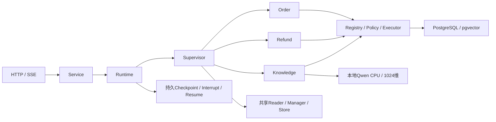

# Agent Engine Demo

[开发文档总览](docs/README.md) · [V1](docs/v1/README.md) · [V2](docs/v2/README.md)

## V2 当前状态（2026-11-20）

V2 01 已正式验收（`ACCEPTED`），六个 Task 的交付与独立 QA 已归档。技术基线、证据与遗留风险见[阶段正式验收](docs/v2/v2-01/v2-01-stage-acceptance.md)。V2 02 六Task已完成开发、自测、独立QA及主复核，阶段VERIFIED；完整隔离回归290 passed/0 failed/0 skipped，独立QA定向38 passed。见[Context Engineering交付报告](docs/v2/v2-02/v2-02-stage-delivery-report.md)。等待人工验收与Git授权，V2 03未开发。

## V1 最新交付状态（2026-11-17）

用户已正式接受06并授权Git提交、推送和合入main，V1六阶段均ACCEPTED。06真实质量门禁及遗留见[最终验收](docs/v1/v1-06/final-acceptance.md)；本轮不冒称重跑原228项门禁。随后在v2分支开发V2 01，02/03仅设计批准、未授权开发；最新状态以[STATE](docs/STATE.md)为准。旧轮次等待文字保留历史语境。

## 当前交付入口（2026-11-15）

01～05已ACCEPTED并归档；06六Task已独立QA PASS并主Agent技术复核，阶段VERIFIED，06-QA-001已关闭。独立新环境完整真实PG门禁228 passed/0 failed/0 skipped，隔离PG/vector镜像、空双库初始化及精确清理通过。06正式验收及Git归档仍待用户明确批准。以下旧轮次状态保留历史；当前以[STATE](docs/STATE.md)、[最终验收入口](docs/v1/v1-06/final-acceptance.md)和[06交付报告](docs/v1/v1-06/06-delivery-report.md)为准。

Supervisor串行调度Order / Refund / Knowledge，Memory是共享基础设施。ToolRegistry、Policy与Executor统一约束工具；订单/退款是有真实数据库状态的模拟业务，不涉及真实支付。



## 首次复现

Windows Python **3.13.7**，单worker；依赖锁在`requirements.txt`，CPU torch **2.9.1+cpu**、sentence-transformers **5.1.2**、transformers **4.57.6**。不复制site-packages，不覆盖现有`.venv`；首次安装示例使用独立环境：

```powershell
py -3.13 -m venv .venv-reproduce
.\.venv-reproduce\Scripts\python.exe -m pip install -r requirements.txt
.\.venv-reproduce\Scripts\python.exe -m pip check
if (-not (Test-Path -LiteralPath .env)) {
    Copy-Item -LiteralPath .env.example -Destination .env
}
```

以下命令中的`.venv`替换为本轮实际环境。`.env`只在本机填写Chat与各库连接；OpenAI与langchain-openai是兼容Chat SDK，Embedding走本地Qwen，无Embedding API Key。真实Chat沿已验证DeepSeek `deepseek-flash`、function_calling、reasoning_effort=none；更换供应商须重新显式验证，health不探测Chat网络。

数据库为PG **17.6** / vector **0.8.7**，应用库`agent_demo/agent_app`、隔离测试库`agent_demo_test/agent_test`。现有`compose.yaml`是**不含vector的原PG镜像**。完整新环境请先读[固定版本数据库配方与初始化边界](docs/v1/v1-06/database-reproduction.md)；不得直接重建原VM容器/卷。PG普通重启与从镜像重建含义不同。

新空环境的顺序是：独立PG/vector资源 → bootstrap双库和角色 → 001～006编号迁移 → Saver setup → Store setup → 首次模拟订单种子 → 固定语料导入。仅对**新目标**执行初始化，已有库不重置数据：

```powershell
.\.venv\Scripts\python.exe -m scripts.init_databases
.\.venv\Scripts\python.exe -m scripts.migrate --target development
.\.venv\Scripts\python.exe -m scripts.setup_checkpoint --target development
.\.venv\Scripts\python.exe -m scripts.setup_store --target development
.\.venv\Scripts\python.exe -m scripts.seed_orders --target development
.\.venv\Scripts\python.exe -m scripts.ingest_knowledge --target development --root data/knowledge --manifest data/knowledge/manifest.json
```

初始化test库时分别换为`--target test`；bootstrap只支持本地固定目标，006的CREATE EXTENSION需要管理员在目标库预建vector或执行该迁移所需权限，详见数据库配方。Web启动只检查资源，不执行迁移、setup、seed或导入。

Qwen模型目录`D:/AI/models/qwen3-embedding-0.6b`，实测权重revision `97b0c614be4d77ee51c0cef4e5f07c00f9eb65b3`，须包含REVISION、tokenizer与完整权重。首次下载使用显式`scripts.download_embedding --download`（联网，下载脚本会解析当时revision；要复现旧profile须准备相同revision文件）。运行时离线加载，CPU/bfloat16/2线程、1024输入tokens、batch=1、单worker单实例；1024输出维度固定，导入和查询profile必须一致。不要并行运行导入、Qwen测试和启用Embedding的Web服务。演示进程显式设置`AGENT_EMBEDDING_ENABLED=true`，用户现有`.env`默认关闭状态保留。

复现上述固定revision时，可在**新模型缓存目录**按下列Python代码显式联网下载（本轮未重复下载现有1.2GB权重），核验通过后再设`AGENT_EMBEDDING_MODEL_PATH`。不要覆盖正在运行的模型目录；原始下载与hash出处见[05模型交付](docs/v1/v1-05/05-local-embedding-delivery-report.md)。

```python
import hashlib
from pathlib import Path
from huggingface_hub import snapshot_download
import tiktoken

revision = "97b0c614be4d77ee51c0cef4e5f07c00f9eb65b3"
path = Path("D:/AI/models/qwen3-embedding-0.6b-reproduce")
snapshot_download("Qwen/Qwen3-Embedding-0.6B", revision=revision, local_dir=path,
                  allow_patterns=["*.json", "*.txt", "*.model", "*.safetensors", "1_Pooling/*"],
                  max_workers=1)
with (path / "model.safetensors").open("rb") as weight:
    assert hashlib.file_digest(weight, "sha256").hexdigest() == "0437e45c94563b09e13cb7a64478fc406947a93cb34a7e05870fc8dcd48e23fd"
assert hashlib.sha256((path / "tokenizer.json").read_bytes()).hexdigest() == "def76fb086971c7867b829c23a26261e38d9d74e02139253b38aeb9df8b4b50a"
(path / "REVISION").write_text(revision, encoding="utf-8")
tiktoken.get_encoding("cl100k_base")
```

## 运行、公共协议与关闭

```powershell
$env:AGENT_EMBEDDING_ENABLED='true'
.\.venv\Scripts\python.exe -m uvicorn app.main:app --host 127.0.0.1 --port 8000 --loop app.infrastructure.postgres:selector_event_loop
```

按Ctrl+C正常关闭并等待Application stopped；Runtime先收敛，再关闭Store、模型/Embedding、Saver和业务池。持久恢复演示必须完整退出旧PID后启动新进程，PG保持运行。仅管理自己记录的PID，勿杀用户进程。完整隔离演示、两次重启、实际业务核对和精确清理见[演示步骤](docs/v1/v1-06/demo-walkthrough.md)，该流程用UUID测试数据且禁止seed固定订单。

`GET /health`的status=ok仅表示HTTP存活；database/checkpoint/store各自ready，model=initialized只表示SDK初始化，embedding=ready表示本地权重已加载，knowledge_ready还需索引/profile检查通过。agent_ready不等于Chat网络或所有专业能力已经真实调用成功；Embedding关闭仍可执行订单/退款及Memory。

公共chat输入为`user_id/conversation_id/message`及可选`input_mode/request_id`，拒绝旧workflow_id输入。task_id唯一由Runtime生成，workflow_id只是同值别名，thread由session持久绑定。Run状态/事件、当前Task、退款事实及审批接口见[接口文档](docs/v1/v1-06/apifox-api-guide.md)。SSE只输出批准的最终回复，done结束本Run；断开不取消执行，重订阅无历史token重放。重启后旧Run缓存可404，应查持久Task/原审批并独立resume。

普通user_id是development/test演示选择，服务端执行归属校验，非生产登录认证。本地审批仅回环、固定审计Actor `local-demo-approval`，无管理员Key，production不注册该入口。原审批绑定task/call/args/operation/interrupt，不可通过聊天批准；unknown先人工核对原操作，禁止换ID重发。

## 交付与验收

- [06交付报告：干净环境、命令、实际结果和限制](docs/v1/v1-06/06-delivery-report.md)
- [最终能力矩阵与用户验收入口](docs/v1/v1-06/final-acceptance.md)
- [06简洁Handoff](docs/v1/v1-06/06-integration-handoff.md)
- [演示与精确清理](docs/v1/v1-06/demo-walkthrough.md)、[OpenAPI/集合导入](docs/v1/v1-06/apifox-api-guide.md)

用户已确认Postman导入；客户端后置脚本实际执行、变量回填和SSE界面仍未实测。Node受控脚本与真实HTTP证据不能替代这些客户端结果。既有Store即时关闭观测波动、unknown人工核对与六项暂缓差异继续保留，详见最终验收入口。

---

以下为按日期保留的历史实施记录；旧准备层、版本及未启动状态不作为当前操作指引。

2026-11-14：Task6.2.2 隔离和退化路径实施记录见[交付与验证证据](docs/v1/v1-06/06-isolation-degradation-delivery-report.md)，交主Agent复核与独立QA；真实TCP/PG/Saver/Store/Qwen配合受控Chat及故障注入，99项风险定向回归通过。

2026-11-14：Task6.2.1 核心持久化故障实施记录见[交付与真实进程证据](docs/v1/v1-06/06-persistence-fault-delivery-report.md)，交主Agent复核与独立QA；范围为原审批/退款恢复的真实PG及独立FastAPI进程验证。

2026-11-14：Task6.1.2 会话/状态/事件统一实施交付，待独立 QA，见[交付与验证记录](docs/v1/v1-06/06-state-events-delivery-report.md)。修复新 Task 首快照前当前任务查询的关联窗口；真实 PG/Saver/Store/Qwen 配合受控 Chat 验证通过，最终完整真实 PG 225 passed、0 skipped。6.1.1 已独立 QA PASS/主复核 VERIFIED；历史轮次表述保留追溯。

2026-11-14：06 已授权；Task6.1.1 装配实施交付待独立QA，见[装配交付与未闭环项](docs/v1/v1-06/06-assembly-delivery-report.md)。本轮统一资源关闭顺序、启动时知识索引/profile就绪检查，并明确偏好呈现优先级；同一真实应用两条中文知识问题均按英语偏好回答，四能力路径及清理已验证；最终完整真实PG224 passed、0 skipped。以下“未进入06”等文字保留历史语境。

2026-11-14：**05 RAG/Store六Task已通过独立QA及主Agent复核，用户已正式验收（ACCEPTED）。** 最新完整真实PG216 passed/0 failed/0 skipped；[阶段验收与使用边界](docs/v1/v1-05/qa/05-rag-memory-stage-acceptance.md)、[简洁Handoff](docs/v1/v1-05/05-rag-memory-handoff.md)、[STATE](docs/STATE.md)。05-QA-001已关闭，已以79d576b交付归档并推送核验，[Git回执](docs/v1/v1-05/05-git-archive-receipt.md)；未进入06。以下各轮记录按原日期保留。

Task 5.3.1 Store / shared Reader implementation and validation: [delivery report](docs/v1/v1-05/05-store-reader-delivery-report.md). Store setup is explicit (`python -m scripts.setup_store --target test` or `development`); startup only verifies readiness.

Task 5.3.2 显式偏好管理已实现，独立QA及主Agent复核通过（VERIFIED）：[交付报告](docs/v1/v1-05/05-memory-manage-delivery-report.md)、[有限真实 Chat 证据](docs/v1/v1-05/evidence/05-memory-manage-real-chat-evidence.json)、[英语偏好＋真实 Qwen/Chat/PG RAG 补验](docs/v1/v1-05/evidence/05-memory-manage-real-rag-evidence-20261114.json)。支持“请记住：回答语言=英语”“请修改记忆：回答风格=详细”“请删除我的回答语言偏好”“请删除全部偏好记忆”“请查看偏好记忆”等冻结格式。Store 命令就绪独立于 Embedding；写入 unknown 时须先人工核对原操作，再提交新修改。真实 RAG 补验按澄清授权仅在验证进程启用原 Qwen，用户 `.env` 不变；此前未验证记录保留历史，见报告末尾追加。

2026-11-13：本地 Qwen CPU Embedding 与 pgvector 检索工作单元已通过独立QA和主Agent复核（VERIFIED），见[独立QA](docs/v1/v1-05/qa/05-local-embedding-qa-report.md)；范围与实际验证见[执行任务](docs/v1/v1-05/05-local-embedding-execution-task.md)及[交付报告](docs/v1/v1-05/05-local-embedding-delivery-report.md)。启用方式、离线导入和真实验证命令均在报告内；05 整阶段尚未验收。下文旧状态按原轮次保留。

## 当前实施状态

01–03 已验收归档；04已完成六Task、独立QA、两轮修复及独立复测，主Agent技术验收通过，用户已正式验收，状态 **ACCEPTED**，已以ab30f12完成Git交付归档并核验远端；05等待用户设置角色配置，未开始。最终完整真实库165 passed/0 skipped，真实uvicorn重启、SQL/Checkpoint故障及真实模型证据齐备。入口见[当前交接STATE](docs/STATE.md)、[04技术验收](docs/v1/v1-04/qa/04-hitl-checkpoint-refund-stage-acceptance.md)、[最终独立复测](docs/v1/v1-04/qa/04-hitl-checkpoint-refund-fix-02-regression-report.md)与[4.3.2交付报告](docs/v1/v1-04/04-hitl-checkpoint-refund-restart-report.md)。以下较早轮次记录保留当时语境。

## 03 工具治理与模拟订单（ACCEPTED，用户已正式验收）

03六Task、独立QA及两项修复回归已通过主Agent技术验收，最新完整真实库137项及27个不同外部场景取得通过证据，详见[03技术验收报告](docs/v1/v1-03/qa/03-tool-governance-stage-acceptance.md)。实现、真实数据库和真实模型证据见 [03 开发交付报告](docs/v1/v1-03/03-tool-governance-delivery-report.md)。订单查询通过冻结工具目录、策略和统一执行器访问 PostgreSQL 中的模拟数据；本人单订单及分页列表由可信查询目标约束，最终回复由核验事实生成。退款、知识检索、审批和持久恢复仍属于后续阶段。

迁移到 schema 3 后，可显式执行 `.\.venv\Scripts\python.exe -m scripts.seed_orders --target development` 或使用 `--target test` 初始化固定双用户模拟订单；种子不会重置已有退款状态。应用启动不会自动迁移或写入种子。`.\.venv\Scripts\python.exe -m scripts.verify_03_real` 是显式真实模型与专用测试库探针，会产生模型调用；默认 pytest 不调用真实模型。

## 02 复测与技术验收（2026-11-11）

02六Task及独立QA、两轮输出脱敏修复回归已完成，用户已正式验收，阶段为ACCEPTED。最新独立完整真实库119项与外部补测3项通过。用户已授权02 Git归档及归档后推进03，见[02技术验收报告](docs/v1/v1-02/qa/02-agent-runtime-stage-acceptance.md)及[独立回归报告](docs/v1/v1-02/qa/02-agent-runtime-redaction-regression-report.md)。历史凭据暴露及配置密码复用按用户决定保留为Demo遗留，暂缓换密；端口实际范围见[协调记录](docs/v1/v1-02/qa/02-agent-runtime-main-review.md)。

## 02 执行会话交付（2026-11-10轮次记录）

六个 Task 的实现和开发自测见 [02 交付报告](docs/v1/v1-02/02-agent-runtime-delivery-report.md)。本段描述本轮实际接口，后文此前 01 准备层和历史验收记录保留其原轮次语境。

`POST /agent/chat` 已接通 Service → Runtime → Supervisor 主图，受理后返回 SSE。通用澄清可在下一 Run 识别具体目标并保留 Task，具体业务缺参保留原目标。取消等不支持能力返回固定边界说明。Order / Refund / Knowledge 当前均为真实编译的三节点骨架，合法专业请求返回 `capability_unavailable`。

Chat body 为 `user_id`、`conversation_id`、`message` 和可选 `input_mode`、`request_id`。`input_mode=auto` 续接待补 Task，`new_task` 仅在允许边界建立新目标。Runtime 唯一生成 task_id，workflow_id 等于 task_id，同一 Task 的新 Run 继承模型次数、主动时间和工具次数快照。

- `POST /agent/runs/{run_id}/status` 返回安全 RunView。
- `POST /agent/runs/{run_id}/events` 返回当前快照及未来事件。
- 上述两个接口 body 均只有 `user_id`、`conversation_id`，读取使用已有 Session，查询不创建 Task、Run 或 Session。

SSE 事件为 status / token / error / done，关联包含 run_id、task_id、workflow_id、sequence。token 仅包含批准的最终回复，02 可整段输出。done 表示该 Run 的流结束，needs_input 的 Task 保留。断开只关闭当前订阅，Runtime 独立执行继续，结果可查询。每 Run 最多一个当前订阅，有界队列满则解绑并记录 subscriber_slow。重订阅不重放旧 token，非空 Last-Event-ID 返回 409。

单 worker 的默认值为 8 个活动执行/受理占位、64 帧单订阅队列、终态保留 1800 秒且最多 100 条、shutdown 等待 5 秒后取消并 await 收敛。设置集中在 `app/core/config.py`，示例见 `.env.example`。相同 request_id 在进程内保留窗口按 user/conversation/message/input_mode 去重，已有订阅返回 subscription_exists。快照/结算不确定时阻止普通输入重放，独立阻塞标记不随 Run TTL 淘汰。

`/health` 增加 `checkpoint_backend=memory`。模型与池仍由 lifespan 管理，退出先 shutdown Runtime，再关闭模型和池。启动命令继续使用 Windows Selector loop。production 演示身份禁用，尚无跨重启图恢复。02 自测使用受控模型和专用 agent_demo_test，真实模型、业务订单/审批/RAG/Store 的联调按后续阶段授权。


轻量多 Agent Demo，采用 Supervisor 与 Order / Refund / Knowledge 专业 Agent。V1 围绕工具治理、HITL、持久恢复、真实向量 RAG 和用户隔离 Store 展开，订单/退款采用本地模拟业务。

## 当前状态

2026-11-12当前01/02为ACCEPTED，02已以94cf205归档推送并核验远端；03已获用户正式验收，状态ACCEPTED，已以62b5eb2归档推送并核验，04未启动。进展及遗留裁决见 [02主Agent协调记录](docs/v1/v1-02/qa/02-agent-runtime-main-review.md)。下文此前状态及人工转交文字属于历史交接记录。

2026-11-10 最新协调结果为01已正式验收（ACCEPTED）并完成Git归档，Baseline `f89db15`、Delivery `cf3e763`已推送至`origin/real-model-chat`。02已获进入许可，待用户人工启动执行会话，任务见 [02整阶段执行提示词](docs/v1/v1-02/02-agent-runtime-execution-task.md)。下段及文末保留前轮实施和验收过程记录。

2026-11-09 已实施一级阶段 01 的六个 Task，验收证据和遗留见 [01 阶段交付报告](docs/v1/v1-01/01-foundation-detailed-design.md#01-正式开发交付报告2026-11-09)。2026-11-10 独立 QA 结束，P2-01 修复及独立回归经主 Agent 复核通过并关闭，阶段状态为 VERIFIED，正式验收待用户批准，详见 [复核决定与阶段状态](docs/v1/v1-01/qa/01-foundation-main-review.md)。02 尚未开始。

当前提供配置、安全错误、HTTP 存活/准备层状态、PostgreSQL 双库与显式迁移、连接池、持久 Session、ModelGateway、普通演示身份和请求准备层。已有主图/映射和 SSE formatter 复用，内存 Saver 保留。专业业务、正式 Task、独立执行与订阅、持久 Checkpoint、审批、RAG 和 Store 按后续阶段实施。

`POST /agent/chat` 在 01 完成身份与 session 准备后返回 JSON 503 `agent_not_ready`。正式受理/Graph/SSE 接线交给 02。HTTP 会校验最终请求格式，旧 workflow_id 字段返回 422。

## 本地运行（PowerShell）

在项目根目录使用 `.venv` Python 3.13.7，单 worker 启动。保留已有 `.env`。

```powershell
if (-not (Test-Path -LiteralPath .env)) {
    Copy-Item -LiteralPath .env.example -Destination .env
}
.\.venv\Scripts\python.exe -m uvicorn app.main:app --host 127.0.0.1 --port 8000 --loop app.infrastructure.postgres:selector_event_loop
```

Windows 的 psycopg 异步连接需要 Selector loop，已按当前安装源码和实际启动验证。开发可添加 `--reload`，进程重启验收使用上面的无 reload 命令。

- [接口文档](http://127.0.0.1:8000/docs)
- [存活与准备层状态](http://127.0.0.1:8000/health)

无模型或数据库配置也能检查 HTTP 存活。`database_status` 为 not_configured / unavailable / ready，ready 要求实际连接和 schema 版本检查成功。`model_status` 为 not_configured / initialized，初始化不探测模型网络。`agent_ready` 表示 development/test 下图与持久 session 资源已初始化，只反映准备层资源状态。生产环境恒为 false。运行中 DB 故障在开流前返回 `session_unavailable`。

请求示例仅会执行准备层。

```json
{
  "user_id": "dev-user",
  "conversation_id": "conversation-1",
  "message": "你好",
  "input_mode": "auto"
}
```

三个必填字段为 user_id / conversation_id / message，可选 input_mode 为 auto 或 new_task，可选 request_id 为 UUID。thread、scope、task、workflow 由服务端负责，额外请求字段拒绝。用户限 development/test 的受控名单，普通 scope 不含审批权限。此演示身份适用于受控本地环境。

## 数据库环境与显式迁移

本次实际使用 Ubuntu 私网虚拟机 `192.168.150.101:5432`。PG17.6 镜像固定到 digest，部署位于 `/home/white7/agent-engine-demo-db`，独立 Volume 为 `agent-engine-demo-db_agent_pg17`。HBA 只允许 Windows `192.168.150.1`，应用库 agent_demo / owner agent_app，测试库 agent_demo_test / owner agent_test。已验证容器重启持久化、双库连接与交叉连接拒绝。

本地 `.env` 已保存三个数据库连接项并被 Git 忽略，密码不进入文档。Web 只读取普通连接设置，管理 URL 仅由显式 bootstrap 读取。已有 `.env` 的应用名覆盖值保留，本次真实 health 的 service 因此仍为 Agent Backend，新配置默认值为 Agent Engine Demo。

仓库 `compose.yaml` 提供本机 localhost PG 环境，端口、bootstrap 用户和密码从本地环境注入。

```powershell
docker compose up -d --wait
.\.venv\Scripts\python.exe -m scripts.init_databases
.\.venv\Scripts\python.exe -m scripts.migrate --target development
.\.venv\Scripts\python.exe -m scripts.migrate --target test
```

init_databases 仅接受同一配置端口上的本地固定双库和 owner。虚拟机已通过 SSH 初始化，日常 Windows 连接虚拟机时直接执行两个迁移命令。经用户授权的临时 localhost 转发已用于 bootstrap 两次幂等重跑验证，验证后已关闭。该脚本不接受现有私网 URL 直接初始化远端。

应用启动只读检查版本，迁移由开发者显式执行。当前版本为 2，001 创建 sessions，002 按用户确认将 thread_id 唯一约束延迟到事务提交，修复相同 uuid5 候选的并发冲突。已应用 SQL 保留原样，后续修正新增编号。每个迁移事务与登记绑定，重跑检查 SHA-256，未知版本/已修改文件拒绝继续。

停止本地容器可使用 `docker compose stop`，具名卷保存数据。Session 仅持久绑定 thread，图快照在后续 04 接入。

## 模型验证与调用边界

ModelGateway 提供普通/工具绑定及结构化调用。SDK 重试关闭，网关统计包含失败和重试的任务累计模型尝试次数，单次调用按配置限制超时和额外重试。Token 缺失保持 unknown/null，成功和可预期错误都返回新用量快照，取消及编程错误继续传播。

当前真实联调使用本地已配置的 DeepSeek deepseek-flash，通过 ChatOpenAI 适配，结构化方法固定为 function_calling，reasoning_effort 固定为 none。该供应商在 thinking 模式拒绝强制工具选择，模式选择和首次失败已记录于交付报告。更换供应商/模型后重新显式验证其兼容性。

```powershell
.\.venv\Scripts\python.exe -m scripts.check_model
```

此命令显式调用真实模型，使用固定无隐私文本和 RouteDecision，可能产生费用。默认测试使用受控模型。启动和 health 不调用模型网络。Supervisor 在 02 切换到 Gateway，RunLimits/RunUsage 在 01 只定义数据契约，Runtime 的任务累计主动时长、工具预算与恢复继承按 02–04 接线。

## 环境重建与验证

`requirements.in` 维护直接依赖，`requirements.txt` 保留已验证版本。本阶段未安装或升级依赖；requirements.in 显式声明已安装并锁定的 openai，用于 Gateway 捕获供应商错误，requirements.txt 保留原验证版本。

```powershell
py -3.13 -m venv .venv
.\.venv\Scripts\python.exe -m pip install -r requirements.txt
.\.venv\Scripts\python.exe -m pytest -q
.\.venv\Scripts\python.exe -m pip check
.\.venv\Scripts\python.exe -m ruff check .
.\.venv\Scripts\python.exe -m ruff format --check .
```

真实 PostgreSQL 测试要求显式测试 URL，默认不会仅因 `.env` 存在就访问数据库。可使用已配置设置显式启用，进程退出后环境随之释放。

```powershell
.\.venv\Scripts\python.exe -c "import os, pytest; from app.core.config import Settings; os.environ['AGENT_TEST_DATABASE_URL'] = Settings().test_database_url.get_secret_value(); raise SystemExit(pytest.main(['-q']))"
```

项目 `pyproject.toml` 会加载 pytest 报告脱敏插件，处理本地 `.env` 和环境变量中的 `AGENT_DATABASE_URL`、`AGENT_TEST_DATABASE_URL` 及其密码。常规运行从项目根目录执行。仓库外的 QA 文件也从项目根目录使用同一配置运行，例如 `.\.venv\Scripts\python.exe -m pytest -c pyproject.toml -q C:/path/to/test_probe.py`。插件要求默认的 `--capture=fd`，拒绝 `-s`、其他捕获模式、实时日志、pytest 文件日志及 JUnit XML。保护范围是 pytest 测试和收集报告中的异常、捕获输出、日志及 warnings 汇总；绕过项目配置、其他报告插件、测试进程外输出或未知凭据不在此范围。历史凭据暴露及复用继续按已知遗留追踪。

全仓检查保留此前用户文件中的 lint/格式问题，具体文件及本阶段定向检查结果见交付报告。SSE formatter 的传输回归在独立测试应用中保留，正式 /agent/chat 按 01 准备层边界验证。

## 开发文档

- [Apifox接口文档、OpenAPI与集合导入说明](docs/v1/v1-06/apifox-api-guide.md)
- [Task6.3.1 演示步骤、Postman集合与精确清理](docs/v1/v1-06/demo-walkthrough.md)
- [Task6.3.1 文件与真实HTTP演示交付记录（GUI待用户导入）](docs/v1/v1-06/06-demo-delivery-report.md)
- [分阶段独立验收、主 Agent 复核及修复任务](docs/v1/qa-index.md)
- [02 AgentRuntime整阶段执行任务](docs/v1/v1-02/02-agent-runtime-execution-task.md)
- [02 主Agent协调与验收记录](docs/v1/v1-02/qa/02-agent-runtime-main-review.md)
- [修复会话提示词与修复记录](docs/v1/fix-index.md)
- [04 首轮 QA 修复与开发自测报告](docs/v1/v1-04/fixes/records/04-hitl-checkpoint-refund-fix-01-report.md)
- [04-QA-007绑定修复与开发补验报告](docs/v1/v1-04/fixes/records/04-hitl-checkpoint-refund-fix-02-report.md)
- [04 Task 4.3.2重启及重放开发自测报告](docs/v1/v1-04/04-hitl-checkpoint-refund-restart-report.md)
- [03 工具治理 QA 修复与开发自测报告](docs/v1/v1-03/fixes/records/03-tool-governance-fix-report.md)
- [01 / P2-01 修复与开发自测报告](docs/v1/v1-01/fixes/records/01-foundation-fix-report.md)
- [项目定位、架构与V1范围（权威文档）](docs/v1/agent-engine-demo-plan.md)
- [唯一有效的V1路线图：六阶段、18个二级环节、36项三级任务](docs/v1/development-roadmap.md)
- [01 正式设计基线——工程、PostgreSQL、模型与普通演示身份](docs/v1/v1-01/01-foundation-detailed-design.md)
- [02 正式设计基线——Supervisor、三专业Subgraph、Runtime与SSE](docs/v1/v1-02/02-agent-runtime-detailed-design.md)
- [03 正式设计基线——ToolRegistry、Policy、Executor与模拟订单](docs/v1/v1-03/03-tool-governance-detailed-design.md)
- [04 正式设计基线——HITL、PG Checkpoint、原调用恢复与退款幂等](docs/v1/v1-04/04-hitl-checkpoint-refund-detailed-design.md)
- [05 正式设计基线——生成式RAG、来源校验、Store与Memory V1](docs/v1/v1-05/05-rag-memory-detailed-design.md)
- [05 Task5.2.1 知识工具与八节点子图开发交付](docs/v1/v1-05/05-knowledge-tools-delivery-report.md)
- [05 Task5.2.2 真实RAG联调与语义/来源验证](docs/v1/v1-05/rag-validation.md)
- [05 Task5.3.2 显式记忆管理实现、自测与未验证边界](docs/v1/v1-05/05-memory-manage-delivery-report.md)
- [06 正式设计基线——完整演示装配、故障验收与最终交付](docs/v1/v1-06/06-integration-and-final-delivery-detailed-design.md)
- [当前代码的 Graph 协议参考](docs/graph-protocol.md)
- [历史资料索引：旧九阶段路线图与阶段设计（不再作为V1依据）](docs/history/README.md)
- [Agent Engine Demo 开发规范](AGENTS.md)

新会话先读AGENTS.md，再读项目定位、六阶段路线图及D01，按当前授权Task需要查阅后续设计和Graph既有协议。获得正式开发授权后，从路线图第一个满足依赖条件的Task开始，初始起点为1.1.1「工程复用与事实基线」。后续按依赖和授权顺序推进，每项交付记录实现、验证及遗留。

旧九阶段路线图及旧阶段设计已统一归档至 `docs/history/`，只供历史参考，不自动带入新V1要求；graph-protocol.md继续保留在docs根目录，仅描述当前代码，不能当作目标架构已实现。历史技术方案需经当前阶段评估采纳后复用。各阶段设计现已获最终确认，具体开发顺序与范围由用户在新会话授权，设计基线不代表实现、测试或联调完成。

以下为历史修订记录，待确认参数及旧管理密钥方案仅反映当时决策，已由末尾最新正式确认记录替代。

## 2026-11-09 全项目审查第一轮整改记录

同步当前设计整改状态与01～06导航，补06入口。运行及旧请求示例保留此前实现记录，后续真实协议迁移归02及06交付。

六阶段、18环节、36Task保持不变。本轮仅修改Markdown设计、规范及导航，未检查实际开发进度，未修改业务代码、配置、依赖、数据库或迁移，未运行测试、代码检查、服务、容器、模型或Apifox联调。四项决策仍推荐待用户确认，设计尚未冻结。第一轮修订完成后停止，最终只读复核由用户另行授权。

## 2026-11-09 第二轮定向文档收敛记录

仅在旧Apifox ChatRequest示例附近补充协议说明，原JSON不变。旧workflow_id字段属于此前实现，V1目标接口移除，正式协议在02实施时迁移，task_id仅Runtime创建。

第二轮修订完成，六阶段、18环节、36Task及既有八项结构不变。四项推荐决策仍待用户确认，未宣布冻结或授权实施。本轮仅修改Markdown，未检查实际开发进度，未开发、安装、测试、检查代码、操作数据库或启动/联调。最终只读复核由用户另行授权。

## 2026-11-09 最终技术决策确认与冻结准备记录

旧ChatRequest JSON保留，说明01负责最终Schema与Route唯一解析，02负责正式Task受理及Runtime/Graph接线。同步确认状态及V1本地审批Actor、延期认证边界。

用户正式确认前三项技术参数并明确延期管理员认证，已无这四项待确认决策。历史记录中的待确认或管理密钥方案仅供追溯，当前以本文规范及本记录为准。LocalDemoApprovalActor固定审计值采用local-demo-approval，沿用approver_id存储字段，不构成真实身份认证或授权。

六阶段、18环节、36Task和既有八项设计结构不变。仍为纯逻辑设计，只修改Markdown，未检查实际开发进度，未修改代码、SQL、实际配置或依赖，未安装、测试、检查代码、启动、数据库操作或联调。实施验证尚待授权，当前等待用户最终设计冻结确认，设计确认不授予任何Task开发权限。本轮完成即停止。

## 2026-11-09 Memory V1与V2职责收敛记录

增加Memory V1/V2范围说明及D05导航描述，避免把未来MemoryWriter当作V1运行或显式写入的必要组件。

V1保留AsyncPostgresStore、两偏好字段、用户Namespace、跨会话/跨Thread、revision、operation_id/digest/expected_revision/last_mutation、per-user锁及conflict/unknown和原Checkpoint写前边界。显式解析独立于V2，旧记录中的Writer为当时V1写路径称谓，现已统一为MemoryManager及显式命令流程，不代表V2已实现。

六阶段、18环节、36Task和八项设计结构保持，5.3.2仅授权更名，无新增Agent、Graph或Task。此前四项最终技术决策不变。本轮仅改Markdown，未检查开发进度，未修改Python/SQL/依赖/配置，未测试、迁移或联调；实现及冻结不在本轮授权内，完成后停止并提交用户审核。

## 逻辑设计阶段正式收尾记录

用户已最终确认六阶段、18环节、36Task、D01～D06及跨阶段契约。逻辑设计阶段正式结束，开发待新会话接手；初始开发起点为1.1.1，实施须另行授权。本次仅更新状态、阅读指引及必要导航，详细设计、路线图及历史资料保留，未执行开发、测试、迁移、启动或联调。
