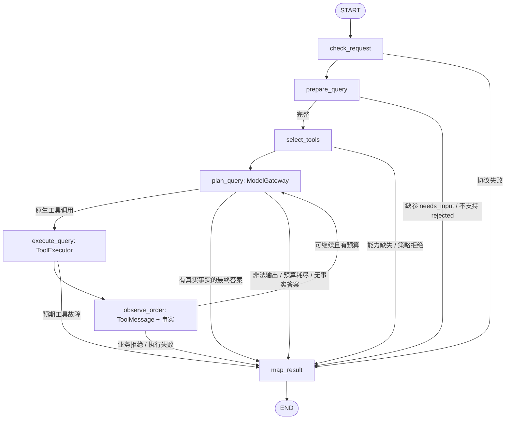
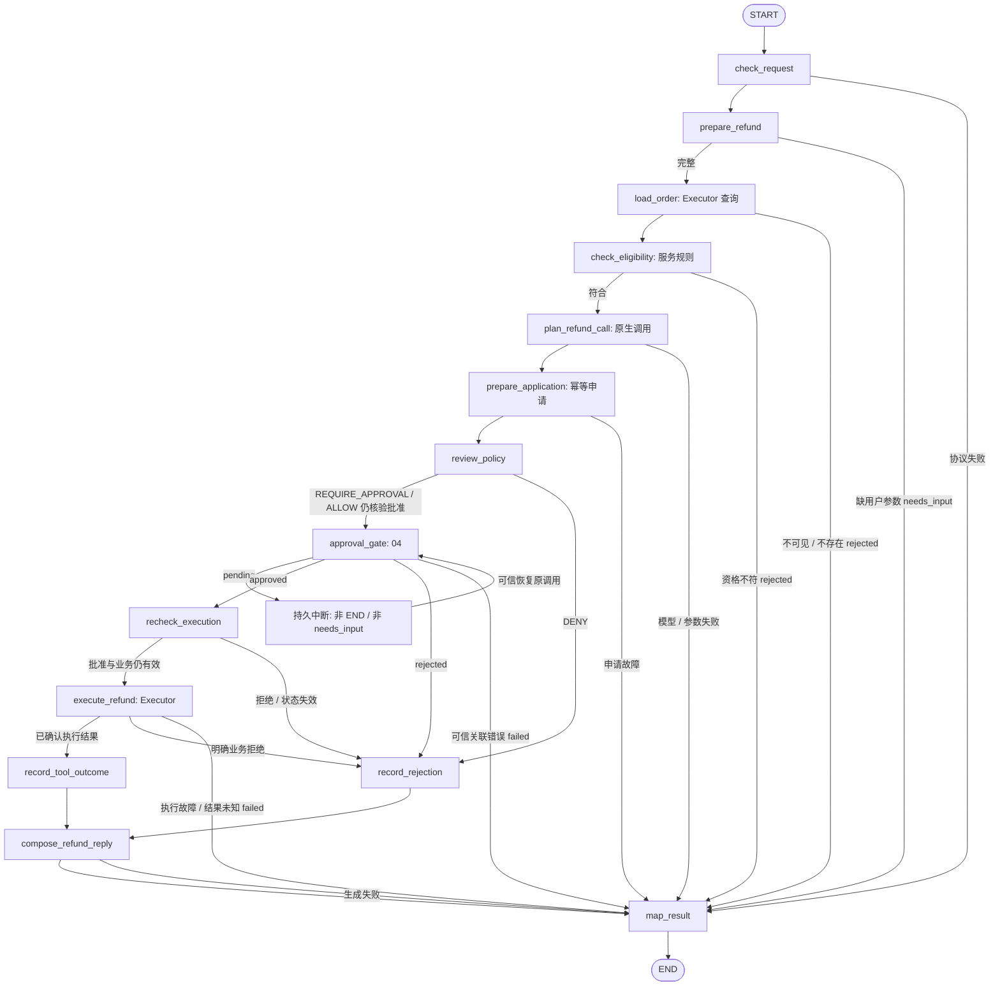
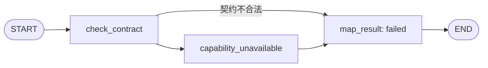
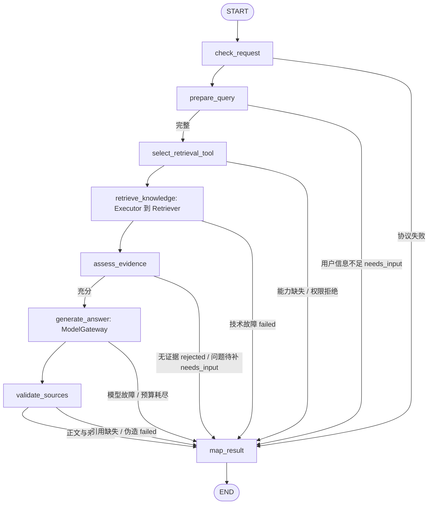
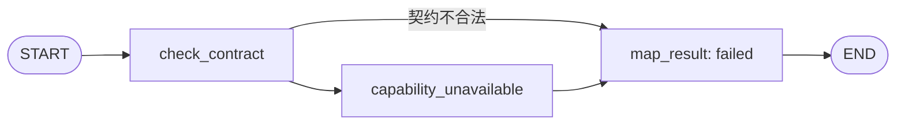

# 02 AgentRuntime 与 Supervisor：完整详细设计

2026-11-11当前实施状态为ACCEPTED。六Task、独立QA及两轮输出脱敏修复回归已完成，最新独立119项和外部3项通过，用户批准02正式验收及归档后推进03。详见 [02阶段验收报告](question/02-agent-runtime-stage-acceptance.md)。冻结设计和历史轮次文字保留，当前状态以本段及协调记录为准。

初版日期为2026-11-08，最近修订日期为2026-11-09。依据：[项目定位与 V1 范围](agent-engine-demo-plan.md)、[六阶段路线图](development-roadmap.md)、[已批准的 01 详细设计](01-foundation-detailed-design.md)。[Graph 协议](graph-protocol.md)只作为既有接口参考，不表示目标能力已经实现。

历史轮次说明（保留追溯，当前状态以页首和末尾最新记录为准）。当前为全项目纯逻辑设计阶段：各阶段详细设计全部完成并经过审核后，才统一进入开发。本轮只修改本文件，不更新其他导航或路线图；未检查 Git 或开发进度、未扫描全仓，未修改业务代码、依赖、配置或数据库，未执行测试、代码检查、迁移、容器操作或模型联调。所有接口、迁移和验收均指未来实施。

## 1. 阶段目标与架构总览

02 交付一个拥有独立执行任务、任务状态、逻辑任务预算、互斥和公共事件边界的轻量 AgentRuntime。复用已有主图与契约，形成 Supervisor→单个专业子图→唯一回复出口；不是只为 ainvoke 加一层包装，也不复制 LangGraph 工作流引擎。

沿用路线图的 3 个二级环节和 6 个三级 Task：

| 二级环节 | Task | 核心交付 |
| --- | --- | --- |
| 2.1 State 与 Supervisor 收敛 | 2.1.1 类型/State 适配 Demo；2.1.2 Supervisor 与澄清 | 角色迁移、任务状态/预算字段、正确澄清与统一模型入口 |
| 2.2 三专业骨架与主图装配 | 2.2.1 主图与专业接入；2.2.2 公共结果与骨架验证 | 三个固定子图入口、白名单映射、结果校验和唯一回复出口 |
| 2.3 轻量 Runtime 和 SSE | 2.3.1 独立执行与互斥；2.3.2 SSE 和状态语义 | 独立进程内任务、同 thread 排他执行、预算结算、订阅分离、结果查询 |

```text
AgentRoute
  ├─ 唯一解析 ChatRequest → development/test 普通演示身份
  └─ AgentService：session 绑定、run 关联、Runtime 提交/订阅适配
          ↓
      AgentRuntime（单实例、单 worker）
          ├─ thread 互斥 / task 续接与新建 / RunRecord / asyncio.Task
          ├─ RunLimits / 两类任务用量快照 / 公共事件队列
          └─ 已编译 Supervisor 主图
                 Supervisor → 澄清 / Order / Refund / Knowledge
                                     ↓
                              显式专业结果回传
                                     ↓
                         汇总 → Response → run_finish → END

共享依赖：01 SessionRepository、ModelGateway、模型资源
02 开发快照：显式注入 InMemorySaver；04 才接 Postgres Saver
后继：03 Registry/Executor；04 可信审批与恢复；05 Retriever/Store
```

02 的边界：

- 不实现订单数据库查询、退款申请/副作用、工具执行器、RAG、Store 或管理认证。
- 三个专业入口可编译可注入；缺少业务实现明确返回 unavailable，不能用替身结果冒充可演示业务。
- 不开放 pause/resume/审批 HTTP 端点，不执行 Command(resume)，不以 InMemorySaver 验收重启恢复。
- 不新增 workflow/run/task 持久表、通用 WorkflowRepository、持久队列、分布式锁、claim/epoch、事件重放系统。
- 不支持多任务拆分、并行专业分派或返回 Supervisor 的反复调度循环；同一 Run 内模型和工具调用串行。
- 01 的环境、身份、模型和预算决策保持不变；本阶段只落实应由 Runtime 和主图承担的接线。

## 2. 分层、依赖与装配契约

### 2.1 Route / Service / Runtime / Graph 的唯一职责

| 模块 | 职责 | 不承担 |
| --- | --- | --- |
| AgentRoute | 一次请求体解析、调用普通身份辅助函数、HTTP 错误与 SSE 响应 | 不读 Checkpoint/业务库，不选 Agent、不创建协程生命周期 |
| AgentService | prepare_chat准备DemoContext/SubmitOptions及候选run_id；submit_chat显式转交context/options/owner；按用户查询订阅并格式化 | 不创建正式Task、不生成workflow_id、不判断任务迁移、不保存可变用户状态 |
| AgentRuntime | 受理门禁、thread 排他、task 新建/续接、RunRecord、执行任务、预算、事件和退出清理 | 不解析业务意图、不绕过 Executor 调业务、不信任聊天审批 |
| Supervisor | 结构化意图与目标 Agent/Task 建议、未知意图澄清、具体任务参数补齐 | 不创建可信身份/thread、不清零预算、不持有全量业务工具 |
| 专业子图 | 领域决策与私有消息、结构化结果；03–05 再接真实能力 | 不整份覆盖主 State，不自行更换 task/workflow 或用户 |
| transfers / router | 输入输出白名单、关联和组合校验、有限分支选择 | 不调模型、不做副作用或 HTTP 转换 |
| streaming | 安全事件 DTO、JSON/SSE 编码和订阅资源清理 | 不拥有执行任务，不透传 LangGraph 任意事件 |

Service/Runtime/节点可以是应用级对象，但可变执行数据只能存在于明确按 run/thread 键管理的进程内记录或本次 RunScope，不能保存成单例的 current_user/current_state。

### 2.2 初始化与统一编译

lifespan 复用 01 的池、SessionRepository 和 ModelGateway：先建依赖，编译专业入口，再编译主图一次，最后创建 Runtime 和 Service。退出先停止 Runtime 受理并收敛执行任务，再关闭模型/数据库资源，避免任务使用已关闭的客户端。

```python
def build_supervisor_graph(*, gateway: ModelGateway,
                           specialists: Mapping[AgentType, CompiledStateGraph],
                           checkpointer) -> CompiledStateGraph: ...

class AgentRuntime:
    def __init__(self, graph, *, run_limits: RunLimits,
                 queue_capacity: int = 64,
                 max_active_runs: int = 8,
                 retained_runs: int = 100,
                 result_ttl_seconds: float = 1800,
                 shutdown_grace_seconds: float = 5): ...
```

builder 不再内部偷偷创建 InMemorySaver；由 lifespan 显式注入，02 允许只用内存开发模式并在文档/health 中标明 checkpoint_backend=memory。04 更换资源而不重写拓扑。Graph 缺失仍沿用 01 的未就绪 HTTP 行为。

Gateway构造只收ModelCallLimits，Runtime只收RunLimits。专业Registry/Executor、Retriever/Store在对应阶段有调用方时注入。队列64、活动8、终态30分钟/100条及退出5秒为已采用运行契约，未来集中加入Settings，本轮仅修改设计。

### 2.3 执行上下文与依赖传递

复用 DemoIdentity、DemoContext：身份限 development/test，production 禁用且 agent_ready=false。普通 scope 不含审批权；本阶段不创建管理认证，04仅接本地审批审计Actor。

增加运行时内部上下文，区分可保存的关联字段与不能保存的执行资源：

```python
@dataclass(frozen=True, slots=True)
class ExecutionContext:
    user_id: str
    conversation_id: str
    workflow_id: str   # 与权威task_id同值的内部关联别名
    task_id: str       # 逻辑任务稳定标识
    run_id: str        # 本次执行标识

@dataclass(frozen=True, slots=True)
class RunExecutionContext:
    context: ExecutionContext
    thread_id: str
    permission_scopes: frozenset[str]
    scope: RunScope    # 仅本次执行对象，不能写入 State/Checkpoint
```

Runtime 把可信当前上下文作为 Graph 的运行时 context 注入，而非与用户 entities 合并。采用 LangGraph 的运行时 context/context_schema 通道；实际调用参数按实施时安装版本核对，不能把 scope/客户端塞进可持久化 State 或可记录的模型参数。节点依赖的 Gateway 通过构造闭包注入，节点读取本次 RunScope 时才访问当前执行上下文。

RunScope 是单 Run 内的轻量协调对象，内部仅替换不可变 ModelCallUsage/RunUsage 快照、持有单调计时起点和安全事件回调；不是全局预算服务或可序列化资源。跨 Run 的权威来自任务快照，RunScope 只能从已核验的基线创建，不能因新 run_id 使用零值默认构造。

## 3. Task 与 Run 生命周期

### 3.1 标识与预算生命周期

| 标识/数据 | 语义 |
| --- | --- |
| user_id / conversation_id | 受控演示用户与逻辑会话；SessionRepository 持久绑定稳定 thread |
| thread_id | 服务端保存的 Checkpoint 线程；同会话顺序任务复用，客户端不能指定 |
| task_id | 正式逻辑任务唯一权威ID，仅AgentRuntime创建新Task时生成；暂停、澄清、审批、恢复加载原值 |
| run_id | 一次具体执行；普通续接/未来恢复均生成新值，不刷新任务额度 |
| workflow_id | 直接取task_id同值，仅内部Graph兼容，不单独生成、保存生命周期或建Workflow表 |
| ModelCallUsage / RunUsage | 均属于 task_id；跨 Run 继承，不能按 run_id 清零 |
| operation_id / approval_id | 04 的业务幂等/审批关联，02 不创建或伪造 |

Task 是当前 thread 的逻辑业务目标；Run 是推进这个目标的一次主动执行。Run 结束不等于 Task 结束，SSE 断开也不等于 Run 结束。

### 3.2 状态及迁移

TaskStatus 统一用 `running / needs_input / completed / rejected / failed / superseded / waiting_approval / paused`。后两项只定义后继语义；02 正式运行不通过普通结果伪造这些状态。

RunStatus 用 `running / completed / waiting_input / failed / waiting_approval / paused`，除 running 外都表示该 Run 已停止主动执行。02 的 waiting_input 表示 task=needs_input；业务 rejected 对应 run=completed、task=rejected；failed 表示技术或预算失败。

| 进入条件 | Runtime 动作 | task_id/用量 | 本次结束 |
| --- | --- | --- | --- |
| 无已有任务，或前任务 completed/rejected/superseded | 新建 Task，生成内部 workflow 关联 | 新 task，两个用量为零 | 由图结果决定 |
| needs_input，input_mode=auto | 续接已存 PendingTask | 同 task/workflow，继承全部用量，新 run | 澄清或继续专业分派 |
| needs_input，input_mode=new_task | 将旧澄清目标结束为 superseded，再建立新目标 | 新 task/零用量，仅限未执行副作用的澄清目标 | 由新图决定 |
| thread 有活动 Run | 立即冲突，不排队也不创建第二执行 | 不改变原 task 或预算 | HTTP 409 |
| waiting_approval / paused | 普通输入无论 input_mode 均拒绝 | 原 task/预算保持 | HTTP 409，返回安全当前状态 |
| failed，input_mode=auto | 拒绝隐式重试，要求明确开始新任务 | 不偷偷复用/清零原任务 | HTTP 409 |
| failed，input_mode=new_task，已确认无待执行/未知副作用 | 开新 Task；旧 Task 保持 failed | 新 task/零用量 | 02 无副作用骨架适用 |
| 快照显示未完成内部节点或结果未知 | 不通过新消息重放图 | 保留快照，标记 execution_uncertain | 返回冲突/需要核对；04 设计权威核对 |

02 不提供通用取消或重试 API；new_task 只是显式替换尚在澄清的目标或在明确终态后开始新任务，不是取消业务、解除审批或绕过副作用核验的命令。04 接业务后必须用实际审批/操作记录决定是否仍阻塞，不能仅看进程内 failed 记录放行。

Supervisor 不拥有任务生命周期：程序先决定新建/续接，再让模型理解本轮输入。未知意图 CLARIFICATION 在后续识别为具体任务时保留 task_id；已明确业务 TaskType 的续接不得静默切换到另一业务。如果用户想换目标，提示显式 new_task，不让模型自己结束原任务并刷新预算。

### 3.3 API 输入迁移与显式新任务

沿01已对齐的最终请求契约，02落实Task受理语义：

```python
class ChatRequest(BaseModel):
    # 继续 extra=forbid 与原有字符串长度/空白约束
    user_id: Identifier
    conversation_id: Identifier
    message: str
    input_mode: Literal['auto', 'new_task'] = 'auto'
    request_id: UUID | None = None
```

Route唯一声明并解析ChatRequest，调用01普通身份辅助函数，不新增身份Header/Query。公共请求移除workflow_id，旧字段返回422，未来同步README/OpenAPI。DemoContext不含task_id/workflow_id或input_mode/request_id。Service准备DemoContext与SubmitOptions，Runtime在锁内唯一创建正式task_id或加载原Task，将同值workflow_id填入RunExecutionContext/Graph映射。未完成正式Task关联的准备上下文不能送旧Graph，不增加workflows表。

request_id 为可选的客户端本次提交关联，不能选择 task/thread/权限。相同用户、会话、request_id 在当前进程保留窗口内映射同一 run；指纹包括 message/input_mode，匹配则返回原 Run 的查询/订阅入口，不重新执行，不同则 409 request_id_conflict。省略 request_id 时无法判断用户是否有意再次发送相同文本；不按文本去重，明确不承诺网络重试幂等。

普通输入接入顺序为Route一次解析/身份检查 → Service.prepare_chat取得session并返回(context, options) → Service.submit_chat显式调用Runtime.submit(context, options=options, subscription_owner=owner) → Runtime锁内去重/校验状态 → 新建时唯一生成task_id，续接时加载原task_id，workflow_id直接取同值 → 注册Run/独立asyncio.Task → 返回RunHandle并建立SSE。冲突时不改变任务，去重命中复用原Run，候选run_id不成为新Run。旧Graph迁移仅在此正式Task绑定完成后执行。

## 4. State、消息与父子图契约

### 4.1 主 State 的字段与写入权

复用现有 AgentState/contracts/transfers；字段只有明确需要时扩展，不建第二套 State。

| 字段 | 写入方 | 合并/生命周期 |
| --- | --- | --- |
| messages | 轮次准备 Human、唯一 Response 的公开 AI | add_messages；稳定消息 ID，不加入工具/推理消息 |
| user_id/conversation_id/workflow_id/task_id/run_id | Runtime 可信轮次输入 | 覆盖；子图不得回传修改，续接保留 task/workflow |
| task_status | Runtime 新建/续接；图结算和 Runtime 错误收敛 | 覆盖；只有经校验的结果映射可结束任务 |
| task_type/task_goal/agent_type | Supervisor 决定，经 transfers 校验 | 覆盖；新任务清空，具体待补目标不任意换型 |
| task_message_ids | 轮次准备与 Response | 当前任务公开消息 ID 列表，默认覆盖；新任务重置、续接保留并追加 |
| route_decision | Supervisor | 本轮覆盖；每个新 Run 清空 |
| pending_task | 澄清/专业 needs_input 映射 | 仅 needs_input 保留；带 owner/task/workflow，不能由客户端提供 |
| specialist_result/final_answer/sources/error | wrapper/回复/错误收敛 | 本轮覆盖；每次 Run 清空，禁止旧结果被再次发送 |
| model_call_usage | Gateway 调用节点/可信 RunScope | 任务累计不可变快照，默认覆盖；新 Run 继承、新 Task 才归零 |
| run_usage | Runtime 计时、Executor 工具计数；普通出口由 run_finish 返回 State 更新 | 任务累计不可变快照，默认覆盖；不使用加法 Reducer 或 END 后第二次常规写回 |

消息使用消息专用 Reducer，预算使用覆盖式完整快照，避免重放时把同一增量重复累加。节点返回增量更新，不整份返回/原地修改 State。内部可信调用不逐层深拷贝；现有输入输出边界的必要快照与身份关联校验保留。

Runtime 在锁内读取 snapshot 后只为合法普通轮次构造输入：

```python
def create_turn_state(context: ExecutionContext, message: str, *,
                      task_mode: Literal['new', 'continue'],
                      saved_task) -> TurnInput: ...
```

此函数不生成 task_id、不认证、不访问 DB；Runtime 决定标识与模式。new 清理任务槽和用量，continue 明确继承已校验 PendingTask、task_message_ids 和两类用量；不能因 PendingTask 为 None 就默认新任务或归零。审批恢复不调用该函数。

### 4.2 Supervisor 输出与澄清

继续复用 RouteDecision 的目标 Agent/Task 组合、entities、needs_clarification、missing_fields 和 clarification_question。模型不能输出身份、run/task/thread 或任意节点名。

为明确拒绝取消等不支持能力，在结构化模型边界使用小的结果包装：

```python
class SupervisorOutput(BaseModel):
    kind: Literal['route', 'unsupported']
    decision: RouteDecision | None = None
    # route 必须有合法 decision；unsupported 必须没有可执行 decision
```

unsupported 由程序生成固定能力说明，task=rejected，走唯一 Response；不增加可执行取消枚举或靠模型返回“已取消”。未知意图仍用原 CLARIFICATION/SUPERVISOR 且需要问题，进入 needs_input；不把 unsupported 和未知意图都当作执行失败。

上述 unsupported 终结用于新任务或尚未明确业务类型的通用任务。已有具体 PendingTask 时，本轮输入若改问不支持的其他业务，只返回能力边界并继续澄清原目标，不能据此悄悄结束原任务。router 对程序已设定的 rejected/允许回复分支直接进入 Response，不要求伪造一个可执行 RouteDecision；其他正常分派仍必须有合法决定。

澄清分两类：

1. 未知目标：保存通用 PendingTask；下一轮可从 CLARIFICATION合法迁移到ORDER_QUERY/REFUND_APPLY/KNOWLEDGE_QA/MEMORY_MANAGE，保持同一 task_id 和用量，修复“必须维持 CLARIFICATION 导致永远无法识别业务”的问题。
2. 业务已知但缺实体：保留原业务类型/目标和已知候选实体，只补仍缺的信息；例如本人订单查询缺 order_id 时继续收集，不允许 entities 覆盖可信 owner。

Supervisor 模型上下文只含固定系统职责、本任务 PendingTask 和本任务最近最多 12 条允许的公开 Human/最终 AI 消息。按 task_message_ids 筛选，去掉 System/Tool/带 tool_calls 的 AI 及附加敏感元数据；新任务不直接继承前任务工具事实。公共长期历史仍可留在 messages，但不全量喂给路由。截断后仍以 PendingTask 的目标/实体为权威，不能靠旧聊天计算金额或归属。

路由模型全部经 01 Gateway.invoke_structured。结构非法允许最多一次显式纠正调用，作为新的 Gateway 调用消耗同一 task 的 max_attempts；Gateway 的 max_retries 仍仅用于单次调用的瞬时网络错误。纠正耗尽/额度不足则安全 failed，不静默选业务、不继续模型循环。

### 4.3 专业 State 与显式映射

专业 State 继续保存 request、私有 messages、selected_tools、result；扩展 model_call_usage/run_usage 为任务快照。request 使用当前可信 ExecutionContext 和白名单实体。内部 ToolCall/ToolMessage 仅在私有 messages，不能复制到父图公共历史。

| 方向 | 允许传递 | 明确不传 |
| --- | --- | --- |
| 父→专业 | 本次 context/task、领域目标/实体、允许公开消息、两类用量快照 | 管理凭据、其他 Agent 私有历史、整个父 State |
| 运行时 context→子图 | 可信当前 RunExecutionContext、必要普通 scope；资源经依赖注入 | 不把 scope/客户端保存入 checkpoint |
| 专业→父 | 关联已校验 SpecialistResult、来源、缺参进展、可信用量快照 | user/thread/workflow/task 改写、全部工具消息/selected_tools |

保留 SpecialistResult 的 completed/needs_input/rejected/failed 及业务事实/来源约束；completed 订单必须有事实，未来退款须有真实 operation/approval，知识回答须有真实来源。waiting_approval/paused 不伪装成 completed 或 needs_input：04 通过真实 interrupt 的图执行结果表示。

wrapper 核验 user/conversation/task/workflow、目标 Agent/Task 及当前 run。预算数值只能来自本次可信 RunScope 与图节点累计结果，不采用 LLM 或任意 facts 中的数值；不能用较小子图值覆盖父图累计值。正常结果才进入汇总/Response，关联错误直接安全 failed。

04 恢复时专业 request 可能仍有旧 run_id；必须从 Runtime 当次上下文建立 effective execution context 校验与回传，保留原 task/workflow/operation/call。02 只规定映射和上下文传播，不通过重建专业初始 State 来“准备恢复”。

### 4.4 角色与目录迁移

AgentType为SUPERVISOR/ORDER/REFUND/KNOWLEDGE。TaskType正式包含CLARIFICATION、ORDER_QUERY、REFUND_APPLY、KNOWLEDGE_QA、MEMORY_MANAGE，售后角色统一REFUND。合法组合为SUPERVISOR/CLARIFICATION、ORDER/ORDER_QUERY、REFUND/REFUND_APPLY、KNOWLEDGE/KNOWLEDGE_QA及KNOWLEDGE/MEMORY_MANAGE。

SupervisorOutput沿kind/decision结构，RouteDecision允许记忆operation/field/value候选。transfers白名单校验组合与候选，PendingTask保留缺字段及当前Task真实Human关联，写授权由程序验证明确指令。Knowledge wrapper按TaskType选择QA八节点图或05记忆命令图。SpecialistResult的QA completed须有验证后的sources与approved_answer，MEMORY_MANAGE completed须有真实Store结果且sources=[]，主Response对QA直接传递批准正文。02定义契约，05负责记忆业务实现与样本验收。

Runtime在新Task受理门禁中生成task_id，并设置workflow_id=task_id。task_id是逻辑目标与累计预算权威，workflow_id是同值兼容关联别名，二者没有独立的一对多关系。保存到Task State、专业request与必要业务记录，澄清/审批/恢复继承，新的逻辑目标才生成新值。候选run_id由Service准备，恢复由既有Service/Runtime受理路径生成新run；run改变不改变Task别名。

同一变更同步 Prompt、配置、条件边、wrapper 关联与受影响测试，不使用枚举别名把旧取消能力挂回去。02 只有开发用内存快照，无历史持久业务迁移要求；04 以后如改变已保存快照类型，须另外设计兼容，不能拿本次更名说明冒充持久数据迁移已验证。

### 4.5 三个 Subgraph 的共用协议与两层交付范围

本节及 4.6–4.8 是三个专业子图的**目标架构设计**，确定职责、节点位置和交互约束；03/04/05 还要分别细化真实工具、业务规则与存储实现。目标图中的节点不等于 02 要创建的函数或空实现。

| 层次 | 02 设计/未来交付 | 后继责任 |
| --- | --- | --- |
| 目标架构图 | 本轮明确三个领域各自 State/Node/Edge，包含正常、缺参、拒绝、失败和退款中断的位置 | 03/04/05 在这些边界下细化 Schema、规则、工具与节点实现；合理细化内部步骤不扩展 V1 |
| 02 最小骨架图 | 每个专业子图只有契约检查、能力不可用、结果映射三个节点，正式返回 `failed + error.code=capability_unavailable` | 不预建空工具平台，不创建目标图全部节点，不模拟业务完成或审批等待 |

**共同 State 契约。** 下列字段为专业 State 的共享协议，不是复杂 Agent 基类。02 实际只保留骨架必需字段，业务字段在所属阶段才落地。

| 字段 | 写入方 | 生命周期/合并 |
| --- | --- | --- |
| request: SpecialistInput | 父 wrapper 构造，子图只读 | 普通调用固定；关联以可信当前 RunExecutionContext 校验，恢复规则见 04 |
| messages: list[AnyMessage] | 本专业模型/工具结果节点 | 私有 add_messages；ToolCall/ToolMessage 配对，正常新调用新建，真实恢复沿原快照 |
| selected_tools | Registry 过滤适配节点（03 起） | 本次允许集合，非授权凭据；执行仍由 Executor 复检；02 不发现工具 |
| model_call_usage / run_usage | 当前 RunScope、模型/Executor 适配节点 | 继承 task 累计快照，覆盖；子图不能归零或重复相加 |
| outcome | 确定性节点/结果映射 | 私有 `continue/completed/needs_input/rejected/failed`；不能由模型直接决定业务成功 |
| missing_fields / clarification_question | 请求准备/缺参节点 | 仅缺少用户可补信息时填写；不是审批入口 |
| error | 安全模型/工具/协议错误转换节点 | code/message；仅预期错误转换，不逐节点宽泛捕获编程错误 |
| result: SpecialistResult 或 None | 各专业 map_result | 普通完成/缺参/拒绝/失败出口才赋值；等待可信审批时保持 None |

领域输入、工具返回、模型输出与最终结果在边界验证；内部确定性节点使用已校验契约。所有 ConditionalEdge 是有限纯路由函数，只读节点输出的枚举/事实，不调用 LLM、DB 或工具。表中“任一节点预期失败→map_result”表示该节点返回安全 failed 更新后路由，不是通用 try/except 吞掉所有异常；意外异常由 Runtime 安全收敛并保留不确定现场。

**父子图交互顺序：** Supervisor 产生并经程序校验的决定 → 固定目标 wrapper 构造白名单 SpecialistInput 和当前上下文 → 编译专业子图 → 只有 map_result 产生普通 SpecialistResult → wrapper 复核用户/会话/task/workflow/当次 run/目标及可信预算 → 主图 needs_input 走 Clarification，completed/rejected 走汇总，failed 走 error-only → 主图唯一 Response（如有允许回复）→ run_finish → END。

专业 `map_result` 与主图 `run_finish` 职责不同：前者只把领域结论映射为结果、引用和缺参；后者在普通主图出口结算本 Run 的任务累计预算。专业子图没有独立的 Run，也不自行关闭 Runtime 时钟或发布公共 done。

共同依赖边界：ModelGateway 只生成候选调用/答案并累计模型尝试；ToolRegistry 过滤并提供允许的完整 Schema；ToolExecutor 是所有工具执行及确定性副作用的唯一入口。Retriever 是知识检索工具背后的适配，不由 Knowledge 节点旁路访问。Store 是三个 Agent 共用的用户长期记忆，既不是知识证据库也不是 Checkpoint；05 才接共享读取/写入，记忆不能授予权限、批准退款或覆盖当前数据库事实。

Checkpointer 保存各自嵌套 State，父 wrapper 不复制整份子图历史；资源不进 State，子图不创建 Saver/thread。04 的真实 interrupt 必须传播到父图/Runtime：wrapper 先识别中断，不能因 result=None 将其误判失败或送入普通 map_result/run_finish；恢复保留原调用/私有历史，不能重新调用普通初始化工厂。

### 4.6 OrderAgent Subgraph

#### 4.6.1 职责与领域 State

负责本人订单 get/list 查询，以及相关缺参澄清和基于真实查询事实的结果组织。不负责取消、物流变更、退款资格/执行或真实支付；不能把模型记忆的订单内容当数据库事实。

下表为目标 OrderState 在共同专业协议上的专属字段；均为覆盖式槽位，只在本专业调用中使用，03 才实现。

| 专属字段 | 写入节点 | 生命周期/约束 |
| --- | --- | --- |
| query_spec | prepare_query | get/list、候选 order_id/分页等；用户可补实体，不携带模型指定 owner |
| pending_calls | plan_query | 模型原生 ToolCall 列表；03 串行执行，每次调用都经 Executor |
| verified_order_facts | observe_order | 只接已核验的工具结果；未查到与工具故障不同，不能由模型填充 |
| candidate_answer | plan_query | 候选最终摘要，只是文本建议，不足以判 completed |

owner/scopes 来自运行时 context，query_spec 不得覆盖它们。普通下一轮如需补参，父 PendingTask 只带允许实体；旧工具历史不整份并入父图，预算保留在原 task。

#### 4.6.2 目标 Node 与 Edge 契约（03 实现）

| Node | 输入 → 输出与职责 | 条件出口 |
| --- | --- | --- |
| check_request | request/context → 核验 ORDER/查询任务与可信关联 | 合法到 prepare_query；协议错安全 failed 或抛关联错误，不当成可补业务参数 |
| prepare_query | 目标/entities → query_spec、缺参问题 | 完整到 select_tools；缺参到 map_result(needs_input)；不支持目标到 rejected |
| select_tools | query_spec、可信 scope → 允许完整工具 Schema | 可用到 plan_query；能力缺失/策略禁止到 failed/rejected |
| plan_query | 私有消息、允许 Schema、预算 → 原生 pending_calls 或 candidate_answer | 有合法 call 到 execute_query；无 call 的答案须已有事实才到 map_result(completed)；无事实/非法输出到 failed |
| execute_query | 原 call/context → Executor 的标准结果 | 到 observe_order；预期执行失败到 map_result(failed)；不直接读 Domain/DB |
| observe_order | 工具结果 → 配对 ToolMessage、verified_order_facts、任务预算 | 可继续到 plan_query；明确无权限/不存在等业务拒绝到 map_result(rejected)；耗尽到 failed |
| map_result | 已验证事实/问题/拒绝/错误 → SpecialistResult | END；completed 必须有 facts，可含真实空列表，不允许“模型说成功”替代 |

get 缺 order_id 才需补参，list 不应机械要求订单号；具体查询 Schema/分页/不可见订单的统一提示由 03 确认。数据归属/权限在 Domain/Executor 校验；对不存在与非本人订单不暴露可枚举差异。工具返回成功但模型想执行取消仍拒绝，不能因为模型拿到工具名称就获得权限。



正常路径是请求→计划→执行→观察→有事实结果；缺参不执行工具；拒绝保留安全原因；失败不复用旧 facts。plan/execute 循环受同 task 的模型尝试、工具次数和主动时间限制，不在子图另开预算，也不反复回到 Supervisor。

#### 4.6.3 02 最小骨架与交接


02 仅实现上图：check_contract 检查父子协议而非真实订单业务；所有合法请求包括缺实体请求，都进入 capability_unavailable，不能先假装具备查询能力。map_result 以当前关联返回安全失败，无订单 facts/副作用。不可可信的身份关联直接拒绝 wrapper，不伪造结果归属。

03 才细化/实现 query_spec、Registry/Policy/Executor、模拟订单服务/数据、工具循环与真实查询验收。02 已确定目标节点位置、结果映射和工具统一入口；不创建 execute_query 空 handler 或测试模式业务字典。

### 4.7 RefundAgent Subgraph

#### 4.7.1 职责与领域 State

负责本人模拟退款申请的目标识别、订单/资格事实获取、风险策略、可信审批等待、批准后的原调用执行及结果组织。金额/资格由 Domain 服务计算与复检；不负责真实资金、支付补偿、订单取消或任意聊天授权。

以下是 04 目标 RefundState 的专属字段，不在 02 骨架预创建；具体 Schema、哈希和 DDL 由 04 细化。

| 专属字段 | 写入节点 | 生命周期/约束 |
| --- | --- | --- |
| refund_input | prepare_refund | order_id、必要用户说明等候选参数；模型不能裁定金额/身份 |
| order_facts / eligibility | load_order / check_eligibility | 经统一执行入口取得的归属、状态、服务端候选金额/资格事实；执行前必须重检 |
| pending_refund_call | plan_refund_call | 原生 call_id/tool/原参数及规范化快照；审批/恢复期间稳定，不让后续模型重生成取代 |
| application_ref / operation_id | prepare_application | 幂等申请与操作关联；只登记待审批，不表示退款已执行 |
| policy_decision | review_policy / recheck_execution | DENY/REQUIRE_APPROVAL/ALLOW，来自可信策略；模型不能填批准结果 |
| approval_ref / gate_state | approval_gate | 只从可信审批记录读取 pending/approved/rejected；不从普通聊天、entities、记忆读取 |
| execution_facts / execution_uncertain | execute_refund | 真实模拟业务结果或待核对标记；不能用成功文本清除不确定性 |

Gate 中断时保留上述原调用、申请、操作与任务预算；request 旧 run 不成为恢复权威。ToolCall 参数快照与服务端金额/operation 上下文关联必须不可偷换，精确封装由 04 设计，不在 02 凭空新增工具参数。

#### 4.7.2 目标 Node 与 Edge 契约（03 基础上由 04 实现）

| Node | 输入 → 输出与职责 | 条件出口 |
| --- | --- | --- |
| check_request / prepare_refund | 可信 request → 查询目标、缺参 | 完整到 load_order；缺订单等用户信息到 map_result(needs_input)；协议错到 failed |
| load_order | 用户限定查询调用 → order_facts，始终经 Registry/Executor | 有可用订单到 check_eligibility；不可见/不存在统一 rejected；故障 failed |
| check_eligibility | 订单事实 → Domain 资格/候选金额（经注册适配/统一执行入口） | 符合到 plan_refund_call；不符 rejected；不得自行在 Prompt 里定金额 |
| plan_refund_call | 私有上下文、允许 Schema → 原生待退款 ToolCall | 合法到 prepare_application；无调用却声称已退款/参数不合法到 failed |
| prepare_application | 原调用、资格事实 → 幂等申请/operation 关联 | 到 review_policy；失败到 failed；只登记请求，不更新订单退款标记 |
| review_policy | 原调用快照、普通 scope、申请引用 → 风险/审批策略 | DENY 到 record_rejection；需要审批到 approval_gate；ALLOW 仍须经过同一 Gate 读取有效批准 |
| approval_gate | 原调用、关联审批记录 → 可信决定 | pending 真实中断；approved 到 recheck_execution；rejected 到 record_rejection；无可信记录/关联错 failed |
| recheck_execution | 同一批准/调用/申请 → Policy 与 Domain 执行前复检 | 仍合法到 execute_refund；失效/拒绝到 record_rejection；故障/不明到 failed |
| execute_refund | 原调用/原参数/operation → Executor 执行实际模拟退款 | 已确认成功到 record_tool_outcome；明确业务拒绝到 record_rejection；结果不明到 failed+execution_uncertain，先核对不盲重发 |
| record_rejection | 确定拒绝 → 安全结果；已存在原 call 时补匹配的拒绝 ToolMessage | 到 compose_refund_reply；无原 call 的早期拒绝可直接 map_result |
| record_tool_outcome | 已确认执行事实 → 原 call 对应稳定 ToolMessage/私有消息 | 到 compose_refund_reply，不重新生成退款调用 |
| compose_refund_reply | 工具执行/拒绝事实 → Gateway 候选回复 | 到 map_result；文本不得覆盖实际业务状态 |
| map_result | 缺参/拒绝/失败/真实执行事实 → SpecialistResult | 普通 END；completed 必须有真实模拟事实、operation/approval 引用 |

review_policy 的 ALLOW 不是“无需可信批准”：V1 实际退款始终要求绑定原调用的有效审批。只有 Gate 读取到可信批准且执行前复检通过才能执行；普通聊天“同意”、模型决定、Store 偏好与 RAG 文档都不能改变这条边。退款准备阶段也经统一策略/执行入口，不能借确定性节点绕过治理。



图中的“持久中断”框表示 approval_gate 的运行时控制结果，不是要新增的普通等待节点或到 END 的边。每个外部调用节点还遵守共同预期故障→failed/预算耗尽→failed 规则；不为每条技术错误复制一套工作流。正常执行必须经过“申请、Gate、复检、Executor”；拒绝不退款；缺参发生在业务准备边界；等待审批停在真实中断点，没有 SpecialistResult，不经过主图 Response/run_finish，不向 END 伪返回 waiting_approval。

04 再确定 interrupt/Command(resume)、安全节点拆分、审批记录与调用快照、稳定 ToolMessage、申请/执行两级幂等、已执行结果核对和完全重启验收。原模型调用、申请登记、Gate、实际副作用必须分节点；Gate 重放前仅允许幂等准备，不把实际退款放到可重新进入的审批前逻辑中。Checkpoint/审批/业务事务不承诺全局 Exactly Once。

#### 4.7.3 02 最小骨架与交接



02 不实现 load_order、资格/风险策略、申请、Gate 或执行节点；不创建审批记录/operation，不调用 interrupt，不返回退款成功或伪 needs_input 审批等待。03 提供查询/治理基础，04 才细化并实现整张目标图及本地审批Actor、PG Checkpointer、原调用恢复与业务幂等；02 只固定这些逻辑位置与父子图中断传播要求。

### 4.8 KnowledgeAgent Subgraph

#### 4.8.1 职责与领域 State

负责有证据的知识库问答，能区分问题缺信息、知识库无证据、技术检索失败与可引用回答。不查询/更改订单或退款，不把模型常识和用户长期记忆伪装成知识库证据。

| 专属字段 | 写入节点 | 生命周期/约束（05 落地） |
| --- | --- | --- |
| retrieval_query | prepare_query | 规范化查询/范围候选，不赋予工具权限 |
| retrieved_chunks | retrieve_knowledge | 检索工具返回的片段、doc/version/chunk/title、分数等；只在专业 State |
| evidence_assessment | assess_evidence | sufficient/insufficient/needs_clarification，后者仅问题本身需用户补充时使用 |
| answer_draft | generate_answer | Gateway 基于给定证据生成的候选正文与引用标识 |
| validated_sources | validate_sources | 与本次证据匹配的公开来源白名单；不含本机路径/凭据 |
| memory_context（如接入） | 05 共用 Memory 入口提供 | 与 retrieved_chunks 分开；仅偏好/上下文辅助，不算知识来源或审批权 |

retrieved_chunks、answer_draft、validated_sources 在每个普通专业调用重新建立；跨会话记忆由 Store 的 user namespace 读取，不从这些 State 槽当作长期保存策略。Checkpoint 记录执行快照也不等于文档向量索引或 Store。

#### 4.8.2 目标 Node 与 Edge 契约（05 实现）

| Node | 输入 → 输出与职责 | 条件出口 |
| --- | --- | --- |
| check_request | request/context → KNOWLEDGE_QA 与关联验证 | 合法到 prepare_query；协议错 failed |
| prepare_query | 用户问题/允许上下文 → retrieval_query | 完整到 select_retrieval_tool；缺问题/歧义需用户补充到 map_result(needs_input) |
| select_retrieval_tool | Agent/普通 scope → Registry 允许检索 Schema | 到 retrieve_knowledge；未就绪 failed，权限拒绝 rejected |
| retrieve_knowledge | 查询调用 → Executor→检索工具→Retriever 的证据 | 到 assess_evidence；服务/Embedding/索引故障 failed，不当成“查无资料” |
| assess_evidence | 证据/问题 → sufficient / insufficient / needs_clarification | 充分到 generate_answer；无/弱证据到 map_result(rejected)，说明无法据资料回答；问题不清才 needs_input |
| generate_answer | 充分证据 → Gateway answer_draft/引用候选 | 到 validate_sources；模型/预算失败到 map_result(failed) |
| validate_sources | 草稿引用与本次证据 → validated_sources/批准正文 | 全部匹配且必要引用存在到 map_result(completed)；伪造/缺引用/越界 URI 到 failed，不直接公开草稿 |
| map_result | 批准正文/来源，或缺参/知识不足/错误 → SpecialistResult | END；completed 必须有真实来源，无证据不输出模型编造答案 |

来源结构匹配不等于自动证明每句语义正确：05 细化证据阈值、引用与回答核对和必要的有限修正策略。目标图不预设复杂多跳检索或无限改写循环。检索文档一律当资料，不能作为系统指令或扩大工具权限。



#### 4.8.3 02 最小骨架与交接



02 不实现检索、证据阈值、答案生成和来源校验业务节点；无检索能力时明确 capability_unavailable，不能改用模型常识返回 completed。05 再设计 Embedding/pgvector/文档切分和版本更新、Retriever 契约、证据质量与来源验证，并单独设计持久 Store 及共用 Memory 读取/更新；02 不预建空 Retriever/Store 适配或统一 Agent 基类。

## 5. 预算：职责分离与任务累计

完全沿用 01 的 ModelCallLimits、RunLimits、ModelCallUsage、RunUsage，不更名或更改默认额度。

| 内容 | 唯一职责 | 生命周期 |
| --- | --- | --- |
| max_attempts / model_attempts | Gateway 检查并累计；调用节点收集新快照 | 同 task 累计，含失败尝试/重试 |
| max_retries | Gateway 单次 invoke/invoke_structured 的额外重试上限 | 不等于每 Task 重试额度；每次仍消耗累计 max_attempts |
| timeout_seconds | Gateway 单次底层尝试 | Runtime 任务剩余主动期限可更早终止 |
| active_timeout_seconds / active_elapsed_ms | Runtime 单调时钟累计 | 同 task 所有 Run 的主动执行；等待用户/审批/队列/暂停不计入 |
| max_tool_calls / tool_calls | Runtime 管余额，03 ToolExecutor 执行前检查递增 | 同 task 累计，模型生成 ToolCall 不计为执行 |

每次合法续接加载已保存基线，Runtime 为本 Run 创建独立 RunScope：

```python
class RunScope:
    # 以下是本次执行协调职责；保存/替换的都是不可变快照
    def model_usage(self) -> ModelCallUsage: ...
    def adopt_model_usage(self, updated: ModelCallUsage) -> None: ...
    def run_usage(self) -> RunUsage: ...       # 基线 + 本次主动耗时 + 工具计数
    def adopt_tool_usage(self, updated: RunUsage) -> None: ...
    def remaining_active_seconds(self) -> float: ...
    def finish_active_period(self) -> RunUsage: ...  # 普通 run_finish 调用，冻结本次计时
    def emit_status(self, code: str) -> None: ...
```

RunScope 不拥有预算规则的新副本：ModelCallLimits 只在 Gateway；RunLimits 属 Runtime。adopt_tool_usage 只接收可信 Executor 更新的 tool_calls，主动时间仍以 Runtime 时钟计算，不能用旧 Executor 快照覆盖当前时间。因为同 Run 串行，不需要 CAS/原子计数/预算预留。

执行与结算顺序：

1. 锁内核对 task 基线和余额；余额耗尽则不发新模型请求或工具调用，以原 task 记录 budget_exceeded，不为同目标偷偷建新 task。
2. Runtime 开始主动计时，使用任务累计剩余 active_timeout_seconds 减 active_elapsed_ms/1000 的外层期限限制图执行；模型重试等待也在这个区间。
3. 每次模型成功/ModelCallError 都先收集新的 ModelCallUsage，再写入节点更新；模型错误不能通过直接抛出而丢失已返回的计数。受控错误走错误结果到 run_finish，未预期编程异常由 Runtime 收敛并保留现场。
4. 专业子图共用本次 RunScope，结果映射只镜像已核验快照，不能把各 Agent 用量相加重复计数；图使用覆盖式快照，消息 Reducer 不处理预算。
5. 普通完成、缺参、拒绝和受控失败均在主图内进入 `run_finish`：先核验 task 状态与可信模型/工具快照，再调用 Runtime 提供的 RunScope.finish_active_period() 冻结本次主动计时，返回 task_status、model_call_usage、最终 run_usage 等 State 更新，随后唯一后继为 END。预算结算是这次图执行的一部分，不依赖 END 后的第二次常规 update_state/aupdate_state。
6. Runtime 只有在图普通结束且上述更新的快照写入成功后，才根据返回 State 收敛 RunRecord、发布最终事件并释放门禁/资源；不在 END 后再次改 Graph State。冻结计时后的最终快照提交、事件编码和资源清理属于收尾开销，不追加到已结算的主动预算，也不减免此前主动执行/重试耗时。若终结节点或快照写入失败，Run 标 failed，保留 execution_uncertain，不自动重新 ainvoke 或另写假成功状态；Graph 与外部业务仍不是全局事务。
7. 外层主动时间耗尽、进程关闭取消或意外异常时，结束本 Run 并保存能确定的最新快照到进程内记录；不承诺取消瞬间 Gateway 内尚未返回的尝试精确计数。标明 usage_complete=false/需要核对，不把未知 Token 记零、不允许把同任务重启为零额度。

run_finish 只处理普通主图出口；finish_active_period 在本次 RunScope 内幂等地返回同一冻结快照，不做工具调用或独立 State 写入。异常取消未到达 run_finish 时 Runtime 仅记录能够确认的本地用量与 incomplete/uncertain，不在图外强行补写普通终态。04 真实中断必须在安全 gate 前保存必要用量并暂停主动时钟；中断路径不进入 run_finish，Runtime 不用普通终结更新覆盖 pending next/interrupt，也不把暂停任务标 failed 再新建。04 单独设计并验收嵌套 namespace、重放、等待时间排除及跨进程预算继承。

只有新建逻辑任务才初始化两类用量；new run_id、重新订阅、澄清输入、未来可信恢复都不能归零。不同任务用量独立，不能通过单例 Gateway 的计数器互相影响。Token 继续保持 known/estimated/unknown 口径，02 不新增 tokenizer 或成本账本。

## 6. 执行受理、互斥和进程内生命周期

### 6.1 内部接口

```python
@dataclass(frozen=True, slots=True)
class SubmitOptions:
    input_mode: Literal['auto', 'new_task'] = 'auto'
    request_id: UUID | None = None

# SubmitOptions复用01 app/runtime/context.py的唯一定义。
class AgentService:
    async def prepare_chat(self, *, identity: DemoIdentity,
                           conversation_id: str, message: str,
                           input_mode: Literal['auto', 'new_task'] = 'auto',
                           request_id: UUID | None = None
                           ) -> tuple[DemoContext, SubmitOptions]: ...
    async def submit_chat(self, context: DemoContext, *, options: SubmitOptions,
                          subscription_owner: SubscriptionOwner) -> RunHandle: ...
    def stream_chat(self, handle: RunHandle) -> AsyncIterator[dict[str, str]]: ...

@dataclass(frozen=True, slots=True)
class RunHandle:
    run_id: str
    task_id: str
    workflow_id: str
    subscription: EventSubscription | None

class AgentRuntime:
    async def submit(self, context: DemoContext, *,
                     options: SubmitOptions,
                     subscription_owner: SubscriptionOwner | None = None) -> RunHandle: ...
    async def get_run(self, *, user_id: str, conversation_id: str,
                      run_id: str) -> RunView: ...
    async def subscribe(self, *, user_id: str, conversation_id: str,
                        run_id: str,
                        subscription_owner: SubscriptionOwner) -> EventSubscription: ...
    async def get_state(self, *, user_id: str, conversation_id: str,
                        thread_id: str) -> TaskView | None: ...
    async def shutdown(self) -> None: ...
    async def _execute(self, record: RunRecord, prepared_input,
                        execution: RunExecutionContext) -> None: ...
```

get_state的thread来自Service校验归属的session，有活动Run时读安全内存视图。04审批恢复通过本地Actor入口取得原审批引用/session/thread并复用同一门禁，真实interrupt才Command，Gate后核对安全续跑，正常END直接持久结果，未知拒绝自动恢复。仅实际推进创建新Run，V1无管理员认证，02不提前增加恢复端点。

RunRecord 是本进程按 run_id 保存的一条记录，包含 owner/conversation/thread/task/workflow/run、status、结果/安全 error、用量视图及 usage_complete、创建/结束时间、可选 request_id/指纹、asyncio.Task 强引用和一个当前订阅及其 subscription_id。资源字段只在内存，RunView 只投影允许字段，不序列化整条 RunRecord。SubscriptionOwner 是一次 SSE 请求的轻量订阅持有器，与 HTTP Schema 无关；Runtime 只把新订阅登记到它，不管理 HTTP receive/send。

这不是持久 Run 管理，缓存丢失/TTL 到期返回 run_not_found，不能据此判断原操作未执行。Task 当前状态与用量来自 thread 的 Graph 快照；RunRecord 提供执行中的当前视图与本次结果。

### 6.2 同 thread 排他与不同会话并发

使用进程内每 thread asyncio.Lock/门禁，覆盖读取快照、判断输入模式、登记 task/run、执行图、预算结算和收敛。单事件循环内先检查/占用门禁，再执行第一个 await；忙则立即 409，不让 HTTP 请求无限等待锁，不启动第二个 Run。

门禁由 Runtime 拥有，submit 在成功受理时把释放责任交给其创建的执行 task；创建任务或受理中途失败由 submit 自己释放。不是让 HTTP async generator 持锁执行。每条出口在 finally 释放一次；线程锁映射只清理已无活动执行/受理引用的条目，不在仍有持有方时换锁。

同一逻辑任务的多次 Run 只能顺序执行；审批等待时可以释放“正在运行”的锁，但持久 task 状态仍阻止普通聊天。不同 thread 可并发到 max_active_runs=8，超过立即 503 runtime_busy，不建立持久或无界等待队列。request_id 命中已知 Run 的读取不占新执行额度。

### 6.3 受理原子边界与重复请求

受理过程在当前进程保证“登记和创建 task”一起完成：锁内检查 request_id 和状态，准备上下文/State，登记 RunRecord、初始订阅及 request_id 映射，把订阅挂到调用方预先建立的 SubscriptionOwner，再创建并强引用 asyncio.Task。这段不插入 await，全部完成才算 accepted；提交成功后 HTTP 取消只拆订阅，不取消该 task。无 HTTP 订阅的内部调用可不传 owner，此时不创建初始队列，不创建无主订阅。

成功受理之前任何 await 被取消，清理未受理记录并释放门禁；注册→owner 持有订阅→create_task→返回之间不插入 await。初始订阅在执行 task 能产出事件前建立，避免短流程结果早于订阅丢失；清理不依赖 await submit 返回后才拿到 RunHandle，因而响应丢失/迭代器未启动时也不会留下无主订阅。客户端可用同 request_id 重交查到原 Run，不触发第二执行；这仅在当前进程与保留窗口成立。

request_id 去重键为 (user_id, conversation_id, request_id)，指纹包含实际业务输入和 input_mode，不含新生成的候选 run_id。命中还需核对 owner/session，错误用户查询统一 404。命中原 Run 且无当前订阅时，仅建立快照/后续事件订阅并返回原 RunHandle，不创建执行 task；遇已有订阅时返回 409 subscription_exists 并给状态查询地址，原执行继续。

04 并发恢复也必须走同一门禁；重复审批/原调用幂等不能依赖这里的内存 request_id，须由审批记录、Checkpoint 和 operation_id 数据库约束解决，02 不提前承诺这些保证。

### 6.4 异常与退出

- 可预期模型/能力未就绪/预算错误走安全结构化失败，结算后发布 error/done；不发假业务成功回复。
- 意外代码错误记录安全类别和必要关联，不记录原始 prompt、秘密或整份 State；失败且快照仍有 next/疑似未完成执行时阻塞自动续接，不能直接重新调用 graph 输入。
- 同一进程运行状态/快照读取失败不能当成空会话；拒绝新任务，避免把未知旧任务重置为零预算。
- shutdown 先拒绝新受理，最多等 5 秒现有任务，超时取消进程内任务并 await 清理；可送达时发布一次 run_interrupted 的 error/done，无法送达不伪造客户端已收到。
- shutdown/断电不等于业务取消。02 尚无业务副作用；04 后进程中断的业务结果以持久快照/审批/退款记录核对，不能宣称协程可恢复或退款未执行。

关闭不等待客户端消费队列。终态记录保留 30 分钟，最多 100 条，惰性清理最旧终态及其 request_id/订阅资源；活动 Run 不因 TTL 被回收。execution_uncertain 的 thread 阻塞标记不能因 RunView 过期而清除，进程内保留到明确核对；02 不提供任意解除接口，也不承诺该标记跨重启持久。04 再以真实 Checkpoint/业务事实接管判断。没有通用 run 仓储、分布式调度或独立清理服务。

## 7. 内部事件、公共 SSE 与结果查询

### 7.1 事件模型及安全投影

沿用公共 `event/data` 信封与中文 JSON 编码，增加最少关联。RuntimeEvent 是内部受控 DTO，不等于 LangGraph 的原始事件：

```python
@dataclass(frozen=True, slots=True)
class RuntimeEvent:
    kind: Literal['status', 'token', 'error', 'done']
    run_id: str
    task_id: str
    sequence: int
    data: dict[str, JsonValue]   # 实际构造按事件类型使用白名单字段
```

| 事件 | 允许数据 | 约束 |
| --- | --- | --- |
| status | 公开 run_status/task_status、固定 code、快照标志 | 不发任意节点 State 或模型解释 |
| token | 已经 Response 批准的最终回复 content | 02 可整段发送，不宣称逐 token 模型流；不流推理/专业工具历史 |
| error | 稳定 code、安全 message、可选 usage_complete | 不透传 SDK/SQL/校验输入全文 |
| done | 本次 run_status、task_status | 本次执行流收敛，不等于任务/业务 workflow 一定完成 |

公共 data 统一包含 run_id/task_id/workflow_id 与 sequence；owner/conversation 在查询授权边界使用，不在每帧重复暴露 user_id。thread_id、scope、工具 args、原始文档路径不公开。来源只能来自已校验 SourceReference，公开 document/version/chunk/title 与允许 URI，不公开完整子图消息。

Graph 节点/状态更新通过 Runtime 白名单投影为粗粒度状态，如 routing、needs_input、completed；Graph 自带 on_chat_model_stream/messages/custom 等不能直接成为 SSE。唯一 Response 输出才可转 token。失败时若没有经过批准的最终回复，只发安全 error 与 done。

专业 map_result 出现完成/缺参结论时，不提前发布 Run 终态或最终 token。普通最终 status/token/error/done 必须等主 run_finish 的 State 更新提交并且图正常返回后，由 Runtime 按 RunRecord 一次收敛发布；运行中的粗粒度进度不冒充这次最终结算。

02 正式协议不新增 workflow_paused/workflow_resumed；04 真正支持中断恢复时再增加对应公共事件，并明确当次 run 关联。02 的生命周期表可以描述 waiting_approval/paused，但测试状态投影不等于这些能力已可调用。

### 7.2 执行与单订阅队列分离

每个 Run 同时最多一个当前订阅，使用容量 64 的 asyncio.Queue；没有订阅时不缓存事件。Runtime 创建订阅并登记到 RunRecord 与请求的 SubscriptionOwner，请求级所有者负责覆盖整个 HTTP 响应生命周期；队列不是执行 task 的所有者。Runtime 的执行 task 永远不等待客户端消费：使用非阻塞发布，队列满就结束并释放该订阅，记录 subscriber_slow，业务任务继续，结果由状态查询取得。

订阅关闭使用独立关闭信号或清空后可写入的终止标记唤醒消费方，不能因队列满把生成器永远卡住。断开只运行 unsubscribe/finally，不能对执行 task 调 cancel。响应构造后客户端立即断开、读到一半断开、慢客户端三种情况都不改变 task 生命周期。

**首次迭代前断开必须由请求级清理覆盖。** 不能只在 SSE async generator 的 finally 中关闭订阅，因为迭代器从未开始时该 finally 不会运行。SSE 路由使用一个小的 ASGI 请求级 guard，包住 Route handler、响应构造以及完整 response.__call__，在调用 submit/subscribe 前建立 SubscriptionOwner，在其最外层 finally 关闭所持订阅；它不是路由函数返回前就结束的局部上下文，也不是只在响应成功结束时才运行的 background task。guard 只保证 finally 清理，不另起与 SSE 响应竞争读取 ASGI receive 的监听任务。不新增 Broker、常驻订阅扫描或多订阅平台。

| 时间点/情况 | 创建、持有与关闭责任 |
| --- | --- |
| SSE 请求进入，尚未 submit | 请求级 guard 创建 owner 并保持到 ASGI 请求退出；Service 只传递 owner |
| Runtime 受理/建立订阅 | Runtime 在无 await 登记段创建 subscription_id/队列并调用 owner.adopt；RunRecord 持当前订阅，独立执行 task 持业务执行 |
| submit 已受理但响应尚未构造/迭代 | 取消、构造异常、发送响应头失败或 ASGI 退出均由 guard.finally 调 owner.close；即使 Route 未拿到返回 handle 仍可清理 |
| SSE 已开始迭代 | disconnect 回调、消费迭代器 finally、请求 guard、队列溢出均可调用同一个幂等 close；实际解绑一次 |
| 正常流结束 | 消费方释放订阅，guard 再 close 无副作用；Runtime 只按 Run 结果决定是否结束执行 |
| 后续重新订阅 | 旧订阅已清 RunRecord 引用，新建 subscription_id/owner；旧 owner 延迟 close 只匹配旧 ID，不可误删新订阅 |

最小接口如下，只处理当前订阅所有权：

```python
class SubscriptionOwner:
    def adopt(self, subscription: EventSubscription) -> None: ...
    def close(self) -> None: ...

class EventSubscription:
    subscription_id: str
    def close(self) -> None: ...  # 同事件循环内非阻塞、幂等解绑/清队列/唤醒
    def __aiter__(self) -> AsyncIterator[RuntimeEvent]: ...
```

Runtime/owner/迭代器的 close 最终复用同一解绑操作：仅在 RunRecord 当前 subscription_id 匹配时移除引用，清队列并发出关闭信号；不修改 run_status/task_status、不释放执行门禁、不 cancel 执行中的 asyncio.Task。请求最终清理不再执行网络 await，避免已取消请求让订阅清理再次被取消。若 owner 已关闭，不能再接纳新订阅。重订阅接口也使用同一 guard 和 owner，不为初次/再次附流建立两套机制。

所有终结路径由 Runtime 一个收敛入口完成：RunRecord 先定终态/结果，再尝试发布最终 status/token/error/done；finalize 只能成功一次。每个仍有效的订阅最多送达一个 done，正常可消费订阅最终送达一次。断开/溢出/进程崩溃不能承诺 done 必达。

### 7.3 重新订阅与无重放语义

断开后可在 Run 保留窗口内重新订阅，不再次提交执行。重新订阅先投递当前安全 RunView 快照，然后仅接收新事件；已发生的 status/token 不补发，sequence 可以有跳号。若 Run 已终态，返回包含最终结果的快照和一个该订阅的 done 后关闭，不重新产生业务 Run，也不重新执行 Response。

运行中快照建立、安装队列及登记到 SubscriptionOwner 在同一事件循环的无 await 临界段完成，避免快照/订阅之间漏终态或出现无主订阅。队列容量与单订阅限制保持简单，不建 Broker、多订阅 fanout 或事件表。SSE 不设置支持重放的持久 event id；带非空 Last-Event-ID 的请求明确返回 409 event_replay_not_supported，建议用状态查询，不默默宣称已续播。

### 7.4 公共接口与错误边界

建议以 JSON body 保持 01 演示身份模式，不增加 user_id Header/Query：

| 接口 | 请求 | 行为 |
| --- | --- | --- |
| POST /agent/chat | 3.3 的 ChatRequest | 受理后 SSE，首帧 status 含 run/task 关联 |
| POST /agent/runs/{run_id}/status | `{user_id, conversation_id}` | 返回安全 RunView；只读，不创建 task/run |
| POST /agent/runs/{run_id}/events | `{user_id, conversation_id}` | 对已有 Run 订阅；只读，不重新执行 |

status/events 使用独立的最小 body Schema，同样由 Route 唯一解析、普通辅助函数校验身份/环境。使用 POST 是为了保持受控身份在 JSON 的方案，不为此新增真实认证协议；这些查询仍只是本地模拟用户隔离。

RunView 含 run_id/task_id/workflow_id、run_status/task_status、final_answer/sources、安全 error、两类任务用量视图及 usage_complete、开始/结束时间。执行中内容来自当前 RunScope 的安全投影；终态后结果不被后续任务覆盖。旧 RunView 的 task_status/用量是该 Run 结束时的任务累计快照，不冒充当前最新任务状态，也不是该 Run 独立额度。TaskView 只含当前 task/workflow、task_status、当前/最近 run 关联、两类累计用量和安全阻塞原因，由 get_state 读取。State 里的当前任务和旧 RunView 可以不同，不以旧 RunView 再创建 workflow。

| 开流前情况 | HTTP / code |
| --- | --- |
| 环境/身份/配置 | 沿用 01 的 503 demo_identity_disabled、403 demo_user_not_allowed、503 agent_not_ready |
| 同 thread 正在执行、待审批/暂停、隐式重试失败任务 | 409 thread_busy / task_blocked / explicit_new_task_required |
| request_id 内容冲突、第二个当前订阅 | 409 request_id_conflict / subscription_exists |
| Runtime 超过并发上限/关闭中 | 503 runtime_busy / runtime_stopping |
| run 过期/未知/不属于当前演示用户会话 | 404 run_not_found，避免枚举差异 |
| 现有快照未完成/状态读取不可信 | 409 execution_uncertain 或 503 state_unavailable，不当成空任务 |

开流后只能用 error/done 表达错误，不尝试再改变 HTTP 状态。订阅问题不更改 Run 业务结果。事件和状态接口都不把内部 thread、凭据或任意 State dump 暴露给客户端。

## 8. 全部三级 Task 的详细设计

以下六项沿用路线图名称与职责；步骤是未来授权开发顺序，本轮一项也不执行。

### Task 2.1.1 类型/State 适配 Demo

#### 1. 设计目标

把旧角色和轮次状态迁移为新 Demo 的单任务契约，提供稳定 task、逐 Run 临时槽和任务累计预算，解决旧结果污染、预算被新 Run 清零的问题。

#### 2. 模块职责划分

agents/types 管角色/任务和不可变配置；graph/contracts 管关联、PendingTask 与结果规则；state 管通道/Reducer/轮次输入；transfers/router 管映射和合法组合。Runtime 后续使用这些纯契约，不在这里开发执行任务或锁。

#### 3. 技术方案及理由

按 4.1/4.4 一次迁移 AFTER_SALES→REFUND、退出可执行 ORDER_CANCEL；复用既有消息 Reducer、结果校验和白名单。预算用覆盖快照，task 生命周期不依赖客户端 workflow_id。TaskStatus 与 RunStatus 语义分开；RunStatus DTO 可在 runtime/models 定义，不把进程任务资源放进 Graph。

#### 4. 具体执行步骤

1. 更新 AgentType/TaskType/AgentConfig 的目标组合，移除执行取消路径与旧售后路由名，同步相关 Prompt 引用。
2. 在 contracts 补 task_id 关联和 TaskStatus，保留业务结果/source 的既有有效约束。
3. 按 4.1 为 AgentState 明确字段写入方、覆盖规则，增加任务消息 ID 与两类用量快照。
4. 调整 create_turn_state 为由 Runtime 提供 task/workflow 与 new/continue，不再内部隐式生成任务或用 PendingTask 缺失推断新任务。
5. 明确 new 清临时/任务槽，continue 继承 PendingTask/消息范围/用量，两者都只追加本轮 Human 消息。
6. 更新 transfers/router 的目标组合与关联校验，保留专业历史隔离。
7. 未来按受影响测试验证消息增量、关联拒绝、新任务清理/续接继承，更新实际协议说明。

#### 5. 接口、类、函数及数据结构

采用第 3–5 节的 ExecutionContext、TaskStatus、AgentState/TurnInput、create_turn_state；ModelCallUsage/RunUsage 直接复用 01。PendingTask 保持 owner/conversation/workflow/task/type/goal/entities/missing/question。任务状态不能从模型 facts 或普通请求反序列化覆盖。

#### 6. 文件与目录规划

修改 `app/agents/types.py`、`app/graph/contracts.py`、`state.py`、`transfers.py`、`router.py` 及受影响既有类型/协议测试。必要的 RunStatus/DTO 放 `app/runtime/models.py`。不新增数据库表或第二份 task repository。

#### 7. 前置依赖及后续交接

设计依赖已批准 01 契约及 Graph 协议；未来实现依赖 01 基础完成。交给 2.1.2 的路由、2.2 的 wrapper 与 2.3 的生命周期，不依赖这些模块先实现，避免循环。

#### 8. 交付物与未来验收标准

角色/类型/State/转换契约一致；不同任务临时结果隔离；续接保留 task/workflow/两类用量，新逻辑任务才为零；非法 Agent/Task 或跨用户/旧 run 结果拒绝。验证可观察契约行为，不为枚举常量机械补测试。

### Task 2.1.2 Supervisor 与澄清

#### 1. 设计目标

修复通用澄清无法变成具体目标的问题，让 Supervisor 使用统一 Gateway 与有限公开上下文，未知/不支持/缺参数有明确分支。

#### 2. 模块职责划分

Supervisor Prompt 描述职责和业务范围；节点组织可信 PendingTask 与公开消息、调用 Gateway；transfers 校验决定；router 选择澄清/专业/拒绝回复。Runtime 只负责提供 task 与预算基线，不参与意图推断。

#### 3. 技术方案及理由

复用 RouteDecision，增加小的 SupervisorOutput 非执行拒绝分支；具体合法组合仍由程序校验。所有模型调用经 Gateway.invoke_structured，最多一次显式结构纠正。未知目标可在同 task 内细化，已知具体目标不得被补参输入静默替换。

#### 4. 具体执行步骤

1. 更新 Prompt 的三专业职责和不支持取消/真实支付等范围，禁止模型持有身份与审批决策。
2. 构建 task_message_ids 下最近 12 条允许公开消息，附 PendingTask，保留公开 AI 澄清上下文。
3. 接 Gateway 与 RunScope，调用前取 task 的 ModelCallUsage，成功/可预期失败均收集新快照。
4. 实现未知 CLARIFICATION→具体类型的合法细化与具体业务目标续接校验；跨目标提示显式 new_task。
5. 实现 unsupported 固定说明和 task=rejected，不生成订单取消工具调用。
6. 增加一次受限纠正调用；预算/模型失败直接安全结束，不无限纠正或兜底专业执行。
7. 未来用受控 Gateway 走实际节点路径验证两种澄清、非法输出、有限纠正和任务预算继承，不默认发付费请求。

#### 5. 接口、类、函数及数据结构

`make_supervisor_node(gateway)` 从运行时 context 取可信 task/run/RunScope；`SupervisorOutput`、`RouteDecision` 按 4.2。节点输出包括 route/pending/模型快照或安全 error；路由模型失败不能先抛出丢掉 ModelCallError 中的计数。

#### 6. 文件与目录规划

修改 `app/agents/prompts/supervisor.py`、`app/graph/nodes/supervisor.py`、`clarification.py`、相关 contracts/router/transfers；按需新增 `tests/test_supervisor.py` 或复用已有协议用例。01 Gateway 不复制到 graph。

#### 7. 前置依赖及后续交接

依赖 2.1.1、01 Gateway/预算契约；先以受控 RunScope/运行时 context 验证节点，再由 2.3 接实际生命周期。交给 2.2 装配和公共回复，不要求先实现专业业务。

#### 8. 交付物与未来验收标准

未知意图多轮后能识别合法专业目标且 task 不变；具体缺参澄清保目标；不支持取消只返回能力说明；非法结构/组合不分派；有限上下文不含工具/推理；重试与纠正都消耗原 task 模型尝试额度。

### Task 2.2.1 主图与专业接入

#### 1. 设计目标

明确三专业各自的 State/Node/Edge 目标架构、父子映射和阶段交接，使后续填业务无需重建主图；02 实施只交付最小可编译骨架，缺能力明确失败。目标图与本阶段交付图分别见 4.6–4.8。

#### 2. 模块职责划分

主 builder 注册 Supervisor/澄清/三个 wrapper/汇总/Response/run_finish；专业 builder 负责各自拓扑，不共建复杂 Agent 基类。Order 的请求/工具查询/事实映射交 03，Refund 的资格/风险/Gate/执行交 04，Knowledge 的检索/证据/来源交 05；wrapper 统一处理父子输入输出与中断传播边界。lifespan 注入真实已有资源并编译，Runtime 不逐请求编译。

#### 3. 技术方案及理由

02 三个固定专业 StateGraph 均为 `START → check_contract → capability_unavailable → map_result → END`，契约失败走允许的 failed 映射或直接拒绝可信关联错误。合法请求统一返回 `SpecialistResult.failed / error.code=capability_unavailable`。骨架不根据缺实体伪造业务可用，不返回订单事实、退款成功或知识答案。4.6–4.8 的目标图仅设计，不能提前为它们建立空 handler、假 Gate 或空 Retriever。

父子图只使用 contracts/transfers，不展开合并子图 State。Saver 由外部显式提供，专业图沿 LangGraph 嵌套图配置传播，不能每次 wrapper 创建 Saver/thread。专业 map_result 仅映射领域结果，主 run_finish 才冻结并结算普通执行预算；04 interrupt 必须传播、不能变成无结果失败或普通 needs_input。

#### 4. 具体执行步骤

1. 先按 4.5–4.8 固定共同父子协议及三个领域目标 State/Node/Edge，标明每个业务节点所属 03/04/05；设计评审不要求把目标节点实现成空函数。
2. 新建三个专业最小 builder，复用 SpecialistState，仅定义 check_contract/capability_unavailable/map_result；固定返回失败，不调用 Domain、工具、Retriever/Store 或伪造 facts/approval/source。
3. builder 改注入 Gateway/Saver/专业映射，固定 AgentType key，拒绝未知或缺失装配键。
4. wrapper 使用白名单 request、任务预算和当前 context 调子图，并校验 run/task/owner/目标关联。
5. 保留子图私有 messages，回传结果和可信预算；不向主图复制完整工具历史。
6. 添加主图 run_finish 普通 END 路径，在节点内冻结时钟并返回最终预算 State 更新；图外不再做第二次常规 update_state。
7. 未来检查三个骨架的真实编译/调用、当前 context 传播、failed 结果及映射；目标图仅核对拓扑和交接，不为验收 02 提前模拟全套业务或运行审批 interrupt/resume。

#### 5. 接口、类、函数及数据结构

采用 2.2 的 build_supervisor_graph。02 的 `build_order_graph()`、`build_refund_graph()`、`build_knowledge_graph()` 仅构造无业务依赖的骨架；不为未来预留无调用方的 Registry/审批/Store 参数。wrapper 接编译图与可信运行时 context，共同 State/输入/结果按 4.3/4.5。

目标业务接入后，Order/Knowledge builder 才接所需 Gateway/Registry/Executor；Refund 04 再接可信审批记录读取与恢复关联。Retriever/Domain 是工具 handler 的依赖，不作为节点的旁路访问入口；Store 05 通过共享 Memory 入口提供独立上下文。具体领域 DTO/工具 Schema 由对应阶段设计，02 不冻结其数据库细节。

#### 6. 文件与目录规划

修改 `app/graph/builder.py`、`nodes/specialist.py`、transfers；新增三个 `specialists/{order,refund,knowledge}/builder.py` 与主 `nodes/run_finish.py`。骨架节点可就近定义在各 builder，不为三节点强制拆包；共同协议在既有 State/contracts。03/04/05 才按实际实现增加各专业 `state.py`、`nodes.py`、必要 `routing.py` 和 Prompt，不在 02 创建目标图的空文件/节点。lifespan 改 `app/main.py`，不创建 Domain/knowledge 存储模块或通用 Agent 基类。

#### 7. 前置依赖及后续交接

依赖 2.1、01 模型资源与 InMemorySaver 注入边界；交给 2.2.2 骨架验证、2.3 Runtime。03 接 Order 查询/工具循环，04 接 Refund 的订单/资格/策略/Gate/执行，05 接 Knowledge 的检索/证据/来源与共享 Memory；各阶段细化目标图业务节点。04 另验 namespace/中断/重放和原调用幂等，02 不要求它们先实现。

#### 8. 交付物与未来验收标准

三个目标图有职责/专属 State/Node/Edge/异常路径与阶段责任；02 三骨架各自可编译可调用且合法请求全部返回 capability_unavailable，无业务调用/伪成功/伪审批。主图一次编译、无双角色、context/预算映射一致、错 owner/task/run 拒绝、私有历史不泄漏；普通预算由 run_finish 一次结算。目标图评审和骨架验证不能宣称业务或重启恢复完成。

### Task 2.2.2 公共结果与骨架验证

#### 1. 设计目标

统一专业结果、澄清与公开回复的收敛方式，确保用户只看到经过批准的最终文本，Runtime 能区分 needs_input、rejected、failed 和 completed。

#### 2. 模块职责划分

专业 map_result 只产生领域结论，ResultAggregator 读取已验证结果且不额外调用模型；ClarificationNode 选择真实缺参问题；Response 是公开 AI 消息唯一写入点。主 run_finish 冻结本次主动计时并返回合法 task 状态/最终预算更新，Runtime 图后只映射 RunRecord/事件/清理，不再改 State；真实 interrupt 不进入这条普通结算链。

#### 3. 技术方案及理由

保留单回复出口与事实/来源约束；completed/rejected/needs_input 可生成合法回复，failed 只带安全 error，不能把 unavailable 包装成成功。稳定消息 ID 按 run_id 生成，任务消息范围按 task_id 归属；重新订阅不再次调用 Response。

#### 4. 具体执行步骤

1. 明确 SpecialistResult 到 task_status/final_answer/error/sources 的白名单映射，失败不使用旧 summary/final_answer。
2. Clarification 保留原任务目标/实体与所需问题，任务状态置 needs_input。
3. ResultAggregator 对 completed/rejected 生成允许摘要，来源保留实际结构化字段，不让模型再自由改写业务结论。
4. Response 仅在存在批准回复时追加一条公开 AI，并登记 task_message_ids；error-only 路径直接 run_finish。
5. run_finish 统一收敛 TaskStatus，冻结 Runtime 时钟并返回可信模型/工具/主动时间快照；禁止 pending 与 completed 并存，不依赖 END 后再次写回。
6. 用 tests 中受控专业图验证 completed/needs_input/rejected/failed 的映射与隔离；实际装配三个 unavailable 骨架，目标业务节点不作为 02 运行能力验收。
7. 未来验证一次普通结算、正常 Graph 返回后没有第二次常规 State 写入、旧结果不跨 Run/Task 输出；核对退款中断契约不允许被 map_result/普通 run_finish 吞掉，真实中断测试留在 04。

#### 5. 接口、类、函数及数据结构

`apply_specialist_result` 校验并输出允许字段；`response_node` 只接收已选择 final_answer；`run_finish(state, runtime_context) -> RunFinishUpdate` 是 END 前唯一普通结算节点，RunFinishUpdate 含 task_status、model_call_usage、run_usage 及必要清理字段。RunResult 投影为 task_status、final_answer、sources、error 和已结算两类用量，不含整份子图 State。中断结果是独立控制流，不强制转换成这个普通结果接口。

#### 6. 文件与目录规划

修改 `nodes/result_aggregator.py`、`clarification.py`、`response.py`、`run_finish.py`、contracts/transfers；测试放现有 `tests/test_graph_protocol.py` 及必要 `tests/test_supervisor_graph.py`。测试替身只在 tests 注入，不增加应用 stub 模式或验收开关。

#### 7. 前置依赖及后续交接

依赖 2.2.1 与 2.1；交给 2.3 的 Run 结果/事件映射。03/04/05 提供真实专业结果时不重写公开回复通道；06 验实际业务数据与引用。

#### 8. 交付物与未来验收标准

澄清结束 Run、保留 Task；三个实际骨架失败无业务成功事实；受控 completed 有必要 facts/source、知识不足 rejected 与检索故障 failed 可区分；同 Run 公开回复只有一个出口，预算仅由 run_finish 节点更新一次且图后不补写。真实 Gate 不变成 needs_input/普通失败，也不走 END 结算；02 只验证控制流约束，04 才验真实中断。测试证明编译路径/隔离，不机械测试 getter。

### Task 2.3.1 独立执行与互斥

#### 1. 设计目标

让受理后的业务执行由 Runtime 的 asyncio.Task 持有，建立 thread 排他、任务续接、预算继承与退出机制，摆脱 HTTP 生成器拥有执行生命周期的问题。

#### 2. 模块职责划分

Runtime 管 submit/_execute、门禁、RunRecord/RunScope/结果和强引用；Service 复用 session/关联并提交；Route 只把受理/查询转 HTTP；Graph 负责调度与正常结算。队列和订阅由 runtime/streaming 小模块共同管理，不新增 execution 平台。

#### 3. 技术方案及理由

单进程每 thread 锁、最多 8 个活动 Run、内存 run/request_id 索引、单订阅有界队列。受理和订阅登记在执行 task 创建前完成；锁持有权从 submit 转给执行 task。RunScope 只在本次执行替换不可变任务累计快照，不做全局预算预留。

#### 4. 具体执行步骤

1. 实现RunStatus/Record/View/Scope与安全错误，复用01限制及DemoContext/SubmitOptions。Service.prepare_chat返回二元组，submit_chat显式转交context/options/owner，不经单例字段保存选项。
2. 实现submit门禁、request_id指纹、容量及任务迁移表，Runtime唯一生成正式task_id，续接不换ID，workflow_id直接同值映射；Service只准备候选run_id。状态读取错误不当空任务，旧Graph仅接绑定完成的执行上下文。
3. 构建 new/continue 输入并继承预算，将初始订阅在无 await 登记段交给预先建立的请求 SubscriptionOwner，再注册强引用 task；覆盖受理成功但迭代器未启动的清理。
4. _execute 注入 RunExecutionContext，外层按任务剩余主动时长执行图，节点通过 Gateway 更新模型快照。
5. 普通图内 run_finish 完成最终预算结算；图返回后只读取已结算 State、收敛 RunRecord/事件，不再次 update_state。异常/超时仅保留确定本地用量与 incomplete/uncertain，不图外伪补终态或盲重试。
6. finalizer 统一收敛结果/事件并释放门禁；断开只关闭订阅，不取消 task。
7. 实现只读 get_run/get_state、TTL/终态数量清理和 shutdown 有界等待，资源关闭顺序接 main。
8. 未来以可控阻塞模型/图验证并发、预算、断开和关闭，不用真实模型延迟制造不稳定测试。

#### 5. 接口、类、函数及数据结构

采用第3、5、6节的SubmitOptions、RunHandle、RunScope、AgentRuntime及Service三个签名。Route只解析一次body，prepare_chat按body已校验值构造options，submit_chat显式转交，stream_chat只消费handle。SessionRepository不承担运行仓储，RunScope不进Checkpoint，request_id仍是可选进程内去重。

#### 6. 文件与目录规划

修改 `app/runtime/agent_runtime.py`、`runtime/context.py`、`services/agent_service.py`、`main.py`；新增 `runtime/models.py` 与必要的 `runtime/run_scope.py`；队列实现可放 `streaming/subscription.py`，不为单类再拆多层包。未来同步 config/.env.example 的本阶段小量运行设置。按需新增 `tests/test_agent_runtime.py`。

#### 7. 前置依赖及后续交接

依赖 2.2 普通图和结算接口、01 session/Gateway/预算。2.3.2 使用 Runtime 结果/订阅接口，不反向决定 Runtime 状态；04 的恢复调用同一受理门禁与任务基线，无需新建第二执行器。

#### 8. 交付物与未来验收标准

验证Route单次解析后input_mode/request_id完整经过Service进入Runtime，缺省request_id不保证HTTP去重。新Task仅Runtime生成，续接/恢复不覆盖task_id，旧Graph的workflow_id始终同值。迭代前及消费中断开均释放订阅且执行继续，失效订阅不挡重订阅。同thread单受理，不同thread独立，命中request_id不重执行。同Task累计预算不清零，主动时间排除等待。普通结算图内完成，Runtime图后只收敛/发布/释放，失败不盲重放。shutdown不依赖订阅，内存用例不替代重启恢复。

### Task 2.3.2 SSE 和状态语义

#### 1. 设计目标

将 Runtime 的任务/Run 状态安全地提供给客户端，使正常结束、等待输入、错误和订阅断开可区分，提供无重放的重新订阅和结果查询。

#### 2. 模块职责划分

Runtime 发布受控事件和 RunView；streaming 编码/队列清理；Route 唯一解析 chat/status/events body 并在开流前检查；Service 做用户隔离后的 Runtime 调用适配，不读取原始 Graph stream 透传。

#### 3. 技术方案及理由

复用 event/data 与安全 JSON，增加 run/task/workflow/sequence；02 的 token 可以整段最终文本。单订阅/有界队列/非阻塞发布保证慢客户端不拖执行；状态查询和快照重订阅代替持久重放。每 Run 一次逻辑 finalize，每个有效订阅最多一次 done，终态重订阅只有快照与流结束，不重复执行。

#### 4. 具体执行步骤

1. 定义 RuntimeEvent 与事件类型字段白名单，序列化只处理公开字段，不 dump State。
2. 将 Graph 允许结果/粗粒度状态转换为 status/token/error/done，过滤所有原生模型流/内部工具信息。
3. SSE 请求级 ASGI guard 在 submit/subscribe 前创建 SubscriptionOwner，包住 handler、响应构造与完整 ASGI 响应调用；Route 受理后返回 SSE，开流前冲突走 HTTP。
4. 实现 subscription_id 对应的幂等 close：覆盖迭代前断开、构造/响应头异常、迭代 finally、disconnect 和溢出；旧 owner 不能删除新订阅，不影响执行 task/门禁。
5. 加 status/events 两个只读已有 Run 的接口，复用 01 普通身份环境与隔离；重订阅先快照、无历史补发。
6. 明确 Last-Event-ID 不支持、TTL/过期/其他用户统一 not found、单订阅冲突、结果来源白名单。
7. 同步 OpenAPI/README/Graph 协议的实际 API 和内存限制；未来验证一次 done、安全文本与源信息、慢队列/断开/重订阅，不重复证明 SSE 库自身编码行为。

#### 5. 接口、类、函数及数据结构

采用第 6–7 节 RuntimeEvent、RunView、SubscriptionOwner、带 subscription_id 的 EventSubscription 和请求级 guard；close/迭代仅管理订阅，guard 不能只包住生成器或 Route 返回前的局部代码。format_events 继续编码 event/data，复用现有公共信封。04 新事件/resume payload 留给该阶段。

#### 6. 文件与目录规划

修改 `app/streaming/events.py`、`formatter.py`、`subscription.py`、`api/routes/agent.py`、`api/schemas/chat.py`、Service 适配；必要时用一个小的 `streaming/response.py` 承载仅 SSE 路由的 ASGI 请求 guard，不建设通用 middleware/订阅平台。扩展既有 HTTP 与少量队列/Runtime 用例，未来同步 README 实际行为；本轮不修改这些文件。

#### 7. 前置依赖及后续交接

依赖 2.3.1 和 2.2.2 安全结果；03 补工具治理事件但默认不公开 args，04 才补 paused/resumed 和等待审批真实状态，05 补可追溯来源与记忆退化，06 验完整演示链。

#### 8. 交付物与未来验收标准

用户可区分 run completed 与 task needs_input；受理成功但 SSE 从未开始迭代时，guard 仍解绑订阅/清队列、任务继续且可重订阅；旧 owner 的晚到清理不会误关新流。慢消费不取消执行，结果可查，重订阅不重执/不重放；普通用户隔离、内部信息不泄漏、正常 done 一次。02 没有真实 waiting_approval 业务路径，明确标未实现。

## 9. 统一文件规划与依赖顺序

| 文件区域 | 主要变更归属 | 单一职责 |
| --- | --- | --- |
| agents/types、prompts/supervisor | 2.1 | 角色迁移、领域范围与结构化决策 |
| graph/contracts/state/transfers/router | 2.1.1 定义；2.1.2/2.2 按契约使用 | task/消息/预算、显式映射，无 HTTP/数据库决策 |
| graph/nodes/supervisor/clarification | 2.1.2 | Gateway 与两类澄清 |
| graph/builder、specialists/{order,refund,knowledge}/builder | 2.2.1 | 02 只实现三节点 unavailable 骨架与注入；三个领域目标图在文档中设计，不建空业务节点 |
| specialists/{order,refund,knowledge}/state、nodes、routing 与领域 Prompt | 03/04/05 后继文件计划，02 不创建 | 各自领域 State、目标节点与有限路由，按实际复杂度拆文件，不复制通用 Agent 框架 |
| graph/nodes/specialist/result_aggregator/response/run_finish | 2.2 | 映射、唯一回复、图内一次普通预算结算；真实中断不走 run_finish |
| runtime/context/models/run_scope/agent_runtime | 2.3.1 | 上下文、任务/Run 生命周期、计时/互斥/独立 task |
| streaming/events/formatter/subscription、必要 response 请求 guard | 2.3.1 队列；2.3.2 协议/请求全生命周期清理 | 单订阅、安全事件、subscription_id 幂等解绑，覆盖首次迭代前断开 |
| api/schemas/chat、routes/agent、services/agent_service | 2.3 | 明确请求迁移、提交/只读查询/订阅，Route 不读库 |
| main、core/config、.env.example | 2.2/2.3 最小装配 | 复用 01 生命周期，必要设置集中化 |
| tests 与 docs/README | 各 Task 受影响部分 | 有意义风险验证、实际行为/计划分开记录 |

推荐未来实施顺序：

```text
01 已实施基础（设计先行，不在本轮实施）
  → 2.1.1 → 2.1.2 → 2.2.1 → 2.2.2 → 2.3.1 → 2.3.2
  → 02 集成验收 → 03 实施（另需明确授权）
```

依赖无循环：2.1 只定义纯契约与可注入节点；2.2 用受控 context 验编译图；2.3 再把实际 Runtime 接入这些契约。2.3.1 先提供最小事件队列，2.3.2 在此上实现 HTTP/公共语义，不反向要求 SSE 决定执行生命周期。

上述仅为未来开发依赖。六阶段详细设计及第二轮定向修订已完成，四项技术决策现已确认或明确延期，当前等待最终设计冻结。所有Task尚未获得开发授权，实际环境验证留实施阶段。

## 10. 与前后阶段的衔接

| 阶段 | 输入/交付与责任 | 02 不提前实现 |
| --- | --- | --- |
| 01 | 复用 session、Gateway、两组 Limits/Usage、受控环境身份和资源生命周期 | 不改 PG 主版本/迁移/身份方案，不把 task 预算改成逐 Run 清零 |
| 03 | 4.6 的 Order 请求准备/缺参/过滤工具/模型计划/Executor/事实观察/结果映射目标图；03 细化工具 Schema、Policy、模拟订单与真实循环 | 02 只交 unavailable 骨架，不创建空 Registry/Executor handler，不直读 DB，不预实现目标业务节点 |
| 04 | 4.7 的 Refund 查询/资格/原调用/申请/策略/Gate/复检/执行/回传逻辑位置；04细化本地审批Actor、interrupt/resume、PG 快照、原调用/ToolMessage、申请与执行幂等 | 02 无 Gate 实现/审批记录/退款成功；等待不当 needs_input，中断不走普通 map_result/run_finish，不图外补写终态 |
| 05 | 4.8 的 Knowledge 查询准备/Executor 检索/证据评估/生成/来源验证/结果目标图；05 细化 pgvector/Embedding/文档更新、证据策略，并单独接共用 Store/Memory | 02 无空 Retriever/Store 适配；检索证据、用户长期记忆与执行快照分开，不把记忆当引用或审批权 |
| 06 | 统一 Runtime/结果查询/订阅和失败边界，支持三专业链路组合验证 | 不把受控骨架验证当成真实业务演示完成 |

04 必须补充的具体事项：Postgres Saver 生命周期与 setup；安全 Gate 前的预算快照与主动计时暂停；审批/原 ToolCall/operation 唯一关联；可信管理提交；新 Run 的有效上下文；完全重启后的 interrupted state 与未知结果核对。不得由 wrapper 将中断改成普通失败或由 Runtime END 后补写覆盖恢复点。暂停只能发生在明确安全点，不冻结任意 Python 协程；恢复重放可进入节点，业务副作用由 operation_id/事务幂等保障，结果未知先核对。

## 11. 阶段交付物与未来验收

### 11.1 整体交付物

1. Demo 角色/State/契约与正确的 Supervisor 澄清/不支持能力分支。
2. 三专业的职责/State/Node/Edge 目标图和各自 Mermaid 最小骨架图；未来 02 仅交付一次编译主图、显式注入/三个 capability_unavailable 骨架与安全映射，不交目标业务能力。
3. 单进程 AgentRuntime：独立 task、thread 门禁、任务续接、request_id 有界去重、预算、异常/退出和内存结果保留。
4. 单订阅有界 SSE、只读状态/重订阅、安全事件与 done 语义；请求级 owner/guard 覆盖首次迭代前断开，关闭不取消执行任务。
5. 与实际行为同步的 README/OpenAPI/Graph 协议，以及必要自动验证与明确后继限制。

### 11.2 验收矩阵

| 场景 | 必须观察到的未来结果 |
| --- | --- |
| 通用澄清→具体业务 | 同 task/workflow、不同 run，模型用量延续，不再被锁为 CLARIFICATION |
| 具体缺参/显式换目标 | 缺参保目标；new_task 只在允许边界切换，旧结果/用量不污染新目标 |
| 不支持取消/非法模型输出 | 不分派业务或执行工具，固定能力说明/安全错误，纠正有上限 |
| 目标图与三专业骨架 | 三个目标图分别有 State/Node/Edge/流程与阶段交接；02 实际三骨架可编译，合法输入一律 capability_unavailable，无空业务平台/伪退款成功/模型常识假 RAG |
| 父子图隔离 | 当前 run/task/owner 校验、私有工具消息不入公共回复、来源/事实约束保留 |
| 预算 | 重试/纠正计累计 max_attempts；同 task 主动时间和工具次数不按 Run 重置；人工等待不计时 |
| 普通结算与中断边界 | run_finish 在图内冻结时钟并返回最终 State 更新，END 后无第二次常规写回；04 中断不得进入该出口或覆盖待恢复快照，真实恢复验证留 04 |
| 同 thread/不同会话 | 同 thread 第二执行立即冲突，不同 thread 可并发，容量满明确拒绝 |
| 重复请求 | 相同 request_id 指纹不重执、冲突指纹拒绝；TTL/重启后不宣称持久幂等 |
| 断开/慢队列 | 受理后首次迭代前断开、响应构造/响应头失败、消费中断开均清订阅，执行继续；可立即再订阅，旧 owner 晚清理不误删新流 |
| 重订阅/结束 | 先当前快照、仅未来事件，无重放；每有效订阅最多一次 done，等待输入不等于 task 完成 |
| 异常/预算结算失败 | 安全失败并保留不确定状态，不自动从普通输入盲重放或清零额度 |
| 关闭/隔离 | 单 worker 有界清理；跨模拟用户会话不可见，production 演示禁用 |

未来优先用受控模型、编译图和可控阻塞点验证这些行为，复用现有测试，不按测试数量或字段穷举验收。02 只验目标图设计与骨架编译/失败映射，不为证明未来拓扑提前建设业务替身平台。订阅清理需专门覆盖“受理成功、生成器从未开始、ASGI 请求已退出”，并检查无当前订阅、任务仍运行、可重订阅；实际 HTTP 断开至少有一个连接取消场景，不能仅 generator.close 冒充。普通结算用可观察 State/写入次数确认没有 END 后补写；真实中断/副作用/知识证据由 03–05 验。真实模型如有必要单独显式记录，PG session 复用 01，不重复全套验收。

02 阶段公共入口/协议变化后做一次必要完整回归与代码检查；本轮不执行。04 的真实 PG Checkpoint/重启/审批验收不能用本阶段内存测试替代。

## 12. 技术决策分类与确认状态

### 已确定或已采用

以下记录既有审核和本轮明确的接口选择，不再作为用户待决策事项。采用设计不代表已经实施或验证。

| 决策 | 已采用方案 | 影响 |
| --- | --- | --- |
| 新/续任务输入 | input_mode 默认 auto；显式 new_task 仅在合法边界替换目标 | 不靠模型猜测用户是否要刷新任务预算，不提供通用业务取消 |
| 公共 workflow 迁移 | 移除请求 workflow_id，旧字段 422；服务端按任务生成内部关联 | 一次明确 API 迁移，不静默兼容或建 workflow 平台 |
| 重复提交 | 可选 request_id，按用户/会话/指纹在内存保留窗口复用 Run | 非持久幂等，04 审批/退款仍需数据库业务幂等 |
| 运行容量/保留 | 单 worker，8 活动 Run；64 帧单订阅队列；终态 30 分钟/100 条；退出等 5 秒 | 有界内存与失败语义，不建持久排队/事件重放 |
| 查询与重订阅 | JSON body 的 status/events POST，普通身份规则一致 | 不新增身份 Header/Query；重订阅快照+未来事件，无 Last-Event-ID 重放 |
| 公开上下文/纠正 | 本任务最近 12 条允许消息；结构纠正最多一次 | 不喂所有历史；纠正消耗原任务预算 |
| 异常现场 | 状态/结算未知时阻塞自动重发，要求核对；02 不提供任意故障恢复 | 为 04 副作用安全留明确边界，不承诺协程恢复 |
| 专业目标图与骨架 | 4.6–4.8 固定总体业务拓扑；02 三节点骨架只返回 capability_unavailable | 本轮补充；03–05 再细化工具、规则、存储与完整节点，目标图不扩大 02 实施范围 |
| 普通预算结算 | run_finish 图内冻结/结算并返回 State 更新，Runtime 图后只收敛记录/事件/释放 | 本轮修订；不依赖 END 后第二次 update_state，真实 interrupt 独立处理 |
| 首次订阅所有权 | 请求级 ASGI guard + SubscriptionOwner，Runtime 无 await 登记 owner，subscription_id 幂等 close | 本轮补边界；覆盖迭代前断开、构造失败和旧清理晚到，不引入 Broker/多订阅系统 |

### 最终决策状态

全项目四项决策已确认或明确延期，见06第13.2A。正式采用OpenAI text-embedding-3-small/1536、candidate5/top3与2400tokens/24KiB/阈值null、审批创建起30分钟；管理员认证V1延期，仅保留04本地审批ActorProvider审计。此前已采用架构不重开，无该四项待确认参数。实际服务及框架行为仍按下节实施验证。

### 实施阶段验证

2.2/2.3验证实际编译、普通结算、互斥和ASGI迭代前断开行为。04再按真实LangGraph版本验证父子Checkpoint/namespace/context恢复，02内存骨架不代替该证据。

### V1范围外

生产级身份认证、分布式执行/预算、持久事件重放及通用恢复平台延期，不阻塞当前设计收敛。Memory自动崩溃恢复、复杂工具披露及ANN优化保持既有范围边界。

## 13. 设计与执行状态

| Task | 设计状态 | 实现 | 自动验证/真实联调 |
| --- | --- | --- | --- |
| 2.1.1 | 详细设计已完成，等待最终冻结 | 未开始 | 未执行 |
| 2.1.2 | 详细设计已完成，等待最终冻结 | 未开始 | 未执行 |
| 2.2.1 | 详细设计已完成，等待最终冻结 | 未开始 | 未执行 |
| 2.2.2 | 详细设计已完成，等待最终冻结 | 未开始 | 未执行 |
| 2.3.1 | 详细设计已完成，等待最终冻结 | 未开始 | 未执行 |
| 2.3.2 | 详细设计已完成，等待最终冻结 | 未开始 | 未执行 |

未来每个授权 Task 完成后记录新增/复用/修改、实际验证、真实环境结论、遗留及所属后继 Task，再同步路线图与实际行为说明。六阶段详细设计及第二轮定向修订已完成，四项技术决策现已确认或明确延期，当前等待最终设计冻结。所有Task尚未获得开发授权，实际环境验证留实施阶段。

以下为历史修订记录，待确认参数及旧管理密钥方案仅反映当时决策，已由末尾最新正式确认记录替代。

历史修订记录（仅追溯当轮范围，不作为当前待办）。本轮仅修订本文件：补三个 Subgraph 的目标/骨架 Mermaid 图、领域 State/Node/Edge 与流程、统一父子协议和后继责任；把普通预算结算收回图内 run_finish，补首次 SSE 订阅的创建/持有/关闭及迭代前断开清理，连同相关 Task/文件计划/验收同步。3 个二级环节、6 个三级 Task 和其他已确认方案不变；未改 README/路线图或任何代码/配置/数据库，未执行测试、检查、迁移、容器或模型操作，等待本轮补充审核，不授权实施。

## 跨阶段最终接口收敛记录（2026-11-09）

普通Graph完成由run_finish返回State更新并提交后Runtime收敛，真实interrupt按04读取最新父子快照/真实绑定进入waiting，跳过普通finish。可信管理恢复创建新run，加载原thread/Task/审批继续原call。完整重启创建新Runtime对象，Task与预算沿原快照继承。

MEMORY_MANAGE已纳入正式Task/组合/路由/transfers/PendingTask/wrapper/结果契约。02定义该分派接口，05提供真实命令小图。普通scope含01固定memory读写权限，结果校验区分QA sources与真实Memory操作。task_id为权威，workflow_id为同值别名，无独立Workflow生命周期。仅修改设计定义，运行时实现与验证待授权。

## 2026-11-09 全项目审查第一轮整改记录

修复P1-02/P1-03。落实Service.prepare_chat/submit_chat/stream_chat签名，context/options显式传Runtime，Runtime唯一创建正式task_id，续接不覆盖，workflow同值。同步2.3.1及旧Graph迁移，去重/容量/缓存规则不变，决策分类整理。

六阶段、18环节、36Task保持不变。本轮仅修改Markdown设计、规范及导航，未检查实际开发进度，未修改业务代码、配置、依赖、数据库或迁移，未运行测试、代码检查、服务、容器、模型或Apifox联调。四项决策仍推荐待用户确认，设计尚未冻结。第一轮修订完成后停止，最终只读复核由用户另行授权。

## 2026-11-09 第二轮定向文档收敛记录

清理第9节过期的待审核及继续03～06设计描述，统一为六阶段详细设计完成、定向整改后等待最终只读复核。未来依赖及实现顺序保留。

第二轮修订完成，六阶段、18环节、36Task及既有八项结构不变。四项推荐决策仍待用户确认，未宣布冻结或授权实施。本轮仅修改Markdown，未检查实际开发进度，未开发、安装、测试、检查代码、操作数据库或启动/联调。最终只读复核由用户另行授权。

## 2026-11-09 最终技术决策确认与冻结准备记录

同步当前状态为六阶段设计及第二轮修订完成、决策已确认或延期、等待最终冻结。04交接改本地Actor及四类恢复，无认证实现，保留Task唯一Runtime生成。

用户正式确认前三项技术参数并明确延期管理员认证，已无这四项待确认决策。历史记录中的待确认或管理密钥方案仅供追溯，当前以本文规范及本记录为准。LocalDemoApprovalActor固定审计值采用local-demo-approval，沿用approver_id存储字段，不构成真实身份认证或授权。

六阶段、18环节、36Task和既有八项设计结构不变。仍为纯逻辑设计，只修改Markdown，未检查实际开发进度，未修改代码、SQL、实际配置或依赖，未安装、测试、检查代码、启动、数据库操作或联调。实施验证尚待授权，当前等待用户最终设计冻结确认，设计确认不授予任何Task开发权限。本轮完成即停止。


## 2026-11-10 执行会话实施记录

用户正式授权完整 02，执行依据为 02-agent-runtime-execution-task.md，参考实施计划，已按 2.1.1 → 2.1.2 → 2.2.1 → 2.2.2 → 2.3.1 → 2.3.2 完成代码与开发自测。完整交付、矩阵证据和后继边界见 [02 交付报告](02-agent-runtime-delivery-report.md)。本节更新实现事实，设计正文及原历史状态保留原轮次语境。

| Task | 实施交付 | 开发验证 |
| --- | --- | --- |
| 2.1.1 | Demo 枚举、可信 Task/别名、显式轮次与预算 State、消息与 Memory/QA 结果契约 | 类型/State/边界与累计快照通过 |
| 2.1.2 | Gateway 路由、两类澄清、有限公开上下文、unsupported 与一次结构纠正 | 通用→具体、具体补参/换目标、纠正与限额通过 |
| 2.2.1 | 显式注入三骨架/Gateway/Saver 和运行时 context | 四种专业 Task 真实编译不可用与父子关联通过 |
| 2.2.2 | 单一 Response、图内 run_finish 和 sync durability 后事件发布 | 普通结算、私有隔离、慢提交与提交失败通过 |
| 2.3.1 | 独立 Runtime、门禁/容量、去重、RunScope、uncertain/TTL/shutdown | 并发、重复请求、预算、失败与资源顺序通过 |
| 2.3.2 | 三 POST 接口、单订阅队列、请求 ASGI owner/guard、快照重订阅 | 迭代前/构造/响应头失败及实际 TCP 断开通过 |

实现适配使用已安装 FastAPI APIRoute.handle 包裹完整 ASGI 生命周期，避免该版本 included-router 的 effective context 绕过单独替换 self.app。LangGraph 使用已核对的 context_schema、context 与 durability='sync'。这些是现有版本的局部适配，冻结公共接口和六 Task 范围保留。

当前交付为执行会话完成开发自测，等待主 Agent 审核、独立 QA 与用户验收。
