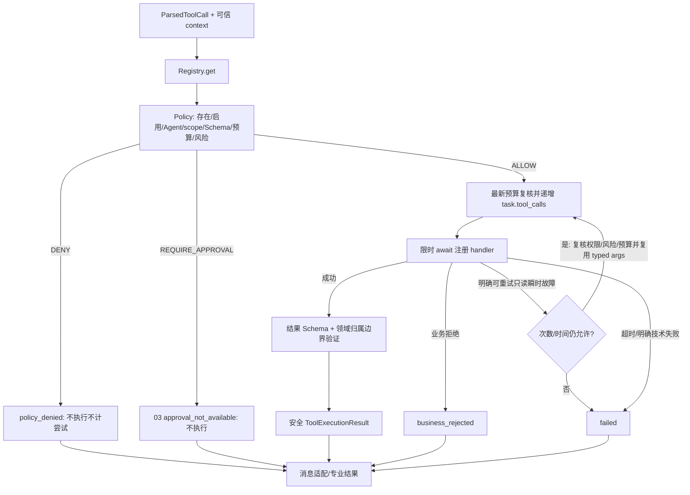
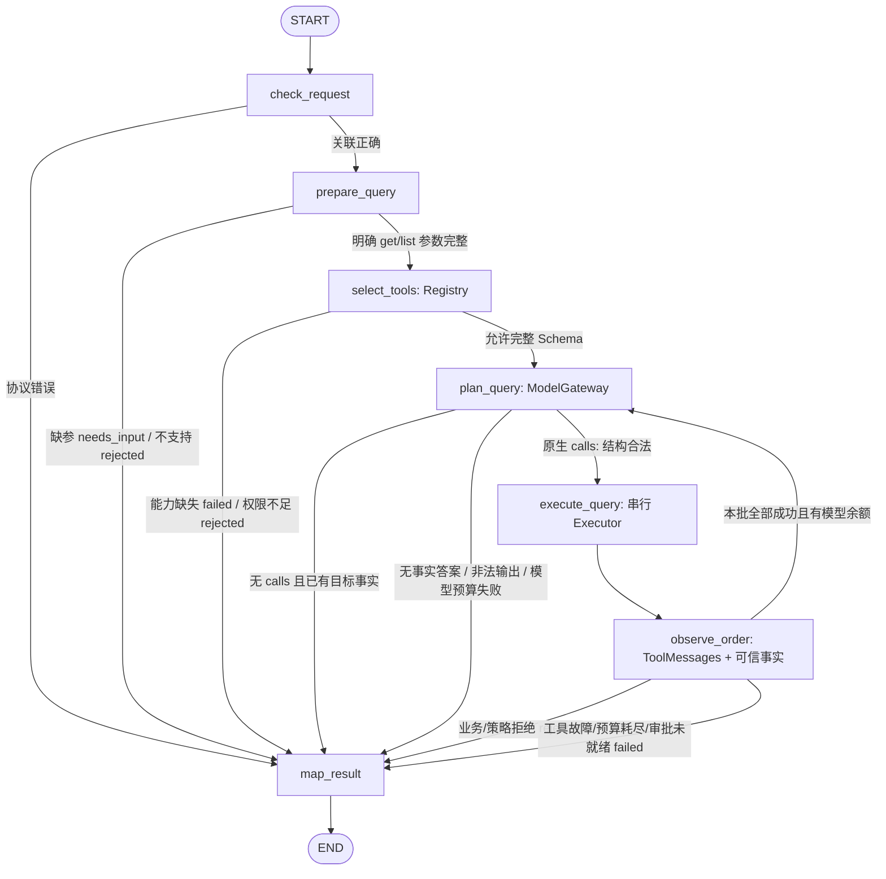

# 03 ToolRegistry 与工具执行治理：完整详细设计

状态为六阶段详细设计及第二轮定向修订已完成，四项技术决策现已确认或明确延期，当前等待最终设计冻结。所有Task尚未获得开发授权，实际环境验证留实施阶段。

初版日期为2026-11-08，最近修订日期为2026-11-09。依据：[项目定位](agent-engine-demo-plan.md)、[六阶段路线图](development-roadmap.md)、[已批准的 01 设计](01-foundation-detailed-design.md)、[已批准的 02 设计](02-agent-runtime-detailed-design.md)。[Graph 协议](graph-protocol.md)只作旧实现接口参考，不覆盖已批准的目标契约。

历史轮次说明（保留追溯，当前状态以页首和末尾最新记录为准）。本轮只修订本文件上述三项契约，不改其他文档/导航，不重新审核整体项目或检查 Git、开发进度、全仓代码；不修改业务代码、依赖、配置、数据库或迁移 SQL，不执行测试、代码检查、容器、迁移或模型联调。文中的接口、DDL、数据和验证均为未来方案。全项目 01–06 详细设计全部完成并审核后才统一开发，本轮不授权任何 Task。

## 1. 阶段目标、范围与调用链

03 建立三个专业 Agent 可复用的 Registry/Policy/Executor，并将 OrderAgent 从 02 的 capability_unavailable 骨架替换为真实 PostgreSQL 模拟订单查询。业务闭环必须真正产生原生 ToolCall、通过执行策略查询数据库、返回配对 ToolMessage，再由主图唯一 Response 公开事实结果。

严格沿用路线图的名称、数量和顺序：

| 二级环节 | 三级 Task | 阶段交付 |
| --- | --- | --- |
| 3.1 工具定义与注册过滤 | 3.1.1 Metadata/Registry；3.1.2 过滤与模型绑定 | 固定工具目录、元数据、按 Agent/可信 scope 过滤的完整 Schema |
| 3.2 Policy与Executor | 3.2.1 Policy/Executor；3.2.2 工具消息与治理 | 三态策略、唯一实际执行入口、预算/超时/安全结果、原调用消息配对 |
| 3.3 模拟订单与OrderAgent | 3.3.1 最小模拟订单事实；3.3.2 OrderAgent查询 | 单表/种子/小服务、get_order/list_orders、完整专业子图 |

```text
Route → Service → 02 AgentRuntime（thread 门禁、Task/Run、SSE、RunScope）
                   → Supervisor → OrderAgent
                       select_tools：Registry.list ∩ query_spec 单工具范围 → 完整 Schema → ModelGateway
                       plan_query：AIMessage.tool_calls
                       execute_query：ToolExecutor
                           Registry.get → ToolPolicy.evaluate → ALLOW → 投影最小业务上下文 → handler
                               → MockOrderService → OrderRepository → PostgreSQL
                       observe_order：可信事实 + 配对 ToolMessage
                       plan_query / map_result → SpecialistResult
                   → 主图汇总 / Response → run_finish → END

RefundAgent、KnowledgeAgent：03 仍是 02 的 capability_unavailable 骨架
```

界限：不建设退款资格/申请/执行、真实审批/interrupt/resume、PG Checkpointer、RAG/Embedding/pgvector/长期 Store；不做取消、完整物流/支付、企业 RBAC、独立工具服务或动态插件平台。工具目录固定、少量、启动冻结；不做 Tool RAG、目录分页/渐进披露、热加载、Broker、分布式预算或通用 Agent 基类。

## 2. 模块职责与单一权威

| 模块 | 职责 | 不负责 |
| --- | --- | --- |
| ToolRegistry | 关联工具对象/元数据/Schema/handler，拒绝重名、冻结，按可信上下文列出可暴露工具 | 不执行 handler，不批准副作用，不读取业务数据 |
| ToolPolicy | 对每个可关联的调用做工具存在性、启用、Agent/scope、参数、风险与预算决策 | 不调用 handler/DB、不持有 task 生命周期或计时器、不执行审批 |
| ToolExecutor | 唯一实际调用入口，查 Registry/调用 Policy，增加工具尝试计数、控制超时/有限重试、验证和投影输出 | 不创建 task/run/thread，不判业务金额，不直接信任模型权限 |
| 工具消息适配 | 验证原生调用批次、串行编排、把标准结果变成 ToolMessage | 不绕开 Executor 执行业务，不向公共 SSE 透传参数 |
| Order 工具 handler | typed args/最小可信 BusinessExecutionContext 到小服务的薄适配，返回类型化数据或拒绝 | 不接触 RunScope/RunLimits/Policy 对象，不自行决策、路由或识别身份 |
| MockOrderService | 本人订单查询语义、行归属复核、精确金额/状态的可用事实投影 | 不依赖 LangGraph/LLM，不提供退款或完整商城规则 |
| OrderRepository | 参数化 owner 限定 SQL、行映射 | 不接受模型拼 SQL/owner，不提供不带用户条件的查询 |
| OrderAgent | 02 既定七节点，组织允许工具/私有消息/事实、映射专业结果 | 不直接调 Service/Repository，不自建执行器/预算 |
| 01/02 基础 | Gateway、可信上下文、Limits/Usage、Runtime、Checkpoint 注入、SSE/订阅清理 | 本阶段不复制或重设计这些能力 |

调用入口必须统一：模型发起和确定性节点发起的工具，都进入同一个 Executor 和 Policy。注册的 handler 不作为 Graph 节点依赖直接暴露；专业 builder 只得到 Registry 的发现视图和 Executor。无法通过“工具已绑定”“普通身份在名单中”“节点是可信代码”跳过执行检查。

## 3. ToolMetadata、工具对象与 Registry

### 3.1 元数据与对象契约

工具对象用轻量 frozen dataclass 表达，无抽象基类/动态加载器。ToolDefinition 关联唯一的元数据、参数/结果 Schema 与真实 async handler；不同时维护另一个可绕过 Executor 的可执行 LangChain Tool。

```python
@dataclass(frozen=True, slots=True)
class ToolMetadata:
    name: str
    version: str
    description: str
    enabled: bool
    allowed_agents: frozenset[AgentType]
    required_scopes: frozenset[str]
    risk_level: Literal['low', 'medium', 'high']
    approval_required: bool
    read_only: bool
    has_business_side_effects: bool
    idempotency: Literal['not_applicable', 'operation_id_required']
    timeout_seconds: float
    max_retries: int
    tags: frozenset[str]

@dataclass(frozen=True, slots=True)
class ToolDefinition:
    metadata: ToolMetadata
    args_schema: type[BaseModel]
    result_schema: type[BaseModel]
    handler: Callable[[BaseModel, BusinessExecutionContext], Awaitable[HandlerResult]]

@dataclass(frozen=True, slots=True)
class ToolView:
    metadata: ToolMetadata
    model_schema: dict[str, JsonValue]
```

name/description 只有 metadata 一份权威；args_schema 只在 ToolDefinition 定义一次，Registry 从它生成完整 JSON Schema。result_schema 定义 handler 成功 data 的安全结构，不能用任意 dict/string 冒充业务结果。HandlerResult 是本地工具的标准返回：`data: BaseModel | None` 与 `rejection: BusinessRejection | None` 二选一；技术故障按明确异常类别报告，不作为业务拒绝吞掉。

注册时集中检查：name 满足固定工具标识格式、version 非空、async handler 可调用、Schema 有效、allowed_agents 非空、timeout>0、max_retries 为 0 或 1。read_only=true 必须 has_business_side_effects=false、idempotency=not_applicable；副作用工具不允许声明只读，自动重试为 0；high 风险必须 approval_required=true。非高风险的准备写操作可有副作用，但由后续阶段明确策略/幂等，不能仅凭 metadata 变为任意可执行写入口。

不递归冻结 Schema 类和内部所有容器，不设计复杂对象安全沙箱；注册数据由应用代码提供，使用 frozenset 与冻结对象避免常规误改即可。运行时开关为启动配置确定的 enabled，不提供热变更后台；启停变更重启并重建绑定。

### 3.2 Registry 接口和冻结

```python
class ToolRegistry:
    def register(self, definition: ToolDefinition) -> None: ...
    def freeze(self) -> None: ...
    def get(self, name: str) -> ToolDefinition | None: ...
    def list(self, *, agent_type: AgentType,
             permission_scopes: frozenset[str]) -> tuple[ToolView, ...]: ...
```

register 同名即拒绝，即使相同 version/handler 也不静默覆盖；freeze 后 register 拒绝。未冻结的 Registry 不能用于正式模型绑定/执行，防止绑定集合和执行目录边开发边改变。get 是内部执行查找接口，无工具返回 None；已禁用工具可查到定义但 Policy 必须拒绝，不能把 get 当授权。

list 的暴露条件同时满足 enabled、Agent 在 allowed_agents、required_scopes 全部包含于服务端普通 scope。默认稳定按 name 排序，返回完整 Schema 的只读视图，不带 handler/连接/用户数据。Supervisor 不绑定业务工具；03 正式目录只有 get_order/list_orders。未实现的退款/检索工具不注册成可用目录项，不能仅靠工具名预留假能力。

### 3.3 模型 Schema 绑定与执行集合

select_tools 根据当前专业 Agent、RunExecutionContext.permission_scopes 获取 ToolView，再与程序已校验的 query_spec 工具范围取交集，在私有 selected_tools 保存最终 `(name, version)`。Order 的范围严格为：`kind=get → 只允许 get_order`，`kind=list → 只允许 list_orders`；不得同时把两个工具都绑定给同一查询目标。所需工具被禁用/无权限时沿既定失败/拒绝路径结束，不换成另一个工具扩大查询。完整 description/JSON 参数 Schema 经原有 ModelGateway.invoke(tools=...) 绑定；不把 handler 传给模型，也不让专业图直接调用 BaseTool.ainvoke。

同一次模型调用暴露集合与执行允许集合均为上述交集。execute_query 依据当前已校验 query_spec 核对 selected_tools，并构造 Executor 的 allowed_tools/argument_constraints；不能从全目录或未经核验的快照恢复一个更宽集合。Executor 经同一 Policy 同时复核任务允许工具名称、必要参数、Registry、Agent/scope，模型伪造另一个合法工具也拒绝。确定性节点调用没有模型曝光集合时使用服务端固定的 origin=node 和节点/任务 allowlist，仍做相同检查，不能作为 Order 改目标或 skip_policy 的旁路。

允许曝光不等于允许执行：曝光时尚无实际 args、预算或可信审批决定；即使是已曝光工具，也可能因参数、预算、归属或审批要求被拒绝。未曝光名称、未知名称、禁用名称和 scope 不足均不得执行，不返回完整隐藏工具目录或所缺权限细节。

### 3.4 03 的正式工具元数据

| 字段 | get_order | list_orders |
| --- | --- | --- |
| version / enabled | `1` / true | `1` / true |
| description | 查询当前演示用户本人的一个模拟订单 | 分页查询当前演示用户本人的模拟订单列表 |
| allowed_agents | ORDER、REFUND（04 可复用） | ORDER |
| required_scopes | orders:read | orders:read |
| risk / approval_required | low / false | low / false |
| read_only / side_effects | true / false | true / false |
| idempotency | not_applicable | not_applicable |
| timeout_seconds / max_retries | 5 秒 / 1 次额外只读重试 | 5 秒 / 1 次额外只读重试 |
| tags | order、read、demo | order、read、demo |

具体 timeout/只读额外重试由集中配置 `tool_timeout_seconds=5`、`tool_read_max_retries=1` 映射进固定定义，注册后不在节点复制常量；副作用工具不复用只读重试设置。允许 Refund 发现 get_order 不代表 03 Refund 骨架已调用该工具。Knowledge 不获得订单工具，仅在 05 注册检索定义后拥有其专属允许集合。

## 4. ToolPolicy：输入、决策和执行前检查

### 4.1 可信调用上下文

```python
@dataclass(frozen=True, slots=True)
class ToolExecutionContext:
    execution: ExecutionContext       # user/conversation/workflow/task/run
    agent_type: AgentType            # wrapper/编译节点确定，非模型提供
    task_type: TaskType              # transfers已校验的当前Task
    node_name: str | None            # node来源取编译节点，model来源为None
    permission_scopes: frozenset[str]
    origin: Literal['model', 'node']
    allowed_tools: frozenset[tuple[str, str]]  # 当前任务目标收窄后的执行/曝光集合
    argument_constraints: Mapping[str, Mapping[str, JsonValue]]
    # 由专业节点依据已校验 query_spec 给出的少量精确参数约束，非模型控制
    run_limits: RunLimits
    scope: RunScope                   # 只引用 02 本次执行协调对象
```

execution 与普通 scope 来自 01/02 已校验的 DemoIdentity/session/RunExecutionContext；构造时核对本专业 request 关联，不从 ToolCall.args、ToolMessage、RAG 文档或长期记忆补身份。task_id 在澄清/未来恢复中稳定，run_id 可以变化；上下文和 scope 不进模型参数或 Checkpoint。

Executor/Policy 保留完整 ToolExecutionContext；只有 ALLOW 且实际准备调用 handler 时，由 Executor 投影最小可信业务关联：

```python
@dataclass(frozen=True, slots=True)
class BusinessExecutionContext:
    user_id: str
    task_id: str
    run_id: str

# Executor 内从 context.execution 投影，不从模型 args 或客户端另建身份。
# Handler 调用形状：await definition.handler(validated_args, business_context)
```

03 handler 只读取这些关联，实际 Service 通过正常应用依赖注入取得；不接收完整 ToolExecutionContext、RunExecutionContext、RunScope、RunLimits、PolicyEvaluation、权限集合或策略对象，也不通过闭包/额外参数偷渡这些执行内部对象。普通订单 handler 用 business_context.user_id 调服务，task/run 仅供必要业务关联。04 若有真实需求，再在业务上下文中增加经可信校验的 operation_id/审批记录引用等业务关联，不能加入 approved/skip_policy 或暴露预算对象；不建设通用权限框架。

模型与 node origin 由适配节点固定，不能由模型 args 选择。所有参数 Schema extra=forbid，禁止 owner/user_id/permissions/approved/operation_id 等控制字段冒充业务参数；未来 operation_id 作为可信操作上下文如何关联由 04 设计，03 不开放通用注入槽。

### 4.2 Policy 接口与顺序

```python
class PolicyDecision(StrEnum):
    ALLOW = 'allow'
    DENY = 'deny'
    REQUIRE_APPROVAL = 'require_approval'

@dataclass(frozen=True, slots=True)
class PolicyEvaluation:
    decision: PolicyDecision
    code: str
    message: str                    # 固定安全消息
    validated_args: BaseModel | None
    approval_requirement: ApprovalRequirement | None

class ToolPolicy:
    def evaluate(self, *, call: ParsedToolCall,
                 definition: ToolDefinition | None,
                 context: ToolExecutionContext,
                 usage: RunUsage,
                 remaining_active_seconds: float) -> PolicyEvaluation: ...
```

Policy 是不访问网络/DB 的确定性判断，参数校验只做一次并把类型化结果交给 Executor：

1. 工具不存在、未启用或不在当前origin对应的任务允许集合即DENY。node来源同时核对agent_type/task_type/origin/node_name的固定组合、allowed_tools中的工具名/版本和参数约束，不能只凭Agent或scope放行。Memory具体组合沿D05第6.1节，未列节点拒绝。Order get只允许get_order，list只允许list_orders。
2. 当前专业 Agent 与 allowed_agents 不符、可信 scope 不包含 required_scopes → DENY。用户在演示名单中不自动拥有所有工具。
3. 验证 name/args 与注册 args_schema；禁止多余身份字段、错误类型、越界参数。依据 context.argument_constraints 对少量已确定业务参数做精确匹配，03 包括 get 的 order_id、list 的 limit/offset；不让模型更换已准备的任务目标。这是可信节点给出的参数约束，不是通用条件表达式/RBAC 平台，缺省只表示没有额外目标约束而非略过 Schema/权限。
4. 校验 Runtime 的可信关联与预算快照：任务累计工具次数已满或剩余主动时长≤0 → DENY，不执行 handler。
5. 03 中 high 风险或 approval_required → REQUIRE_APPROVAL；否则 ALLOW。04 的审批后 ALLOW 扩展必须满足 4.4 的可信关联验证，不能修改工具风险/审批元数据或跳过前四项检查。read_only 也须通过前述权限/参数检查。

未知工具/无权工具不向模型披露其完整参数和隐藏元数据。参数错误只给允许的安全字段原因，不 dump 含身份候选的原始输入。DENY/REQUIRE_APPROVAL 本身不发起工具尝试，因此不增加 tool_calls；恶意重复无效调用仍受同 task 模型次数/时间和每消息调用数量限制。

Executor获取最新RunUsage/剩余时长，初次evaluate完成参数验证，每次handler前复核启用/Agent/Task/origin/node/允许工具/参数约束/scope/风险/预算，复用typed args。Policy不拥有时钟或计数，重试也不跳过复核，不增加通用DSL或第二套执行器。

### 4.3 REQUIRE_APPROVAL 的 03 安全行为

ApprovalRequirement 只是“该具体调用需要审批”的描述，含 call_id、tool_name/version、规范参数快照和可信 user/task/workflow 关联；不是批准凭据，也不声称已创建申请/审批/中断记录。

03 不注册正式写工具。受控用例可验证高风险定义得到 REQUIRE_APPROVAL 且 handler 从未被调用；实际若遇此决策，Executor 返回 `status=approval_required / code=approval_not_available / attempts=0`。03 消息适配为该 call 生成安全失败 ToolMessage，并以专业 failed 结束，不把它变成 needs_input、waiting_approval 或“请聊天同意”。

04 再接真实审批登记、可信记录读取、Gate 和原调用恢复；该阶段需在真实等待时暂不生成终结 ToolMessage，可信批准/拒绝后才闭合原调用。03 不提供 approved 布尔参数、管理密钥或“拥有某 scope 即自动放行所有副作用”的接口。未来有审批引用也要由可信存储核验当前原调用/参数，不仅相信客户端 resume 内容。

### 4.4 04 审批后同一 Policy 返回 ALLOW 的扩展契约

本节只约定后继扩展，不属于 03 实现范围。03 的 evaluate/Executor 不接收批准标记、也不读取审批存储；遇 REQUIRE_APPROVAL 仍按 4.3 零执行阻断。

04 在原调用中断恢复后，由可信 Gate/Executor 执行准备路径读取**持久化审批记录及关联的申请/操作事实**，验证审批来源和当前有效决定，构成内部不可变的 VerifiedApproval 事实。它是本次可信读取的结构化结果，不是客户端可提交的授权对象或模型参数；具体类型、存取、有效期与事务设计由 04 确定。

必须核对的关联包括：审批记录/原中断、可信 user/session/thread/task/workflow、原 ToolCall.call_id、tool name/version、原调用按注册 Schema 校验得到的规范参数，以及服务器保存的申请、金额快照与 operation_id。规范参数内容及其摘要须与审批快照一致，不能只比较工具名或任意客户端 hash。恢复的新 run_id 可用于当次执行关联，但不能因为它变化而另建批准、替换原调用/operation 或重置 task 用量。

扩展调用语义为 `ToolPolicy.evaluate(原调用, 当前完整执行上下文, 当前预算, verified_approval=可信核验事实)`；这是 04 才增加的内部参数，不在 03 提前实现。Policy 继续为确定性判断，不自己访问 DB；可信审批数据的读取和有效性核验由 04 执行准备路径完成，并在实际尝试前按其一致性规则重新确认，不能复用早先 Gate 的通用放行状态。

| 04 再次执行检查 | 同一 Policy 的决定与边界 |
| --- | --- |
| 工具、任务范围、Agent/scope、Schema、参数或任务剩余预算不通过 | DENY；有批准也不覆盖普通策略拒绝 |
| 需要审批，尚无可信批准/决定仍 pending | REQUIRE_APPROVAL；仍不执行 |
| 可信记录明确拒绝或关联/参数/operation 不符、批准已失效 | DENY；若审批存储读取失败则安全中止，不当成 ALLOW |
| 所有普通检查通过，且有效 approved 记录与原调用、规范参数、申请/金额和 operation_id 完整匹配 | ALLOW；保留 approval_required 元数据，经同一 Executor 执行原调用 |

ALLOW 仅是该次具体调用的策略许可，不替代 Domain 在业务事务中的资格/金额/归属复检，也不等于已退款。operation_id 的唯一约束、既有结果核对和业务幂等由 04 落实。模型参数、聊天“同意”、客户端 approved 布尔值、伪造 VerifiedApproval、通用审批 scope 或 skip_policy 均不能进入这一批准路径；更改目标/参数/金额必须按 04 新调用和新审批规则处理。

## 5. ToolExecutor：唯一实际执行入口

### 5.1 调用与结果契约

```python
@dataclass(frozen=True, slots=True)
class ParsedToolCall:
    call_id: str
    name: str
    raw_args: dict[str, JsonValue]   # 保留模型原始参数；不被规范值覆盖

@dataclass(frozen=True, slots=True)
class ToolExecutionResult:
    call_id: str
    tool_name: str
    execution_id: str               # 当前Executor入口的关联ID
    status: Literal['success', 'business_rejected', 'policy_denied',
                    'approval_required', 'failed', 'not_executed']
    code: str
    message: str
    data: dict[str, JsonValue] | None
    attempts: int                   # 该调用本次实际 handler 尝试数
    run_usage: RunUsage              # 同 task 累计快照，非 attempts 的替代值
    effect_status: Literal['not_applicable', 'not_started', 'completed', 'unknown']

class ToolExecutor:
    def __init__(self, registry: ToolRegistry, policy: ToolPolicy): ...
    async def execute(self, call: ParsedToolCall, *,
                      context: ToolExecutionContext) -> ToolExecutionResult: ...
    async def execute_batch(self, calls: Sequence[ParsedToolCall], *,
                            context: ToolExecutionContext) -> list[ToolExecutionResult]: ...
    # 04实施的同一Executor扩展，03不提前实现或验收副作用。
    async def assess(self, call: ParsedToolCall, *,
                     context: ToolExecutionContext) -> PolicyEvaluation: ...
    async def prepare_attempt(self, call: ParsedToolCall, *,
                              context: ToolExecutionContext,
                              execution_context: ToolExecutionContext | None = None,
                              business_context: BusinessExecutionContext | None = None
                              ) -> PreparedToolAttempt | ToolExecutionResult: ...
    async def execute_prepared(self, attempt: PreparedToolAttempt, *,
                               context: ToolExecutionContext) -> ToolExecutionResult: ...
```

prepare_attempt/execute_prepared沿D04第5.2、6.4节，属于同一Executor的两步入口。普通execute/execute_batch复用内部检查、计数和handler路径，不承担中间Checkpoint提交；要求写前sync的副作用不能用普通execute跳过准备。prepare只检查并产生标记，零handler尝试，不占用工具次数；拒绝或预算不足返回既有ToolExecutionResult，不能当作准备成功。图节点保存标记并完成durability=sync后，execute_prepared才最终复核Policy并实际执行。标记不等于许可、已执行或已提交。

跨节点准备复用可选execution_context。context保留真实准备节点，execution_context来自编译图固定目标节点，仅用于预检未来执行范围；不得把准备节点伪装成执行节点。只有D05规定的prepare_memory_write→execute_memory_write可准备Memory写。两上下文必须同user/thread/task/run、普通scope、RunScope和限制，目标工具及参数完全对应，Executor核对固定配对后用目标上下文通过同Policy预检。PreparedToolAttempt保存prepared_by_node_name及execution_node_name，最终执行时context.node_name必须是当前真实执行节点并匹配目标。退款原生调用省略该参数，仍按原model来源及原call审批执行。

business_context仅接可信节点从原Task/已校验命令准备的最小业务关联，不接HTTP/模型对象或预算/权限。Executor核对基础user/task/run，沿已定义业务投影绑定到标记的可序列化业务快照；Memory保存operation_id/command_digest/expected_revision/replay_check_only，规范命令及call_id/tool/version/args_digest一并固定。execute_prepared从标记恢复原调用及规范参数，按当前ExecutionContext投影handler上下文，不能依赖单例缓存或节点外隐藏State。退款缺省仍沿原可信申请/审批关联投影，不改变其机制。PreparedToolAttempt定义及持久尝试口径仍归D04，共用既有tools模型模块。

Memory调用必须提供完整MemoryBusinessContext及原命令关联，缺失或错配不得准备或启动handler。已知故障重入的同节点纯核对沿D05第10.3执行，replay_check_only=true且只消费原操作，不授予新写许可；该模式仍走同Policy/预算/执行入口。新写跨节点固定配对与纯核对不能相互替代。

origin=model时call_id/name/raw_args来自模型原生ToolCall，origin=node时由可信节点按本轮记录契约构造，不使用 tool 名充当 call_id，不为缺失 ID 随机补值。规范参数来自 validated_args，用于 handler/记录；原 args 与规范快照分开，默认值补全或空白规范化不能偷偷改写原生 AIMessage。数据只含注册结果 Schema 允许的安全字段，技术错误无旧 data。

HandlerResult 业务拒绝映射为 business_rejected；Policy DENY 映射为 policy_denied；两者都不能包装为成功但分属不同来源。未知工具/参数/权限属于策略问题，DB/工具超时属于工具故障，Gateway 解析/超时属于模型故障；不混成一个“模型回答有误”。意外编程异常正常传播到 Runtime，不能用宽泛捕获转成“订单不存在”。

Memory沿D05第10.4节映射四态领域结果。applied/reused经handler.data返回，conflict经既有BusinessRejection表达并保留原MemoryMutationResult安全载荷，unknown经明确的写结果未知异常进入Executor，保留code=memory_result_unknown、effect_status=unknown和data.status=unknown。通用技术错误仍data=None；仅这种当前调用的已校验unknown领域载荷可保留，绝不复用旧success data。ToolExecutionResult.status沿现有枚举为failed，表示执行未能确认完成，不把Memory业务unknown降格为普通技术failed或未开始。Manager不生成ToolExecutionResult，也不增加MemoryMutationResult.failed。

上述安全载荷使用既有结果边界，BusinessRejection及工具副作用未知异常允许携带本调用的领域结果BaseModel，由Executor按注册result_schema验证后投影到data。HandlerResult仍是data或rejection二选一，unknown异常不是第三种成功返回。明确未写的基础设施异常不携带MemoryMutationResult，Executor映射failed及effect_status=not_started。已经进入handler的读取/校验故障仍计一次工具尝试，not_started仅表示未开始业务写；Policy拒绝或handler启动前预算耗尽才是零尝试。副作用工具超时不能证明未写，无法确认时保守unknown；Runtime取消继续传播，不为填结果吞取消或重试。

批次入口由同一 Executor 提供 `execute_batch(calls, *, context) -> list[ToolExecutionResult]`：所有结构可关联 call 先在该入口通过 Registry/Policy 得到一次参数验证与初始决策，再按原顺序逐个核对最新尝试预算并执行。单 call 的 execute 与批次入口复用同一内部执行函数，不构建第二套策略/重试逻辑。预检阶段不调用 handler、不增加次数；某 call 因前项失败最终未执行，也已经过 Policy 检查，未获执行权限。

### 5.2 执行顺序



Executor 从 Registry 取唯一 ToolDefinition，调用 Policy 并取得 typed args；不是先调用 handler 再检查风险。批次预检只是初始判断，真正尝试前仍复核当前任务允许工具名称/参数约束、权限和最新预算；复用 typed args。ALLOW 后在无 await 步骤中取最新 RunScope、替换 tool_calls+1 快照，并由 context.execution 投影 BusinessExecutionContext，随后 `await handler(typed_args, business_context)`。结果/失败返回最新快照，调用节点及时 adopt；handler 不持预算/策略内部对象，不等到成功后才记数。

每次真实 handler 尝试都消耗一次 tool_calls，包括失败和安全重试；未知工具、Schema/权限拒绝、审批阻断、批次中未执行的剩余 call 为零尝试。总次数沿 task 跨 Run 继承；单次返回 attempts=2 不代表任务累计只有 2，禁止把所有结果的完整 run_usage 相加。

### 5.3 超时、重试与取消

单次 handler 超时为 `min(metadata.timeout_seconds, Runtime 剩余任务主动时间)`；外层仍由 02 Runtime 管整个 Run。工具内部不能另开无界后台任务或调用另一个未计数 handler。重试等待属于主动执行时间，每次额外尝试先重新核对预算/权限。

03 两个只读查询最多额外重试一次，仅对明确瞬时且安全的数据库连接获取/只读事务冲突等白名单错误。Schema、权限、业务拒绝、结果结构错误不重试；单次工具超时默认不自动重试，避免用额外请求掩盖持续故障。精确驱动异常类在未来实施时按本地版本映射，不把任意 Exception 都判可重试。

工具单次 timeout 可返回 failed/tool_timeout，已开始尝试仍计数；03 只读查询 effect_status=not_applicable，不会造成退款结果未知。Run 外层取消/关闭取消必须清理连接/协程并传播 CancelledError，不吞掉后继续工具批次或发下一轮模型。取消时尚未确定的计数/结果按 02 usage_complete=false/uncertain 记录；不能许诺异步取消等于外部操作没发生。

未来写工具默认不自动重试；执行超时/连接中断可能 effect_status=unknown，须用稳定 operation_id 先核对原结果，不能盲目重发。03 只定义这个结果分类，不实现操作幂等表/补偿/退款服务；04 明确审批绑定、事务和重放规则。

### 5.4 输出与归属安全

Executor 对注册 handler 的成功 data 使用 result_schema 验证并按白名单 JSON 序列化，过滤原始异常/连接/任意 metadata；不能把数据库行或 SDK 对象直接塞进 ToolMessage。金额以固定两位小数字符串、时间以带时区 ISO 字符串传输，不把 Decimal 转为 float。

归属必须在实际数据边界落实：OrderRepository SQL 限定可信 owner，MockOrderService 对返回记录 owner 再做一次必要结果边界核验，随后投影成不含 owner 的 OrderView。归属不一致属于明确程序/结果契约错误，失败并不公开数据，不作为可见订单。通用 Executor 无法从任意字符串自动证明归属，不能靠 Prompt 或通用 JSON Schema 替代领域校验。

ToolExecutionResult 只供专业子图/测试使用，不直接成为公共 SSE。工具参数、普通身份、权限和内部重试原因不逐帧公开；公共最终事实仍由主图既有白名单结果通道输出。日志只记必要 user/conversation/workflow/task/run、Agent、tool/call_id、耗时、状态/安全 code，不记录凭据、原始用户文本或整份参数/结果。

### 5.5 LangGraph 执行适配取舍

采用小的自定义 execute_query 节点串行调用 ToolExecutor，不直接使用默认 ToolNode 自动并发执行与默认错误转换。理由是本项目要统一可信上下文、Policy 三态、任务累计尝试数和原调用保留；不应在 Registry/Policy/Executor 外再有第二个实际执行入口。

不复制大型 ToolNode、通用工作流引擎或复杂 Runnable 框架；保留 AIMessage/ToolCall/ToolMessage 原生结构、Graph/Reducer/context 和 Checkpointer 注入。Gateway 的 tools 参数只接 Schema，不接真实可自行执行的 handler。

## 6. ToolCall 批次、ToolMessage 与快照

### 6.1 批次预检与串行规则

plan_query 在任何实际执行前验证一条 AIMessage：原生 tool_calls 的 id/name/args 结构完整、ID 非空且在该私有调用历史内唯一、没有 invalid_tool_calls、批次最多 `tool_max_calls_per_message=4`。缺 ID、重复 ID 或不可解析 args 等无法可靠配对的结构错误，整条输出不进入可继续模型消息历史，不执行其中任何 call，安全 failed；模型尝试仍已计数，不随机生成补配 ID。

对于结构合法、ID 可关联的未知工具/不合 Schema 参数，由 Policy 针对每个 call 返回拒绝；不是绕过 Policy 在适配层直接调 handler。整个结构合法批次先记入私有 AIMessage，再按原列表顺序串行执行，每个 call 均得到可关联结果。调用集合不根据模型自己宣称的 Agent/scope 改变。

```python
async def execute_tool_calls(calls: Sequence[ParsedToolCall], *,
                             executor: ToolExecutor,
                             context: ToolExecutionContext) -> list[ToolExecutionResult]: ...

def to_tool_message(result: ToolExecutionResult, *, task_id: str) -> ToolMessage: ...
```

execute_tool_calls 是专业消息适配的小函数，委托同一 executor.execute_batch，不在适配层调用 handler。批次中每个结构合法 call 均经 Executor 内部 Registry/Policy 预检；某一 call 出现拒绝、技术故障、审批未就绪或预算耗尽时，不再启动后续 handler，给其余 call 返回 `not_executed / previous_call_failed` 或 `tool_budget_exceeded` 的零尝试结果，闭合 AIMessage 后结束专业执行。预检 ALLOW 不预留预算，真正逐个尝试时仍核对最新余额；03 不失败后无限要求模型改参重试。

全部 call 成功后才允许下一次 plan_query。Run 级取消/进程崩溃导致无法闭合整个批次时，停止本次执行并保留现场，不把未配对消息送入下一轮模型；真正中断恢复的完整配对由 04 处理。

### 6.2 ToolMessage 生成规则

| 场景 | ToolMessage / 专业行为 |
| --- | --- |
| success | 原 tool_call_id，安全 JSON status/code/data；加入私有消息，再基于事实继续模型 |
| business_rejected | 原 tool_call_id，明确业务拒绝；Order 最终 rejected，不编造事实 |
| policy_denied | 原 tool_call_id，安全策略拒绝；专业 rejected（预算耗尽则 failed），不执行工具 |
| approval_required（03） | 原 tool_call_id，approval_not_available；专业 failed，无等待/聊天批准 |
| failed | 原 tool_call_id，安全错误；专业 failed，无旧 success data |
| not_executed | 原 tool_call_id，明确未尝试；不能伪造成功或增加工具次数 |

`ToolMessage.tool_call_id = 原 call_id`，name 保留原工具名，稳定消息 ID 建议 `tool:{task_id}:{call_id}`；内容只含安全 status/code/message/data，LangChain ToolMessage 的成功/错误字段按实际版本映射。不要把 run_usage、普通 scope、原始 args、内部 owner 或 ApprovalRequirement 全量写进模型可见内容。多 call 不能只生成一个汇总 ToolMessage。

每个已登记的有效 call 在正常闭合路径恰好一条对应 ToolMessage。exec 结果保存和 observe 的消息生成分开时，使用稳定 ID 配合 add_messages，避免同一节点重进追加重复消息。模型新输出重复已有 call_id 属结构错误，不作为“自动获准重放”。

### 6.3 私有执行记录与重放边界

专业 State 使用必要的 `call_records`（call_id→原调用快照、规范参数、执行结果），只保存本专业调用的原生调用和安全结果，不建工具调用数据库或完整审计平台。execute_query 输出结果/记录，observe_order 只映射已保存结果到 ToolMessage/事实；如果结果已保存，observe 重进不再执行 handler，也不重复增加计数。

本次私有历史受模型次数、工具次数和每消息 4 call 限制；模型/工具消息均保留在对应子图快照，不把 call_records 整份回传父 State。普通澄清续接可重新构造私有对话，但父 Task 的两类用量必须继承；未来真实 resume 则保留原 namespace/调用记录/私有消息，不能新建专业初始 State。

03 的记录与原生 Reducer 不构成副作用 Exactly Once。handler 已返回但结果快照未保存、RunScope 计数尚未提交或取消时，沿 02 的 uncertain 边界停止，不根据“查不到 call_records”认定没执行。04 再以操作唯一键/事务核对真实副作用，不能拿内存记录替代。

## 7. 最小订单数据、服务与工具

### 7.1 数据边界与表结构

复用 01 PostgreSQL 17、池、编号迁移、独立测试库。新增一张 `demo_orders`，不新增商品/物流/支付/用户/RLS 表；所有订单和资金都是本地模拟数据。

| 字段 | 类型/约束 | 说明 |
| --- | --- | --- |
| order_id | text primary key，长度 1–128 | 固定演示标识；不接受 SQL 片段作为查询条件 |
| owner_id | text not null，长度 1–128 | 受控演示 user_id；无虚构 users 外键 |
| amount | numeric(12,2) not null，>0 | 精确模拟订单金额，服务用 Decimal |
| currency | text not null，三位大写字母 | 初始数据统一 CNY，不提供汇率/资金操作 |
| payment_status | text check in ('unpaid','paid') | 最小付款事实，不扩展完整交易状态机 |
| is_refunded | boolean not null default false | 模拟已退款标记，03 运行时只读，04 再设计真实变更规则 |
| created_at | timestamptz not null | 固定样本时间，列表稳定排序 |

保留约束 `NOT is_refunded OR payment_status='paid'`，列表索引 `(owner_id, created_at DESC, order_id DESC)`。未来退款需要的金额规则、申请表/外键/锁在 04 加，不为预期完整商城建表。

迁移计划为 `migrations/002_demo_orders.sql`（基于 01 的 001_sessions，实际实施时使用下一个未占编号），仅 DDL/索引；同步应用期望 schema 版本，沿 01 显式迁移、不在启动中自动建表。本文不创建/执行 SQL 文件。

### 7.2 固定演示数据与初始化

| order_id | owner_id | amount / currency | payment_status / is_refunded |
| --- | --- | --- | --- |
| demo-order-a-001 | dev-user | 128.50 CNY | paid / false |
| demo-order-a-002 | dev-user | 59.90 CNY | unpaid / false |
| demo-order-a-003 | dev-user | 35.00 CNY | paid / true |
| demo-order-b-001 | demo-user-b | 888.00 CNY | paid / false |
| demo-order-b-002 | demo-user-b | 30.00 CNY | unpaid / false |

created_at 使用种子中固定的带时区时间，按 ID 对应固定顺序，不用每次运行的 now 让列表漂移。未来脚本 `python -m scripts.seed_orders --target development|test` 必须显式选目标，读取相应 SecretStr URL；test 强制 01 测试库保护，development 限本地开发库且不能在 production 启用。样本 owner 应在受控演示名单中，不自动扩大白名单。

种子用事务 `INSERT ... ON CONFLICT(order_id) DO NOTHING`，再核对已有标识的静态 owner/amount/currency/固定时间与样本一致；冲突不重写成另一个用户订单。已有 payment_status/is_refunded 保留，不因再次初始化把 04 产生的退款结果重置。无清库/删除卷选项，测试只清本用例数据。种子不是 Runtime 工具，应用启动不自动插入数据。

### 7.3 Service/Repository 与数据结构

```python
@dataclass(frozen=True, slots=True)
class OrderRecord:
    order_id: str
    owner_id: str
    amount: Decimal
    currency: str
    payment_status: Literal['unpaid', 'paid']
    is_refunded: bool
    created_at: datetime

class OrderView(BaseModel):
    order_id: str
    amount: str                 # 固定两位小数
    currency: str
    payment_status: Literal['unpaid', 'paid']
    is_refunded: bool
    created_at: str             # 带时区 ISO
    simulated: Literal[True] = True

class OrderRepository:
    def __init__(self, pool): ...
    async def get_owned(self, *, owner_id: str,
                         order_id: str) -> OrderRecord | None: ...
    async def list_owned(self, *, owner_id: str,
                          limit: int, offset: int) -> list[OrderRecord]: ...

class MockOrderService:
    def __init__(self, repository: OrderRepository): ...
    async def get_order(self, *, user_id: str, order_id: str) -> OrderView: ...
    async def list_orders(self, *, user_id: str, limit: int,
                           offset: int) -> list[OrderView]: ...
```

Repository 使用静态参数化 SQL：get 必含 `WHERE owner_id=%s AND order_id=%s`；list 必含 owner 条件、固定 ORDER BY 和参数化 limit/offset。不先按 order_id 查全表再在 Python 隐藏 owner，不提供通用 raw_sql/filter 接口。Service 的 user_id 必须由工具上下文提供；404 类业务语义用一个 OrderNotAccessible 领域拒绝同时覆盖不存在/非本人，不泄露其他用户订单。

list 合法空列表是成功，不是异常；DB 连接/语句失败抛明确技术错误，不静默返回 []；返回 row.owner_id 与可信 user_id 不符时暴露明确结果契约错误并禁止数据外传。Service 不知道 LLM、ToolCall、Graph 或 HTTP；Repository 不拥有模型/审批权。

采用具体小类，无 Repository 抽象基类/ORM/通用电商模型。service/repository 是 Domain 的实现依赖，只注入工具 handler，专业子图不能取得它们作为执行旁路。

### 7.4 get_order / list_orders Schema 与结果

```python
class GetOrderArgs(BaseModel):
    # extra=forbid，str_strip_whitespace=True
    order_id: str               # 1–128，不能空白

class ListOrdersArgs(BaseModel):
    # extra=forbid；整数严格校验，不接受 bool/字符串强转
    limit: int = 5              # 1–20
    offset: int = 0             # >=0

class GetOrderData(BaseModel):
    order: OrderView

class ListOrdersData(BaseModel):
    orders: list[OrderView]
    returned_count: int
    limit: int
    offset: int
```

两个 args 都没有 owner/user_id/Agent/scope/SQL 参数。handler 从 BusinessExecutionContext.user_id 调 Service，返回 GetOrderData/ListOrdersData，不接触完整执行上下文；returned_count 只表示本页真实条数，不伪造总订单数。03 不做商品详情/物流事实，公开回答也不能补出这些字段。

| 情况 | 工具结果 | OrderAgent 结果 |
| --- | --- | --- |
| 本人订单存在 | success + OrderView | completed，facts 来源于实际返回 |
| 订单不存在或属于他人 | business_rejected / order_not_accessible，data=None | rejected，统一安全说明 |
| list 当前页为空 | success + orders=[] / returned_count=0 | completed，明确本次范围无订单 |
| DB 故障/超时 | failed / order_query_unavailable 或 tool_timeout | failed，无旧事实或假空列表 |
| 模型伪造 user_id/错误参数 | policy_denied / invalid_tool_arguments | 不调 Service，专业拒绝或缺参处理按已有边界，不回显身份候选 |

## 8. OrderAgent 完整 State / Node / Edge

### 8.1 沿用 02 State，补必要的执行字段

仍用 SpecialistState/当前 RunExecutionContext，不新建第二个 Agent 引擎。共享 request/messages/selected_tools/result/outcome/error/缺参/两类用量按 02；专属字段如下：

| 字段 | 写入节点 | 生命周期与约束 |
| --- | --- | --- |
| query_spec | prepare_query | `kind=get/list`、目标 order_id 或分页；无 owner/scope；本专业普通调用覆盖 |
| pending_calls | plan_query | 完整原生 call 列表；批次预检后保存，不重写 id/name/raw args |
| batch_results | execute_query | 按原 call 顺序的 ToolExecutionResult，包含未执行/失败结果 |
| call_records | execute_query | 原调用/规范参数/安全结果；供观察节点重进，不是业务幂等表 |
| verified_order_facts | observe_order | 只接成功并通过归属/Schema 验证的数据，按查询目标确定事实快照 |
| candidate_answer | plan_query | 模型无 tool_calls 时的候选文本，不能直接成为公共业务事实 |

普通调用初始化私有槽时不清父 task 用量；真实 resume 04 沿原子图快照不重新初始化。消息用 add_messages，其他快照覆盖；不是对每条工具结果的完整累计用量反复做加法。

### 8.2 请求准备与目标约束

check_request 先检查 Agent=ORDER、Task=ORDER_QUERY 和 owner/conversation/task/workflow/当前 run；关联不可信直接协议失败，不假设用户可补身份。prepare_query 对 Supervisor 的候选实体做业务输入校验：

- 明确单订单查询为 get；缺 order_id 则 needs_input，父 PendingTask 续接原 task。
- 明确“我的订单列表”为 list，不机械要求订单号；采用默认 limit/offset。
- get/list 不明确且不能由当前目标确定，先澄清，不为扩大查询范围任意选 list。
- 取消/退款/物流变更不作为 Order 可执行目标；按 02 拒绝或回主图澄清规则处理，不调用写操作。

准备出的 query_spec 是本任务的允许查询目标。Order 必须按下表同时收窄模型暴露和 Executor 的任务执行集合，不能只约束参数却允许换工具：

| 当前 query_spec | 模型暴露 / context.allowed_tools | context.argument_constraints |
| --- | --- | --- |
| kind=get | 仅 get_order 的当前注册 version | get_order.order_id 精确匹配已确定订单 ID |
| kind=list | 仅 list_orders 的当前注册 version | list_orders 的规范 limit/offset 精确匹配已确定分页 |

execute_query 核对当前 query_spec 与 selected_tools，再构造上述可信约束；Executor 经 Policy 复核工具名和参数，模型从 get 换为 list、从 list 换为 get、改其他订单或扩分页均被拒绝，即使 Agent/scope/Schema 本身合法。所有结构可关联 call 仍走 Policy，不能直接调 Service。这些约束不替代服务端 owner SQL 和领域归属验证。

### 8.3 七节点契约

| Node | 主要输入 | 更新/职责 | ConditionalEdge |
| --- | --- | --- | --- |
| check_request | request + 可信 context | 协议/目标关联验证 | 合法→prepare_query；失败→map_result 或协议异常上抛 Runtime |
| prepare_query | goal/entities/允许消息 | query_spec、缺参/拒绝 | 完整→select_tools；缺参→map_result(needs_input)；不支持→rejected |
| select_tools | Agent/scope/query_spec | Registry 授权集与 get/list 单工具目标取交集，仅暴露对应完整 Schema/selected_tools | 所需工具可用→plan_query；缺失→failed；权限不足→rejected；不换另一个工具 |
| plan_query | 私有消息/Schema/ModelCallUsage | Gateway 原生 AIMessage；批次校验后的 pending_calls 或候选结束 | 有合法 call→execute_query；无 call 且有符合目标事实→map_result；无事实/非法输出/预算耗尽→failed |
| execute_query | 原 calls、当前 query_spec/selected_tools、可信 context、RunScope | 核对单工具目标并交 Executor 复核名称/参数/权限，串行保存结果/记录/用量 | 正常可关联批次→observe_order；取消/意外异常→Runtime 收敛 |
| observe_order | batch_results/call_records | 每 call 一 ToolMessage、验证事实、将拒绝/失败映射为 outcome | 全成功且有模型预算→plan_query；业务/策略拒绝→map_result(rejected)；技术/预算/审批未就绪→failed |
| map_result | outcome/query_spec/verified facts/允许来源 | 领域 SpecialistResult、可信用量快照 | END；不发布 SSE、不冻结主 Run 计时 |

ConditionalEdge 是读取节点输出的纯函数，返回固定节点名；不在边上执行模型、数据库或业务。没有自由选择节点的模型输出，也没有绕回 Supervisor 的反复调度。

### 8.4 Mermaid 完整目标图（03 未来实现）



E 中的 Registry→Policy→Executor 调用与失败后剩余 call 闭合按第 5–6 节；外层取消和意外编程错误不被图中 failed 分支吞掉。04 中断传播仍按 02，本图不创建 Gate。

### 8.5 事实闭环与最终回复

plan_query 首次没有事实就直接回答“订单已付款”等，不能完成任务，应 failed/model_answer_without_facts，不直接 fallback 读 DB。允许模型根据 ToolMessage 继续调用或结束，但最终业务摘要**不用未经约束的 candidate_answer 原文**。

map_result 从 verified_order_facts 按固定模板生成 summary：订单 ID、精确金额/币种、paid/unpaid、模拟退款标记以及“模拟订单”说明；list 逐条渲染当前页事实/returned_count。模型候选文本只作为私有结束建议，不进入公共 summary。这样可确定地防止模型添加物流、交易状态、金额或成功操作等未提供事实，同时仍真实演示原生工具计划与结果反馈循环。

facts 只保存本次 query_spec 匹配的工具数据，包含 query kind、订单或列表、分页/条数和 simulated=true；不得把模型回复解析为事实。空列表有合法结构化 facts；业务拒绝没有假事实；failed 含稳定 safe error。sources 对订单不伪造知识库引用。

若成功工具返回后继续模型已无尝试额度，按 02 预算规则 failed，不再额外请求模型；不通过重置 task 或偷发“最后一次总结”绕过限制。可保留内部已取得事实用于故障说明/查询，但不能将未走合法结果路径的任务标 completed。

wrapper 继续校验当次 run/task/workflow/用户和专业类型，只回传允许结果/预算；主图唯一 Response 写公开 AI。普通主图 run_finish 在图内冻结时钟并返回最终 State 更新，Runtime 在 END 后只收敛 RunRecord、发布事件/释放门禁，无第二次常规 update_state。SSE 迭代前断开清理继续用 02 SubscriptionOwner/guard，不能让工具任务依赖订阅存活。

## 9. 全部三级 Task 的详细设计

### Task 3.1.1 Metadata/Registry

#### 1. 设计目标

建立有真实 handler/完整 Schema 的固定目录，解决“只有工具名、不知权限风险、同名覆盖”的问题，为模型绑定和执行查找提供同一份权威定义。

#### 2. 模块职责划分

tools/models 定义 Metadata/Definition/View；registry 管注册/冻结/get/list；工具实现模块提供具体定义，不由 Registry 访问业务库。01/02 的 AgentType/普通 scope 复用，不建用户角色表。

#### 3. 技术方案及选择理由

采用第 3 节轻量冻结对象与内存白名单；固定工具启动注册后 freeze，完整 Schema 由唯一 args_schema 生成。真实可调用工具对象与 metadata 关联，不建第二个 BaseTool 可执行旁路，不做插件热加载/Tool RAG。

#### 4. 未来实际开发步骤

1. 实现 Metadata/Definition/View 和注册边界一致性检查；将 read_only/副作用/风险/审批/重试约束落在一处。
2. 实现 register/get/freeze，拒绝重名/冻结后修改，未完成冻结不可正式使用。
3. 实现按 enabled、Agent、required_scopes 过滤的 list 和固定排序/完整 Schema 视图。
4. 定义 get_order/list_orders 的正式元数据；实际 handler 待 3.3.1/3.3.2 接入，不在应用注册假的成功工具。
5. 未来用少量受控可调用定义验证重复名/越权过滤/冻结行为，记录目录契约；不创建动态管理接口。

#### 5. 接口、类、函数和数据结构

采用 ToolMetadata、ToolDefinition、ToolView、ToolRegistry.register/freeze/get/list。name/version/Schema/handler 一对一；list 返回 tuple[ToolView] 而不是 handler，get 只供可信内部执行查找，未找到为 None。

#### 6. 文件与目录规划

新增 `app/tools/models.py`，实现既有 `app/tools/registry.py`；必要的发现过滤复用 `app/tools/discovery.py`，不另建 Registry 管理平台。未来测试可放 `tests/test_tool_governance.py`，不为简单 getter 逐项堆测。

#### 7. 前置依赖与后续交接

设计依赖 01/02 已批准的 Agent/scope/上下文；未来开发依赖这些基础。交给 3.1.2 的完整 Schema 与 3.2 的唯一定义查找；不依赖订单业务先实现，避免循环。

#### 8. 交付物和未来验收标准

工具定义与真实 callable 关联、重名/冻结拒绝成立；未授权 Agent/普通 scope 看不到工具 Schema；未注册业务不假可用。受控目录验证只是基础验证，最终真实 get/list 仍需 3.3 PostgreSQL 联调。

### Task 3.1.2 过滤与模型绑定

#### 1. 设计目标

确保下一次模型调用真正带有当前允许工具的完整 Schema，发现行为不授予执行权限，不泄漏其他 Agent 的能力。

#### 2. 模块职责划分

Registry/list 提供发现视图；专业 select_tools 保存选中名称/version；Gateway 复用原 tools 参数创建派生 binding；Executor 后继复核相同集合。Supervisor 仍不持全量工具。

#### 3. 技术方案及选择理由

采用第 3.3 节直接完整绑定少量 Schema。共享底层模型不原地改 tools，单次派生 binding 隔离不同 Agent/Run；无需渐进披露收据、目录分页或向量发现工具。

#### 4. 未来实际开发步骤

1. 实现可信 Agent/scope 的 Registry 过滤；Order 再按 query_spec 固定收窄为 get→仅 get_order、list→仅 list_orders，不从模型实体读取权限或同时暴露两个工具。
2. 将完整 name/description/JSON Schema 交给现有 Gateway.invoke；空目录返回能力不可用，不绕过工具自行读库。
3. 用当前 query_spec 核对 selected_tools，将相同单工具 `(name,version)` 集合和精确参数约束交给 Executor，复核任务范围而不只看 Agent/scope。
4. 验证不同 Run 的工具 binding 不相互污染，原生 tool_calls 的 id/name/args 保留。
5. 未来用可控模型观察真实传入 Schema；3.3.2 再记录真实模型工具调用，不为本 Task 默认发付费请求。

#### 5. 接口、类、函数和数据结构

复用 Gateway.invoke(tools=完整Schema)，新增小的 `select_tool_views(registry, agent_type, scopes)` 通用适配即可；get/list 任务范围的进一步缩小由 Order select_tools 负责，不让公共发现模块依赖订单业务。selected_tools 只存标识，不存 handler。不要返回可让图直接 .ainvoke 的可执行工具对象。

#### 6. 文件与目录规划

复用 tools/discovery.py 与注册视图；Order select_tools 在对应 nodes.py 真正有调用方时接线，Gateway 仅做必要 Schema 适配、不创建第二网关。测试合并进工具治理用例，未来更新工具目录说明。

#### 7. 前置依赖与后续交接

依赖 3.1.1、01 Gateway 与 02 SpecialistState；交给 3.2 的曝光边界、3.3.2 的 plan_query、04/05 的专业筛选。无反向依赖 Executor 实现才能生成 Schema。

#### 8. 交付物和未来验收标准

模型实际只收到与 get/list 目标对应的单工具完整 Schema；未知/禁用/越权工具不暴露，所需工具不可用不换另一个；曝光/执行集一致且 Executor 拒绝换工具/扩大参数范围。Supervisor 无业务工具，原生 call 不丢失、共享 binding 不污染。不能只断言工具名列表就验收绑定完成。

### Task 3.2.1 Policy/Executor

#### 1. 设计目标

把所有实际工具执行汇聚到同一可检查入口，确保可信身份、权限、参数、风险与任务累计预算在 handler 前生效。

#### 2. 模块职责划分

Policy 纯判断/一次 Schema 校验，Executor 保留完整 ToolExecutionContext 并负责查目录/策略/尝试/结果；RunScope 仍归 02，handler 仅接 typed args 和最小 BusinessExecutionContext，Domain 处理具体业务事实。

#### 3. 技术方案及选择理由

第 4–5 节三态策略与轻量自定义 async Executor，替代默认 ToolNode 并行执行。只读最多一次明确安全重试，写操作无默认重试；REQUIRE_APPROVAL 在 03 明确阻断，不 fake interrupt/批准。

#### 4. 未来实际开发步骤

1. 实现 ParsedToolCall、完整 ToolExecutionContext、最小 BusinessExecutionContext、PolicyEvaluation/ToolExecutionResult 和安全错误分类，不把执行内部对象放入业务上下文。
2. 实现 evaluate 的查找/启用/任务工具名与参数约束/Agent/scope/Schema/预算/风险顺序，typed args 仅在允许执行时使用。
3. Executor 在每次实际尝试前复核任务范围和最新预算，先检查/递增，再投影 user_id/task_id/run_id 调 handler；不得直接把完整执行上下文传进去。
4. 实现单次超时/白名单只读重试、业务拒绝/技术失败/未知效果分类，正常传播取消与编程异常。
5. 验证成功 result_schema 并安全序列化；归属具体约束由领域数据边界承担，不靠 JSON Schema 或 Prompt 冒充。
6. 03 将 REQUIRE_APPROVAL 变为零尝试不可用返回，不实现认证/Gate；将 4.4 的持久审批/原调用/规范参数/operation_id 校验后同 Policy 可返回 ALLOW 作为 04 交接契约，不提前增加批准参数或实现审批读取。
7. 未来用受控 handler 验证 DENY/审批/预算时 handler 未被调用，失败/重试尝试计数正确；正式订单 handler 留 3.3。

#### 5. 接口、类、函数和数据结构

采用 ToolPolicy.evaluate、ToolExecutor.execute/execute_batch、BusinessExecutionContext 和第 4–5 节契约。两执行入口共用内部检查，批次每 call 先经 Policy，实际尝试仍串行复核任务范围/预算；Executor 从完整 context 投影最小业务关联给 handler。不接受模型 user_id、skip_policy/approved，03 不增加 VerifiedApproval 实现。RunLimits/RunUsage/RunScope 复用 01/02，不新建预算器或权限框架。

#### 6. 文件与目录规划

实现既有 `app/tools/policy.py`、`executor.py`，扩展 models.py；集中 Runtime/工具默认设置未来更新 core/config/.env.example，不在本轮修改。受控用例可新增 `tests/test_tool_executor.py`；不引入独立执行服务。

#### 7. 前置依赖与后续交接

依赖 3.1.1/3.1.2 和 02 RunScope/context；交给 3.2.2 的标准执行结果，3.3 的真实查询入口，04 的审批/幂等扩展，05 的检索调用。Policy 不依赖未来审批存储才能安全阻断。

#### 8. 交付物和未来验收标准

未知/越权/任务换工具/扩大参数/审批未就绪/预算耗尽均不执行；每尝试含失败/重试计入原 task；取消停止后续，错误无秘密/旧 data。handler 只收到 typed args 与 user/task/run，不接触 RunScope/RunLimits/策略对象。04 批准后 ALLOW 只有扩展设计，03 不实现或验收审批/幂等/恢复。

### Task 3.2.2 工具消息与治理

#### 1. 设计目标

保证原生 ToolCall/ToolMessage 可追溯配对，多 call 串行且失败不会留下可继续发送模型的半配对批次，为后继原调用恢复保留契约。

#### 2. 模块职责划分

私有工具适配验证消息批次/顺序和生成 ToolMessage；Executor 负责每次真实调用；专业 observe 保存安全消息/事实；父 wrapper 不复制工具历史，Runtime 负责异常终止与预算结算。

#### 3. 技术方案及选择理由

第 6 节批次结构预检、最多 4 calls、稳定 ToolMessage ID 和必要私有 call_records。无需数据库 ToolCall 平台；03 普通失败闭合消息并结束，04 真正等待时才保持原调用待恢复，不提前创建 Gate 空实现。

#### 4. 未来实际开发步骤

1. 验证原生 AIMessage 的 IDs/name/args/invalid_tool_calls 和批次上限；结构错误在任何 handler 前拒绝整条输出。
2. 保存结构合法原 AIMessage，消息适配委托同一 Executor.execute_batch；内部先逐 call 经 Policy 预检，再串行执行允许尝试，typed args 只验证一次。
3. 遇拒绝/失败/预算耗尽停止后续 handler，为其生成明确零尝试 not_executed 结果。
4. observe 对每条有效 call 建立一个稳定 ToolMessage，保留原 tool_call_id；正常完整配对后才允许再次 Gateway 调用。
5. 保存 call_records/结果快照并以覆盖式更新预算；观察节点重进不得再次执行/计数。
6. 明确取消时不向模型发送半配对历史、03 approval_not_available 的终结消息以及 04 真实中断必须改变此适配位置。
7. 未来用少量多 call/重复 ID/未知工具/超时/预算/观察重进场景验证实际节点与 Executor，不只测字符串格式化。

#### 5. 接口、类、函数和数据结构

使用 execute_tool_calls/to_tool_message、ToolExecutionResult、私有 call_records；领域 outcome 与安全结果按第 6 节映射。ID 保留不随机修复，完整累计用量不能逐条加法合并。只读重复观察复用已存结果，不承诺业务全局 Exactly Once。

#### 6. 文件与目录规划

新增 `app/tools/messages.py` 存批次验证/消息适配；专业 nodes.py 使用该适配，既有 Executor 不被复制。测试与 test_tool_executor/Order 节点用例复用，不新建通用 ToolNode 或工具消息数据库。

#### 7. 前置依赖与后续交接

依赖 3.2.1 的标准结果和 02 私有 State/Reducer；交给 3.3.2 的 execute/observe，04 的稳定原调用/消息边界，05 的检索工具反馈。03 不依赖 interrupt 来证明消息配对。

#### 8. 交付物和未来验收标准

一条多 call AIMessage 的工具顺序、配对与安全错误可观察；重复 ID/非法结构零执行；拒绝后剩余 call 明确未执行；已存结果的观察重进不重调 handler；公共历史/SSE 不含内部工具消息；审批未接入时明确失败、不聊天批准。

### Task 3.3.1 最小模拟订单事实

#### 1. 设计目标

提供可用真实 PostgreSQL 读取核对的本人订单事实，代替内存字典或模型编造，同时给 04 复用最少订单查询能力。

#### 2. 模块职责划分

编号迁移建一张订单表；种子脚本显式初始化固定数据；OrderRepository 参数化 SQL；MockOrderService 处理归属/不可见/安全事实。无 HTTP 订单后台、通用商城服务或订单写工具。

#### 3. 技术方案及选择理由

采用第 7 节单表、Decimal、owner 条件、专用测试库和幂等种子，延续 01 的显式迁移/池。真实订单与支付均模拟；payment_status/is_refunded 只为查询和后续退款资格所需，不扩建支付账本/物流表。

#### 4. 未来实际开发步骤

1. 增加下一编号 demo_orders DDL/索引/约束，同步应用期望 schema 版本，普通启动不自动迁移。
2. 实现 OrderRecord/OrderView、get_owned/list_owned 的静态 owner SQL 与稳定分页。
3. 实现 MockOrderService 的统一不可见拒绝、归属结果核验和 Decimal/时间安全投影；DB 错误不假空列表。
4. 增加显式 seed_orders 目标选择/事务插入/冲突核对，保留既有订单状态与退款标记。
5. 复用 lifespan 的实际池注入 Repository/Service，但只向工具 handler 暴露 Service，不作为专业节点直接依赖。
6. 未来真实 PG 验证本人查询/跨用户不可见/空列表/DB 失败/种子重跑及数据状态；不只断言文本说成功。

#### 5. 接口、类、函数和数据结构

采用 OrderRecord/OrderView、OrderRepository、MockOrderService 与单表字段。get 不存在/非本人统一领域拒绝，list 空页成功；Service 独立于 Graph/LLM。04 若要在退款事务重检/锁定，再设计专门方法，不在 03 创建未使用的写 Repository。

#### 6. 文件与目录规划

新增 `app/domain/orders.py`（具体服务/数据与领域拒绝）、`app/infrastructure/order_repository.py`、未来 `migrations/002_demo_orders.sql` 和 `scripts/seed_orders.py`。按需新增 `tests/test_order_service.py` 的真实库用例；README 未来同步模拟数据/显式初始化。无额外 ORM 依赖/抽象接口。

#### 7. 前置依赖与后续交接

依赖 01 PG/迁移/池和本阶段 3.2 的执行契约；数据层本身不反向依赖工具或图。推荐仍按路线图顺序实施，交给 3.3.2 正式 handlers、04 本人查询与最小订单事实。

#### 8. 交付物和未来验收标准

真实 PG 行/金额/归属可核对，重复种子不增重复数据或清除状态；A 看不到 B，与不存在结果一致；合法空页与 DB 错误分开；无物流/支付/退款写能力。缺真实数据库只记录未验证，不拿 Mock 当本 Task 验收。

### Task 3.3.2 OrderAgent查询

#### 1. 设计目标

把 02 Order 骨架替换为已设计七节点的真实工具闭环，保留 Runtime/预算/互斥/SSE 与唯一公开出口；Refund/Knowledge 骨架保持不可用。

#### 2. 模块职责划分

Order tools 将 args/context 薄映射到 Service；专业 State/nodes/routing 实现第 8 节七节点；主 builder 注入 Registry/Executor/Gateway；父 wrapper 校验结果和预算，Response/run_finish 维持原职责。

#### 3. 技术方案及选择理由

复用 02 的拓扑、私有消息和事实槽，Model→native ToolCall→Executor→ToolMessage 的有界串行循环真实运行。最终摘要从核验事实确定性生成，不把自由文本当订单事实；不新增第二网关/订单 HTTP 查询路径来绕过工具演示。

#### 4. 未来实际开发步骤

1. 实现 get_order/list_orders 的 args/result Schema 与真实 handler，按 3.4 注册/冻结正式工具目录。
2. 按 8.1 落地 OrderState 与七节点；get 缺参/list 无需订单号/意图歧义分别处理。
3. select_tools 按当前 query_spec 只选 get_order 或 list_orders，并经可信 Agent/scope 过滤；plan_query 只绑定这一集合的完整 Schema，保留原调用。
4. execute_query 核对当前单工具集合/参数约束，使用同一 Executor 复检；Executor 仅给 handler 最小业务上下文，observe 保存结果、配对消息、事实与任务快照。
5. map_result 从实际 facts 渲染安全 summary；旧 facts、模型金额/物流想象不能进入 completed。
6. 通过既有主 builder 接 Order 真实子图，Refund/Knowledge 仍返回 capability_unavailable；不改 Runtime 生命周期或订阅所有权。
7. 未来先用受控模型+真实 PG 验完整图的主路径、缺参、拒绝、空页、故障/预算/隔离，再显式真实模型+真实 PG 联调并核对源数据。
8. 同步实际工具目录、订单样本、演示流程、限制和完成记录；没有真实模型/PG 证据时不勾选该门禁完成。

#### 5. 接口、类、函数和数据结构

采用第 7–8 节工具 Schema、OrderState 七节点、既有 SpecialistResult；`build_order_graph(*, gateway, registry, executor)` 只注入实际依赖，OrderService 由 handler 取得，专业节点不能拿到。公开回复仍经主图 Response，专业不发 token/done。

#### 6. 文件与目录规划

新增 `app/tools/implementations/orders.py`；在 `app/graph/specialists/order/` 增加 state.py/nodes.py 与必要 routing.py，替换既有 builder 骨架；新增实际 Order Prompt `app/agents/prompts/order.py`。main 只增量装配 Registry/Policy/Executor/真实 Order 工具；复用受影响图/Runtime/HTTP 测试，必要新增 `tests/test_order_agent.py`。不改 Refund/Knowledge 业务实现。

#### 7. 前置依赖与后续交接

依赖 3.1、3.2、3.3.1、01/02 完成的基础。交给 04 真实订单查询与三工具治理组件，05 统一检索工具调用和消息/预算契约，06 最终真实模型演示，不以此任务代替其他专业实现。

#### 8. 交付物和未来验收标准

真实模型产生允许 ToolCall、真实 Executor 查询 PG 并返回配对 ToolMessage，最终 facts/summary 与源行一致；跨用户不可见/无单/空页/DB 故障/错参数/预算耗尽可区分；缺参同 task 续接不清零预算；内部消息不入 SSE、断开不取消查询、run_finish 图内一次结算。正式路径无替身数据，退款/知识明确尚不可用。

## 10. 统一文件与最小变更规划

| 文件 | 归属/职责 | 范围 |
| --- | --- | --- |
| app/tools/models.py | 3.1.1/3.2.1 元数据/定义/完整执行上下文/最小业务上下文/结果 | Handler 的类型只接 BusinessExecutionContext，不拆通用权限框架；04 审批核验类型不提前实现 |
| app/tools/registry.py、discovery.py | 3.1 注册冻结/过滤完整 Schema | 复用现有目录，不建发现服务 |
| app/tools/policy.py、executor.py | 3.2 纯策略/唯一 handler 执行 | 不合并成巨型 ToolNode |
| app/tools/messages.py | 3.2.2 原生批次/ToolMessage 配对 | 不执行 handler，不建调用数据库 |
| app/domain/orders.py | 3.3.1 具体 OrderRecord/View/MockOrderService | 无完整商城或抽象基类 |
| app/infrastructure/order_repository.py | 3.3.1 owner SQL/行映射 | 复用现有池，不另建连接管理器 |
| migrations/002_demo_orders.sql、scripts/seed_orders.py | 3.3.1 表/索引、显式种子 | 本轮只规划，不创建/执行 SQL/脚本 |
| app/tools/implementations/orders.py | 3.3.2 两个真实工具 handler/Schema | 无退款/检索占位 handler |
| graph/specialists/order/{builder,state,nodes,routing}.py | 3.3.2 七节点真实专业流程 | 按需要拆 routing，保留已批准节点名 |
| agents/prompts/order.py | 3.3.2 工具选择、只基于事实结束 | 不能赋予身份/审批权 |
| main、core/config、.env.example | 实际装配和集中设置 | 未来只加 tool_timeout_seconds=5、tool_read_max_retries=1、tool_max_calls_per_message=4；不引入新预算器 |
| 受影响 tests/README/阶段记录 | 风险验证、实际运行事实/未实现清单 | 本轮不新增测试代码或执行验证 |

资金/归属等边界使用必要校验，内部可信调用不逐层重复 deep copy/类型转换。现有 tools/workflows/memory 占位不等于能力完成；03 不扩展后两者，也不因目标目录整齐创建空模块。预计复用现有 psycopg/Pydantic/LangChain/LangGraph，无新增外部依赖需求；未来真实 API 以安装版本为准，不为本设计盲升全部依赖。

## 11. 依赖与推荐未来开发顺序

```text
01/02 设计与未来基础实施
  → 3.1.1 Metadata/Registry
  → 3.1.2 过滤与模型绑定
  → 3.2.1 Policy/Executor
  → 3.2.2 工具消息与治理
  → 3.3.1 最小模拟订单事实
  → 3.3.2 OrderAgent查询
  → 03 整体验收 → 04/05 后继实施（均需明确授权）
```

保持原 Task 名称/数量/顺序。契约没有循环：Registry 不依赖 Domain；Policy 不依赖后继审批实现；Executor 接受注册 handler；数据服务不引用工具/图；3.3.2 最后将真实 handler 与专业图装配。03 受控工具仅在测试定义，不能为了早期 Registry 验证先注册假的正式订单成功工具。

上图是未来实施依赖。当前仍可继续 04–06 逻辑设计，不要求先开发 03；全部阶段设计完成并审核后，再由用户安排具体 Task 授权，不因本文完成就开始迁移/联调。

## 12. 与 01/02、04/05/06 的衔接

| 阶段 | 复用/交付 | 明确后继边界 |
| --- | --- | --- |
| 01/02 | Gateway、两组 Limits/Usage、RunScope、ExecutionContext/RunExecutionContext、Runtime/Supervisor/State/Result、PG 池、Checkpoint 注入 | 不复制网关/身份/预算/Runtime；任务累计不按 Run 清零，普通结算只在 run_finish，订阅 guard 不影响执行 |
| 04 RefundAgent | get_order与治理三态、原生调用/消息、最小业务上下文及4.4批准后ALLOW | 04核验持久审批、原调用/规范参数/申请金额/operation绑定后同Policy可ALLOW，提供资格/金额/退款、本地Actor/Gate、PG Checkpoint/resume及幂等；V1管理员认证延期 |
| 05 KnowledgeAgent | 按 Agent/scope 注册完整检索 Schema，经同一 Executor 调 Retriever，安全消息/预算/结果契约 | 05 才接 Embedding/pgvector/文档版本/证据/引用与独立 Store；不把记忆/文档变成工具权限 |
| 06 集成 | 真实订单专业路径与明确的工具治理证据/接口 | 最终三专业/五核心能力组合验收，03 不代替退款恢复或真实 RAG/跨会话 Store |

04 不能把 approval_required 换成普通 needs_input；pending 保留原 ToolCall/参数/用量，不输出虚假执行 ToolMessage。恢复后从持久化审批与申请/操作记录验证原调用、规范参数、身份/task/thread/中断及 operation_id 绑定，再把可信核验事实交给同一 Policy 重做范围/权限/参数/预算/审批检查；只有全部满足才 ALLOW，不更改 approval_required、不接客户端 approved 或 skip_policy。04 的业务 handler 仍只接最小可信业务关联，按真实需要增加 operation/审批引用，不接预算/策略对象；业务事务再次核对资格/金额/归属并实现唯一操作/结果复用。call_records/request_id 不是幂等或批准凭据，副作用默认不重试。

05 可以新增自己的检索 result_schema/领域结果核验，复用 generic Executor 的安全序列化，不强行继承 OrderState/OrderView。Store 是共享用户长期记忆，RAG 是知识库证据，Checkpoint 是执行快照，三者不混用。

## 13. 阶段整体交付物与未来验收矩阵

### 13.1 交付物

1. 启动冻结的 ToolRegistry、完整元数据/Schema/真实 handler 关联与工具过滤绑定。
2. 独立 ToolPolicy 和唯一 ToolExecutor，三态决策、可信上下文、任务累计预算/单次超时/有限安全重试/标准结果。
3. 原生 ToolCall 批次和稳定 ToolMessage 配对、私有执行记录与无旁路规则。
4. 一张 demo_orders 表、显式迁移/种子、具体小 Service/Repository，两种真实本人查询工具。
5. OrderAgent 七节点真实闭环、源事实生成的 SpecialistResult、原主图/Runtime/SSE 接线及清晰后继边界。

### 13.2 核心验收矩阵（只设计，当前不执行）

| 场景 | 必须观察到的未来行为/证据 |
| --- | --- |
| Registry 与 Schema | 重名/冻结拒绝、Agent/scope 过滤、模型实际绑定完整 Schema，不只是工具名 |
| 曝光/执行分离 | 已曝光但错参数/越权/预算/审批仍被拒绝，handler 零调用；模型自造工具不能旁路 |
| Order 任务范围 | get 只暴露/执行 get_order，list 只暴露/执行 list_orders；换工具、改订单 ID/分页即使通常有 scope 也拒绝，不扩大查询 |
| Handler 边界 | Executor 持完整执行上下文，handler 仅收可信 user_id/task_id/run_id 与 typed args，不暴露 RunScope/RunLimits/策略对象 |
| 身份与 owner | args 中 user_id/owner 被拒，SQL 与结果归属以可信身份为准，A 不见 B，与不存在同一提示 |
| Policy 三态 | ALLOW 才尝试，DENY/REQUIRE_APPROVAL 不执行；03 审批未接入明确失败，不创建等待或聊天批准 |
| 计数/限制 | 成功/失败/只读重试每真实尝试增加累计 tool_calls；拒绝和未执行为零；跨澄清/Run 继承，耗尽不再 handler |
| 批次/消息 | 多 call 串行、原 ID/name/args 保留、每有效 call 一个 ToolMessage；重复/缺 ID 预检零执行，半配对不再送模型 |
| 超时/取消/观察重进 | 明确工具 timeout 与 Run 取消边界；后续工具不启动；已存结果观察重进不重复 handler/计数 |
| 表与种子 | 真 PG 类型/Decimal/约束、固定双用户样本、重复种子不增数据/不重置状态，测试不连开发库 |
| 订单结果 | 本人 get/list、不可见/不存在、合法空页、DB 故障分清；源行/ToolMessage/facts/最终摘要一致，无模型物流/金额伪造 |
| 专业主图 | 缺参同 task、新 run、预算延续；主图唯一 Response 与图内 run_finish；无工具历史泄漏到公共 SSE |
| 真实联调 | 显式真实模型+真实 PG 原生工具链路/源数据核对，不能只用 Mock 或模型说成功当证据 |
| 后继未实现 | Refund/Knowledge 仍 capability_unavailable；无真实审批/退款/RAG/Store 的假完成声明 |

未来按每个 Task 运行受影响的少量有意义用例，优先复用已有 Runtime/图/HTTP 隔离和断开清理测试，不重复全套 01/02；只有新改动影响这些公共边界才增补。阶段整合涉及公共行为时运行一次必要完整回归/检查，依赖变更才同步清单并 pip check。本轮不执行任何命令验证。

默认测试不发付费模型请求，模型可控替身不进入实际应用；PG 关键归属/金额/约束/种子需真实独立测试库。缺环境/凭据时标未验证，跳过不代表验收通过；真实模型单独显式联调，记录 provider/model、工具 Schema、实际订单 ID 与结果，不记录秘密。04 的重启/审批/副作用幂等验收不能由本阶段只读用例替代。

## 14. 技术决策分类与确认状态

### 已确定或已采用

以下记录既有审核和本轮明确的接口选择，不再作为用户待决策事项。采用设计不代表已经实施或验证。

| 决策 | 已采用方案 | 影响 |
| --- | --- | --- |
| 工具对象/执行适配 | 轻量 ToolDefinition + Schema-only 模型绑定，自定义串行节点→Executor | 不用默认 ToolNode 并发，不保留 BaseTool 可执行旁路；仍用原生消息 |
| 工具尝试计数 | 每真实 handler 尝试含重试计一次，参数/权限/审批拒绝与未执行不计 | 与 01/02 任务累计快照一致，模型恶意无效调用另受模型预算约束 |
| 超时与批次 | 5 秒单次、只读瞬时故障最多额外一次、每消息最多 4 calls | 所有尝试仍受 120 秒/12 次工具任务总额度约束，不新增预算系统 |
| 批次失败策略 | 首次拒绝/失败后不执行剩余 handler，但闭合其 not_executed ToolMessage 后结束 | 保持配对且避免在已失效流程继续调用，不做自动改参重试循环 |
| 订单字段/分页 | 最小 paid/unpaid + is_refunded、Decimal/CNY；list 默认 5、最大 20、offset 分页 | 不扩建订单/支付状态机；空页成功，不宣称总条数 |
| 最终订单回复 | 模型负责工具计划/结束建议，summary 由 verified facts 固定模板渲染 | 确保金额/状态/物流不被自由文本伪造，仍真实演示工具调用反馈 |
| 样本/初始化 | 固定双用户五订单、幂等插入且保留已有状态、显式目标种子脚本 | 可复现隔离场景，不自动重置后继模拟退款结果 |
| 审批扩展 | 03 REQUIRE_APPROVAL 仍阻断；04 持久记录核验原调用/规范参数/operation_id 后，同 Policy 再检可 ALLOW | 03 不增加审批实现、approved 或 skip_policy；可信批准不覆盖权限/预算/业务复检 |

### 最终决策状态

全项目四项决策已确认或明确延期，见06第13.2A。正式采用OpenAI text-embedding-3-small/1536、candidate5/top3与2400tokens/24KiB/阈值null、审批创建起30分钟；管理员认证V1延期，仅保留04本地审批ActorProvider审计。此前已采用架构不重开，无该四项待确认参数。实际服务及框架行为仍按下节实施验证。

### 实施阶段验证

3.1/3.2验证实际模型Schema绑定及原生call_id配对，3.3验证PG订单和真实模型工具链，缺凭据应记录未验证。实际实现不得引入并行ToolNode或绕过Executor的执行通道。

### V1范围外

生产级身份认证、分布式执行/预算、持久事件重放及通用恢复平台延期，不阻塞当前设计收敛。Memory自动崩溃恢复、复杂工具披露及ANN优化保持既有范围边界。

## 15. 设计与未来执行记录

| Task | 设计 | 实现 | 自动验证/真实联调 |
| --- | --- | --- | --- |
| 3.1.1 Metadata/Registry | 详细设计已完成，等待最终冻结 | 未开始 | 未执行 |
| 3.1.2 过滤与模型绑定 | 详细设计已完成，等待最终冻结 | 未开始 | 未执行 |
| 3.2.1 Policy/Executor | 详细设计已完成，等待最终冻结 | 未开始 | 未执行 |
| 3.2.2 工具消息与治理 | 详细设计已完成，等待最终冻结 | 未开始 | 未执行 |
| 3.3.1 最小模拟订单事实 | 详细设计已完成，等待最终冻结 | 未开始 | 未执行 |
| 3.3.2 OrderAgent查询 | 详细设计已完成，等待最终冻结 | 未开始 | 未执行 |

未来每个授权Task完成后记录实际新增/复用/修改、验证及真实环境证据、遗留和后继责任，只有实现及必要验证成立才更新完成事实。六阶段详细设计及第二轮定向修订已完成，四项技术决策现已确认或明确延期，当前等待最终设计冻结。所有Task尚未获得开发授权，实际环境验证留实施阶段。

以下为历史修订记录，待确认参数及旧管理密钥方案仅反映当时决策，已由末尾最新正式确认记录替代。

历史修订记录（描述此前三项修订的范围及审核时点，当前状态以本节首段和最新记录为准）。当轮明确04从持久审批事实核验到同Policy的批准后ALLOW，Order get/list各限单工具且执行复核目标参数，Executor向handler投影最小BusinessExecutionContext。三个二级环节、六Task、组件职责、串行/消息配对、PG订单、七节点及01/02架构保留。当轮仅修改本文件相关契约、步骤、验收及交接，未开发、测试或联调，提交修订确认。

## 跨阶段最终接口收敛记录（2026-11-09）

ToolMetadata以3.1代码字段为最终定义，idempotency取not_applicable/operation_id_required。调用来源由同Policy校验可信task_type、agent_type、origin、node_name、allowed_tools和argument_constraints。task_type来自transfers核验的Task，Agent由wrapper决定，origin/node_name由编译入口生成，客户端/模型不能覆盖。正式模型绑定集合来自同一收窄范围，节点调用也走同Executor。

模型调用保留原call_id及对应ToolMessage。节点内部构造ParsedToolCall，其call_id为node:加UUID5(task_id,node_name,tool_name/version,slot,逻辑轮次)，同调用重进稳定。每次Executor入口创建execution_id，实际handler尝试记录attempt序号。call_records复用既有存储，记origin/安全摘要/状态/code/effect_status/当前run/execution_id/attempts/累计用量。节点结果进State，不伪造AIMessage/ToolMessage。真实handler调用仍计工具次数，纯结果映射零新handler尝试；副作用是否发生另按业务事实核对。

订单、知识检索和MemoryReader用BusinessExecutionContext(user_id,task_id,run_id)。退款生成原call后使用04的RefundBusinessContext，含conversation/thread/workflow/application/operation/approval引用和原call摘要。V1显式记忆写handler使用05的MemoryBusinessContext，附operation_id/command_digest/expected_revision/replay_check_only，并调用MemoryManager.apply。MemoryWriter归V2候选建议，不接该V1持久执行职责。Executor按工具投影，handler不接完整scope、Policy或RunScope，写仍经原审批/显式指令与领域再检。

本次仅收敛上述接口与执行记录，Task范围与03审批阻断交付边界继续按原章节执行，实现与验证待授权。

## 2026-11-09 全项目审查第一轮整改记录

仅整理第14节决策分类、第15节当前设计状态及历史记录标识，保留工具架构、全部接口和六Task设计。

六阶段、18环节、36Task保持不变。本轮仅修改Markdown设计、规范及导航，未检查实际开发进度，未修改业务代码、配置、依赖、数据库或迁移，未运行测试、代码检查、服务、容器、模型或Apifox联调。四项决策仍推荐待用户确认，设计尚未冻结。第一轮修订完成后停止，最终只读复核由用户另行授权。

## 2026-11-09 第二轮定向文档收敛记录

清理第15节当前状态，将此前三项契约的修订说明明确标为历史记录，保留有效决策及审计信息，移除继续04～06设计的过期待办。

第二轮修订完成，六阶段、18环节、36Task及既有八项结构不变。四项推荐决策仍待用户确认，未宣布冻结或授权实施。本轮仅修改Markdown，未检查实际开发进度，未开发、安装、测试、检查代码、操作数据库或启动/联调。最终只读复核由用户另行授权。

## 2026-11-09 最终技术决策确认与冻结准备记录

同步当前状态及最终决策，04交接改本地Actor/Gate而非V1认证，Registry/Policy/Executor及原审批核验契约保持。

用户正式确认前三项技术参数并明确延期管理员认证，已无这四项待确认决策。历史记录中的待确认或管理密钥方案仅供追溯，当前以本文规范及本记录为准。LocalDemoApprovalActor固定审计值采用local-demo-approval，沿用approver_id存储字段，不构成真实身份认证或授权。

六阶段、18环节、36Task和既有八项设计结构不变。仍为纯逻辑设计，只修改Markdown，未检查实际开发进度，未修改代码、SQL、实际配置或依赖，未安装、测试、检查代码、启动、数据库操作或联调。实施验证尚待授权，当前等待用户最终设计冻结确认，设计确认不授予任何Task开发权限。本轮完成即停止。

## 2026-11-09 Memory V1与V2职责收敛记录

仅同步最小业务上下文交接，原MemoryBusinessContext用于V1显式写handler及MemoryManager.apply，MemoryWriter归V2候选建议，不承担V1持久化执行。

V1保留AsyncPostgresStore、两偏好字段、用户Namespace、跨会话/跨Thread、revision、operation_id/digest/expected_revision/last_mutation、per-user锁及conflict/unknown和原Checkpoint写前边界。显式解析独立于V2，旧记录中的Writer为当时V1写路径称谓，现已统一为MemoryManager及显式命令流程，不代表V2已实现。

六阶段、18环节、36Task和八项设计结构保持，5.3.2仅授权更名，无新增Agent、Graph或Task。此前四项最终技术决策不变。本轮仅改Markdown，未检查开发进度，未修改Python/SQL/依赖/配置，未测试、迁移或联调；实现及冻结不在本轮授权内，完成后停止并提交用户审核。

## 2026-11-09 Memory V1最终执行接口收敛记录

第4.2统一六项可信来源检查。第5.1正式汇总04同一Executor准备执行接口，补充可选目标execution_context/最小business_context及准备拒绝返回类型，标记绑定真实准备/目标节点与原调用。明确领域载荷的业务拒绝/副作用未知适配、effect_status和真实handler计数，03本身不提前实现04/05能力。

本轮补齐的是同一Executor的跨阶段接口细节，无第二执行器或新治理平台。MemoryManager仍只返回applied/reused/conflict/unknown，明确未开始的技术故障沿Executor异常契约；unknown不得伪装普通技术失败或未写。V1显式管理、共享Reader/Manager、两字段、单进程锁及人工核对边界保留，MemoryWriter仍仅V2且未来需独立授权。

六阶段、18环节、36Task保持，不新增Agent、Graph、Task、表或独立服务。仅修改Markdown，未修改代码/SQL/配置/依赖，未检查开发进度、运行测试/代码检查、安装、启动、数据库操作或联调。文档完成提交用户审核，未授权任何实施。
