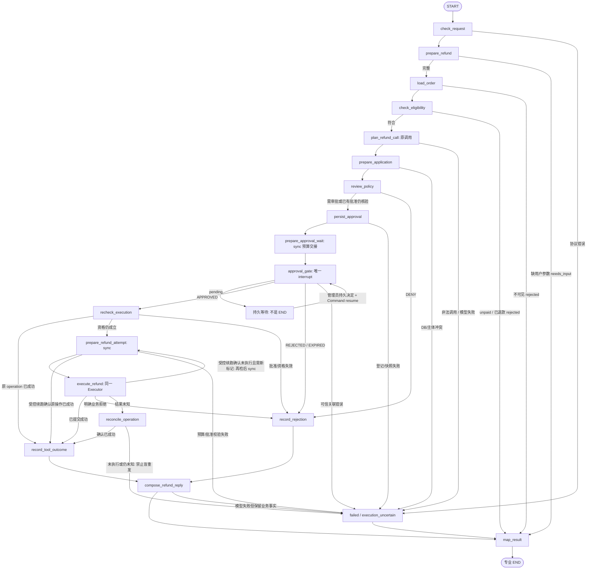
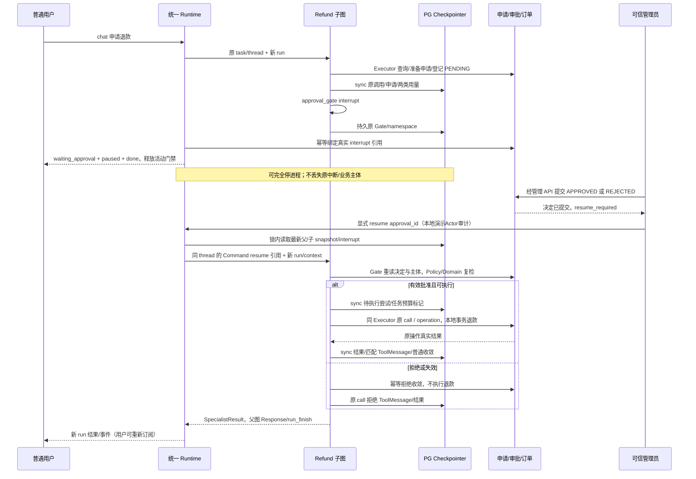

# 04 HITL、Checkpoint 与 RefundAgent：完整详细设计

状态为六阶段详细设计及第二轮定向修订已完成，四项技术决策现已确认或明确延期，当前等待最终设计冻结。所有Task尚未获得开发授权，实际环境验证留实施阶段。

初版日期为2026-11-08，最近修订日期为2026-11-09。依据：[项目定位](agent-engine-demo-plan.md)、[六阶段路线图](development-roadmap.md)、已批准的 [01](01-foundation-detailed-design.md)、[02](02-agent-runtime-detailed-design.md)、[03](03-tool-governance-detailed-design.md) 设计。Graph旧协议作迁移参考。

历史轮次说明（保留追溯，当前状态以页首和末尾最新记录为准）。本轮只新增本设计并更新路线图/README 的设计状态与导航；定向阅读权威文档、官方 API 说明和本地依赖接口源码，不检查 Git/开发进度或扫描全仓。未修改业务代码、依赖、配置、迁移 SQL 或数据库，未运行测试、代码检查、容器、迁移或模型联调。下文所有数据、接口和验收均为未来方案。01–06 全部详细设计完成并审核后才统一开发。

## 1. 阶段目标、架构与任务边界

实现真实本地模拟业务的完整路径：用户申请 → Supervisor → Refund 子图查询/资格 → 原生退款 ToolCall → 幂等申请 → Policy 要求审批 → 持久 interrupt → 独立管理员决定 → Runtime 同门禁恢复原图 → Policy/Domain 再检 → 同一 Executor 执行原调用 → 原 call 的 ToolMessage → 最终结果。

| 二级环节 | 原路线图三级 Task（名称/数量不变） | 交付 |
| --- | --- | --- |
| 4.1 持久Checkpoint与恢复入口 | 4.1.1 PG Saver装配；4.1.2 安全Resume入口 | PG Saver、嵌套快照、统一 Runtime 恢复 |
| 4.2 模拟退款和可信审批记录 | 4.2.1 模拟退款事实；4.2.2 审批存取与身份 | 最小退款/审批表、事务幂等、本地审批审计Actor接入 |
| 4.3 RefundAgent与原调用恢复 | 4.3.1 RefundAgent中断链；4.3.2 重启及重放验收 | 目标子图接线、原调用闭合、完整重启/故障验证方案 |

```text
普通 Chat → 既有 Service/Runtime → Supervisor → RefundAgent
    只读事实/准备工具 → 同一 Registry / Policy / Executor → MockRefundService
    原生 refund_order call → 申请/审批登记 → 持久 Gate
                                                    ↓
本地演示审批入口与服务端审计Actor → 审批决定先提交业务库 → 显式 resume 管理请求
    → 原 Runtime/thread 门禁 → 最新父子快照 → Command(resume=审批引用)
    → 原 Gate 读取可信记录 → Policy/Domain 重检 → 原 call / operation
    → 模拟业务事务 → ToolMessage → 主图 Response / run_finish

同一个 PostgreSQL：sessions / demo_orders / refund_requests / approvals
                 + LangGraph 自管 Checkpoint 表（独立提交，不共享全局事务）
```

保留单 FastAPI、单 worker、串行模型/工具调用、逻辑 task 累计预算。无真实支付、退款渠道、账本、补偿平台、Redis、消息队列、分布式锁/调度、完整管理员体系或通用 WorkflowRepository；Knowledge/RAG/Store 仍留 05。使用真实 PG Saver 后，04 演示模式不静默降级到 InMemorySaver。

## 2. LangGraph API 依据与持久化选择

### 2.1 已定向核对的语义与实施前检查点

官方说明指出，interrupt 会保存等待点，恢复会重进所在节点；通过 wrapper 调子图时父 wrapper 也可能重进。故模型、准备写、Gate、实际退款必须分开，不能捕获中断后继续普通返回。相关依据：[Interrupts](https://docs.langchain.com/oss/python/langgraph/interrupts)。

本方案选择 `durability="sync"`，要求前一步快照写入完成后再进入下一步；该选项不把业务事务并入 Saver。依据：[Checkpointers 的 durability modes](https://docs.langchain.com/oss/python/langgraph/checkpointers)。

子图继承父 Saver，并使用框架生成的嵌套 namespace，不以 workflow 另建 thread；每次专业调用有自己的嵌套执行空间，正在中断的原调用在原空间恢复。依据：[Subgraphs](https://docs.langchain.com/oss/python/langgraph/use-subgraphs)。缺少业务应答或快照不能被解释为副作用没发生，依据：[Fault tolerance](https://docs.langchain.com/oss/python/langgraph/fault-tolerance)。

本轮静态本地源码可见：`AsyncPostgresSaver(conn)`、`await setup()`；`ainvoke(..., context=..., durability=...)`；`aget_state(config, subgraphs=True)`；StateSnapshot.values/next/tasks/interrupts，PregelTask.state/interrupts/error，以及 Interrupt.id。使用当前 `.id`，不依赖已弃用的 interrupt_id 属性或旧版 Interrupt.ns。

StateSnapshot.tasks 中 PregelTask.id 是框架调度标识，不是本项目逻辑 task_id。逻辑任务关联从可信 State/context 核对；递归 child 的 task.state 若是 StateSnapshot 则读取它，若是框架提供的子配置则通过 Saver/图的状态接口读取，不能用客户端 namespace 猜测或把调度 ID 当业务任务。解析结果应包含有效 RefundState、节点 next、未答复 interrupt.id 及实际 child config，无法唯一解析即拒绝恢复。

这些是接口/文档核对，不是运行验证。4.1.1/4.3.2 必须用实际安装版本验证：

1. AsyncPostgresSaver 池参数/事务选项与 setup 所需资源，框架自管迁移版本。
2. 根图 sync 能否按预期覆盖 wrapper 内子图、关键步骤间确实等待落盘。
3. 子图默认继承 Saver 的 per-invocation namespace、父 wrapper 的重入和原 namespace 定位。
4. 父 `Command(resume={interrupt.id: reference})` 如何传播到原 child，如何在 wrapper 重入时使用已有子图输入/快照而非普通新 State。
5. resume 时新 RunExecutionContext 向子图传播、当前 run_id 的有效映射。
6. latest StateSnapshot 与历史 snapshot 中 interrupts 的差别，不能拿已答复历史中断当当前等待点。
7. Gate 后故障的根/子图实际续跑调用形式、next=execute_refund 时节点确实可能重进，以及当前 refund_recovery 能在副作用前到达该节点；不能以 ainvoke(None) 会自动跳过该节点代替验证。

若版本表现与预期不同，先修正最小适配并记录，不升级全部依赖、复制 LangGraph 引擎或跳过这些真实验收。

### 2.2 Saver、池、setup 与生命周期

保留 01 业务池，新增同一开发/测试 DSN 对应的独立小型 checkpoint 池，避免 Saver 的 autocommit 与业务事务混用：`AsyncConnectionPool(open=False, min_size=1, max_size=5, kwargs={autocommit: True, row_factory: dict_row, prepare_threshold: 0})`。具体驱动参数以安装版本落地；不创建独立数据库服务。

显式初始化入口为未来 `python -m scripts.setup_checkpoint --target development|test`，用同一目标数据库和 Saver 自带 `await setup()`。不复制 Saver 的建表 SQL/版本表进应用 migrations，不在每次 HTTP 或普通启动自动 setup。setup 可能包含非事务性索引操作，不能假设与应用编号迁移同一事务。

lifespan：打开业务池并核对应用版本 → 打开 checkpoint 池/核对框架 setup 版本 → 创建 Saver → 构建三专业/主图 → Runtime/Service。shutdown 先关闭 Runtime 受理并清理活动执行，后关 Saver 使用的池与业务/模型资源。初始化失败关闭已开资源，HTTP 可存活但 Agent 未就绪；禁止 fallback 内存或在恢复请求中自动建表。

根图 `compile(checkpointer=saver)`；专业图不创建独立 Saver，保持库支持的继承方式（默认 per-invocation），不用 checkpointer=False 关闭持久化，也不随意改成跨所有任务累积私有消息的永久 child thread。父 node 名/子图调用顺序稳定，每次只调用一个专业子图一次；不手工构造动态 namespace 或在未结任务部署时改节点名。

04 无内存旧快照导入承诺：前三阶段是开发模式，不能把丢失的内存历史描述为已迁移。05 Store 的 setup/资源仍独立，不借 Checkpoint 表保存长期记忆。

## 3. 标识、业务规则与三类状态

### 3.1 标识与原调用身份

task_id/workflow_id/user/conversation/thread 在同一退款目标的澄清、等待、恢复中稳定；每次主动推进生成新 run_id。application_id、operation_id、approval_id 在首次原调用确定时生成并保持；建议从 task_id、原 call_id、tool/version 派生稳定 UUID，业务表唯一约束仍是最终幂等边界，不只依赖生成算法。

原 `refund_order` ToolCall 的 name/version/call_id/raw_args/canonical_args 不随恢复变化。AIMessage.id 与原 tool_calls 整体保存在私有快照；业务申请另存调用快照用于对照。run_id 只记录本次执行关联，不属于需要匹配旧 run 的审批授权条件。

### 3.2 V1 模拟退款规则

本人、paid、尚未退款才可申请；只做全额模拟退款，amount/currency 从锁内订单事实计算，不接受模型或客户端金额、收款对象、批准标记。03 已退款样本按真实标记拒绝。申请创建与执行前都重新核对；检查通过不表示已经退款。

同 operation 已成功时先返回原操作事实，不因当前 is_refunded=true 把自己的重放误拒为第二次退款。不同 operation 遇已退款则拒绝，不能据另一次批准重复执行。

### 3.3 状态不混用

| 状态源 | 最小状态 | 权威与说明 |
| --- | --- | --- |
| Task/Run | 沿 02 running、needs_input、waiting_approval、completed/rejected/failed 等 | 当前执行/目标；等待不能伪装 needs_input 或 END 完成 |
| approvals.decision | PENDING、APPROVED、REJECTED、EXPIRED | 持久审批事实，非退款成功；只允许 PENDING 向一个终态转换 |
| refund_requests.status | PENDING、SUCCEEDED、REJECTED | 业务申请/操作事实；没有“客户端超时所以数据库 UNKNOWN”这种推断状态 |
| 执行结果未知 | Runtime execution_uncertain / effect_status=unknown | 是观察者不能确认结果，先读业务记录核对；不能直接写假 SUCCEEDED 或盲重发 |

APPROVED/REJECTED/EXPIRED一旦落库不覆盖。PENDING到EXPIRED仅在POST decision/resume的短事务内按数据库当前时间惰性转换，GET列表/详情保持只读，查询时可派生expired有效性而不改decision。APPROVED到期保留原决定/审核者/决定时间，失去新副作用授权。已成功operation只查询/复用原结果，后续审批过期不产生第二次退款。

审批有效期正式为30分钟，expires_at=approvals.created_at+30 minutes，使用数据库当前时间判断，等待不消耗主动运行预算。过期没有自动退款/自动同意：管理员可发受控 resume 进行失效收敛（仅拒绝闭合，不得执行），避免永久挂住 session；不是普通聊天解除等待。APPROVED 的有效性与“已经成功”的事实分别判断。

## 4. 最小数据库、约束与事务

### 4.1 两张必要业务表

复用 sessions/demo_orders；新增 refund_requests 与 approvals，不另建退款操作表、通用 workflow/run 表或工具幂等平台。退款执行结果直接保存在 refund_requests。

| refund_requests 字段 | 类型/约束与语义 |
| --- | --- |
| application_id | uuid PK |
| operation_id | uuid NOT NULL UNIQUE，跨恢复稳定 |
| user_id、conversation_id、thread_id、task_id、workflow_id | text/uuid 关联，非空；session 组合 FK(user_id,conversation_id)，服务同时验证已存 thread |
| order_id | text，订单归属复合 FK(order_id,user_id)；04 给 demo_orders 增加所需 UNIQUE(order_id,owner_id) |
| call_id、tool_name、tool_version | text NOT NULL，原生退款调用标识 |
| raw_args、canonical_args | jsonb object，原参数/一次规范化参数分别保存，不接受客户端改写 |
| args_digest | text NOT NULL，服务端规范序列化 SHA-256，必须同时比内容，不只比 hash |
| amount、currency | numeric(12,2)>0 / 三位币种；锁内订单金额快照，非模型金额 |
| status | PENDING/SUCCEEDED/REJECTED，默认 PENDING |
| rejection_code | 安全 code，可空；REJECTED 时有值 |
| execution_result、executed_at | jsonb / timestamptz，可空；SUCCEEDED 时必须存在，与 amount/currency/order/operation 一致 |
| created_at | timestamptz NOT NULL |
| 任务/调用唯一键 | UNIQUE(user_id,task_id)、UNIQUE(thread_id,task_id,call_id)，V1 一个逻辑退款目标只有一个原高风险调用 |

追加部分唯一索引 `UNIQUE(order_id) WHERE status='SUCCEEDED'`，防止同一订单产生两个已提交成功申请；与订单行锁/is_refunded 标记共同保证模拟效果。PENDING 不全局锁死订单，允许另一会话登记同订单申请，但只有一项可最终成功。

| approvals 字段 | 类型/约束与语义 |
| --- | --- |
| approval_id | uuid PK |
| application_id | uuid NOT NULL UNIQUE FK refund_requests，V1 一申请一审批 |
| subject_snapshot、subject_digest | jsonb object / SHA-256；绑定下列主体，不接受客户端定义主体 |
| decision | PENDING/APPROVED/REJECTED/EXPIRED |
| approver_id、decided_at | text / timestamptz；PENDING 为空，人工决定记录服务端provider提供的本地演示审计Actor；EXPIRED 记录服务端失效处理来源 |
| expires_at、created_at | timestamptz NOT NULL，使用 DB/服务端 UTC 时间 |
| interrupt_id、checkpoint_ns、checkpoint_id | text 可空，三项同时空或同时存在；Runtime 从真实已落盘中断绑定，一旦绑定不换成无关中断 |

subject_snapshot 包含 application_id/operation_id、user/conversation/thread/task/workflow、call_id/name/version、canonical_args 及 args_digest、amount/currency。金额使用固定小数字符串，规范 JSON 使用固定键序/编码；原始 AIMessage 只存 Checkpoint，不在业务表重复保存全部聊天。主体登记后不可修改，管理决定只改 decision/审核者/时间；若要改目标/金额/参数必须新任务/新原调用/新审批。

task_id为唯一权威，workflow_id为同值兼容别名。refund_requests两个字段均非空且同类型，规划CHECK(workflow_id = task_id)。approvals仅在subject_snapshot保留二者时，规划CHECK要求两个键存在且其字符串值相等；若后续选择显式列存储，也须同样非空相等约束。ApprovalRepository/RefundRepository在登记、冲突复用、读取映射及恢复核验时检查subject中两个值与原申请/Task一致，不能单独生成workflow_id或维护其生命周期。本节仅约束设计，未创建迁移SQL。

Checkpoint 表由框架管理，不对其内部结构加业务 FK；approvals 保存 checkpoint 引用用于核验，不代表两套表在同一事务。checkpoint_id 是首次绑定的审计定位，不把旧历史 ID 当本次强制执行分支；恢复永远重新读取最新状态。

### 4.2 迁移与初始化规划

未来下一编号 `migrations/003_refund_approvals.sql`（若前序编号变动用下一个未占号）：增加订单复合唯一约束、新建两表/FK/CHECK/索引。approvals 的 PENDING 与 reviewer 空值、SUCCEEDED 与结果/时间等关系用 CHECK 保留；runtime 不自动建表。不创建本文件以外的实际 SQL。

Saver setup 使用第 2 节单独脚本。演示复用 03 五条订单，不自动清除已有退款标记、不添加业务支付种子；测试用独立测试库和本用例订单，不能“重跑种子”当还原已执行订单。

### 4.3 申请与审批登记事务

prepare_application 通过统一 node-origin 工具入口调用 MockRefundService：按可信 owner 锁定订单，检查 paid/未退款并取金额；以稳定 operation/application 与原调用快照 INSERT PENDING，冲突时先取已有申请并逐项核对，完全一致则复用，不一致拒绝。此事务不能更新订单 is_refunded 或执行结果。

persist_approval 是 review_policy 之后的必要拆分节点：通过受控登记工具插入审批主体/TTL，application_id UNIQUE 保证重放复用；已有主体不一致拒绝，已有决定不被重置 PENDING。登记完成的 State 更新同步保存后才进入预算交接与 Gate。

审批决定 API 用 approvals 行锁，在事务中读取当前决定/主体/有效期；同决定+同主体返回原审核者/时间，不重写；相反决定 409。主体摘要不匹配/过期/不可用状态拒绝。决定提交与 Runtime resume 完全分开，不让 DB 事务跨越模型执行或等待管理员。

### 4.4 退款执行原子事务

`MockRefundService.execute_original(...)` 由 refund_order 的真实 handler 调用，输入是 typed order_id 与最小可信 operation 关联，不接受批准布尔值。

所有准备/关闭/执行按固定顺序锁订单 → refund_requests → approvals（管理决定只锁 approvals，事务内不反向请求订单锁）：

1. 按原 operation 查询定位申请，核对 user/task/order/call digest/approval 关联；取得订单与申请/审批行锁后重新读取。
2. 若该 operation 已 SUCCEEDED 且主体匹配，返回已存结果；这是结果复用，不再次 UPDATE，不要求订单恢复为未退款。
3. 若尚未成功，必须审批 APPROVED 且未过期、参数/申请/金额/币种一致、owner 正确、paid、is_refunded=false；否则明确业务拒绝，不更新订单退款标记。
4. 同一事务更新 `demo_orders.is_refunded=true`，并把该 refund_requests 置 SUCCEEDED、写执行结果/DB 时间。两项一起 commit 或 rollback。
5. 因另一个 operation 已退款则该申请拒绝，不覆盖别人成功；部分唯一约束是最后防线。

同 operation 并发被行锁串行化；不同 operation 的同订单也由订单锁和成功唯一索引约束。结果未知时先等待/获取原操作行锁后读取已提交事实，不能在另一个事务仍未确定时贸然判“没执行”。无外部支付，所以本地这两行的状态变更可由单事务保证；这不等于 Graph/Checkpoint/审批 API 全链路 Exactly Once。

## 5. 工具、Policy 与最小业务上下文

### 5.1 Refund 工具范围

全部实际业务工具仍走 03 的同一 Registry/Policy/Executor。Refund 的模型仅绑定 `refund_order`；订单读取和准备/收敛是程序确定的 node-origin 调用，不伪造模型 AIMessage。

| 工具 | 调用方/范围 | 风险/审批/副作用/重试 |
| --- | --- | --- |
| get_order | load_order，复用 03；固定当前 order_id | 03 只读低风险，orders:read |
| check_refund_eligibility | check_eligibility/recheck_execution，REFUND node-only | 只读低风险，refunds:request；返回服务规则/同 operation 结果 |
| prepare_refund_application | prepare_application，REFUND node-only | 准备写、低风险、无需审批、operation 幂等、0 自动重试；不退款 |
| register_refund_approval | persist_approval，REFUND node-only | 只登记 PENDING 主体，不作批准；低风险准备写、幂等、0 重试 |
| refund_order | 唯一模型原生待审批调用，execute_refund 执行其原记录 | high、approval_required、业务副作用、operation 幂等、0 自动重试 |
| close_refund_application | record_rejection，REFUND node-only | 只拒绝/关闭申请，不退款；受控幂等写、0 重试 |

ToolMetadata采用03冻结字段，调用来源约束统一放同ToolPolicy，依据可信task_type/agent_type/origin/node_name/allowed_tools及参数约束判断。准备/收敛工具限定node入口与对应退款节点，模型绑定只取其合法任务工具。refund_order 的原生调用始终保持 origin=model，等待/恢复不能把它改成 node 来绕过原曝光/任务范围；deterministic 执行节点只是推进该原调用。该字段不是新权限框架，每次 node 工具仍校验可信普通 scope、任务允许名称/参数、预算；不计数的只有 Policy/审批核验等控制面判断，不是业务 handler。

node-origin 结果保存 facts/call_records，不向 LLM 私有消息插入没有对应 AIMessage 的 ToolMessage。原生 refund_order 才按原 tool_call_id 闭合。管理 API 的审批记录读写与 Runtime 对中断/业务结果的受控核对属于管理/执行控制面，不是新增模型业务工具或专业旁路执行退款。

```python
class RefundOrderArgs(BaseModel):
    # extra=forbid，无 user_id、金额、approved、operation_id
    order_id: str

@dataclass(frozen=True, slots=True)
class RefundBusinessContext(BusinessExecutionContext):
    conversation_id: str
    thread_id: str
    workflow_id: str
    operation_id: str
    application_id: str
    approval_id: str | None
    expected_call_digest: str
```

额外字段都是 04 持久业务关联所必需的可信值，由 Executor 从原任务/调用关联投影；handler 不接完整 ToolExecutionContext、RunScope、RunLimits、Policy 对象/权限集合、管理凭据或 approved 标记。原生调用尚未产生前，load_order/初次资格检查只接 03 的基础 BusinessExecutionContext，不要求不存在的 operation/application；原调用确定后的准备/执行才使用 RefundBusinessContext。expected_call_digest 绑定原 call_id/name/version/canonical args，区别于仅参数的 args_digest，服务端从申请字段重算比对。执行 handler 在事务中再读审批/申请，不仅相信某个 approval_id。

### 5.2 同一 Policy 的审批扩展

按 03 第 4.4 节：Executor 新增实际使用的内部审批核验适配（注入具体 ApprovalService/小的异步读取函数即可，无抽象认证框架），从原调用/operation 读取持久事实，再传给同一纯 ToolPolicy；Policy 自己不查 DB。

```python
@dataclass(frozen=True, slots=True)
class ApprovalReference:
    approval_id: str  # resume 仅携带引用，不携带客户端批准结果

@dataclass(frozen=True, slots=True)
class VerifiedApproval:
    approval_id: str
    application_id: str
    operation_id: str
    subject_digest: str
    # user/conversation/thread/task/workflow、call/name/version、canonical_args、金额/币种
    subject: ApprovalSubject
    approver_id: str
    decided_at: datetime
    expires_at: datetime
```

VerifiedApproval 只在服务器从可信记录核验后构造，非请求 Schema、不存成通用 Graph 放行 token。核对主体内容与摘要、原 namespace/interrupt、当前 session/task、原 name/version/canonical args/operation、真实 APPROVED 和有效期。new run_id 可变，任务与调用不能变。

同一 Policy 仍先查启用/Agent/origin/scope/任务范围/Schema/参数和剩余预算：失败 DENY；尚无有效决定 REQUIRE_APPROVAL；记录拒绝/失效/不匹配 DENY；全部通过且 VerifiedApproval 匹配原调用，才 ALLOW。approval_required 元数据不修改，有批准也不能越权或透支。执行前 Executor 再读当前可信事实，Domain 事务再次核验，不复用一个很早以前 Gate 的一般放行状态。

```python
class ToolPolicy:
    def evaluate(self, *, call, definition, context: ToolExecutionContext,
                 usage: RunUsage, remaining_active_seconds: float,
                 verified_approval: VerifiedApproval | None = None) -> PolicyEvaluation: ...

class ToolExecutor:
    async def assess(self, call, *, context: ToolExecutionContext) -> PolicyEvaluation: ...
    async def prepare_attempt(self, call, *,
                              context: ToolExecutionContext,
                              execution_context: ToolExecutionContext | None = None,
                              business_context: BusinessExecutionContext | None = None
                              ) -> PreparedToolAttempt | ToolExecutionResult: ...
    async def execute_prepared(self, attempt: PreparedToolAttempt, *,
                               context: ToolExecutionContext) -> ToolExecutionResult: ...
```

Executor 通过已注入的可信审批核验函数取得 VerifiedApproval，不接受客户端构造它；初次 assess 无有效批准则 REQUIRE_APPROVAL。prepare_attempt 仅在当前 ALLOW 时产生标记，否则返回既有明确拒绝/错误路径；execute_prepared 要重新校验标记与当前 Policy，不因持有标记自动执行。原 execute/execute_batch 继续服务普通工具，共享内部路径而不是第二执行器。

接口正式汇总见D03第5.1节。可选execution_context/business_context只补齐05节点跨准备/执行及最小业务关联绑定，普通退款调用省略，原审批与原生call机制不变。准备拒绝返回零尝试ToolExecutionResult，成功才返回PreparedToolAttempt；只有后者可保存后执行。node来源固定准备/目标配对沿D05白名单，最终执行节点仍须重新通过同Policy。

本阶段退款prepare_attempt仍要求真实有效审批。Memory的低风险写按自身approval_required=false走同一Policy，不制造VerifiedApproval。业务结果/未知异常沿D03通用执行分类，Memory四态映射由D05负责，不改变退款事务及恢复事实核对。

### 5.3 在真实 Gate 前拦截，不产生假终结消息

新增 `ToolExecutor.assess(call, context) -> PolicyEvaluation`，与 execute 共享解析/Registry/Policy，只做评估、不计 handler 尝试或执行写操作。review_policy 使用它得到 REQUIRE_APPROVAL，然后登记审批并进入 Gate；不能先调用 03 的 execute 把 approval_not_available ToolMessage 写入，再声称恢复同一次调用。

03 其他未接审批的调用仍按其安全阻断行为，Refund 只在真实准备/Gate 接线后使用这个路径。approval_gate 可信拒绝后生成原调用的拒绝 ToolMessage；可信批准后先 recheck，再经同一 Executor 执行，成功/业务拒绝/明确失败才闭合原调用。

### 5.4 单个原生高风险调用与多调用兼容

V1 plan_refund_call 只能产生一条 AIMessage、恰好一个 name=refund_order 的原生 ToolCall。拒绝同消息多个高风险/混合工具调用或重复/缺 ID，整条输出不执行任何 call、不建申请；不把其中一个抽出来审批、忽略其他 call。模型失败仍计 task 尝试数。

模型输出通过结构校验后，保存原 AIMessage 和 ParsedToolCall，并由注册 Schema 一次规范化；原 raw_args 不改写，canonical_args/digest 另存，ToolMessage ID 仍 `tool:{task_id}:{call_id}`。业务准备读写发生在确定性节点，不追加虚假的模型调用消息。03 的其他 Agent 多 ToolCall 串行/每 call 配对保持原规则；等待前已完成的读取/准备节点不会因原 Gate 恢复而自动重执行。

## 6. Checkpoint、Gate 与预算交接

### 6.1 必要节点拆分与同步边界

保持 02 的业务顺序，额外拆出 `persist_approval`、`prepare_approval_wait`、`prepare_refund_attempt`，以及结果未知时的 `reconcile_operation`。这是同一 Task/子图内部安全步骤，不增加路线图 Task 或第二 Runtime。

| 已完成节点 / sync 快照 | 必须保存 | 后继才能做什么 |
| --- | --- | --- |
| plan_refund_call | 原 AIMessage/调用/规范参数、稳定操作关联、模型用量 | prepare_application 登记申请，不再生成退款调用 |
| prepare_application | application/operation/金额快照、准备工具计数 | review_policy/persist_approval |
| persist_approval | approval 引用、固定主体、计数 | prepare_approval_wait |
| prepare_approval_wait | waiting 交接、原 call、两类任务累计用量，冻结本 Run 主动区间 | approval_gate 唯一 interrupt |
| approval_gate 已恢复返回 | 可信引用/决定与当前有效上下文，不是凭据 | recheck_execution，不执行模型计划节点 |
| prepare_refund_attempt | 本次待执行调用、审批/operation 关联、尝试记账标记与预算基线 | execute_refund 发起真实 handler |
| execute_refund | 原操作结果/执行记录、最新计数 | record_tool_outcome；快照失败走受控核对，不盲重发 |

sync 只串行保证这些 Graph 边界，不能回滚已经提交的申请/审批/退款业务事务。每个节点只有必要外部调用，不用“模型+Gate+写 SQL”一个大节点。

### 6.2 Gate 固定调用次序

prepare_approval_wait 调本次 RunScope 的暂停交接方法（复用同一计时对象），返回 State 的 task 等待语义和累计用量，然后同步落盘。Gate 自身不在 interrupt 前生成模型调用、随机 ID 或实际退款，也不能靠在 Gate 内原地修改 state 后 interrupt 来保存计数。

approval_gate 每次进入都执行同一个、无条件位置的 interrupt，第一次即使管理员决定已很早写入也不跳过该位置。resume 得到的只是 ApprovalReference；随后按持久记录核验，不信任其值为批准。Gate 不包宽泛异常处理，不捕获 LangGraph 中断并伪返 result。

```python
# 控制流示意，不是本轮实现
reference = interrupt({
    'kind': 'refund_approval',
    'approval_id': saved.approval_id,
    'application_id': saved.application_id,
    'operation_id': saved.operation_id,
    'subject_digest': saved.subject_digest,
})
# interrupt 返回只发生于真实恢复；这里从可信数据库读取并检查 reference 和原主体。
# 批准 → recheck_execution；拒绝/过期 → record_rejection；不匹配/读失败 → 安全失败。
```

真实等待无 SpecialistResult，不经过专业 map_result/主 Response/run_finish。Runtime 从最新嵌套快照解释 task=waiting_approval；父 root 中 task_status 可能仍是 wrapper 前的 running，应读取匹配的有效 child 状态/interrupt，而不在图外更新 root 来“修正”等待。

暂停交接之后的最终 Gate/快照落盘为交接开销；用户/审批等待不计主动时间。恢复创建新 RunScope，从任务快照继承 ModelCallUsage/RunUsage，再开始本次主动区间；原 scope 不跨进程序列化。普通结束依旧只由图内 run_finish 最终结算，END 后无第二次常规 update_state。

### 6.3 真实中断与审批记录绑定

框架 Interrupt.id 只有真实中断产生后才能取得，因此审批登记时 interrupt_id/ns/checkpoint_id 可空，不能提前猜 UUID。

Runtime 在图以中断返回且 sync 快照可读取后，`aget_state(root_config, subgraphs=True)` 检查：只有一个预期 refund approval_gate 的未答复 interrupt、当前 task/owner/session 相同、payload 中 approval/application/operation/digest 与业务主体相同；读取实际 child config.checkpoint_ns 和对应 checkpoint ID。

然后通过 ApprovalService 将 approvals 的空绑定原子填为该真实 interrupt/ns/checkpoint；已有完全相同绑定复用，不同绑定拒绝。此绑定写失败时不发“审批已可恢复”的成功事件：保留真实中断，返回 pause_binding_unavailable。后续由本地演示操作者显式调用第 8.2 节 `repair-binding`，按第 9.6 节在原 Runtime 门禁下重读真实快照并幂等补绑定；不重新创建申请、重新运行退款请求或以普通输入重跑图。

管理员在绑定未完成时看到待登记/不可决定状态，提交决定返回 409 approval_not_ready。绑定完成后决定可先提交；若 Runtime 旧 Run 尚在收敛，新 resume 返回暂忙但决定不丢失，可信管理端稍后显式重试。

### 6.4 执行尝试标记与恢复计数

03 的 execute 将检查/计数/handler 放在一个入口，04 为副作用增加同一 Executor 的两步适配：`prepare_attempt` 只完成 Policy 与已核验审批、创建本 call 的 PreparedToolAttempt；其标记和用量基线由 prepare_refund_attempt 节点同步落盘，之后 `execute_prepared` 才发起 handler。两方法复用同一 Policy/尝试路径，不能成为 skip_policy。

PreparedToolAttempt 是单 Run 串行的一条调用标记，含 attempt_id、创建该标记的 run_id、task/call/tool/version/args_digest/operation、基线 tool_calls 和本尝试后的计数、单次主动时间上限；不带 handler/RunScope/批准布尔值，不是并发预算预留服务。execute_prepared 重新验证当前可信审批、范围、余额/该标记归属，真正开始时按这条标记增加一次工具尝试；同一个标记不能换 call 或重复触发新效果。

标记还须能恢复原ParsedToolCall及规范参数，不能只存摘要并依赖进程内缓存。node来源保存prepared_by_node_name/execution_node_name及已核验最小业务关联快照，Memory包含op/digest/expected_revision/只核对模式；与原命令同次sync，执行用当前可信上下文重新投影，不携带客户端批准或权限对象。model来源的两个node字段为空，退款仍用原申请/审批关联并在执行前复检。这是同一标记的数据契约补齐，不新增持久表或恢复平台。

成功路径只计一次真实尝试；恢复时若无法证明该标记尚未开始，继承计数至少取“基线/标记中的可能已开始计数”的较大值，保守视为已消耗，usage_complete=false，不把不确定尝试归零。先核对 operation：成功复用结果、退款写副作用尝试为零；确认未执行且需要再次实际尝试，必须新标记/再次消耗预算，不能利用旧标记获得无限免费重试。

主动时长继承最后确定快照；对执行到业务已成功但结果快照丢失的有限窗口，按已保存单次尝试上限保守追加而非记零，并标明是保守核算、非精确观测。若不能给该未落盘执行窗口确定可信上界，则只允许查询/纯结果复用，不再发模型或业务副作用，标预算需核对；不能声称崩溃期间的时钟/Token 被精确持久。这里不改变逻辑 Task 累计上限或引入生产成本账本。

## 7. RefundState 与完整 Node 契约

### 7.1 State 字段与生命周期

共享 request、messages、selected_tools、outcome/error/result、model_call_usage/run_usage 沿 02/03。两类 Usage 始终属于 task_id；消息专用 Reducer、其他快照覆盖，不用加法重放计数。

| Refund 专属字段 | 写入方 | 清理/跨 Run 规则 |
| --- | --- | --- |
| refund_input | prepare_refund | 仅目标 order_id 等用户候选；缺参续接沿 PendingTask，不含金额/批准 |
| order_facts / eligibility | load_order / check_eligibility | 可信读取快照；批准后重检，不能把旧资格当当前执行授权 |
| original_ai_message / pending_refund_call | plan_refund_call | 原 AIMessage、call/id/name/version/raw/canonical/digest；等待/恢复保持，不能重生成 |
| application_id / operation_id / amount / currency | prepare_application | 稳定申请与服务端金额；原调用/快照匹配，不允许用户覆盖 |
| approval_id / subject_digest | persist_approval | 等待/恢复固定；不存管理密钥或 VerifiedApproval 放行对象 |
| gate_state | approval_gate | pending/approved/rejected/expired 来自可信读取；pending 通过真实中断表达 |
| prepared_attempt | prepare_refund_attempt | 原调用唯一的一次待执行标记；进入受控核对时不偷偷清零 |
| execution_result / execution_uncertain | execute_refund / reconcile_operation，安全后段节点消费可信核对结果时 | 原 operation 的真实结果或未知分类；成功事实经节点返回增量随 sync 保存，无成功文本兜底；不由 Runtime 图外 update_state 注入 |
| call_records / tool_outcome | 工具执行/结果节点 | 原调用规范记录与标准结果，正常配对后闭合；真实恢复沿原 namespace |

普通新逻辑任务才新建初始 State；pending refund Gate 恢复不调用 create_turn_state/create_specialist_state。缺参时只回传允许实体/问题和任务用量，不复制私有工具历史；中断保留全部必要 child 状态。已完成专业结果只回传 SpecialistResult/可信用量，父 wrapper 不合并整个 RefundState。

### 7.2 节点职责、输入输出与控制流

下表“Executor”包括 node-origin 受控工具；“重放”指节点可能重进，绝不保证函数只运行一次。预期错误返回安全增量/分支，意外编程异常由 Runtime 收敛，不吞掉 interrupt。

| Node / 调用方 | 输入 → 增量输出 | 调用/条件边 | 拒绝/技术失败 | 重放、事务/Checkpoint |
| --- | --- | --- | --- | --- |
| check_request / 父 wrapper | 原 request + 当前 context → 关联验证 | 无外部调用；合法→prepare_refund | 错 Agent/task/身份/目标为协议失败 | 纯检查可重进，不改可信关联 |
| prepare_refund | goal/entities → refund_input 或缺参 | 无模型/业务调用；完整→load_order，缺参→map_result(needs_input) | 不支持请求 rejected；不把审批缺失当用户缺参 | 纯准备；只向父 PendingTask 回允许字段 |
| load_order | order_id/可信 owner → order_facts | Executor.get_order→check_eligibility | 不存在/非本人统一 rejected；DB失败 failed | 只读重进仍计实际尝试，结果同步保存 |
| check_eligibility | owner/order → eligibility/服务候选金额 | Executor 检查资格→plan_refund_call | unpaid/已退款 rejected；读故障 failed | 只读，无 Prompt 金额决策 |
| plan_refund_call | 事实+仅 refund_order Schema → 原 AIMessage/调用/操作关联 | Gateway；单合法 call→prepare_application | 缺/多/错调用或模型故障 failed | 模型节点不与 Gate 同体；sync 保存后不重生原 call |
| prepare_application | 原调用/可信业务关联 → app/op/amount | Executor 准备工具→review_policy | 状态改变 rejected，冲突主体/DB失败 failed | 幂等申请事务；sync 后继才继续；不退款 |
| review_policy | 原 call/申请/普通 scope → policy_decision | Executor.assess；REQUIRE_APPROVAL→persist_approval | DENY→record_rejection；ALLOW 也需核对已有可信审批，不可越 Gate | 纯 Policy/可信读取，无实际 handler 尝试 |
| persist_approval（拆分） | app/原主体 → approval_id/digest | Executor 登记工具→prepare_approval_wait | 主体冲突/DB故障 failed | 幂等登记事务；已有决定不重置，sync 保存 |
| prepare_approval_wait（拆分） | 两类累计用量/原调用/approval → waiting 交接快照 | 同 RunScope 暂停计时→approval_gate | 快照失败不得发可恢复等待成功 | 无业务副作用，sync 后 Gate；不以原地修改代替更新 |
| approval_gate | 固定 payload；恢复引用+可信持久记录 → gate_state | 无条件 interrupt；批准→recheck_execution，拒绝/过期→record_rejection | pending 为中断非失败；记录/关联错误安全失败 | 会重入；interrupt 前无模型/退款，保持唯一位置 |
| recheck_execution | 原批准/operation + 当前身份预算 → 新资格或已有原结果 | 先消费 9.4 可信核对，原 op 成功→record_tool_outcome；未成功才同 Policy + Executor 只读资格，仍合法→prepare_refund_attempt | 新资格失效→record_rejection；故障/预算不足 failed | 只读复检；既有成功优先核对，sync 更新 |
| prepare_refund_attempt（拆分） | 原 call/可信核验 → prepared_attempt/预算基线 | 先按 9.4 消费核对结果：已成功→record_tool_outcome；确认未执行且复检通过→同 Executor.prepare_attempt→execute_refund | 权限/批准/预算失效→拒绝或失败；未知禁止写 | 不调用退款 handler；恢复须创建区别于旧标记的新尝试并 sync，不复用可能已消耗的标记 |
| execute_refund | 原 call/标记/当次 context → 标准结果/不确定标记 | 重入先按 9.4 核对：成功→record_tool_outcome；确认未执行但无本次新标记→prepare_refund_attempt；新标记及全部再检通过才同 Executor.execute_prepared；未知→reconcile_operation | 不盲目自动重试写操作；不能因 next 指向本节点就直接调用 handler | 成功复用，退款写副作用尝试为零；Domain 本地事务幂等；结果 sync，失败窗口需核对 |
| reconcile_operation（拆分） | 原 op/申请/批准 → 已提交结果/确认未执行/仍未知 | 受控只读核对；成功→record_tool_outcome；无结果且需重试→保留人工受控恢复；未知→failed+uncertain | 查询失败不当没执行；不新建 operation | 读取当前已提交事实，原 task 阻塞普通聊天，不能自动循环 |
| record_tool_outcome | 已核验原操作事实 → 匹配原 call 的 ToolExecutionResult/ToolMessage | 无新副作用→compose_refund_reply | 错原 call/主体为协议失败 | 稳定消息 ID、Reducer 去重；复用结果不再次退款 |
| record_rejection | 可信拒绝/过期/不符 → 拒绝消息/申请关闭 | 有预算时 Executor 关闭申请，原 call 存在则配对 ToolMessage→compose_refund_reply；无原 call可直接map_result | 关闭失败/额度不足不准退款，保留审批/业务真实状态 | 关闭幂等，拒绝不得写订单已退款；不能为清理透支预算 |
| compose_refund_reply | 成功/拒绝 ToolMessage 与真实事实 → 候选摘要 | Gateway→map_result，不重新绑定退款工具生成新操作 | 模型/额度失败：安全 failed，但保留 business SUCCEEDED 事实 | 独立模型节点；失败不回滚已成功退款 |
| map_result | 允许结论/事实/引用 → SpecialistResult/用量 | END（专业正常出口） | failed 与 business outcome 分开 | 无 handler；主 run_finish 才普通结算；中断不进入 |

Gateway 拒绝后如因预算无法再生成回复，可用明确的固定安全说明结束失败/拒绝，不偷发新模型请求；真实业务 SUCCEEDED 不能被描述为“未退款”。completed/refund 结果必须有真实 facts、operation_id、approval_id。原拒绝的 ToolMessage 由服务记录构造而非执行退款 handler，因此“管理员拒绝时退款工具从未执行”成立。

### 7.3 完整 Mermaid 目标图



每个外部调用还遵守统一预期技术错误→failed/预算错误→failed，不为每一故障再建一套流程；sync 提交失败可直接使 Runtime 失败而不能继续后继。等待框是运行时控制结果，不是普通 workflow 节点。map_result 返回后才进父图映射/Response/run_finish，真实等待不会落到专业 END。execute_refund 回准备节点的边仅限第 9.4 节管理员显式受理的核对续跑；已有本 Run 新标记后不得再走该边形成自动写重试循环。

## 8. 可信管理身份与审批 API

### 8.1 本地审批审计Actor与未来认证边界

V1管理员认证正式延期，不实现admin_api_key、管理SecretStr、X-Admin-Key、hmac.compare_digest、固定demo-admin认证、账号/RBAC/SSO。审批列表、详情、批准、拒绝、原调用绑定及恢复能力全部保留。

只保留最小ApprovalActorProvider接入边界，API依赖由服务端取得审计Actor，再传给ApprovalService和原Runtime。普通DemoIdentity、客户端reviewer_id/approver_id、Header或模型输出均不能提供该Actor。

    @dataclass(frozen=True, slots=True)
    class ApprovalActor:
        approver_id: str

    class ApprovalActorProvider:
        def get_actor(self) -> ApprovalActor: ...

    class LocalDemoApprovalActor:
        def get_actor(self) -> ApprovalActor:
            # 固定本地演示审计来源，不证明操作者身份或权限。
            return ApprovalActor(approver_id='local-demo-approval')

以上仅为未来接口示意，LocalDemoApprovalActor是V1 provider具体适配。provider由lifespan按环境注入，Service只接ApprovalActor，不依赖密钥或认证实现。未来真实认证模块可在该依赖边界提供同一Actor，不改ApprovalService、审批状态机和退款规则。V1不提供管理scope、AdminContext或认证结果，Actor仅用于原approver_id字段的审计。

审批Router只用于development/test的本地回环演示，运行说明及Apifox使用127.0.0.1，不对外网、生产或反向代理开放。production不注册演示approvals Router，地址返回404，provider在该环境不创建本地Actor。不因允许演示用户而自动获得审批权，普通chat内容仍不能提交决定或恢复。直接访问本地审批API不要求认证，不能宣称其能鉴别或阻止其他本地调用者。

GET的can_decide/can_resume表示当前本地入口及业务状态能否执行操作，不代表已认证用户权限。决定仍须核对主体/原调用/真实中断绑定、有效期和状态，执行仍走同Policy/Executor及Domain。未来认证也不得替代这些校验。

### 8.2 API 契约与决定幂等

管理前缀建议 `/admin/approvals`。普通 chat/status/events 沿 02 的 JSON 演示身份方案，不因本阶段新增 user_id Header/Query。

GET列表每项和详情统一返回approval_id、subject_digest、decision、expires_at、binding_status、approval_validity、can_decide、can_resume。binding_status为unbound/bound，表示完整真实中断绑定是否存在。approval_validity为派生展示值valid/pending/expired/rejected，APPROVED未到期为valid，PENDING未到期为pending，到期的PENDING/APPROVED及EXPIRED为expired，REJECTED为rejected。它不持久化，不替代原decision或退款业务状态。APPROVED过期仍返回decision=APPROVED、approval_validity=expired。

can_decide仅在本地演示入口已启用、PENDING未到期且绑定完整时为true。can_resume需入口已启用、原主体/绑定/当前真实快照匹配、无活动执行且处于04允许的恢复路径，并且已有决定或PENDING已到期。PENDING未过期为false，PENDING已过期可为true，表示POST将先转EXPIRED再拒绝收敛。已成功结果可按原安全结果路径复用，过期批准仅可拒绝收敛/成功结果复用。字段是GET当前视图，POST必须重新检查，GET不得借计算标志修改记录。原Task已完成时can_resume=false，POST重复请求仍可200返回已有终态。

| API | 输入/身份 | 成功与错误语义 |
| --- | --- | --- |
| GET /admin/approvals?decision=PENDING | development/test本地入口，服务端审计Actor，固定上限列表 | 200 返回可审核主体摘要/金额/当前绑定与有效期；未绑定标不可决定，不泄露原聊天/密钥 |
| GET /admin/approvals/{approval_id} | ApprovalActor | 200 返回固定主体、规范参数/金额、当前决定/业务结果/恢复可用状态；不存在 404 |
| POST /admin/approvals/{approval_id}/decision | `{decision: APPROVED或REJECTED, subject_digest}`，严格 forbid 多余字段 | 200 持久化决定；相同决定/主体重交 200 返回原记录；相反决定/主体不匹配/未就绪 409 |
| POST /admin/approvals/{approval_id}/resume | 空body或{}，ApprovalActor | 202仅真实等待或Gate后安全推进的新Run；正常END为200 accepted=false、run_id=null及原持久结果；已活动返回既有状态不创建第二执行；未知/错关联/未到期PENDING/不安全位置409，不自动恢复 |
| POST /admin/approvals/{approval_id}/repair-binding | 严格空 body `{}`，服务端ApprovalActor，本地演示入口已启用 | 200 返回原 approval_id、binding_status=bound、repaired=true/false；不存在 404，活动执行/真实中断缺失或不唯一/主体或已有绑定冲突 409，Saver/业务库不可用 503。客户端不得提供 interrupt、namespace、checkpoint、调用参数或决定；不受理执行 Run |
| POST /agent/tasks/current | `{user_id, conversation_id}` | 200 由已验证 session 读取有效父/子 task 状态和业务摘要；无当前任务返回空 current_task，不能用客户端 thread 指定别人快照 |
| POST /agent/refunds/{application_id}/status | `{user_id, conversation_id}` | 200 本人且匹配会话申请/审批/真实模拟结果；其他人/不存在统一 404 |

管理决定的 subject_digest 仅用于防止审核界面所见主体已变化，服务器仍重新读取并逐项比主体；不能只信客户端 digest。APPROVED 不是允许管理员更改金额/order_id/参数，拒绝这些额外字段。已过期 PENDING 在服务端事务转 EXPIRED 并返回 409 approval_expired；已 APPROVED 超过期限不再允许新副作用，不重写为另一人工决定。

同决定+同主体重复提交先识别已有相同决定并返回原记录，200且原approver_id/decided_at/expires_at保持，即使该批准后来已过期。相反决定409，PENDING过期时才走上述EXPIRED转换。响应使用同一审批视图，重交决定不会使expired授权复活。

**决定与执行采用显式两步，不自动调度：** decision API 只提交审批事务，返回 `resume_required=true`；管理员随后显式调用 resume。决定提交后响应丢失，重交相同决定只返回原记录；不会自动退款。resume 请求在 Runtime 成功受理后才 202，HTTP 断开不取消其 asyncio.Task；受理前取消则没有执行任务，审批决定仍在库中，可重试。

这种分离不需要 outbox/消息队列或承诺“批准后系统一定自动运行”。批准/拒绝后都通过原 Gate 继续闭合原调用；过期也可由本地演示操作者触发只做拒绝收敛的 resume。待决定且未过期的审批不能 resume；普通聊天/用户接口不提交恢复命令。

接口归属固定为4.2.2提供ApprovalActorProvider/本地审计Actor、ApprovalRepository及list/detail/decision路由与Service。4.1.2提供原AgentRuntime.resume_approval/repair_approval_binding能力及对应路由/Service协调接线。共用现有管理Router、ApprovalService与同一Runtime，各Task只补自己负责的方法和入口。repair-binding保留为异常路径。

### 8.3 决定服务与最小业务接口

```python
class ApprovalService:
    async def register_pending(self, subject: ApprovalSubject) -> ApprovalRecord: ...
    async def bind_interrupt(self, approval_id: str,
                             binding: InterruptBinding) -> ApprovalRecord: ...
    async def decide(self, approval_id: str, *, actor: ApprovalActor,
                     decision: Literal['APPROVED', 'REJECTED'],
                     expected_subject_digest: str) -> ApprovalRecord: ...
    async def verify_for_call(self, reference: ApprovalReference, *,
                              original_call, context,
                              interrupt_binding) -> VerifiedApproval: ...

class MockRefundService:
    async def check_eligibility(self, *, context: BusinessExecutionContext | RefundBusinessContext,
                                order_id: str) -> RefundEligibility: ...
    async def prepare_application(self, *, context: RefundBusinessContext,
                                  original_call) -> RefundApplication: ...
    async def execute_original(self, *, context: RefundBusinessContext,
                               order_id: str) -> RefundExecutionFact: ...
    async def get_operation(self, *, user_id: str,
                             operation_id: str) -> RefundOperationView: ...
    async def reject_application(self, *, context: RefundBusinessContext,
                                  reason_code: str) -> RefundApplication: ...
```

verify_for_call 只有确认有效 APPROVED 才返回 VerifiedApproval；Gate 先读取绑定的 ApprovalRecord，REJECTED/EXPIRED 直接走拒绝收敛，只有批准分支调用该核验方法。过期/不匹配为明确结果/错误，不返回假的 approved=false 让 Policy 猜。审批存储失败安全中止，不 default ALLOW。register_pending 在 Graph 中仍经受控 node 工具调用；decide/bind 和当前状态查询是管理/执行控制面，不能发起实际退款。

Gate对APPROVED也先按expires_at派生有效性，已过期时gate_state=expired并走record_rejection，审批行decision仍保留APPROVED。这是现有专业执行分支的投影。若原operation已成功则按9.4先只读核对/复用成功事实，不用过期拒绝分支覆盖成功结果。

具体 ApprovalRepository/RefundRepository 使用同一 PG 池和明确事务方法，不创建抽象仓储接口/生命周期平台。Domain 事务可读取审批行事实，但不依赖 LLM、HTTP 或管理 Header；Actor只在API边界由服务端provider取得，V1无管理员认证。

## 9. Runtime 暂停、恢复与嵌套上下文

### 9.1 发现真实 waiting_approval

用户最初提交仍走 02 submit：可信 session→稳定 thread，按目标新建或澄清续接 task/workflow，创建当次 run。Refund wrapper 只在普通首次进入时从白名单构造专业初始 State。

Runtime 的 _execute 增加“中断结果”识别：先检查最新 StateSnapshot（含 subgraphs），不能仅凭图 result 中没有 final_answer 就报失败。只有可识别的真实 interrupt、原主体/节点/namespace/引用一致并完成 6.3 的绑定，才能公开 task/run=waiting_approval。多个/不认识中断、tasks.error、next 非空却无已知安全中断，均视为待核对，而非自动等待或完成。

确认中断后：结束本次 RunRecord，发 workflow_paused/status/done，释放 thread 活动执行锁；不进普通 run_finish、不补 root update_state、不创建完成的 SpecialistResult。永久约束来自持久中断/申请/审批，不靠那把内存锁一直占住。普通新输入、new_task、重试均重新检查最新快照/活跃申请，waiting/unknown 时 409，不能用新输入盖掉原 task。

### 9.2 统一恢复受理

```python
class AgentRuntime:
    async def resume_approval(self, reference: ApprovalReference, *,
                              actor: ApprovalActor) -> ResumeAcceptance: ...
    async def repair_approval_binding(self, reference: ApprovalReference, *,
                                       actor: ApprovalActor) -> BindingRepairResult: ...

@dataclass(frozen=True, slots=True)
class ResumeAcceptance:
    accepted: bool
    run_id: str | None
    task_id: str
    operation_id: str
    status: str
    result: SpecialistResult | None  # 正常END复用原Task持久结果，202受理时为空
```

Service 根据审批/申请记录解析真实 user/conversation/thread，不让管理请求任意提供执行目标。Runtime 复用原 thread 门禁/容量/RunRecord/asyncio.Task/结果查询，审计Actor不授予权限，Runtime只受理原审批关联的恢复，不能替换普通用户业务身份。

锁内先按最新真实快照和原业务事实分类。共享身份、session、thread门禁及原主体核验，当前pending interrupt只是真实等待分支的必要条件。

| 恢复情况 | 受理核验与动作 |
| --- | --- |
| 真实Interrupt等待 | 当前pending interrupt唯一且与原interrupt.id/thread/namespace/Gate/payload/主体及原调用绑定一致，核验决定后用Command(resume) |
| 已越过Gate但Graph未正常结束 | 不要求当前pending interrupt，核对原持久绑定、最新checkpoint/namespace/安全next及operation，按9.4受控核对和原图续跑，禁止伪造interrupt或盲发Command |
| Graph已正常结束 | 原Task及持久结果关联一致，直接返回已有结果，200 accepted=false、run_id=null，不创建新Run、不执行Graph或退款工具 |
| Checkpoint或业务事实无法确认 | 安全拒绝自动恢复，保留unknown/execution_uncertain，沿原业务核对或人工处理，不把读取失败当作未执行 |

锁内步骤如下。

1. 核对本地演示入口可用性、服务端Actor/session/原主体，从Saver读取最新父子快照并按上表分类，必要时只读核对原operation。已正常结束直接返回原持久结果，无法确认则拒绝自动推进，两者均不创建执行Run。
2. 仅对可推进的真实等待或Gate后安全路径，在thread门禁内进入审批受理短事务，锁行后取clock_timestamp，重查主体/绑定/决定/期限。PENDING到期原子转EXPIRED并提交，未到期409 approval_pending。APPROVED到期保留决定，只允许拒绝收敛或成功复用。真实等待必须核对当前interrupt.id/child namespace/Gate/payload与原调用；Gate后核对原持久绑定及当前安全位置，不要求已消失的interrupt。原checkpoint_id用于审计，不用于回滚。事务不跨Graph调用，Gate/Policy/Domain仍再检期限。
3. 继承有效 child 的两类 task 用量，核对 prepared_attempt/已有操作结果。父 wrapper 尚未回传时不能用较旧 root 用量覆盖 child 累计值。
4. 仅对实际推进创建新run_id与RunExecutionContext/RunScope，真实等待取execution_mode=resume，Gate后安全续跑取reconcile。原user/task/workflow/operation不变，普通scope由服务端重建，不取管理员声明或旧模型args。
5. 登记新 RunRecord/强引用 task，沿 02 受理点独立执行；恢复使用最新 thread config，不创建新 thread 或重复提交用户文本。
6. 真实pending interrupt才调根图`ainvoke(Command(resume={interrupt.id: {approval_id: ...}}), config, context=当前上下文, durability='sync')`，只传引用，由Gate重读决定。Gate后安全路径采用9.4已验证的原图续跑形式，execution_mode=reconcile，不伪造interrupt或发送Command(resume)。

结构中 `interrupt.id`/`approval_id` 是服务端提取的真实值，代码为语义示意。正常等待恢复使用 Command(resume)；不能用 Command(update/goto) 操作任意节点，不能通过 chat、普通输入或 create_turn_state 冒充恢复。

### 9.3 父 wrapper 重入与当前 run_id

RunExecutionContext 增加可信 execution_mode=normal/resume/reconcile，属于运行时非持久资源上下文。父 wrapper 重入只能做纯关联/白名单映射，不能重调模型、登记新申请/生成新 operation。保持同一子图调用位置和从框架取得的 namespace。

普通进入才调用 create_specialist_state；resume/reconcile 分支进入已保存的嵌套执行，使用框架恢复传播及已存 child 输入，不能把本轮 fresh State 覆盖子图。child `ainvoke(None, inherited_config, context=当前上下文)` 仅为待验证候选形式；它不是自动跳过副作用节点的保证，根 Command 向原 child 的传播同样必须验证，不向 child 另发第二个外部 Command。4.1.1 必须以真实安装版本定向验证父 wrapper 重入、原 namespace/待执行节点定位及当前 context 传播，记录实际可用的根/子调用形式。若库要求重现原纯输入映射，也只允许框架原 namespace 的恢复路径复用已存输入，不走普通初始化或手动合并旧 State；无法验证原执行定位及 9.4 的重入守卫则拒绝开放续跑。

request.run_id 可仍是初次执行值；节点/工具/result 构造使用 runtime.context 的当前 ExecutionContext 作为 effective context。保留原 task/workflow/call/operation；父结果关联按当前 run_id 校验，最终普通主图结算时更新父当前 run 关联。不能为了让旧校验通过而继续用旧 run_id 发新事件/日志，或改掉原调用已批准的主体。

### 9.4 已经过 Gate 的受控核对与续跑

本节属于9.2的“已越过Gate但Graph未正常结束”分支。退款SQL成功但结果checkpoint失败时，最新快照可能没有pending interrupt，next指向execute_refund/结果节点。受理不要求当前仍有interrupt，必须核对原持久绑定及最新namespace/位置，不发送盲目的Command(resume)。真实等待走Command，已正常END只返回持久结果，快照或业务不明保留unknown并人工核对。

同一管理 resume API 只允许一个额外受控路径：审批已持久决定，最新快照/原主体仍匹配，next 处于明确安全名单 `recheck_execution / prepare_refund_attempt / execute_refund / reconcile_operation / record_tool_outcome / record_rejection / compose_refund_reply / map_result` 及外层纯 wrapper/结算返回路径，先只读核对该 operation 的当前提交结果：

- 已 SUCCEEDED：形成来自可信记录的结果复用事实，继续原消息/结果收敛；可经Domain只读幂等核对后复用，不增加退款写副作用尝试、不要求订单仍未退款。不因批准后来过期改变已发生事实；这不是向失效批准重新授予 ALLOW。
- 确认未执行：在当前有效批准、普通策略、预算和业务资格都仍通过时，才允许显式新写尝试标记；不自动重试循环。
- 仍未知/数据库不可用/快照是任意模型计划或不认识节点：拒绝续跑，保持 execution_uncertain，要求核对；不重新创建业务 Task。

#### 9.4.1 可信核对结果的交接

锁内由 Runtime 通过受控只读核对形成下面的简单不可变值，放入本次 `RunExecutionContext.refund_recovery`；仅 execution_mode=reconcile 可非空，不来自 HTTP、模型、普通 Graph 输入或旧 State。父 wrapper 必须把同一当前上下文传入原 child。此值不是批准、Policy 豁免或持久化平台。

```python
@dataclass(frozen=True, slots=True)
class RefundRecoveryContext:
    thread_id: str
    task_id: str
    workflow_id: str
    application_id: str
    approval_id: str
    operation_id: str
    call_id: str
    expected_call_digest: str  # 包含 tool/version/规范参数；与原快照逐项核对
    source_checkpoint_ns: str
    source_checkpoint_id: str
    prior_attempt_id: str | None
    disposition: Literal['succeeded', 'not_executed', 'unknown']
    committed_result: RefundExecutionFact | None  # 仅 succeeded，来自原业务记录
```

主体 owner/session 仍来自当前可信 ExecutionContext/业务记录。核对必须等待原事务结束并读取已提交事实；PENDING、超时或读不到结果本身不足以证明未执行。恢复值只在本次 Run 有效，进程再次退出后必须重新从原 operation 核对，不能把旧“未执行”结论当持久许可。Runtime 不在图外 update_state 填执行结果。

#### 9.4.2 原节点重入时的消费契约

1. wrapper 只校验原关联并传播上下文，不生成新输入/Task/调用。原图实际重进哪个节点由已验证的框架恢复语义决定，不能假定 `None` 会跳过 execute_refund。
2. 安全名单内可能先进入的专业节点均在模型、工具、拒绝关闭或准备新尝试之前，检查恢复上下文与原 State/调用/operation 是否一致；不一致安全失败。`recheck_execution`、`prepare_refund_attempt`、`execute_refund`、`reconcile_operation` 接到 succeeded 时，返回可信 execution_result、原调用结果增量并沿原条件边进入 record_tool_outcome。结果/拒绝/摘要节点接到 succeeded 时，保留或重建原成功事实，禁止覆盖为拒绝；只做其既有结果闭合/回复职责。重建 ToolMessage 仍使用原 call_id 与 `tool:{task_id}:{call_id}`，Reducer 去重。
3. 尤其当 next=execute_refund，必须在调用 `execute_prepared` 前消费/刷新原 operation 的核对：已 SUCCEEDED 直接返回复用增量，**不重新执行退款写副作用**，不创建新写尝试，也不因旧审批过期拒绝已提交事实。刷新读取失败或身份/结果不符则停止，不退回旧标记执行。复用结果可作为同 Executor 的结果映射输入，不能伪造一次 handler 调用或新的工具尝试。
4. 确认未执行只允许进入原图已有再检/准备路径。若先重进 execute_refund，则其返回“需新尝试”增量并由既有条件边回 prepare_refund_attempt；当前审批、普通 Policy、预算和资格重新通过后生成新 attempt_id。新标记须属于本次 run、区别于 prior_attempt_id、按累计预算记新尝试并经 sync 保存；execute_refund 再次进入核对当前操作及新标记，随后仍由同 Policy/Executor/Domain 检查再执行。不能把旧 prepared_attempt 视为新额度；不自动循环重试。未执行结论与已持久成功结果节点矛盾时拒绝续跑，不伪造结果。
5. unknown 不受理可能执行副作用的续跑；节点中再次核对转 unknown 时也停止并保留 execution_uncertain。对已提交成功的结果复用，模型摘要仍检查任务剩余额度；额度/时长不确定时只报告已确认业务事实和待核对执行状态，不再发模型或副作用。
6. 节点返回的成功事实、原 ToolMessage/记录及继承用量在既有 sync 边界保存，后续正常 run_finish 结算。若再次保存失败，下一次仍重新核对原 operation，保持 task_id、operation_id、原 ToolCall/ToolMessage ID 不变，不创建新的逻辑任务。

根图 `ainvoke(None, latest_config, context=当前上下文, durability='sync')` 与 child 调用都是**待真实版本验证的原图续跑形式**，不是控制跳转或副作用保护本身。4.1.1/4.3.2 必须验证 wrapper 重入时的原 namespace、实际重进节点及 refund_recovery 传播；没有这些证据不得启用该路径。保护来自上述节点守卫与原事务事实，不使用 Command(goto)、新建 Task、重跑退款文本或图外结果 State 注入来绕过原图。

此能力仅限原批准调用的白名单安全后段，不声称恢复任意运行中 Python 或任意损坏快照。latest root 已普通 END 且原 Task 已完成时，仅返回现有 Task/业务结果，200 accepted=false，不创建新 Run。

### 9.5 并发、重复恢复与重启

同 thread 只有一个活动恢复/普通执行。并发管理恢复请求，先受理者获得原 Runtime 门禁，后者读取同进程已有 Run 返回同关联或暂忙，不创建第二 task；数据库审批行锁处理并发决定，业务行锁处理重复效果，不能用内存 request_id 代替这些事实。

完全重启只重建依赖/图/Runtime；不自动扫描并启动所有未完成任务。通过已验证 session/审批查询按需加载当前快照：真实 Gate→可管理恢复等待；普通 END→当前终态；未知 next/业务结果窗口→execution_uncertain。没有活动协程的旧 run_id 不冒充正在运行，旧 RunRecord/队列不存在可以 404，状态接口仍可从持久 task/审批/业务事实回答。

审批通过后 ordinary chat 仍不能恢复；即使批准已写入也要走可信 resume 入口。审批/申请 PENDING 或未知效果不能因 02 的显式 new_task 规则被覆盖；只有原目标已安全终结、无原待执行副作用，才允许同会话顺序新任务。

### 9.6 真实中断已保存但绑定失败的显式修复

唯一触发方为具备既本地演示操作者，调用 `POST /admin/approvals/{approval_id}/repair-binding`。Route检查演示环境并取得服务端Actor，Service 从原审批/申请解析真实 session/thread，调用同一 Runtime.repair_approval_binding；不允许客户端选择快照或提供待写绑定。

1. 复用原 Runtime thread 门禁，与 submit/resume/另一修复互斥；仍有活动执行则 409 thread_busy，管理员稍后重试。此操作不创建 RunRecord、run_id 或 asyncio 执行业务任务，不调用 Graph.ainvoke。
2. 门禁内重读原审批/申请与 session 绑定，从 Saver 获取最新真实父子快照。要求唯一当前未答复的 refund approval_gate interrupt，原 user/conversation/thread/task/workflow、完整调用/规范参数摘要、application/operation/approval、金额币种与 payload/业务主体一致；任何缺失、历史已答复中断、未知节点或多候选均 409，不猜测定位。
3. 从该真实 child config/snapshot 提取 interrupt.id、checkpoint_ns、对应 checkpoint_id，并核对父子层级关联。审批已有绑定时还核对原审计 checkpoint 关联；不拿它回滚 latest，不接受客户端 namespace。绑定尚空的审批必须仍未作决定，已决定却未绑定视为异常而非补造授权。
4. 复用 ApprovalService.bind_interrupt 的原子 CAS：只将原 approvals 的三项空引用填为刚核验的完整元组；主体/状态在事务内再比对。完全相同的绑定重复调用返回 repaired=false；已有不同绑定、主体/状态变化返回 409，不覆盖。原审批过期也不能因此延期或变成批准。
5. 成功返回 BindingRepairResult(approval_id, binding_status='bound', repaired)，释放门禁；失败也释放门禁，数据库不可用 503，已持久中断原样保留。若提交成功但响应丢失，重试只核验并复用同一绑定。可记录管理员/审批/关联与结果的普通日志，不新增修复表/后台调度。

修复只恢复绑定事实，不改变决定、有效期、业务状态或预算，不重新登记审批/申请，也不恢复或重跑退款。未绑定期间 decision 始终 409 approval_not_ready；修复完成后管理员另行调用 decision，再显式 resume。全程不允许普通聊天触发修复或获得审批权。

## 10. 管理决定与恢复时序



## 11. SSE、状态查询与业务事实展示

沿用 02 event/data、run/task/workflow/sequence 白名单与 SubscriptionOwner/请求级 ASGI guard。恢复执行没有 SSE 订阅也继续运行；管理 resume 返回 JSON 202，普通用户可用已有 status/events 附流。任何 HTTP 断开都不能取消已受理退款或把审批决定回滚。

| 事件/接口结果 | 当次 run/task 关联 | 语义 |
| --- | --- | --- |
| workflow_paused | 被中断的原 run_id，稳定 task/workflow | 已确认真实持久等待；含 application_id/approval_id、reason=waiting_approval，不暴露 raw args/namespace/key |
| status + done(waiting_approval) | 同一原 run_id | 仅结束该 Run 的流，不表示退款完成 |
| workflow_resumed | 新 run_id，同 task/workflow，可附 previous_run_id | Runtime 已受理原快照恢复，不等于批准或退款成功 |
| token / done(completed/rejected/failed) | 当前恢复 run_id | 只从允许最终结果发布；business_status 可与 Run 技术状态不同 |
| 结果未知 error | 当前 run/task、operation 公开关联 | execution_uncertain，要求查询核对，不提示“请重新申请” |

paused 在快照与真实绑定可读后发，resumed 在新执行任务受理后发。重订阅仍是当前安全快照+未来事件，没有持久重放；不能承诺断开/停机时必达事件。

普通退款 status 同时列 `task_status / approval_decision与有效性 / refund_status / confirmed_execution_result`，把 APPROVED 与 SUCCEEDED 区分；技术回复失败但业务已成功时明确显示模拟退款已提交。重启后状态可查不表示恢复了旧内存 RunView；`active_run_id` 只在本进程真有活动任务时提供，不能把旧 checkpoint run_id 当当前活跃执行。

公共回复由 map_result 从最终已核验业务 facts 按固定模板渲染金额/币种/模拟退款状态与关键结论；compose 候选只是私有表达建议，不能直接公开为业务事实、把拒绝说成功或声称真实到账。completed 的 operation/approval 引用来自数据库而非模型。无真实支付，所有成功/状态说明都明确模拟数据/模拟退款。

## 12. 故障、幂等与边界矩阵

| 窗口/重复情况 | 权威事实与处理 | 禁止行为 |
| --- | --- | --- |
| 同 operation 申请重进 | 原申请内容匹配则复用，任务唯一键/operation 唯一键；不符拒绝 | 覆盖原参数/金额或创建第二申请 |
| 同决定重交/两个管理员并发 | 审批行锁；同决定原记录 200，不同决定 409 | 后到请求把已批准改拒绝或更换审核人 |
| 决定提交后 HTTP 丢失 | 数据库决定仍在；查询/重交后显式 resume | 因响应没收到当作未审或自动再次退款 |
| 申请提交、审批登记失败 | 申请 PENDING 不表示退款；幂等登记重试/现场核对 | 设置 is_refunded、把缺审批当无需审批 |
| Gate 快照落盘、绑定写失败 | 管理员显式 repair-binding→同 Runtime thread 门禁→最新真实父子快照核验→原审批 CAS 补绑定；重复返回同一绑定，之后另行决定/恢复 | 未绑定先批准、客户端指定绑定、覆盖冲突绑定、新审批/新 Run 或重跑退款 |
| sync 快照失败且未进写节点 | 不进入下一节点，保留已提交准备记录，标失败/需核对 | 跳过快照屏障仍执行实际退款 |
| 批准后订单已变/另一操作已退款 | 事务锁内复检；原 operation 成功则复用，不同 operation 拒绝 | 仅凭旧金额/资格再次变更 |
| 原调用参数/tool version/operation 被改 | digest+内容+全部主体匹配失败，Policy DENY | 客户端 approved/新 args 复用原批准 |
| 审批过期/明确拒绝 | 不执行；可信恢复原 Gate 收敛拒绝消息/目标 | 普通聊天同意、临时增加 scope 代替审批 |
| 退款 commit 成功但响应超时 | effect unknown；锁定读取原 operation，成功即复用 | 自动发第二写请求/另起 operation |
| 工具成功但结果 Checkpoint 失败 | Runtime 将原 DB 成功事实通过当前 refund_recovery 传到原节点；next=execute_refund 等也先消费守卫，只复用原结果/消息，退款写副作用尝试为零；再保存失败则重新核对 | 假定 None 跳过写节点、再次尝试退款写副作用或产生第二次退款业务变更、将未存 call_records 当“没退款” |
| 安全后段确认未执行/仍未知 | 未执行须当前审批/Policy/资格/预算通过且新标记 sync 后才执行；未知停止副作用；原 Task/调用/消息/操作不变 | 沿旧标记免费重试、Command(goto)、新建 Task、将未知视为未执行 |
| 进程在实际事务前/中/后崩溃 | PG 最终 commit/rollback 事实核对，未确认之前不重发；同原操作事务幂等 | 宣称协程恢复/跨 Saver 与业务 Exactly Once |
| 预算/计数未知、暂停再恢复 | 原 task 基线+待尝试标记，不归零；不确定窗口保守记账/限制进一步执行 | 以新 run_id 获取完整预算或未知 Token 记零 |
| 已退款但 compose/回复失败 | business SUCCEEDED 保留，Run 可 failed；状态查询显示真实事实 | 回滚成功退款、提示重新申请同一退款 |
| 拒绝收敛工具遇额度/DB失败 | 仍无退款，已拒绝审批事实保持；显露未完成清理/目标状态 | 为清理无视预算执行写工具或改批准状态 |
| 并发 resume / 用户新输入 | 同 thread 门禁，普通 waiting/uncertain 输入 409 | 同一 thread 并发推进或创建新任务盖掉原状态 |

## 13. 六个三级 Task 的详细设计

### Task 4.1.1 PG Saver装配

#### 1. 设计目标

以真实 Postgres Saver 替换内存快照，验证稳定 thread/嵌套 namespace 和关键同步屏障，为原调用恢复提供实际基础。

#### 2. 模块职责划分

infrastructure/checkpoint 管池/Saver/资源核对，显式 setup 脚本管理框架表，lifespan 装配根/子图，Runtime 选择 sync 和读取 StateSnapshot。业务 migrations 不管理框架内部表。

#### 3. 技术方案及选择理由

采用第 2 节独立 checkpoint 小池、AsyncPostgresSaver、sync、子图继承/per-invocation 模式。保证前一步保存后再下一步，不假设与业务写事务原子；不为 session/workflow 新建 thread 或全局调度平台。

#### 4. 未来实际开发步骤

1. 定向核对实际安装 Saver/Graph/Interrupt API，固定本阶段使用方式，不盲升依赖。
2. 增加显式 setup 入口/框架版本检查，区分应用编号迁移与 Saver 自管初始化。
3. 实现 checkpoint 池/Saver lifespan 和失败释放；未就绪明确 503，不 fallback 内存。
4. 根 builder 注入真实 Saver，子图继承同源；所有普通/恢复入口设置 sync。
5. 用受控纯节点图验证 thread/namespace、wrapper 重入、新 context（含 refund_recovery）传播和当前 Interrupt.id/StateSnapshot 读取方式，记录中断恢复/无中断待执行后段的实际根/子调用形式及节点重入；不假定 None 自动跳过节点，不引入业务替身到正式应用。
6. 未来真实 PG 检查落盘、关闭重开、写失败阻止后继；记录已验证接口/限制，为 4.3 业务中断接线交付。

#### 5. 接口、类、函数及数据结构

`create_checkpoint_resources(settings)` 产生 Saver/池，`check_checkpoint_schema(...)` 只读核对；`graph.aget_state(..., subgraphs=True)` 返回有效原始快照，再由 Runtime 白名单投影，不公开 State dump。绑定资源不写入 State。

#### 6. 文件与目录规划

实现现有 `app/infrastructure/checkpoint.py`；未来新增 `scripts/setup_checkpoint.py`，修改 main/builders/Runtime 的必要调用。复用既有依赖，不建框架迁移副本；测试按需 `tests/test_checkpoint_integration.py`。

#### 7. 前置依赖与后续交接

未来实施依赖 01 PG/池/生命周期和 02 注入边界；不依赖退款业务或管理决定，交给 4.1.2/4.3。当前只设计，不运行受控图/PG。

#### 8. 交付物与未来验收标准

真实快照跨进程可读、sync 屏障/嵌套 namespace/当前上下文路径成立、setup 与释放明确；异常不得降级内存。纯图通过不等于真实审批/退款恢复完成，完整验收在 4.3.2。

### Task 4.1.2 安全Resume入口

#### 1. 设计目标

在既有 Runtime 内安全推进原中断 Task，防止普通聊天/任意 checkpoint/goto/新原调用冒充恢复。

#### 2. 模块职责划分

管理Route检查本地演示环境、取得Actor并提交引用，Service 解析审批/session，Runtime在同门禁按9.2四类读取原快照，实际推进才创建新Run并按分支调Command或安全续跑；Gate 再读持久决定，wrapper 刷新当次上下文。无 RefundRuntime。

#### 3. 技术方案及选择理由

采用第 9 节 latest 快照/真实 id 映射、原 namespace 的根 Command(resume)、可信上下文和 9.4 明确安全后段核对模式。批准/拒绝/过期收敛都不能用普通用户消息；状态不明不自动推进。

#### 4. 未来实际开发步骤

1. 在 Runtime 增加 resume_approval 与 ResumeAcceptance，复用 active/thread/capacity/RunRecord/task 生命周期；增加 repair_approval_binding 与简单不可变 BindingRepairResult(approval_id, binding_status, repaired)，只复用门禁/读取/CAS，不创建执行 Run。
2. 接 4.2.2 管理上下文与持久记录，解析原 session、主体和中断绑定；客户端不提供 thread/decision/args。
3. 锁内按9.2分为真实interrupt等待、Gate后未结束、正常END、状态未知四种。前两种分别校验当前interrupt或原绑定/安全next，推进前再检预算和审批，才创建当前业务上下文及新Run；END直接返回原持久结果，未知安全拒绝。
4. 对真中断发送 root Command 的 id→引用映射；wrapper 恢复分支不初始化专业 State，effective context 用新 run。
5. 对 Gate 后失败仅开放 9.4 的受控核对/白名单原图续跑：将 RefundRecoveryContext 放入当前上下文并传到原 child，验证实际安装版本根/子调用形式和节点重入；读不清/未知节点拒绝，不提供通用重放接口。
6. 负责接线既有管理Router的resume/repair-binding入口，复用4.2.2 ActorProvider与Repository；Resume短事务按DB当前时间先转换过期PENDING，未过期拒绝，expired批准只拒绝收敛/成功复用。repair-binding按9.6核验/CAS补绑定，不运行Graph。
7. 接事件/查询/普通聊天 waiting 冲突、重复并发恢复和受理后断开不取消机制。
8. 未来受控与真实 PG 验证正确原 task/thread/call 与隔离、补绑定幂等/冲突和可信核对上下文传播，完整业务重启验在 4.3.2。

#### 5. 接口、类、函数及数据结构

Runtime.resume_approval/repair_approval_binding、ApprovalReference、ResumeAcceptance/BindingRepairResult、execution_mode/refund_recovery 与 InterruptBinding 采用第 5/6/9 节；引用不是授权。verified 数据只作本次内部策略输入，不存批准布尔值。RefundRecoveryContext 不进入公共 API 或持久 State，可信成功事实由原节点返回增量保存。

#### 6. 文件与目录规划

修改 `app/runtime/agent_runtime.py`、context/models、Service、specialist wrapper 与管理路由；审批依赖实际在 4.2.2 落地后接线，仅在development/test本地注册演示入口，production禁用。未来测试复用 Runtime/HTTP 用例。

#### 7. 前置依赖与后续交接

依赖 4.1.1、4.2.2 的可信记录/Actor接入及02基础；因此未来实施不机械照编号先做完 4.1.2。交给 4.3 的原调用恢复，不引入循环仓储平台。

#### 8. 交付物与未来验收标准

分别验收四种受理路径，真实等待核对当前interrupt后Command，Gate后无pending interrupt仍可按原绑定/安全位置核对续跑，正常END返回持久结果且无新Run/Graph/工具，未知保留unknown并拒绝自动恢复。同thread单推进，新Run不改task/call/预算。普通聊天、错主体/namespace及历史中断拒绝。补绑定无新审批/Run/图执行且与恢复互斥，未绑定不可决定。已成功结果通过当前context到原节点，允许原operation只读核对，退款写副作用尝试及第二次业务变更均为零。真实Command与PG路径必须有证据。

### Task 4.2.1 模拟退款事实

#### 1. 设计目标

建立申请与执行分离、金额来自服务端、可核对的本地模拟退款状态，并以 DB 事务/唯一操作防重复效果。

#### 2. 模块职责划分

MockRefundService 管资格/全额金额/申请/执行语义；RefundRepository 管固定锁序与事务；03 tools 适配服务并通过原 Executor；审批决定存取由 4.2.2 承担。

#### 3. 技术方案及选择理由

第 4 节两表最小模型，退款结果就在申请行；订单标记与成功结果单事务。用原 operation 和唯一约束解决副作用幂等，不增加真实支付/账本/补偿/工作流平台。

#### 4. 未来实际开发步骤

1. 设计并落下一编号迁移的订单复合唯一键、refund_requests/approvals 基础 DDL 与 CHECK；审批服务接线仍归下一 Task。
2. 实现本人/paid/未退款及 Decimal 全额规则、已有原操作成功的优先返回。
3. 实现申请幂等事务，保存原 call/raw/canonical/金额/操作关联；不提前更新订单退款标记。
4. 实现锁序/执行事务、批准/主体/资格再检、唯一成功约束及只读结果核对；只有 Executor 的可信批准路径可调用真实执行 handler。
5. 实现必要节点工具、最小 RefundBusinessContext/注册元数据，node-only 准备与 model 高风险执行分开，写工具零自动重试。
6. 未来真实 PG 验申请重跑、归属/资格/金额、同/不同 operation 并发与事务回滚，不用模型文字证明效果。

#### 5. 接口、类、函数及数据结构

MockRefundService/RefundRepository、RefundEligibility/Application/ExecutionFact、RefundOrderArgs/RefundBusinessContext 及第 4 节表字段。Service 不依赖 LLM/Graph/HTTP，handler 不接 Policy/RunScope 或 approved。

#### 6. 文件与目录规划

新增 `app/domain/refunds.py`、`app/infrastructure/refund_repository.py`、未来 `migrations/003_refund_approvals.sql`、`app/tools/implementations/refunds.py`；扩展必要 models/metadata。不创建独立退款服务或操作表平台。

#### 7. 前置依赖与后续交接

依赖 03 真实订单/统一治理和 01 PG；接口可先以受控可信审批行验证事务，但应用真实批准接线等 4.2.2。给 4.3 原操作语义与核对方法，不依赖完整恢复机制先完成。

#### 8. 交付物与未来验收标准

申请不等于执行；拒绝/未付/已退/他人订单不改 is_refunded；一个 operation 重放返回原结果、一个订单最多一次成功；SQL 成功/失败可在真实库核对。批准未就绪不得注册为任意可调用成功写工具。

### Task 4.2.2 审批存取与身份

#### 1. 设计目标

提供与普通聊天分离的本地演示审批入口，将决定绑定原操作/金额/中断并记录服务端Actor，支持重复决定及显式恢复。V1不认证真实操作者，生产环境禁用该入口。

#### 2. 模块职责划分

API dependencies检查演示环境并调用ApprovalActorProvider取得服务端Actor；ApprovalService/Repository 登记主体/绑定/决定/核验；Policy 只收 VerifiedApproval 做纯判断；Service/Runtime 恢复在 4.1.2 接线。

#### 3. 技术方案及选择理由

第8节LocalDemoApprovalActor审计、审批行锁和既有决定状态机；decision先提交、resume显式独立调用。EXPIRED惰性处理，已决定不覆盖。

#### 4. 未来实际开发步骤

1. 定义ApprovalActor/ApprovalActorProvider，development/test仅注入LocalDemoApprovalActor固定审计来源，production不注册演示Router；拒绝body额外reviewer_id/权限字段，原审批期限固定创建起30分钟。不实现管理认证或密钥。
2. 实现 PENDING 登记/相同主体复用、真实中断绑定 CAS、审核状态/到期的事务迁移；补绑定复用该 CAS，完整同元组幂等、不同元组拒绝，未绑定的审批禁止决定。
3. 实现list/detail/decision，GET只读返回八项审批视图与派生validity/can_decide/can_resume，POST决定行锁检查；相同决定重交返回原人/时间/期限，APPROVED过期保留决定。
4. 实现 verify_for_call，逐项核对原调用/规范参数/operation/金额及真实绑定，扩展同 Policy 的批准后 ALLOW。
5. 保持业务 handler 最小上下文，事务再次读审批事实；不让 VerifiedApproval 成为客户端 API/Graph 放行标记。
6. 为4.1.2提供ActorProvider/Repository/原子过期转换与决定读取方法，由4.1.2接线resume/repair-binding对应入口；绑定只取Runtime真实快照，决定提交与执行分离。
7. 未来验证环境禁用、Actor不可由客户端覆盖、错参数/主体、并发相反决定/同决定重复及过期，真实记录可审计。

#### 5. 接口、类、函数及数据结构

ApprovalActor、ApprovalActorProvider.get_actor()、LocalDemoApprovalActor及ApprovalService、ApprovalRecord/Subject/Reference/VerifiedApproval、InterruptBinding沿第8节契约。decide及原Runtime恢复入口显式接服务端Actor，客户端不能修改审计或审批关联。Actor不含管理scope或认证状态，不建设RBAC/账号库。

#### 6. 文件与目录规划

实现现有app/workflows/approvals.py及必要审批模型，Actor/Provider与本地实现放在该既有模块，API dependencies负责注入，不另建认证平台。增加原规划的approval_repository、approvals Router与小Schema，运行说明限定回环及环境。本轮仅设计，不实现通用workflows/repository平台。

#### 7. 前置依赖与后续交接

依赖 4.2.1 主体/DDL，真实 interrupt 绑定接 4.1.1；管理决定服务不依赖完整 resume 已存在，给 4.1.2/4.3 可信决定输入，避免循环。

#### 8. 交付物与未来验收标准

普通 user/LLM 无法审批，管理 key 不泄漏；决定与原 call/金额/operation 精确绑定，同/相反/并发决定可观察；过期不放行；Policy 只有匹配可信 APPROVED 且普通检查通过才 ALLOW。读取失败不兜底批准。

### Task 4.3.1 RefundAgent中断链

#### 1. 设计目标

将已批准 02 的目标拓扑与 03 治理接成真实中断/原调用执行链，退款成功必须是 DB 事实，等待与普通结果严格分开。

#### 2. 模块职责划分

Refund State/nodes/routing 实现第 7 节；wrapper 传播当前 context/中断；同 Executor 扩展 assess/prepare_attempt/execute_prepared 和审批核验；Runtime 识别等待/恢复，Response/run_finish 仅普通收敛。

#### 3. 技术方案及选择理由

保留原十四个目标节点及必要安全拆分；V1 单个原生高风险调用，准备节点只 node-origin，原调用与幂等关联先 sync 后 Gate；实际写前再同步尝试标记。没有新的 RefundRuntime/Executor 或聊天审批。

#### 4. 未来实际开发步骤

1. 实现 RefundState/十四节点与安全拆分节点，按第 7 节写入权/增量/路由，不整份合并子 State。
2. 查询/资格经 Executor，Gateway 只绑定 refund_order；验证一条原生调用，保存规范快照及稳定 app/op/approval 关联。
3. 幂等申请→Policy.assess→登记审批→暂停预算快照→唯一 Gate；不要先生成 approval_not_available ToolMessage。
4. Runtime 读取真实中断并绑定，公开 waiting 而非失败，释放活动门禁但拒绝普通聊天/new_task。
5. 接可信 Command 恢复/当前 run 上下文，Gate 重读决定；批准后 Policy/Domain/预算再检，准备同步尝试再执行原调用。
6. 处理拒绝/过期原 ToolMessage、成功结果与未知结果核对，恢复不重新模型生成退款 call；落实 9.4 的所有安全后段重入守卫，execute_refund 先核对/消费成功事实再考虑 handler。未执行必须复检并创建本 Run 新尝试标记，未知停止副作用；同步 State/条件边与稳定消息结果闭合。
7. compose 仅组织真实 facts，结果通过既有 wrapper/主 Response/run_finish；中断不走普通结算，图外不补写终态。
8. 未来用受控模型+真实 PG 验主路径/失败路径，真实模型联调单独显式记录，完整进程故障验收交下一 Task。

#### 5. 接口、类、函数及数据结构

第 5–9 节所有契约：`build_refund_graph(gateway, registry, executor, approvals)`，退款 handler 的 Domain 由工具依赖注入，不让专业节点直调执行服务。既有模型/工具结果与预算结构保持，新增的尝试标记不是批准凭据。

#### 6. 文件与目录规划

实现 `app/graph/specialists/refund/{state,nodes,routing,builder}.py`、`agents/prompts/refund.py`；修改同一 tools policy/executor/models 和 wrapper/Runtime/main 的必要接线。目标节点按实际阅读性组织，不为每个名称创建空包；保留 Order 真查询、Knowledge 不可用骨架。

#### 7. 前置依赖与后续交接

依赖 4.1/4.2、03 全部公共治理、02 Runtime/State；交给 4.3.2 的真实业务图与可故障注入边界，05/06 继续共享 Gateway/Store/事件，不另造工作流平台。

#### 8. 交付物与未来验收标准

真 interrupt 与真 PG 快照、原 call/args 与恢复 ToolMessage 匹配；拒绝没有执行 refund handler；批准后只经同 Executor/Policy，真实数据变更一次；父子 run/task/namespace 正确，预算继承、SSE 断开不取消执行。源码节点/受控内存图不能代替这些证据。

### Task 4.3.2 重启及重放验收

#### 1. 设计目标

验证最关键的持久中断/原操作幂等与故障窗口，证明组件组合可演示，明确哪些不具备任意崩溃恢复保证。

#### 2. 模块职责划分

PG/独立进程集成用例观测实际表/快照；受控模型固定调用；API 验身份/恢复/断开；阶段文档保存证据与限制。故障注入仅测试/显式演示，不为应用新增生产“模拟成功”开关。

#### 3. 技术方案及选择理由

测试按第 12/15 节核心风险组织，完全停止 uvicorn 进程、保持 PG 数据卷，再以相同版本/凭据/节点拓扑重启；不能用同进程换 Runtime 或再次提交退款文本冒充重启恢复。

#### 4. 未来实际开发步骤

1. 准备独立测试库/固定受控模型，记录原 task/thread/call/digest/operation/审批/快照与数据库初态。
2. 在 waiting_approval 后完全停进程、重新创建资源和图，通过管理决定/原引用 resume，核对新 run/原 call/用量。
3. 分别验证批准/拒绝、不可退/跨用户、重复/相反/并发审批、过期与普通 chat 无法恢复。
4. 在 prepare 后/实际事务前、事务后回应丢失、工具成功但 checkpoint 失败等位置注入故障，核对业务与原快照；另注入真实 Gate 快照成功但绑定失败，由管理员 repair-binding（含响应丢失/并发/错误主体/历史中断）修复，证明零新审批、零图执行、未绑定无法决定。
5. 验证 9.4 的结果复用/确认未执行再受控尝试、未知拒绝盲重发：分别让最新 next 指向 execute_refund 与安全后续节点，观测父 wrapper/child 实际重入与上下文传播，成功核对后退款写副作用尝试为零、原消息/调用/操作不变；未执行复检失败不得写、复检通过须新标记，未知不得写。记录真实版本可用调用形式，不以 None 自动跳过节点为断言前提。
6. 验预算/未知窗口、嵌套 namespace、当前 context、ToolMessage 配对、SSE 断开/初次订阅清理和普通 run_finish 不覆盖中断。
7. 最后独立显式真实模型+PG 演示原生工具/审批/原调用恢复，记录实际结果、未通过项与边界，交用户阶段验收。

#### 5. 接口、类、函数及数据结构

不新增生产领域契约；复用已交付图/API/操作查询，测试只在真实边界控制异常和进程生命周期，不直接篡改批准 State 代替可信 API。

#### 6. 文件与目录规划

未来 `tests/test_refund_integration.py`、必要独立进程用例和既有 Runtime/HTTP 测试扩展；阶段证据记本设计执行记录/最终演示说明，README 同步已验证启动/setup/API。不创建持久事件系统/调度测试平台。

#### 7. 前置依赖与后续交接

依赖 4.3.1 与真实 PG/管理配置；真实模型缺凭据时可先验受控部分，但真实联调门禁未过。交给 05/06 明确已验证恢复接口与已知限制，不提前实现 RAG/Store。

#### 8. 交付物与未来验收标准

完整进程重启后原调用恢复、真实订单/申请/审批/操作事实可核对；副作用幂等而非函数只调用一次；安全失败/未知分类没有重复退款或假成功。记录实现/自动验证/真实联调分开状态，未验证不得标完成。

## 14. 文件规划与依赖顺序

| 文件/区域 | 职责/所属 Task |
| --- | --- |
| infrastructure/checkpoint.py、scripts/setup_checkpoint.py | 4.1.1 Saver/池/显式框架 setup，复用既有依赖 |
| runtime/agent_runtime.py、context/models、services/agent_service.py | 4.1.2 同 Runtime 的等待/恢复/补绑定门禁、RefundRecoveryContext 传递及状态投影 |
| domain/refunds.py、infrastructure/refund_repository.py | 4.2.1 业务资格/申请/原子执行/结果核对 |
| migrations/003_refund_approvals.sql | 4.2.1 统一最小 DDL；04 只规划不创建，03 数据不重置 |
| workflows/approvals.py、必要模型、infrastructure/approval_repository.py | 4.2.2 主体/决定/绑定/可信核验，不实现通用 WorkflowRepository |
| api/routes/approvals.py、schemas/approvals.py、dependencies.py | 4.2.2/4.1.2 本地审批审计Actor接入与决定/恢复/repair-binding 接口，复用服务端本地审计Actor及环境门禁 |
| tools/implementations/refunds.py、policy/executor/models | 4.2/4.3 真工具/审批事实/同 Executor 分步尝试，无第二执行器 |
| graph/specialists/refund/{builder,state,nodes,routing}.py、agents/prompts/refund.py | 4.3.1 目标子图业务节点及安全拆分 |
| graph/nodes/specialist、主图装配/streaming/HTTP状态适配 | 中断传播、当前 run、paused/resumed 安全事件；既有订阅机制复用 |
| main/config/.env.example | 未来生命周期、checkpoint池设置、已确认30分钟TTL及ActorProvider环境接线，无管理密钥；本轮仅设计 |
| tests/文档记录/README | 各 Task 必要风险验证与可复现说明，当前只设计不执行 |

没有新技术栈/独立服务；预计沿既有 psycopg/LangGraph/PG Saver 依赖。实际安装兼容性按本地源码/官方 API 检查，新依赖只有真实需求且单独同步清单时引入，不盲升 Python/全部库。

Task 章节顺序严格沿路线图，**未来实施依赖顺序**沿已确定的主线：

```text
01–03 基础未来实施完成
 → 4.1.1 PG Saver装配
 → 4.2.1 模拟退款事实
 → 4.2.2 审批存取与身份
 → 4.1.2 安全Resume入口
 → 4.3.1 RefundAgent中断链
 → 4.3.2 重启及重放验收
```

4.2.2 不要求 4.1.2 已完成，4.1.2 真实接线必须等可信决定；避免按编号机械产生循环。状态/纯节点契约先定义，恢复入口只在本地演示环境启用，不对外开放。六阶段详细设计已完成，当前仅整改和收敛文档，待最终设计冻结及开发授权后再另行授权实施。

## 15. 整体交付与验收矩阵（未来）

| 必验场景 | 可观察证据 |
| --- | --- |
| 正常申请/批准/模拟执行 | PENDING 申请与审批→真实 interrupt→新 run 恢复原 call→订单 is_refunded/原操作 SUCCEEDED 同事务 |
| 管理拒绝 | 原 call 收到拒绝 ToolMessage；refund_order handler 尝试为零，订单未变化 |
| GET审批视图 | 列表/详情均返回八个规定字段，查询零写入；APPROVED过期保留决定且validity=expired，can_*按入口环境及当前快照/业务状态派生 |
| 过期Resume | POST短事务锁后读取DB时间，PENDING过期先提交EXPIRED再原Gate拒绝收敛，未过期409；APPROVED过期零新效果，成功op仅复用 |
| Task兼容别名 | 原申请CHECK(workflow_id=task_id)，审批主体键存在/同值约束与Repository校验，恢复拒绝错配 |
| 重复决定 | 相同决定/主体返回原决定、人、时间与expires_at，过期不续期；相反决定409 |
| 未付/已退/他人订单 | 明确业务拒绝、跨用户不可见，金额/状态不由模型编造 |
| 普通聊天/伪造Actor/错主体 | chat不提交决定或恢复，body额外reviewer_id/权限字段拒绝，参数/金额/版本/操作不符Policy DENY，不执行退款 |
| 真实 waiting | StateSnapshot 真实 Gate/namespace/id，Run 等待不失败，普通 chat/new_task 409 |
| 中断持久但绑定失败 | 本地演示操作者 repair-binding 在原门禁内读取最新父子快照并 CAS 补原绑定；重复/响应丢失幂等，无新审批/Run/图执行；环境禁用、忙碌、主体/namespace/checkpoint冲突或历史中断拒绝，未绑定决定始终 409 |
| 完全重启 | 停 Python 进程再起，同 thread/task/call/args/operation，run 新建；不是再次发用户退款请求 |
| 审批后的再检 | 当前 scope/参数/预算/业务状态再次校验，旧资格/批准不能覆盖状态改变 |
| 原 ToolMessage | tool_call_id 与原 call_id 匹配，稳定消息 ID 无重复闭合，私有历史不进 SSE |
| 重复/并发 | 同operation原结果复用、不同operation同订单仅一成功；同/相反/两个本地演示审批客户端并发决定有正确幂等/409 |
| 过期/失效 | 不授予新执行许可，可信原 Gate 收敛；已成功事实不会因后来过期消失 |
| SQL 成功回应丢失/快照失败 | next=execute_refund 及其他安全节点分别验证；可信成功事实随当前 context 经原 wrapper 到 child，原节点先消费再返回结果，退款写副作用尝试为零；同 task/operation/原 ToolCall/ToolMessage ID，后续再落盘失败仍可重复核对 |
| 核对未执行/结果未知 | 未执行只有当前审批、Policy、预算、资格通过且新尝试标记 sync 才能实际写；旧标记不能复用；结果未知/核对失败不写，不用 Command(goto) 或新任务绕过原图 |
| 实际恢复调用与重入守卫 | 以真实安装版本记录根/子续跑形式、原 namespace、实际重入节点和当前 refund_recovery 传播；无验证证据不启用；不假定 ainvoke(None) 自动跳过副作用节点 |
| 四种Resume受理 | 真实等待核对当前interrupt后Command；Gate后无interrupt按原绑定/安全next核对续跑；正常END返回原持久结果且无新Run/Graph/退款工具；快照或业务不明保留unknown并拒绝自动恢复 |
| 执行前/后崩溃 | 同步屏障阻止未准备执行，未知先核对，写默认不自动重试，无重复业务效果 |
| 任务预算 | 原 task 累计模型/工具/主动时长继承，等待不计时；不确定计数/时长不记零，新 run 不发新额度 |
| 中断/结算隔离 | pending interrupt 不走 run_finish/END 补写，正常图内结算一次，当前 resume context 刷新 |
| SSE/HTTP 断开 | 原 Run/恢复 Run 接受后独立执行；初次迭代前解绑/重订阅规则仍成立，无持久重放假承诺 |
| 业务/技术状态分离 | compose/Checkpoint 失败但实际成功时，状态查询显示真实退款事实/执行待核对，不误导再次申请 |

每个 Task 做受影响的少量核心用例，复用前阶段身份/HTTP/预算/消息检查；阶段整合再做一次必要完整回归/代码检查。默认模型可控替身，实际 PG 必须是真实独立测试库；真实模型单独显式联调，不混入默认付费测试。本轮不执行任何测试/命令检查/数据库操作。

PG 驱动已安装、DDL 写好、内存 interrupt 或单个类方法存在都不能当持久恢复完成。缺模型/PG/凭据的用例标未验证；用户按真实证据验收阶段，而非按文档勾选或测试数量。

## 16. 与 05/06 衔接及范围限制

05 复用共享 Gateway/Registry/Executor/Runtime、普通用户 namespace、Checkpoint 资源；Knowledge 仍需真实 Retriever/Embedding/pgvector/证据/引用，Store 独立持久化，不复制审批权。退款失败/记忆失败不互相回滚业务事务，Store 不能授权退款。

06 复用当前状态/管理决定/恢复/查询/SSE 接口，按“订单→退款等待→停进程→批准/拒绝→原调用→数据核对”演示；再与 RAG/跨会话记忆组合。04 只保证已确认安全中断/受控原操作后段的恢复，不承诺任意协程恢复、多实例互斥或 Graph/ToolCall/Checkpoint/DB 全局原子执行。

## 17. 技术决策分类与确认状态

### 已确定或已采用

以下记录既有审核和本轮明确的接口选择，不再作为用户待决策事项。采用设计不代表已经实施或验证。

| 决策 | 已采用方案 | 影响 |
| --- | --- | --- |
| 退款规则 | 本人 paid/未退款，全额服务定金额 | 无部分退款/真实支付，模型 args 只有 order_id |
| 审批与执行 API | decision 只持久决定，独立 resume 显式推进 | 无自动调度/outbox；决定请求丢失不导致重复审核/退款 |
| 表结构 | refund_requests+approvals，操作结果在申请行，订单成功部分唯一/行锁事务 | 不建通用 lifecycle/操作平台，Checkpoint 自管表独立 |
| 持久方式 | AsyncPostgresSaver 独立小池、显式 setup、sync、子图继承/per-invocation | 必须真实验证 wrapper/context/namespace，不能内存 fallback |
| 原调用范围 | 每退款目标恰一个原生 refund_order，准备/收敛为 node-origin 受控工具 | 03 其他多 call 规范不变，拒绝混合高风险批次 |
| 写前边界 | 同 Executor 分步尝试标记→sync→原调用执行，恢复先核对/保守计数 | 不做并发预算服务，不把准备标记当批准或免费无限重试 |
| 故障恢复范围 | 真中断 Command；Gate 后明确安全 next 先核对再 None 续跑 | 非通用任意节点恢复，结果未知不盲重发 |
| 预算不确定窗口 | 继承确定快照与尝试标记，有限执行窗保守上界扣账；无可信上界则停止进一步主动调用 | 不把未知当零或宣称精确硬时钟，不改变原任务累计限额 |

### 已确认决策与明确延期

审批有效期正式采用30分钟，expires_at=approvals.created_at+30 minutes，每次Resume和新退款写副作用前以DB时间再检，决定/重复Resume不续期。PENDING过期转EXPIRED，APPROVED过期保留决定但不再授权新写。成功operation允许只读核对/复用，不回滚成功事实或再次退款。

管理员认证正式延期到V1之后。V1由ApprovalActorProvider提供固定LocalDemoApprovalActor作审计，仅development/test本地入口；不含管理key/Header/认证/RBAC。审批、原调用绑定、真实Checkpoint和四类Resume完整保留。四项最终决策统一见06第13.2A，已无该四项待确认参数。

### 实施阶段验证

4.1.1与4.3.2验证真实AsyncPostgresSaver、sync、父wrapper重入、原namespace/位置及当前context传播，记录Command和Gate后安全续跑的实际调用形式。无证据不启用相应路径。6.2.1验证完整进程重启及提交后快照失败。

### V1范围外

生产级身份认证、分布式执行/预算、持久事件重放及通用恢复平台延期，不阻塞当前设计收敛。Memory自动崩溃恢复、复杂工具披露及ANN优化保持既有范围边界。

## 18. 设计与未来执行记录

| Task | 设计 | 实现 | 自动验证/真实联调 |
| --- | --- | --- | --- |
| 4.1.1 PG Saver装配 | 详细设计已完成，等待最终冻结 | 未开始 | 未执行 |
| 4.1.2 安全Resume入口 | 详细设计已完成，等待最终冻结 | 未开始 | 未执行 |
| 4.2.1 模拟退款事实 | 详细设计已完成，等待最终冻结 | 未开始 | 未执行 |
| 4.2.2 审批存取与身份 | 详细设计已完成，等待最终冻结 | 未开始 | 未执行 |
| 4.3.1 RefundAgent中断链 | 详细设计已完成，等待最终冻结 | 未开始 | 未执行 |
| 4.3.2 重启及重放验收 | 详细设计已完成，等待最终冻结 | 未开始 | 未执行 |

未来交付每项分别记录实际实现、受影响验证、真实环境证据、遗留及后继责任，不能把设计/装依赖/替身通过称为业务已运行。六阶段详细设计均已完成，当前进行全项目整改及最终一致性收敛；四项决策和最终复核完成前保持纯逻辑设计，未授权实施。

历史修订记录（仅追溯当轮范围，不作为当前待办）。本次局部修订记录：04 整体架构审核基本通过后，仅在本文件补充真实中断绑定失败的管理员显式修复入口，以及退款提交后结果快照失败的可信结果交接/原节点重入守卫，同步相关接口、条件边、Task 步骤与未来验收矩阵。其他架构、三个二级环节/六个三级 Task、技术选型及预算生命周期保持不变；未修改其他文件，未执行开发、测试、数据库操作或联调，等待最终设计审核。

以下为历史修订记录，待确认参数及旧管理密钥方案仅反映当时决策，已由末尾最新正式确认记录替代。

## 跨阶段最终接口收敛记录（2026-11-09）

本阶段复用03最终Metadata与同Policy来源/任务约束。task_id是逻辑目标/预算权威，workflow_id与task_id同值，原申请/审批/快照显式保存和比对该别名。原调用身份与业务operation关联在恢复时继承。

退款恢复验收分别观测Executor重入、只读operation核对、实际退款写尝试、退款状态变更次数。04已有execute_original在锁内优先检查同operation已成功并返回原结果，因而Domain Handler可进入只读幂等核对。Runtime提供可信成功结果时原节点亦可直接映射。两种已确认成功路径均须退款写副作用尝试为零、无第二次退款变更。只读handler调用按03工具次数计数，纯结果复用不计新handler尝试，不能把副作用次数替代tool_calls。拒绝审批时仍禁止执行退款工具。

审批有效期30分钟及单管理key机制仍为提案，最终确认见06第13.2A。实际父子恢复形式与资源关闭归未来验证。本次仅修改接口/验收语义，审批主体与事务顺序按原章节执行。

2026-11-09认证简化同步仅涉及8.1配置/校验、4.2.2 Task步骤、配置文件规划及认证/并发验收。方案为单SecretStr admin_api_key、X-Admin-Key、hmac.compare_digest与固定demo-admin，替换管理ID到key的映射。管理scope沿服务端配置，环境限development/test。实际认证方案等待最终确认，未修改代码或执行测试。
2026-11-09联合审核修订同步3.3状态、4.1别名约束、8.2审批八字段只读视图/幂等决定、9.2受理短事务及4.1.2/4.2.2接口归属。PENDING只在POST按DB时间转换，APPROVED过期保留决定，成功operation复用；GET仅派生有效性与can_*。原Task/Workflow同值由规划CHECK及Repository校验。验收矩阵同步，初版/最近修订日期分别记录。四项参数仍待用户确认，本轮仅Markdown修订，未实施或验证。

## 2026-11-09 全项目审查第一轮整改记录

修复P1-01/P2-01。9.2按真实等待、安全续跑、正常END、未知四类受理，9.4不要求当前interrupt，只有推进创建新Run。成功operation允许只读核对，禁止重复退款写和第二次状态变更。同步4.1.2、验收矩阵及决策分类。

六阶段、18环节、36Task保持不变。本轮仅修改Markdown设计、规范及导航，未检查实际开发进度，未修改业务代码、配置、依赖、数据库或迁移，未运行测试、代码检查、服务、容器、模型或Apifox联调。四项决策仍推荐待用户确认，设计尚未冻结。第一轮修订完成后停止，最终只读复核由用户另行授权。

## 2026-11-09 最终技术决策确认与冻结准备记录

审批期限正式创建起30分钟，DB时间再检且决定/Resume不续期，成功operation只读核对/复用。V1认证延期，新增最小ApprovalActorProvider与服务端LocalDemoApprovalActor审计契约，同步8.1/8.2/8.3、Runtime参数、4.2.2、文件计划和验收，保留HITL/四类恢复/原调用/幂等。

用户正式确认前三项技术参数并明确延期管理员认证，已无这四项待确认决策。历史记录中的待确认或管理密钥方案仅供追溯，当前以本文规范及本记录为准。LocalDemoApprovalActor固定审计值采用local-demo-approval，沿用approver_id存储字段，不构成真实身份认证或授权。

六阶段、18环节、36Task和既有八项设计结构不变。仍为纯逻辑设计，只修改Markdown，未检查实际开发进度，未修改代码、SQL、实际配置或依赖，未安装、测试、检查代码、启动、数据库操作或联调。实施验证尚待授权，当前等待用户最终设计冻结确认，设计确认不授予任何Task开发权限。本轮完成即停止。

## 2026-11-09 Memory V1最终执行接口收敛记录

仅同步第5.2准备接口可选参数/返回类型及第6.4标记必要数据。原退款调用省略新增可选参数，审批、原call、sync、事务及恢复机制保持；Memory复用同一Executor，不需要退款批准，不增加表或恢复服务。

本轮补齐的是同一Executor的跨阶段接口细节，无第二执行器或新治理平台。MemoryManager仍只返回applied/reused/conflict/unknown，明确未开始的技术故障沿Executor异常契约；unknown不得伪装普通技术失败或未写。V1显式管理、共享Reader/Manager、两字段、单进程锁及人工核对边界保留，MemoryWriter仍仅V2且未来需独立授权。

六阶段、18环节、36Task保持，不新增Agent、Graph、Task、表或独立服务。仅修改Markdown，未修改代码/SQL/配置/依赖，未检查开发进度、运行测试/代码检查、安装、启动、数据库操作或联调。文档完成提交用户审核，未授权任何实施。
