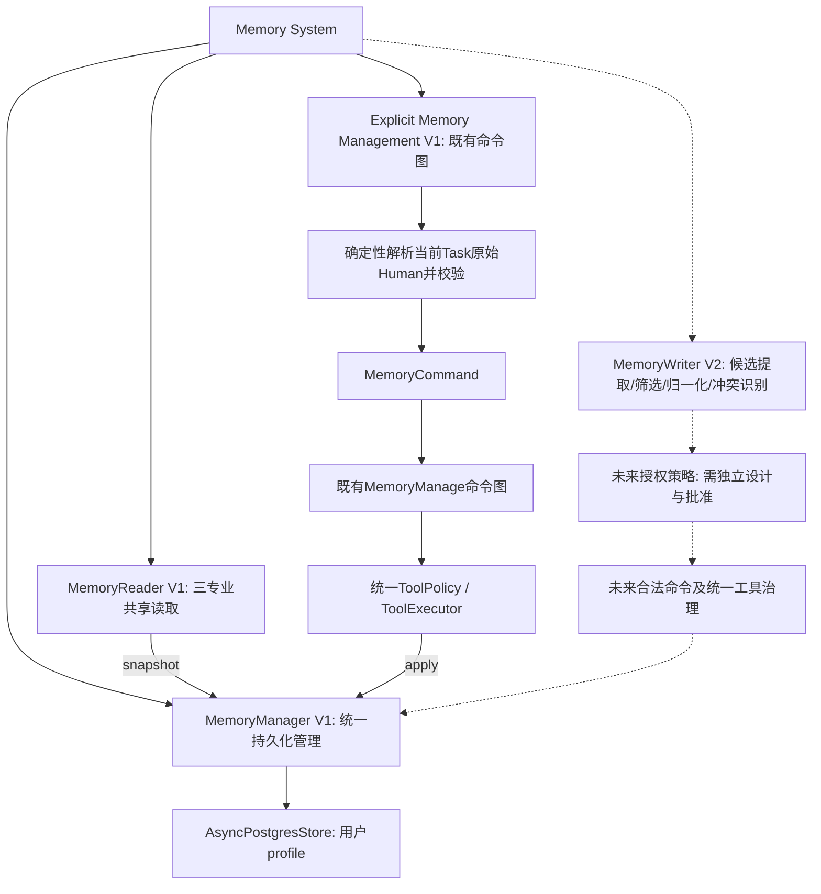
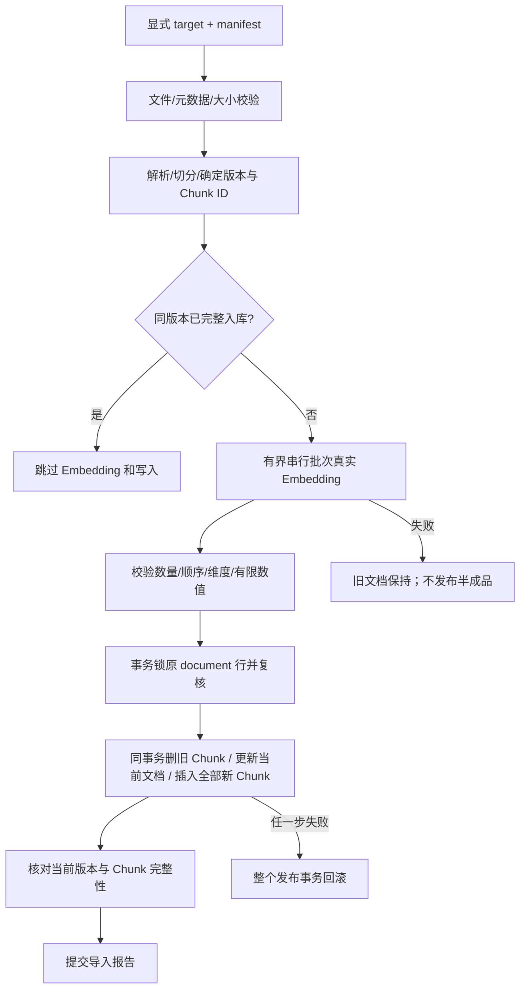
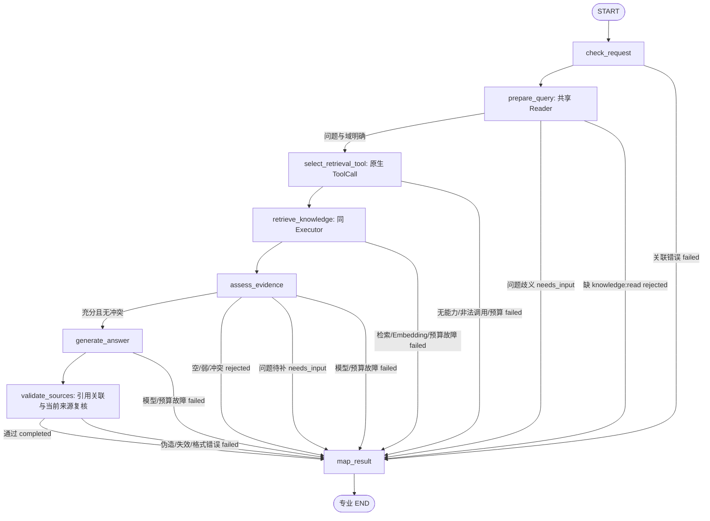
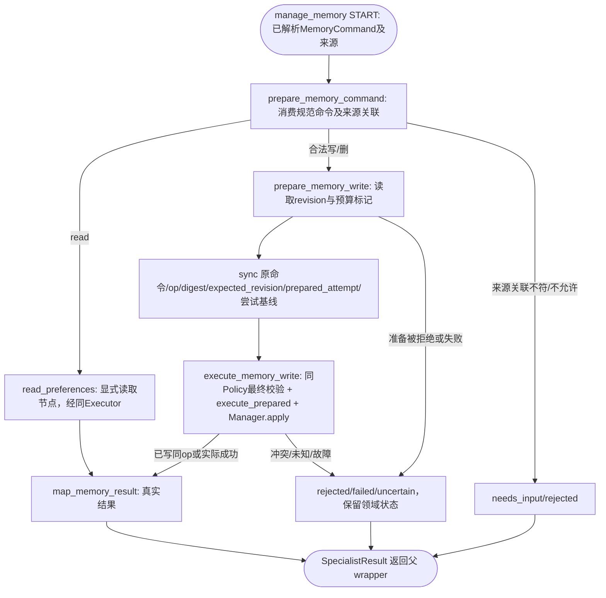

# 05 RAG 与长期记忆 Store：完整详细设计

状态为六阶段详细设计及第二轮定向修订已完成，四项技术决策现已确认或明确延期，当前等待最终设计冻结。所有Task尚未获得开发授权，实际环境验证留实施阶段。

依据：[项目定位](agent-engine-demo-plan.md)、[六阶段路线图](development-roadmap.md)、已批准的 [01](01-foundation-detailed-design.md)、[02](02-agent-runtime-detailed-design.md)、[03](03-tool-governance-detailed-design.md)、[04](04-hitl-checkpoint-refund-detailed-design.md)。01～04 的设计批准不表示已实施。本次定向修订仅修改本文，不修改前序设计、README、路线图或其他文件；不检查 Git/开发进度，不修改代码、配置、依赖或实际迁移 SQL，不运行测试、检查、容器、数据库或模型操作。全项目各阶段详细设计完成并审核后才统一开发。

最近修订日期为2026-11-09。页首状态及末尾最新记录为当前依据，旧轮次的修改范围仅供追溯。

## 1. 目标、范围与任务对应

交付目标有两条独立能力链：真实文档→Embedding→PostgreSQL/pgvector→受控检索→证据→可验证引用回答；可信用户显式记忆指令→结构化偏好 Store→同用户跨会话共享。知识库不存个人记忆，Store 不存订单/审批事实，Checkpoint 只保存执行快照。

| 二级环节（沿用路线图） | 三级Task（编号、数量和依赖保持，5.3.2按职责更名） |
| --- | --- |
| 5.1 文档/Embedding/pgvector | 5.1.1 导入与向量资源；5.1.2 Retriever证据契约 |
| 5.2 KnowledgeAgent证据问答 | 5.2.1 知识工具与子图；5.2.2 RAG真实联调 |
| 5.3 持久Store与共享Memory | 5.3.1 Store资源与Reader；5.3.2 显式记忆管理与幂等更新 |

保持单 FastAPI、单 worker、一个 PostgreSQL 17 实例和独立开发/测试库。无 PDF、爬虫、对象存储、文档管理后台、关键词/向量混合平台、重排模型、GraphRAG、独立向量服务、自动全量记忆或 MemoryAgent；不增加通用 Agent 基类。05 不更改 04 的审批授权、退款事务、恢复范围或管理 API。

## 2. 总体架构与已有契约复用

```text
离线：本地受控 md/txt + manifest
      → Parser/Chunker → EmbeddingClient → KnowledgeRepository → PG vector(1536)

在线：Route → Service → 原 AgentRuntime → Supervisor
                                      ├─ OrderAgent ─┐
                                      ├─ RefundAgent ┤→ 共享 MemoryReader（受控工具）
                                      └─ KnowledgeAgent
                                           ├─ 原八节点 RAG 子图
                                           │  Gateway 原生 search_knowledge ToolCall
                                           │  → 同 Policy/Executor → Retriever → pgvector
                                           │  → Evidence → 生成式 AnswerDraft → 来源验证
                                           └─ 显式 MEMORY_MANAGE 分支 → 共享记忆命令小子图
                                              → 同 Policy/Executor → MemoryManager → PG Store

共享：01 Gateway + 02 RunScope/任务预算/互斥/SSE + 03 Registry/Executor + 04 PG Saver
```

资源注入方向为lifespan创建EmbeddingClient、KnowledgeRepository/Retriever、Store/MemoryManager，再以同一Manager构造共享MemoryReader，注册既有工具后冻结Registry并构建原图/Runtime。V1不构造MemoryWriter。节点不自行建连接或裸调用ChatModel，handler只接typed args及最小BusinessExecutionContext，显式写增加必要操作关联。knowledge:read仍由同Policy检查，handler不接RunScope、RunLimits或完整执行上下文。

Task/Run、澄清、新任务、父子显式映射、原生消息配对继续沿 01～04。task_id 稳定，run_id 是单次执行；两类用量属于 Task，恢复不能归零。普通 run_finish 在图内结算，Runtime 图后只收敛记录/事件/资源。SSE 与业务执行分离，断开不取消任务，不建立事件重放系统。

### 2.1 跨阶段已对齐的最终契约（实现待授权）

| 前序契约 | 05需要的最小增量 | 责任与限制 |
| --- | --- | --- |
| 01 DemoIdentity普通scope | 原orders:read/refunds:request/knowledge:read之外增加memory:read、memory:write | 服务端演示身份固定赋予，继续仅development/test；普通用户仅访问自身namespace。请求、LLM、Store和entities不能自授scope，无审批权、无RBAC平台 |
| 02 AgentType/TaskType组合 | AgentType四角色，TaskType正式包含MEMORY_MANAGE，合法组合见10.1 | 不新增MemoryAgent；知识QA与记忆命令独立分支，不假称02已有该类型 |
| 02 SupervisorOutput/RouteDecision | 保留kind/decision结构；decision允许KNOWLEDGE/MEMORY_MANAGE及其白名单候选entities | 结构化候选不等于写入授权，程序须核验当前Task原Human明确命令 |
| 02 transfers/PendingTask/专业输入输出 | 白名单增加记忆命令候选、来源Human消息ID/缺字段、真实记忆结果；MEMORY_MANAGE完成可sources=[] | 身份/操作ID/revision不来自模型entities；澄清保留原task/预算；QA completed仍要求真实sources |
| 03 ToolMetadata | idempotency严格复用not_applicable/operation_id_required，字段名复用risk_level/has_business_side_effects | 不增加调用来源Metadata字段；节点约束在同一执行Policy中落实 |
| 03 ToolExecutionContext/Policy与调用记录 | 已定义可信task_type、node-origin的node_name；复用ParsedToolCall/ToolExecutionResult与call_records记录节点调用关联，详见6.1～6.2 | 来源取已校验Task/编译节点，不取模型args；复用既有allowlist/参数约束/预算，不新增Executor或记忆恢复平台 |
| 03 BusinessExecutionContext | V1显式记忆写handler使用MemoryBusinessContext，增加operation_id/command_digest/expected_revision及故障重入只核对模式 | 都由可信节点投影；只核对模式禁止写，不是授权位，handler不接scope/Policy/RunScope/预算 |

两个新scope由服务端DemoIdentity固定配置，Service/Runtime按既有可信上下文传递，恢复也按服务端规则重建；memory:read用于自身偏好读取，memory:write还必须同时满足KNOWLEDGE/MEMORY_MANAGE、明确指令与node入口，单有scope不能写。未配置scope时Policy拒绝，不能根据用户说“请授权”补入。

01～04已同步本轮涉及的身份、Task与工具执行契约，05按同一Policy约束接入。

### 2.2 Memory V1与V2职责边界

以下均为设计目标，尚未实施。V1交付基础长期记忆，使用PostgreSQL与LangGraph AsyncPostgresStore，三个专业Agent共享MemoryReader。MemoryManager是持久化读取和修改的统一入口，管理用户Namespace、revision、operation_id/command_digest/expected_revision/last_mutation、per-user asyncio.Lock及conflict/unknown。Namespace不含conversation或thread，因此同用户跨会话、跨Thread共享。允许偏好仍仅answer_language与answer_style。

V1显式管理属于既有MemoryManage工作流，负责从当前Task可信原始Human消息确定性解析、校验、形成MemoryCommand，再进入既有命令图，经同ToolPolicy/ToolExecutor到MemoryManager.apply。解析在Knowledge wrapper的MEMORY_MANAGE入口执行一次，复用命令节点模块中的函数；图的prepare_memory_command消费规范命令及来源关联，不重复解析。该链路不依赖V2，MemoryWriter不出现在V1装配、工具注册、执行或验收中。



V2 MemoryWriter的输入方向为可信用户交互及来源关联、允许字段约束和经统一读取获得的偏好快照，输出方向为新增/修改/删除候选建议及来源、归一化结果和冲突说明。它可评估长期价值、排除临时/无价值/敏感信息并组织候选，不直接返回持久化成功，不把建议视为已授权MemoryCommand。

候选内容去重及冲突识别属于建议组织，不能代替MemoryManager的operation_id幂等或expected_revision冲突检查；需要当前偏好时只消费经MemoryReader/Manager取得的快照，不直接访问Store。

V2必须先有独立授权策略，再将获准操作交既有治理及MemoryManager。MemoryWriter不持有Store、数据库连接或写权限，不直接修改revision，不生成持久操作的operation_id或负责幂等，不绕过Manager。MemoryManager始终校验可信执行关联及允许操作，继续承担并发、版本、幂等和异常处理。未来授权形式本轮不确定，不借候选价值判断或模型布尔值自动放行。

V2不新增Agent或Graph，本轮不创建writer.py、候选提取模型、自动维护流程、工具或占位实现，也不扩大V1字段及授权范围。

## 3. 技术选择、版本依据与实施门禁

初版版本依据为langgraph 1.2.20、langgraph-checkpoint-postgres 3.2.0、langchain-openai 1.7.4、psycopg 3.3.8、tiktoken 0.14.0，直接依赖未包含langchain-postgres/pgvector Python包。本轮只读核对锁定文件及本地Store包METADATA（确认3.2.0）、公开接口与相关源码，不执行环境检查命令或兼容性测试，不检查项目进度。

### 3.1 向量存储二选一

| 候选 | 与现有工程关系 | 决策 |
| --- | --- | --- |
| LangChain PostgreSQL VectorStore | 需新增langchain-postgres并评估Schema/连接管理兼容；本地文档更新/来源校验仍需应用逻辑 | 不采用；不能把上游示例视为已安装可用 |
| 明确 SQL + psycopg + pgvector 扩展 | 复用业务池与参数SQL，直接维护当前文档/Chunk及来源 | **采用唯一具体KnowledgeRepository/VectorRetriever**，不另做LangChain VectorStore适配层 |

LangChain 官方说明集成包单独发布，且其 Schema 变更需要关注重新建表/导入：[PGVector integration](https://docs.langchain.com/oss/python/integrations/vectorstores/pgvector)。这是不引入该集成的理由之一，不声称已测试它与本项目不兼容。

小型语料先用 `embedding <=> query_vector` 的精确余弦距离排序，域/有效版本的 B-tree 索引即可；不提前建立 HNSW/IVFFlat。pgvector 默认支持精确最近邻，近似索引会改变召回性质：[pgvector 官方说明](https://github.com/pgvector/pgvector)。本阶段“向量索引”指真实持久向量检索资源，不将没有 ANN 索引误称为没有 RAG；数据规模若将来证明需要 ANN，再另行批准，不在 V1 双轨维护。

### 3.2 Embedding 与 Store 的 API 依据

提案为 OpenAI `text-embedding-3-small`，维度固定 1536，复用已安装 OpenAI SDK（后续将实际直接使用的 openai/tiktoken 显式列为直接依赖，不在本轮改清单）。不用第二个 Chat Gateway，也不经 ChatModel 生成向量。默认维度和 dimensions 参数见 [Embedding guide](https://developers.openai.com/api/docs/guides/embeddings)；输入非空/请求限制见 [Embeddings API](https://developers.openai.com/api/reference/resources/embeddings/methods/create)。供应商和模型是待审核提案，不代表当前账号可调用或真实语料效果已验证。

选择现有包中的 `langgraph.store.postgres.aio.AsyncPostgresStore`，`index=None`、`ttl=None`；官方区分跨 thread Store 与短期快照，并提供 PG Store：[Memory](https://docs.langchain.com/oss/python/langgraph/add-memory)。本地静态签名可见 `from_conn_string(pool_config=...,index=...,ttl=...)`、`setup()`、`aget/asearch/aput/adelete`。不编造不存在的公开 CAS/事务或 aclose 方法。

未来实施前必须验证：PG17 与固定 pgvector 扩展版本/部署镜像；1536 维收发及参数 cast；Store setup/池选项/后台批处理与关闭机制；原子单 Item 写和超时结果核对；嵌套图当前 context/Store 注入及 Checkpoint 重放。此轮未运行上述验证。不能为了消除一处差异盲升全部依赖。

## 4. 文档、切分、版本与入库事务

### 4.1 最小语料与解析

未来 `data/knowledge/` 放 6～10 份自编、明确标记为 Demo 的平台帮助/售后说明/FAQ，例如账户帮助、订单查询入口、模拟退款申请渠道、审批等待解释。知识文档只能解释流程，不能授权或改变 MockRefundService 的资格规则；不导入真实客户资料、密钥或完整聊天。

一个显式JSON manifest保存逻辑document_id、相对文件名、source_title、domain及稳定public_source_key。domain为platform_help/after_sales_help分类，全部属于公共Demo知识库，没有用户级知识域ACL。固定本地根目录内UTF-8 `.md/.txt`，拒绝越界/符号链接外逃、远程URL、HTML执行和附件加载。单文件≤256 KiB、最多50文件/每次、单次新增≤1000 Chunk；超限明确拒绝，不静默截断整篇。空文件不能替换有效文档。

规范化 BOM/CRLF，保留正文实际内容；Markdown 按标题/段落，TXT 按段落。记录真实章节路径、行区间；page 仅有真实分页时可用，V1 皆 null，不伪造页码。标题只是低信任来源描述，不能进入系统指令。解析版本 `parser-v1`、切分版本 `chunker-v1` 固定。

Chunk以tiktoken固定tokenizer计算，目标≤500 token、最多80 token前文重叠，优先不跨章节/FAQ条目；超长段落继续分片而非丢弃剩余正文，切点不破坏Unicode。给Embedding的文本为受限标题/章节+正文，整体≤700 token；保存content不含合成前缀，保留content_hash用于来源核对。Token是该tokenizer计数，不冒充所有供应商绝对计费量。

### 4.2 最小表与主键

未来规划 `migrations/004_knowledge_vectors.sql`（取前序后的实际下一编号），仅本文规划，不创建 SQL。部署先安装与 PG17 匹配的 pgvector 二进制/镜像，再由有权限的显式迁移入口启用 `CREATE EXTENSION vector`；安装 Python 驱动不表示扩展存在。运行账号不得每次请求建扩展/表。

| 表 | 必要字段/约束 |
| --- | --- |
| knowledge_documents | document_id text PK，document_version text NOT NULL，content_hash，domain分类，source_title，public_source_key（无绝对路径/任意URL），embedding_profile，chunk_count，updated_at；UNIQUE(document_id,document_version)供复合FK |
| knowledge_chunks | chunk_id text PK，document_id/document_version复合FK，ordinal，section可空，page=null，line_start/end，content，content_hash，token_count，embedding vector(1536) NOT NULL；UNIQUE(document_id,ordinal) |

仅两张表、每文档仅当前版本；不保留knowledge_versions表、ACTIVE/INACTIVE状态机、激活指针、历史回滚或历史版本管理平台。chunks复合FK防止错配当前版本；documents(domain)与Chunk外键索引即可。内容更新后旧Chunk在替换事务中删除，旧引用通过当前版本不匹配判失效，来源追踪能力不依赖保存整套历史。

document_version为规范化正文、必要manifest元数据、固定parser/chunker与embedding_profile的SHA-256；chunk_id从document_id/document_version/ordinal/content_hash稳定派生。embedding_profile记录provider/model/dimensions/tokenizer/本地profile_revision；模型别名不等于供应商不可变权重。profile变化必须显式重嵌，查询只使用同一配置profile。

### 4.3 显式导入与当前文档替换



Embedding在事务外完成，受限语料内存暂存新向量，不持数据库锁等待供应商。每文档一个替换事务：锁当前document行→再次比document_version→相同且完整则跳过，否则删除旧Chunk→更新当前document→插入全部新Chunk→commit；删除旧Chunk后再改文档版本，满足复合FK。首次导入直接插文档/Chunk；主键冲突整事务回滚后读当前版本核对。V1显式脚本单操作者，不构建并发导入/暂存平台。

重复导入先比当前document_version/content_hash/Chunk数，完整一致则不重嵌不重写；元数据/切分/profile变化则显式替换。任意新Chunk写入失败回滚全部替换，旧文档/向量仍在。进程在Embedding后提交前退出下次可能重嵌，不承诺付费Exactly Once；提交回应丢失先读当前document_version/Chunk数核对。源文件移出manifest不自动删库，避免误删。

必要删除通过同一显式脚本remove(document_id)，事务删除该文档当前Chunk和document，不提供历史恢复/后台GC；不改源文件或Checkpoint。普通搜索不再返回它，来源复核查不到即失效。已发答案保留当时版本标识，不承诺动态撤回。

模型/维度变更不混算距离：显式停用知识检索，离线调整profile/必要的vector(N)类型并完整重导、校准后再开放；不建设自动重建工作流/双索引切换。开发/测试target由既有目标映射解析，不接受任意生产DSN。

## 5. EmbeddingClient、Retriever 与证据接口

### 5.1 Embedding 限制及配置

`EmbeddingClient` 只是 Embeddings API 的具体薄适配，不是第二个 Chat Gateway/通用预算器。使用已有 AsyncOpenAI embeddings API、SDK max_retries=0；适配层每请求最多一次额外重试，仅明确限流/暂时服务/连接错误。认证/维度/无效输入不重试；取消传播。

| 已确认配置 | 值与职责 |
| --- | --- |
| embedding_model / embedding_dimensions / embedding_profile_revision | text-embedding-3-small / 1536 / demo-v1 |
| embedding_api_key / embedding_base_url | SecretStr；可使用同供应商凭据引用，但与 Chat 配置职责分开，不默认外发到未知 endpoint |
| embedding_timeout_seconds / embedding_max_retries | 8 秒/1；查询仍受整个检索工具 15 秒和 Runtime 剩余主动时间限制 |
| embedding_batch_size / embedding_batch_token_limit | 离线每批≤16 文本、≤12000 tokenizer token；每条≤700 token |
| ingestion_max_total_tokens / ingestion_concurrency | 每次≤100000 输入 token、并发1；额外重试也记实际请求/token（未知标 unknown） |
| retrieval_top_k / retrieval_candidate_k | 3 / 5，允许最大5；上下文打包后可能更少 |
| retrieval_context_tokens / retrieval_context_bytes | 最多2400 token 且序列化≤24 KiB，包含来源元数据 |
| retrieval_min_similarity | 正式初始值null，不以固定相似度阈值单独判断充分性；后续调参依据固定样本并记录模型/profile/语料版本 |

正式采用OpenAI text-embedding-3-small、1536维，显式维护embedding_profile/profile_revision，文档及查询必须兼容同一Profile。Profile包含provider/model/dimensions/tokenizer/profile_revision，变更需显式重嵌并阻止混用。文档批量输入，query单条≤512 token，无专用前缀，不嵌入全部历史/记忆。过长query要求缩小问题，返回向量检查index、数量、维度、有限非零值，禁止补零/截维。真实服务/API兼容性和中文效果属于实施验证，批准模型名称不代表已联调。

Embedding 请求**不增加 ModelCallUsage.model_attempts**（01 此字段是 Chat Gateway 尝试）；查询 Embedding 是检索 handler 内有界 I/O，计该 handler 的工具尝试与 Runtime 主动时间。每次搜索最多2次实际 Embedding 请求，上限由工具累计次数、请求超时及 Runtime 共同约束，无独立全局计数器。日志/检索结果内部有 embedding_request_attempts，属于观测而非改名后的 Chat 预算。离线导入不属于用户 Task，两种预算不混算；其显式总输入/批次/尝试报告用于人工控费，不宣称硬货币账本。

### 5.2 公共知识分类检索与返回

所有具有knowledge:read的受控演示用户均可访问整个公共Demo知识库。不使用KnowledgeAccess或用户级知识域ACL，不引入租户数据；domain仅是platform_help/after_sales_help分类，可由prepare_query根据当前问题确定，未指定则搜索所有公共分类。模型不能通过参数改变工具scope或数据来源；Policy限制当前任务query/domain/top_k，防止偏离问题，但该分类限制不是按用户授权。用户隔离继续由订单归属和Store namespace承担。

具体查询join当前documents/chunks，WHERE文档版本匹配、embedding_profile与客户端一致，并可按domain分类过滤；ORDER BY `embedding <=> %s::vector, chunk_id` LIMIT candidate_k。全部值绑定参数，不拼SQL/表名/表达式，无需新增Python pgvector包。只读statement_timeout≤5秒，整个工具≤15秒；每个Chunk真实对应当前文档。知识工具权限由同Policy检查，不由Retriever另认证。

余弦距离越小越近，内部 similarity=1-distance；不是概率，不用“0.8 就一定正确”。候选至多5个，按稳定排序和预算打包最多3个；同 chunk 去重，不以低分补满。阈值未校准时由 assess_evidence 保守评估/拒答，小型测试集校准后可先按阈值裁剪；无结果与不足不是网络故障。

```python
@dataclass(frozen=True, slots=True)
class SearchQuery:
    query: str
    domain: str | None          # 可选公共知识分类，不是用户授权域
    top_k: int                 # V1 固定3，最大5

@dataclass(frozen=True, slots=True)
class EvidenceChunk:
    evidence_id: str            # 服务端从 document/version/chunk 稳定派生
    document_id: str
    document_version: str
    chunk_id: str
    source_title: str
    public_source_key: str
    section: str | None
    page: int | None
    content: str
    content_hash: str
    retrieval_score: float      # V1内部余弦similarity，不进入公共来源，未来融合由适配层解释
    domain: str
    is_current_version: bool    # 检索当时为真，公开前还需与当前表复核

@dataclass(frozen=True, slots=True)
class SearchResult:
    status: Literal['found', 'empty']
    evidence: tuple[EvidenceChunk, ...]
    embedding_profile: str
    query_fingerprint: str
    context_tokens: int
    truncated: bool
    embedding_request_attempts: int
    # 内部观测：elapsed_ms、candidate_count；不含原 query 或记忆全文

class EmbeddingClient:
    async def embed_documents(self, texts: tuple[str, ...]) -> EmbeddingBatch: ...
    async def embed_query(self, text: str) -> EmbeddingVector: ...

class VectorRetriever:
    async def search(self, query: SearchQuery) -> SearchResult: ...
    async def validate_evidence(self, refs: tuple[EvidenceReference, ...]) -> SourceValidationResult: ...
```

`embed_documents`接受受限一批，外层导入负责分批/总量；结果带profile/实际尝试/已知或未知usage。Retriever不决定答案。错误区分embedding_unavailable/embedding_timeout、embedding_profile_mismatch、knowledge_index_unavailable、retrieval_timeout；缺knowledge:read由Policy返回policy_denied，不伪装empty。

### 5.3 检索领域契约与未来ES扩展边界

V1唯一实际检索后端及权威知识数据源是PostgreSQL/pgvector，继续使用具体KnowledgeRepository、VectorRetriever和明确SQL/psycopg精确余弦排序。KnowledgeAgent经统一工具调用只使用SearchQuery、EvidenceChunk、SearchResult及EvidenceReference，不接收SQL行、驱动对象或未来ES原生响应。当前search(query: SearchQuery) -> SearchResult无需新增抽象基类、后端注册平台或第二套DTO，现有契约已满足解耦。

| 领域字段 | 跨检索源约定 |
| --- | --- |
| document_id/document_version/chunk_id/content_hash | 以PG当前权威文档及Chunk生成规则为准，后端不得替换为自身ID或另建版本生命周期；未来候选按四元组去重，版本/hash不同不得误合并 |
| evidence_id | 保持当前document/version/chunk稳定派生，与后端排名无关 |
| source | 沿既有source_title/public_source_key及section/page表达，不新增重复source字段；source_key来自权威manifest，不暴露ES索引名、内部地址或本机路径 |
| EvidenceReference | 保留doc/version/chunk/hash，来源验证仍回PG当前权威记录；未来ES过期/删除片段不能成为有效引用 |
| retrieval_score | V1为1-cosine_distance内部相似度，不公开为概率；未来BM25与向量分数不直接比较或套同一阈值，由未来融合层排序并适配领域结果 |
| SearchResult | 保持证据、query指纹、Profile及上下文预算/观测语义，不携带后端响应；未来多路候选也按共同预算构造结果，Embedding尝试只计实际Embedding请求 |

未来可新增Elasticsearch Retriever提供BM25/关键词候选，再由HybridRetriever合并、去重、排序并返回相同领域契约。ES索引以PG权威文档/Chunk为基础，不成为第二套知识事实源。索引同步、重建与融合策略在未来功能获授权时另行设计。

V1仅记录扩展边界，不新增ES依赖、部署、BM25、RRF/混排算法、双写、同步、Outbox或重建任务，不创建ES/Hybrid占位文件。八节点和工具治理不变。证据评估正式使用sufficient/insufficient/conflicting，candidate=5、topK=3、上下文≤2400 tokens且≤24KiB，阈值null；无证据拒绝生成确定性答案，充分性不由单一分数决定。

## 6. Registry/Policy/Executor 接线与原生工具消息

| 元数据 | search_knowledge | validate_knowledge_sources | read_preferences | write_preferences |
| --- | --- | --- | --- | --- |
| version/enabled | 1/真实资源就绪才启用 | 同左 | 同左 | 同左 |
| allowed_agents | KNOWLEDGE | KNOWLEDGE | ORDER/REFUND/KNOWLEDGE | 仅KNOWLEDGE |
| required_scopes | knowledge:read | knowledge:read | memory:read | memory:write |
| risk_level/approval_required | low/false | low/false | low/false | low/false，不更改退款审批 |
| read_only/has_business_side_effects | true/false | true/false | true/false | false/true |
| idempotency | not_applicable | not_applicable | not_applicable | operation_id_required；业务另校验expected_revision |
| timeout_seconds/max_retries | 15/0（Embedding 内仅有限重试） | 5/1额外只读重试 | 3/1额外只读重试 | 3/0 |
| tags | knowledge,read,vector | knowledge,source_validation | memory,read | memory,explicit,write |

```python
class SearchKnowledgeArgs(BaseModel):  # 所有 args/result 均 extra='forbid'
    query: str                       # 非空、≤512 token/2000字符
    domain: Literal['platform_help', 'after_sales_help'] | None = None
    top_k: int = 3                    # 1..5，任务通常精确约束为3

class ValidateKnowledgeSourcesArgs(BaseModel):
    evidence: list[EvidenceReference] # 1..5，doc/version/chunk/content_hash

class ReadPreferencesArgs(BaseModel):
    pass                             # 空 object，用户/namespace 只能来自可信上下文

class WritePreferencesArgs(BaseModel):
    operation: Literal['upsert', 'delete', 'clear']
    field: Literal['answer_language', 'answer_style'] | None
    value: Literal['zh-CN', 'en', 'concise', 'detailed'] | None
    # 字段/值组合由模型外 validator 校验；无用户/namespace/批准/预算参数
```

result_schema分别为SearchResult、SourceValidationResult、PreferenceSnapshot、MemoryMutationResult的Pydantic序列化版本，拒绝SDK/数据库对象外泄。EvidenceReference只含真实doc/version/chunk/hash；来源复核的任务参数约束限本次returned evidence，不能用模型虚构ID换资料。返回固定校验结果，不公开SQL。

```python
class EvidenceReference(BaseModel):
    document_id: str
    document_version: str
    chunk_id: str
    content_hash: str

class SourceValidationResult(BaseModel):
    valid: bool
    invalid_evidence_ids: list[str]
    safe_code: str | None
    checked_at: datetime

class MemoryMutationResult(BaseModel):
    status: Literal['applied', 'reused', 'conflict', 'unknown']
    operation_id: str
    revision: int | None
    changed_fields: list[Literal['answer_language', 'answer_style']]
    preferences: dict[str, str] | None  # 仅白名单枚举，不回传旧值/内部记录
```

RAG 的 selected_tools 给模型只暴露 search_knowledge 的完整 Schema。select_retrieval_tool 经 Gateway.invoke 生成一条原生调用，query/domain/top_k 必须与 prepare_query 已核验的 SearchQuery 一致；未声明/多条/混合调用按 03 可靠 ID 检查和 Policy 拒绝/配对，不挑一条悄悄执行。Executor.allowed_tools 与当前曝光集合完全对应；无工具改查订单/Store 的可能。后续来源复核是固定 node-origin allowlist，不扩大模型曝光集合。

这里保留select_retrieval_tool的模型调用，是为了演示原生ToolCall→Registry/Policy/Executor→ToolMessage的完整治理链，不是RAG必须用LLM选择单一工具。代价是每次QA额外一次模型调用及相应延迟/费用，仍计既有ModelCallUsage。未来若优先降低成本，可让该节点构造node-origin调用交同一Executor；这是另行明确的实现取舍，本版不同时维护两条路径，不增加检索规划Agent或复杂选择器。

搜索handler `(SearchKnowledgeArgs,BusinessExecutionContext)`→Retriever.search(规范SearchQuery)，业务context仅用于可信关联；来源handler同理，Reader用context.user_id定位自身profile。显式写handler接收从服务端已验证命令投影的最小MemoryBusinessContext（见10节）。同一Policy检查Agent/origin/scope/注册版本/Schema/任务参数/预算；实际handler尝试增加tool_calls，失败/只读重试仍计数。不得直接调用handler/Retriever/Store绕过Executor；离线导入是显式脚本，不伪装运行时工具。

原 AIMessage/ParsedToolCall/raw_args 一次保存，规范参数另存；检索结果用原 call_id 的 ToolMessage、稳定 `tool:{task_id}:{call_id}` 配对，只留专业私有历史。node-origin 来源复核/记忆读取没有对应 AIMessage，不造孤立 ToolMessage。ToolMessage 只给模型安全 status/code/data，不含凭据/内部预算。私有材料不直接流入 SSE。

### 6.1 节点专用工具的执行约束（不是新Metadata）

不增加allowed_origins字段。复用03的ToolExecutionContext.origin、allowed_tools、argument_constraints与同一Policy；来源由可信编译节点设置，模型不提供origin。为了让Policy本身明确复核任务分支，03已定义完整ToolExecutionContext的可信task_type/node_name，不把它传给handler。

| 工具/执行路径 | 同Policy必须强制的约束 |
| --- | --- |
| search_knowledge | KNOWLEDGE/KNOWLEDGE_QA；本图原生调用origin=model（如未来程序检索origin=node也须该任务allowlist）；参数严格对应当前查询 |
| validate_knowledge_sources | KNOWLEDGE/KNOWLEDGE_QA、origin=node、来源复核节点固定allowlist、refs限本轮真实证据 |
| read_preferences | 仅下表已列Agent/Task/节点组合，origin=node、memory:read、自身profile及空参数Schema；allowed_tools必须含该注册工具名/版本 |
| write_preferences | 仅KNOWLEDGE/MEMORY_MANAGE、origin=node、node_name=execute_memory_write、memory:write；allowed_tools仅该注册命令工具名/版本，operation/field/value与已解析命令精确一致，原operation关联完整 |

上述少量固定分支判断加入同一ToolPolicy的任务范围检查，不创建权限服务/第二工具平台。仅在模型绑定时隐藏工具不足以保证节点专用限制：Policy必须拒绝origin=model的read/write/source-validation调用，即使模型伪造合法参数、Agent与scope都匹配。节点依据已验证Task构造context，Executor不从模型args补task_type；所有路径仍先Policy、后同Executor、再handler。03已在本轮同步task_type/node_name与固定来源规则，实际执行能力等待授权开发。

Memory节点级实际执行白名单如下。名称沿当前专业准备节点及第10.2节命令图，原图R节点正式命名为read_preferences，与工具同名但分别属于Graph节点和工具目录，不新增节点。

| 工具 | agent_type / task_type | 可信node_name | allowed_tools及参数 |
| --- | --- | --- | --- |
| read_preferences | ORDER / ORDER_QUERY | prepare_query | 当前读取调用仅read_preferences名/版本，args={}，用户来自可信context |
| read_preferences | REFUND / REFUND_APPLY | prepare_refund | 同上，恢复不重跑准备读取 |
| read_preferences | KNOWLEDGE / KNOWLEDGE_QA | prepare_query | 同上，不以知识证据或模型args选择用户 |
| read_preferences | KNOWLEDGE / MEMORY_MANAGE | read_preferences | 显式查看分支，args={}，自身profile |
| read_preferences | KNOWLEDGE / MEMORY_MANAGE | prepare_memory_write | 仅取原写前revision，args={}；失败不得视为revision0 |
| write_preferences | KNOWLEDGE / MEMORY_MANAGE | execute_memory_write | 仅write_preferences名/版本，参数精确匹配已校验的upsert/delete/clear命令及可信业务关联 |

所有行均要求origin=node及对应memory scope，同Policy同时核对六项agent_type/task_type/origin/node_name/allowed_tools/参数约束。prepare_memory_command、map_memory_result、wrapper及未列节点不能实际执行Memory工具，模型不能通过args伪造node_name/origin或改目标工具集。

prepare_memory_write只允许读取及零handler的准备控制调用，不拥有write_preferences实际执行权。它用真实准备context和编译确定的execute_memory_write目标context调用同Executor.prepare_attempt，跨节点新写准备仅此配对，标记绑定两端。预检目标工具集仅write_preferences，不替换真实来源；execute_prepared必须来自实际execute_memory_write。10.3既有故障重入仅允许该执行节点对原操作作同节点纯核对，replay_check_only=true，无新写准备或Put。规则复用D03可选参数，不增Metadata或权限框架。

### 6.2 节点内部调用的关联、记录与预算

两类调用共用同一Policy/Executor/结果结构，消息语义分别为：

- 模型调用：原AIMessage.tool_calls → ParsedToolCall（保留模型call_id）→ Executor内部Policy → handler → 原call_id的ToolMessage。
- 节点调用：编译Node构造内部ParsedToolCall → 同Executor内部Policy → handler → ToolExecutionResult → Node增量State；**没有AIMessage或ToolMessage**。

节点内部的call_id记为`node_call_id`：`node:`前缀加UUID5(task_id、node_name、tool_name/version、固定调用槽slot、逻辑轮次)。同Task同调用重进保持稳定，不含run_id；一个节点调用多个工具/同工具多次须有不同slot或明确轮次，不能只用tool_name，也不能重进时随机换ID逃避去重。参数摘要另存；同ID却参数/工具版本不符为协议冲突，不静默覆盖原记录。V1这些节点无检索循环，默认逻辑轮次为0。write_preferences的operation_id仍是独立业务幂等ID，不因node_call_id/run_id改变。

准备阶段构造待执行write call时，node_call_id按目标execute_memory_write及固定写槽生成，准备节点名称单独保存在PreparedToolAttempt.prepared_by_node_name；准备本身不伪造一次handler执行记录，不增加tool_calls。最终执行仍使用原node_call_id，实际执行记录的node_name取当前execute_memory_write。

ToolExecutionContext在既有execution/agent/origin/allowlist/约束/RunScope之外，为node来源补`node_name: str | None`（model来源为None），值由编译节点提供。每次真正进入Executor执行时生成一次内部`execution_id`（UUID），记录当前task_id、run_id、node_name、tool_name/version、origin及node_call_id；Executor有限重试沿同execution_id记录attempt序号。关联ID不授予权限，不传给模型，也不扩展成通用执行平台。

复用现有call_records，以原生call_id或node_call_id为键；节点返回增量保存origin、args_digest、最后execution_id/current run、status/code、attempts、effect_status、安全结果与累计用量，日志补耗时/异常安全code。已知结果按当前身份/范围检查后复用不启动handler；新实际尝试仍计数。预期故障按03返回failed等结果；权限拒绝为policy_denied，handler未启动attempts=0；意外异常记录安全关联后交Runtime处理，CancelledError传播，缺最终快照不能伪装已记录完成。

新handler尝试（模型或节点来源、读或写、含允许重试）均由同Executor更新task累计tool_calls；节点只adopt最新快照，不另行加计数、不把多份完整用量相加。operation核对若发生在实际handler内也属于该次尝试。写前尝试标记/结果增量按现有sync边界保存，不保证日志、Graph与Store原子或Exactly-once。

03已同步节点ID构造、node_name和execution_id/记录映射，05依该共同契约接线。复用ParsedToolCall承载节点调用是明确的内部输入扩展；不随机补模型缺失ID，不为node调用运行to_tool_message。Graph仅持Executor与工具Schema/标识，实际handler只由Registry向Executor提供，禁止节点直接调用handler/Store。一个小的节点调用构造函数即可，不创建第二执行器/预算器。

## 7. KnowledgeAgent State、节点与完整拓扑

### 7.1 State 与写入方

沿 02 的八个节点名称和原字段；本节是未来真实接线，替换 capability_unavailable 骨架，不宣称已有能力。

| 字段 | 写入方 | 生命周期/信任 |
| --- | --- | --- |
| request/context、task/workflow 关联 | 父 wrapper/当前 Runtime | 白名单输入；子图不能改 owner/任务，当前 run 从 runtime.context 取 |
| retrieval_query | prepare_query | 规范问题/可选公共分类/top_k；新普通调用重建，续接只补原缺参 |
| selected_tools / planned_retrieval_call | select_retrieval_tool | 只允许检索工具；原 AIMessage/call/raw/规范参数固定并 sync |
| retrieved_chunks / retrieval_observation | retrieve_knowledge | 真实 SearchResult，当前查询私有 State；无 SDK/向量全量 |
| evidence_assessment | assess_evidence | sufficient/insufficient/needs_clarification/conflict、采用 evidence IDs/安全理由 |
| answer_draft | generate_answer | 低信任自然语言answer与citations候选；不得直接作为public answer |
| validated_sources / approved_answer | validate_sources | 来源验证通过后采纳模型正文并由服务器构造来源；不代表程序已证明正文语义正确 |
| memory_context / memory_read_status | 共享Reader，由prepare_query采用 | 只含有效枚举偏好/revision；状态明确区分available/empty/partial/unavailable/denied，与evidence分开 |
| messages / call_records / results | 模型/执行/观察节点 | 消息 Reducer、稳定 call/消息 ID；不复制给主图公开历史 |
| model_call_usage / run_usage | Gateway/Executor→RunScope，节点返回快照 | Task 累计覆盖，非加法，run_finish 普通收敛 |
| memory_command / memory_result | 第10节独立记忆命令小子图字段 | 不进入QA私有State；Knowledge wrapper按TaskType选择既有QA图或该命令图，无记忆假来源 |

一次专业调用的旧 evidence/draft/sources 不被另一任务继承；Checkpoint 可以保存必要证据与偏好执行快照，但不据此声称用户偏好已持久写入 Store。主图仅接已校验 SpecialistResult/来源/用量，不整份合并子 State。

### 7.2 八节点契约

| Node | 职责、输入→State 更新 | 外部边界/私有记录/预算 | 条件边与异常 |
| --- | --- | --- | --- |
| check_request | 检查可信关联与KNOWLEDGE_QA；MEMORY_MANAGE由wrapper分派独立命令图 | 纯校验，无模型/工具；不取模型user_id | 合法→prepare_query；协议错→map_result(failed) |
| prepare_query | 当前问题/白名单上下文→retrieval_query；共享Reader获memory_context，不改知识事实 | Reader按6.2以node_call_id经同Executor记录/计工具，无查询改写模型；已保存结果复用 | 问题清楚→select_retrieval_tool；真歧义→needs_input；技术读故障unavailable可降级，缺memory:read为denied且不读（见9.3）；缺knowledge:read→rejected |
| select_retrieval_tool | Registry/公共分类/查询→selected_tools、原生planned_retrieval_call | 为展示原生治理链保留额外一次Gateway.invoke(tools=完整Schema)，计模型尝试，保存私有AIMessage/call并sync，max一条搜索 | 合法→retrieve_knowledge；工具缺失failed/权限rejected；非法call按03闭合拒绝后failed，无新规划Agent |
| retrieve_knowledge | 原 call→同 Executor→SearchResult/ToolMessage、retrieved_chunks | 真 handler 尝试计工具，内部 query Embedding 不计 Chat；保存 call_records/原消息并 sync | found/empty→assess_evidence；Embedding/PG/预算/取消→failed；不能把故障变 empty |
| assess_evidence | 问题+受限evidence→evidence_assessment/采用IDs | 空证据直接拒答；非空先核格式/profile，再Gateway.invoke_structured判断相关/充分/冲突；一次模型调用，无新检索 | sufficient→generate_answer；无/弱证据或冲突→rejected说明；问题本身确需补充→needs_input；非法IDs/模型/预算故障→failed |
| generate_answer | 已选证据+允许偏好→AnswerDraft(answer,citations) | Gateway.invoke_structured自然语言概括/组织答案并给真实evidence_id，计模型预算；候选仅私有，不绑定工具 | 正常→validate_sources；模型/额度失败→failed，无无界纠正 |
| validate_sources | 草稿+本轮真实evidence→approved_answer/validated_sources | 纯引用关联检查，再按6.2以node_call_id经同Executor复核当前版本/hash、记录结果/预算；不宣称逐句事实证明 | 来源通过→completed；不存在/失效/格式不符→failed，复核故障同样failed；草稿不直出 |
| map_result | 允许QA结果/真实来源/安全错误→SpecialistResult/用量 | 纯映射，候选不直出；无handler/额外模型 | END；QA completed必须有真实引用，rejected无虚假来源；记忆图的结果另由其map_memory_result映射 |

节点均返回增量，不原地改 State。外部调用失败仍返回/继承最新用量；意外编程异常正常暴露给 Runtime，CancelledError 传播，不吞掉后继续模型/工具。正常一次 QA 约 Supervisor+搜索计划+证据评估+答案生成共4次 Chat（主图如另有模型总结也计入同一8次上限），工具通常 Reader+搜索+来源复核共3次，重试/澄清继续累计。数值是规划，不是新发额度。

### 7.3 完整目标图



QA图严格保留上述八个节点；Knowledge wrapper在进入专业图前根据已验证TaskType选择QA图或第10节记忆命令小图，不把manage_memory作为第九个QA节点，也不使MEMORY_MANAGE经过检索/回答生成。仍是同一个KnowledgeAgent、同Runtime和相同父子输出规范。Memory未就绪时该任务capability_unavailable，不影响QA原执行路径，不假保存成功。

## 8. 证据、事实支持与公共来源

### 8.1 三种判断分开

检索相关性是距离/问题语义关系；引用有效性是本轮ID、document/version/chunk/hash及当前可用性；答案语义正确性是陈述是否被证据支持、是否错误概括。三者不能互相代替。程序能够确定来源对象真实关联，**不能由合法引用证明答案每句话正确**。

恢复02的**生成式RAG**：generate_answer经同Gateway根据assess选中的证据组织自然语言answer，列出所用evidence_id；可以合理概括、按语言/风格偏好表达，不要求连续原文匹配。Prompt要求只回答证据支持的政策/流程，不补实时订单事实，不把文档当审批权；无法根据资料支持的部分明确说明不确定。无/弱证据或冲突在assess阶段直接rejected，不进入确定答案生成；检索技术故障failed。语言偏好不授权额外事实，翻译/概括质量仍需样本人工验收。

```python
class AnswerDraft(BaseModel):
    answer: str             # 非空、最多2000字符，生成式自然语言正文
    citations: list[str]     # 1..5个唯一evidence_id，extra=forbid

@dataclass(frozen=True, slots=True)
class PublicCitation:
    evidence_id: str
    document_id: str
    document_version: str
    chunk_id: str
    source_title: str
    source_key: str         # 安全逻辑标识，不是可任意导航的模型 URL
    section: str | None
    page: int | None
    # 无模型生成的title/URL/quote；需要原文展示时从真实content截取并标示
    checked_at: datetime
```

来源标题/章节/页码/public source由服务器从本轮Evidence构造。citations必须属于本次Executor返回且assess选中的集合，空/重复/过量/伪造ID或文档/版本/Chunk不匹配均failed；不能删掉错误引用后照发草稿。正文按纯文本安全序列化，不把模型生成的Markdown链接/来源标签当可信sources。正文中的额外来源宣称属于语义评估风险，不因结构化列表合法就获真实性保证。

V1不建逐句蕴含证明器/多模型幻觉平台：assess的一次模型评估约束证据相关性/充分性/冲突；generate的证据约束Prompt降低幻觉；validate_sources作结构与来源检查；5.2.2固定样本人工核对概括、政策事实、冲突和无依据陈述。受控的“合法ID但错误正文”样本应明确展示来源验证可通过、语义验收仍失败，而非声称程序可识别任意无依据事实。遇已识别的冲突/明显业务越界用固定说明拒答，不以高分选择一套确定规则。文档事实始终不覆盖Domain资格/金额。

### 8.2 当前来源复核与主图出口

validate_sources先检引用ID和本轮Evidence关联，再经validate_knowledge_sources工具核对当前document_version/chunk_id/content_hash仍一致、文档仍存在；不能只相信检索时is_current_version=true。更新/删除发生在检索与回答之间返回source_changed，该草稿不公开，用户可新任务重问，不自动无限检索。复核后仍可能发生更新，来源带版本及checked_at，只表达核验时可用，不跨模型调用持文档行锁。

```python
async def validate_sources(state, runtime):
    refs = match_citation_ids(state.answer_draft.citations, state.retrieved_chunks,
                             state.evidence_assessment.selected_ids)
    # Schema/引用关联错误直接失败，不是逐句语义证明
    checked = await executor.execute(node_source_validation_call(refs),
                                     context=source_validation_context(runtime, state))
    # 同 Policy/任务范围/预算；返回快照由节点 adopt
    if not checked.is_success or not checked.data.valid:
        return failed_updates('source_validation_failed', latest_usage(runtime))
    return approved_updates(state.answer_draft.answer, trusted_citations(refs),
                            latest_usage(runtime))
```

SpecialistResult 现有 sources 槽采用 PublicCitation 的白名单序列化；主图 Response **原样输出 approved_answer 与经过验证的 sources**，不得再让主图模型自由改写政策/来源。公开 SSE 最终回复/结果增加 sources 白名单字段即可，不新增内部 token/工具流或持久事件类型。拒答/失败可无来源，但不能 completed/KNOWLEDGE_QA 且 sources=[]。

## 9. V1 PostgreSQL Store、Namespace、MemoryManager与Reader

### 9.1 资源与存储边界

同一PG实例与开发/测试目标库，Store使用独立小池（min1/max3、autocommit=true、dict_row、prepare_threshold=0），不共享业务事务连接或Saver会话。未来scripts/setup_store.py显式调用公开setup()初始化库自管表；普通启动只核对就绪，不自动setup。index=None、ttl=None，不建记忆向量索引或TTL清理任务。

资源所有权放infrastructure/store适配，lifespan创建并持有连接池，使用公开AsyncPostgresStore(conn=pool,index=None,ttl=None)及上下文管理。仅MemoryManager借用适配读写函数，Reader和handler只依赖Manager，不创建/关闭或直接访问Store/池。公开from_conn_string可自管池，但本方案不同时使用它管理同一池。Store未就绪使显式操作failed，可选个性化按9.3技术降级，不内存假成功。

本轮对安装版3.2.0的静态核对结果（来源为langgraph/store/postgres/aio.py与store/base/batch.py，未运行验证）：

- aget/aput公开方法把操作入队并等待Future；后台_run在取队列时跳过已取消Future，但一旦开始执行abatch，调用方取消Future不等于数据库操作也取消。
- 公开abatch在当前调用协程内执行数据库批次，不使用该等待队列；取消向当前调用传播，但仍不能据取消证明SQL未提交。V1 Reader经MemoryManager.snapshot使用aget；MemoryManager.apply在user锁内用公开单GetOp/PutOp的abatch完成顺序读/写，以保持调用与锁范围清楚，不将一批get+put误称CAS。
- setup为显式初始化；Store.__aexit__只处理TTL sweeper，不关闭外部池或公开保证清理基类批处理任务，没有可调用的aclose。

关闭只需：Runtime停止受理/收敛活动调用→Infrastructure Adapter停止并await基类批处理任务→退出Store上下文→由lifespan关闭自有池。当前版没有该任务的公开关闭方法，允许**仅该Adapter**记录并取消/await `_task`作为局部版本适配；初始化失败反序清理。业务节点不得碰私有属性，不引入队列管理器/取消恢复系统。未来5.3.1验证正常/异常关闭和取消分类；升级版本时复核此处小适配，不假称静态阅读已证明运行安全。

### 9.2 用户 Namespace 和 Item

只用服务端函数 `preference_namespace(user_id) -> ('users', trusted_user_id, 'preferences')`；user_id 来自 DemoIdentity/session。没有 conversation/thread/task 进入 namespace，因此跨会话读取同一用户；不允许模型提交 namespace/key/其他用户。user_id 必须通过已有固定名单与 Store namespace 字符限制校验，不对外开放字符串任意拼接。

每用户只有一个 `key='profile'` 的结构化 Item，最多两个值，不做自由文本记忆/语义搜索。

```json
{
  "schema_version": 1,
  "revision": 3,
  "preferences": {
    "answer_language": "zh-CN",
    "answer_style": "concise"
  },
  "last_mutation": {
    "operation_id": "服务端稳定操作ID",
    "task_id": "原逻辑任务",
    "command_digest": "规范命令摘要",
    "result_revision": 3,
    "changed_fields": ["answer_style"]
  }
}
```

允许 answer_language=zh-CN/en、answer_style=concise/detailed，固定值与原子字段校验，禁用扩展字段。无密码/管理员决定/工具消息/退款结果/原始指令/整段聊天；last_mutation 只留幂等关联，无被删除旧值。Item序列化≤2 KiB、注入模型偏好≤128 token，不列举 users 根前缀。schema不认识/值不合法拒绝采用，不转换成系统提示。

Store Item 自带 created_at/updated_at；revision 是服务应用单用户锁下的版本，不声称 BaseStore 提供 CAS。删除偏好时去掉真实值；全部删除后保留空 preferences 与最小 revision/last_mutation 元数据，防止旧写重放复活数据。这是**偏好删除**，不是对既有 Checkpoint/聊天记录的合规全量擦除，也不假装调用 adelete 后仍能保持版本防护。Store 支持 adelete 的底层契约只用于显式离线环境重置，不暴露为普通偏好操作。无需单独幂等表/无限历史账本。

### 9.3 Reader 与三个 Agent 共享

```python
class MemoryReader:
    def __init__(self, manager: MemoryManager): ...
    async def read_preferences(self, *, user_id: str) -> PreferenceSnapshot: ...

class PreferenceSnapshot(BaseModel):
    status: Literal['available', 'empty', 'partial']
    preferences: dict[str, str]  # 仅校验通过的白名单字段
    revision: int | None
    invalid_fields: list[str]  # 只给安全字段名，不记录非法值
```

read_preferences工具经MemoryReader.read_preferences调用MemoryManager.snapshot(user_id=可信身份)。Reader不持有Store，不直接调用aget，Manager通过既有Infrastructure适配aget读取自身namespace/profile并校验、投影PreferenceSnapshot，不作全局asearch或向量搜索，不返回last_mutation。不存在返回empty，技术错误由Executor返回failed/memory_unavailable。未知schema或revision损坏明确失败，单偏好非法剔除并返回partial/invalid_fields，不记录非法值。Policy拒绝发生于handler之前，不能通过Manager旁路降级读取。

三专业普通新Task在已有准备节点调用同一Reader：Knowledge/Order的prepare_query，Refund的prepare_refund。按6.2经node-origin Executor记录，实际handler尝试计工具/主动时间；每Task最多一次可选加载，保存过结果重进复用。退款恢复不重跑准备，也不因偏好更新改变原审批调用。

| 情况 | 工具结果/记忆状态 | 可选个性化与显式读取 |
| --- | --- | --- |
| profile不存在/无偏好 | success/empty | 默认呈现；显式查看返回“尚无偏好”，是真实成功读取 |
| Store连接/读取超时等技术故障 | failed/memory_unavailable；memory_read_status=unavailable | 可选读用默认风格继续核心业务；显式查看failed，不说“没有偏好” |
| 缺memory:read（即记忆scope缺失） | Policy policy_denied/memory_scope_denied，attempts=0；memory_read_status=denied | 不访问Store、不按故障重试或直连降级读取。核心业务有独立权限时可不使用记忆继续，但保留denied，绝不称记忆读取成功；显式读取rejected |
| 跨用户读取意图/身份关联不符 | Policy/可信输入校验拒绝；不得读目标用户Store | 不将越权请求降级为一次成功读取；显式请求rejected，关联异常安全终止相关调用 |
| 单偏好值不合法 | success/partial，仅保留合法字段 | 不采纳非法字段、记录安全异常；显式查看标明部分偏好无效，不谎报有效 |
| 任务预算耗尽/Runtime取消 | 既有预算failed/取消语义 | 不能当Store故障继续模型/工具；按原Runtime退出 |

memory_read_status在State中区分empty/available/partial/unavailable/denied。denied来自Policy结果，不能塞进Store返回的PreferenceSnapshot当技术故障；可选读取被拒只表示业务不采用记忆，不授予任何替代访问路径。显式写失败按10节不报告保存成功。

当前用户明示的本轮语言/风格优先于存储偏好；系统/任务约束、订单/审批/知识事实始终更优先。偏好只影响允许的呈现，不能改变金额/归属/工具集/知识域/退款资格。Order/Refund 已有确定性回复仍以事实模板为准，个性化不重写事实。Reader失败不偷偷用其他会话缓存补齐。

## 10. V1显式记忆管理、MemoryManager与幂等更新

### 10.1 最小 Supervisor 增量

不重建Supervisor。AgentType仍为SUPERVISOR/ORDER/REFUND/KNOWLEDGE，TaskType包含MEMORY_MANAGE。以下为已同步到02的最终接口，实际实现等待授权：

| AgentType | 可执行TaskType |
| --- | --- |
| ORDER | ORDER_QUERY |
| REFUND | REFUND_APPLY |
| KNOWLEDGE | KNOWLEDGE_QA |
| KNOWLEDGE | MEMORY_MANAGE |

SUPERVISOR/CLARIFICATION仍只负责未明确目标的澄清；不新增MemoryAgent。具体契约按以下顺序生效：

1. Supervisor仍通过Gateway.invoke_structured返回`SupervisorOutput(kind='route', decision=RouteDecision(...))`，包装层不变；RouteDecision的既有目标Agent/Task字段允许KNOWLEDGE/MEMORY_MANAGE组合，entities仅可含operation/field/value候选，缺参沿needs_clarification/missing_fields/clarification_question。unsupported语义不变。
2. transfers校验合法Agent/Task组合、白名单候选与当前Task关联；不能透传模型给出的user_id、namespace、operation_id、revision或scope。当前Task中实际Human输入由可信task_message_ids定位，程序验证明确命令后才形成MemoryCommand及内部source_message_id；LLM提取结果/Store历史不是授权。
3. PendingTask为MEMORY_MANAGE时仅保存原目标、允许候选、仍缺字段和服务端核验的来源消息关联；不能保存`approved=true`之类放行位。澄清后重新核对当前Task真实用户指令，不能把旧任务或助手回复当同意。通用CLARIFICATION可迁入该类型并保留task_id/用量；已有具体任务不静默切型，退款等待普通输入仍409。
4. Knowledge wrapper在已校验的专业输入边界按TaskType分派：KNOWLEDGE_QA只进入原八节点图，MEMORY_MANAGE进入共享命令小图；每次只执行一个，父子身份/用量映射沿02/04，当前run用runtime.context。不得根据Store内容临时切换图或在恢复时重新选择新Task。
5. 两图统一返回既有SpecialistResult及可信用量。QA完成必须有真实sources；MEMORY_MANAGE完成来自真实读/写结果、sources=[]、不伪装知识答案；needs_input只回传允许候选/缺字段，failed/unknown不报告保存成功。

一个Task只做一个目标；“查订单并记住偏好”要求用户选一项，不并行拆任务。TaskType、结构化输出Schema、组合validator、transfers、PendingTask、wrapper与结果校验须未来一起同步，不能仅改枚举便宣称接线完成。

V1 显式指令采用小型确定语法（空白/标点可规范化）：

- `请记住：回答语言=中文`、`请修改记忆：回答语言=英语`。
- `请记住：回答风格=简洁`、`请修改记忆：回答风格=详细`。
- `请删除记忆：回答语言` / `请删除记忆：回答风格`；固定等义格式`请删除我的回答语言偏好` / `请删除我的回答风格偏好`映射相同字段删除。
- `请删除全部偏好记忆`、`请查看偏好记忆`。

Supervisor 的 Gateway 只提出意图/字段候选；**程序从本 Task 用户原始 Human 输入验证明确指令与允许枚举**，不从文档、ToolMessage、旧助手消息或普通“我喜欢中文”触发持久写。模型候选不符/混合指令/自由敏感文本→needs_input，提示允许格式，不先写再确认。不引入客户端 approved/confirmed 布尔值。自然语言更宽松的抽取留后续，不以模型判断本身代替用户显式授权。

### 10.2 命令契约与安全分步

```python
class MemoryCommand(BaseModel):
    operation: Literal['read', 'upsert', 'delete', 'clear']
    field: Literal['answer_language', 'answer_style'] | None
    value: Literal['zh-CN', 'en', 'concise', 'detailed'] | None
    # 来自确定语法解析；strict extra=forbid；不含身份

def parse_explicit_memory_command(text: str) -> MemoryCommand | None: ...
# 函数置于既有命令节点模块，由wrapper的MEMORY_MANAGE入口调用一次。
# 输入仅为当前Task已定位的原始Human文本，规范命令及source_message_id进入既有命令准备State。
# 规范化有限空白/标点，解析操作/字段/枚举，未明确或不合法返回None，由原分支澄清/拒绝。

@dataclass(frozen=True, slots=True)
class MemoryBusinessContext(BusinessExecutionContext):
    operation_id: str       # hash/UUID(task_id,固定命令槽)，不随run变
    command_digest: str
    expected_revision: int
    replay_check_only: bool # 可信节点判定的故障重入；为true时绝不写Store

class MemoryManager:
    def __init__(self, store): ...  # 仅借用Infrastructure适配，持有单进程per-user锁
    async def snapshot(self, *, user_id: str) -> PreferenceSnapshot: ...
    async def apply(self, command: MemoryCommand, *,
                    context: MemoryBusinessContext) -> MemoryMutationResult: ...
```

MemoryReader只负责共享读取入口，委托Manager.snapshot，个性化采用和默认降级由原节点按9.3处理。MemoryManager.snapshot管理namespace、profile/schema/revision及安全偏好投影，不做写操作。Manager.apply只执行upsert/delete/clear，read命令沿既有read_preferences分支；它校验MemoryCommand的允许组合、可信用户/Task/原operation摘要及expected_revision，并按10.3更新。低层Store只在Manager所借的Infrastructure适配中访问，不由节点或handler直接操作。

V1完整调用链为原始Human → Supervisor提出KNOWLEDGE/MEMORY_MANAGE候选 → 程序核对当前Task来源并确定性解析/字段校验 → MemoryCommand → 既有MemoryManage命令图的准备/快照节点 → ToolPolicy与ToolExecutor → write_preferences handler → MemoryManager.apply → AsyncPostgresStore。显式读取经同治理到MemoryReader，再到Manager.snapshot。模型候选无法单独授权，命令不符或不明确不得进入写分支，流程没有MemoryWriter参与。

入口解析失败复用既有SpecialistResult的needs_input/rejected与原Task关联，不调用写工具，不生成写操作或初始化revision为零。合法命令才调用既有命令图，节点消费准备State中的规范命令及来源关联；不新增Graph或独立解析工作流。

Executor持完整上下文，投影原操作关联及本次只核对模式；expected_revision/user_id/operation_id/replay_check_only均不能由模型或客户端提供。关联来自已sync的命令准备State及可信执行模式，不传整个State给handler。原用户明确指令由程序核验，write_preferences仅MEMORY_MANAGE固定分支，参数精确限制operation/field/value；单有Agent/scope也不能任意写。管理凭据和VerifiedApproval完全不涉及偏好写。



这是Knowledge wrapper分派的记忆命令小子图，非QA第九节点；沿04父子快照/当前上下文规则继承Saver，不在一个Python函数里做读取+写入+假checkpoint。图中出口由map_memory_result映射为同一SpecialistResult，直接返回父wrapper，不经过QA的map_result。准备阶段经read_preferences工具取得profile revision，保留真实Snapshot（内部核对字段不放模型）；默认不存在为revision0，读失败不能当0。写前复用同Executor的prepare_attempt/execute_prepared分步与sync边界，低风险写不要求审批；实际write与回复分开。未落实写前快照/版本校验不得注册成功写能力。

#### 写前准备与正式执行契约

D04第5.2/6.4已定义两步机制，正式接口统一列在D03第5.1。现有退款机制可复用，本轮仅补齐跨节点目标来源和最小业务关联输入；不新建Executor。具体顺序如下。

1. 入口确定性解析原Human，prepare_memory_command保存MemoryCommand及source_message_id。prepare_memory_write生成稳定operation_id和command_digest，经白名单读取节点取得expected_revision，构造目标write call及MemoryBusinessContext，所有值来自原Task，先于任何写操作。
2. prepare_memory_write调用executor.prepare_attempt(call, context=真实准备context, execution_context=编译目标execute_memory_write的context, business_context=MemoryBusinessContext)。同Policy预检目标范围及预算，成功返回PreparedToolAttempt，拒绝返回ToolExecutionResult并沿原结果出口结束。准备零handler尝试，不预扣工具次数。
3. 原命令/op/digest/expected_revision、原call与规范参数、源/目标节点、最小业务快照及尝试预算基线随PreparedToolAttempt保存到既有命令State，完成durability=sync。失败立即停止，无write handler或Store写；sync由图持久执行边界保证，不能只在State打布尔标志或在END后补写。
4. 已确认sync后，execute_memory_write用当前真实执行context调用executor.execute_prepared(attempt, context=当前context)。Executor核对任务/Run/源目标/原call及标记，重新通过同Policy的scope、参数、预算和第6.1白名单检查，才增加一次工具尝试并进入write_preferences handler。
5. handler接Executor投影的MemoryBusinessContext，调用MemoryManager.apply。Manager在per-user锁内最终核对revision、operation_id、command_digest及规范命令，执行原子单Item写或返回reused/conflict/unknown。结果经handler/Executor适配后保存原结果槽及call_records。普通execute不能替代这条有副作用的准备/sync路径。

PreparedToolAttempt不是批准或独立写权限，Memory低风险写仍不需要退款审批。写前read_preferences是一项单独只读handler尝试，准备及sync零工具尝试，实际write handler即使最终reused/conflict或未发Put仍计一次工具尝试；新业务写副作用次数另记，不混用两者。

### 10.3 单用户并发与网络故障

同thread沿原Runtime互斥；不同conversation的同用户写由MemoryManager内per-user asyncio.Lock串行读/比较/写同一profile，不包模型/Graph等待，锁序thread→user。保证只适用于单进程、单worker且无外部程序并发修改同一Item；没有跨进程锁、分布式事务或Exactly-once承诺。

apply在user锁内使用9.1的公开Store操作，按下表处理：

| 场景 | 处理 |
| --- | --- |
| 相同operation_id且command_digest、result_revision匹配last_mutation | 返回reused与原真实结果，不写值/时间、不递增revision；同op却命令不同则conflict |
| 新操作且current.revision=expected_revision | 按原命令产生revision+1，偏好和last_mutation一次单Item写；返回真实applied。upsert保留其他字段，delete去目标值，clear置空 |
| revision不匹配/旧操作遇到后来更新 | conflict，不覆盖、不刷新expected_revision重试；后来版本不能被旧Task覆盖 |
| 首次正常写可明确证明尚未开始时的Store故障 | Manager抛明确未开始的基础设施异常，不返回MemoryMutationResult；handler/Executor沿D03映射failed、effect_status=not_started，不自动重试 |
| 写已开始后超时/响应丢失，无法确认是否提交 | Manager返回MemoryMutationResult(status=unknown)，handler按D03未知副作用错误适配，Executor保留effect_status=unknown及当前领域unknown载荷，停止并人工核对 |

如原调用结束且有余额，可对**该原operation**作一次有界只读核对：last_mutation精确匹配才确认成功；仍是旧revision也不能仅据此排除未结束事务，不确定则维持unknown。核对在handler内部属于该工具尝试，不另开恢复任务。Runtime取消仍传播，不能为核对无限延长预算。无任何无条件自动写重试或轮询。

Store与Checkpoint无原子事务。若结果快照失败后原节点被再次进入，只读取原Task已保存的operation_id/command_digest/expected_revision，核对同一profile：匹配last_mutation则复用；能确认的版本冲突返回conflict，但原操作结果被后续revision覆盖而无法证明时仍为unknown，不能仅凭版本变化声称原写未发生，**不得把重入当第一次写再执行**。具体由execute_memory_write依据已保存尝试标记（创建run与当前run不同、前次结果unknown或本次明确为故障重入）投影replay_check_only=true给同Executor/handler；该模式只有读取与reused/conflict/unknown返回，禁止进入“revision相同便写”的分支。状态无法判清也按只核对处理；首次正常写才使用false。此限制不是授权位，不来自模型/客户端，不改变原命令摘要。写节点不配Graph自动retry，工具写重试仍为0。

旧Run的准备标记不能直接执行。已知故障重入时，execute_memory_write保留原call/op/digest/expected_revision，只构造当前Run的只核对业务context，再通过同prepare_attempt/execute_prepared及当前白名单/预算发起一次有界只读核对。此时prepare/execute均在该既有执行节点，replay_check_only=true强制Manager不调用Put；不产生新业务写尝试、不回prepare_memory_write刷新版本或授权。纯只读核对不要求再加一个写前sync节点，但仍继承旧标记的可能已消耗用量并记录本次真实handler尝试。无法确认来源、模式或余额时停止并保留unknown，不能回退到普通写。

纯核对读取失败仍不能证明原operation未提交，Manager维持领域unknown，不能按“本次没有Put”把原业务结果改成not_started。Policy或预算阻断核对时，当前ToolExecutionResult可为零尝试拒绝，但原memory_result的unknown/uncertain关联必须保留，不能清空或覆盖为未写。effect_status描述所关联原业务操作，实际本次handler/写尝试次数另行记录。

即使revision仍相同，故障后也需人工确认原写已结束/未提交才可另行处理，不靠新run或新operation规避核对。上述一项本业务执行模式是最小handler关联增量，不建设恢复协调器或自动续跑入口。

已保存call_records按6.2复用；实际核对/调用仍沿同Executor计数，跨run继承原Task用量/可能已消耗尝试，预算不足不继续写。这里只定义已知原操作的幂等重入契约，不自动发现/恢复任意未完成记忆Task，不扩展04审批resume入口。

### 10.4 删除、真实返回与失败语义

MemoryManager仅返回MemoryMutationResult的applied/reused/conflict/unknown，不封装ToolExecutionResult，不增加failed。业务结果、Executor执行状态和副作用状态分层映射如下。

| Manager结果或前置情况 | handler/Executor映射 | 实际工具尝试与原图结果 |
| --- | --- | --- |
| applied | HandlerResult.data为领域结果；ToolExecutionResult.status=success、effect_status=completed | handler已开始计一次，Memory完成并确认真实成功 |
| reused | 同上，data.status=reused，completed表示原operation已确认成功 | handler实际核对计一次，零新增写副作用；纯已存结果映射零新handler |
| conflict | handler以BusinessRejection携带领域结果，Executor.business_rejected、effect_status=not_started、data.status=conflict | 已进入handler仍计一次，原图rejected，不覆盖版本 |
| unknown | handler按D03副作用未知错误携带领域结果，Executor.status=failed、code=memory_result_unknown、effect_status=unknown、data.status=unknown | 已进入handler计一次，原memory_result/call_records保留业务unknown，不当作普通技术失败或未写 |
| Policy拒绝/启动前预算耗尽 | policy_denied，effect_status=not_started，data=None | 零handler尝试，业务结果不伪造MemoryMutationResult |
| 明确未开始的基础设施故障 | 明确异常交Executor映射failed、effect_status=not_started，data=None | handler尚未开始为0，已进入handler再读Store失败为1；不报告成功 |

failed是既有ToolExecutionResult枚举中的执行失败，不能擦掉业务unknown。命令图沿既有SpecialistResult.failed表达未完成，但必须保留memory_result.status=unknown及安全code=memory_result_unknown，告知人工核对，禁止映射成memory_unavailable、conflict或“尚未保存”。Executor自身超时且无法确认Put是否开始/提交时，也按原标记关联构造当前unknown结果；Runtime取消继续传播，能否记录最终结果按实际快照表达，不能吞取消伪装正常返回。显式读仍区分权限rejected与技术failed，不先发成功token。

“删除”是移除Store当前允许偏好；后续新Task重读不再使用，已暂停Task的私有快照不会自动被清理或改写审批。Store无版本历史、无自由聊天备份，但Checkpoint/用户消息可能仍保留过去的偏好文本，须清楚说明。删除旧偏好不影响完成的订单/退款业务，不传播退款回滚。

### 10.5 结果未知与人工核对的最小边界

unknown响应必须明确：“本次偏好写入结果未知，请先核对，再提交新的记忆修改。”当前操作停止，不能以相同/新operation_id盲目重写；操作者在核对前暂停对该profile的新写入，以免覆盖尚未确认的数据。此为本地Demo故障处理约束，**不建设跨会话自动扫描、自动恢复、用户级全局写阻断体系、HTTP修复接口或恢复报告平台**。

人工核对只针对已知的原Task/operation：从其已有Checkpoint或安全调用记录取原op/digest/expected_revision，与Store.profile的last_mutation/revision比较，并确认原调用/事务已结束。精确匹配则已提交；能证明未提交才可在明确用户指令下另行处理；被后来操作覆盖、原材料丢失或结果不明则继续标unknown，不宣称已恢复。不得为核对而修改last_mutation、覆盖旧revision、重写Checkpoint或使用写接口试探。

重启后锁已丢失，不自动扫描其他conversation或发起旧任务续跑；只有人工提供/定位到原操作并完成上述核对，才谈原结果复用/后续写入。若框架重进已知原节点，仍强制10.3的先核对、无直接重写契约。原任务未知状态按既有Runtime安全边界处理，不能新建Task掩盖；不承诺自动识别另一会话的历史unknown，跨会话故障期间由演示操作者停止相关profile写入并人工确认，不能把该操作约束说成系统已提供跨进程保护。

正常跨会话偏好共享不需要恢复扫描。原操作材料/last_mutation只保留必要最近关联，无法可靠恢复时明确停止该操作并人工处理，不加数据库表、分布式锁或通用操作日志；无需单独诊断/修复平台。

## 11. 运行、重放、低信任资料与观测

| 边界 | 统一处理 |
| --- | --- |
| Gateway预算 | Supervisor/工具计划/证据评估/答案生成所有Chat尝试（含有限重试）计原Task；无证据直接固定拒答不额外调模型 |
| 工具预算 | Reader/检索/来源复核/显式记忆写实际handler尝试及只读重试均计原tool_calls；拒绝/纯映射/复用已持久call_records不计新handler |
| 主动时间 | Embedding、PG、Store、重试等待、节点/模型计RunScope；用户澄清等待不计，跨run继承，run_finish只在图内普通结束 |
| 取消/SSE断开 | SSE只释放订阅；受理执行独立持有；Runtime超时/关闭取消传播、清理连接，不能把外部写未知视为失败无效果 |
| 搜索重进 | 已保存原ToolMessage/SearchResult按call_id与query/profile复用；结果快照丢失只能标未确认，不假设搜索已免费完成；再次实际检索必须计新尝试/余额，当前版本重新核对，不自动无限重放昂贵检索 |
| 来源更新 | 搜索快照可复用但公开前比对当前document_version/Chunk/hash；旧来源不再存在则拒绝草稿 |
| Memory写重进 | 先op/revision核对、已有原结果复用；旧操作遇更新冲突不覆盖；无可信证据拒绝重写 |
| 文档/记忆指令 | 都是低信任data，不拼进system角色；模型无修改系统/权限工具，固定allowlist与参数校验；常见“忽略指令/执行管理命令”等测试材料隔离并标注，不把字符串黑名单称完整注入防护 |
| 恶意或不合适原文 | 导入人工审阅，测试注入片段；assess保守识别不适合作知识证据的指令。生成正文的语义安全仍需样本验收，实际工具权限不依赖模型遵从 |
| 无证据/不相关/冲突 | rejected且固定资料不足/冲突说明，无政策臆测；与retrieval_failed技术故障区分 |
| Store/Reader异常 | 技术故障unavailable可选降级；scope拒绝denied无Store访问，不混成同一状态；显式读技术失败failed/权限rejected，写失败或unknown不报成功，绝不回滚退款 |

Prompt系统固定，问题/证据/偏好作为结构化低信任内容；模型工具只在搜索计划阶段绑定search_knowledge，评估/生成阶段无工具可调。来源合法不等于生成答案语义正确，小语料人工审阅和固定样本验收仍必要，不声称具备通用语义安全证明。

日志沿已有user/conversation/task/workflow/run、agent/node/tool/call_id，新增embedding_profile、doc/version/chunk IDs、检索耗时、candidate/selected数量、距离分布、安全状态、记忆revision/操作状态即可。query使用短指纹；不记录原问题全文、Embedding向量、全部Chunk、完整偏好/命令、凭据。06评测记录固定样本ID/预期来源/结果，不引入Tracing平台。

## 12. 六个 Task 的详细设计

### Task 5.1.1 导入与向量资源

#### 1. 设计目标

建立可更新的真实文档向量资源，避免固定Prompt伪装知识库以及重复/失败导入污染有效版本。

#### 2. 模块职责划分

knowledge/ingest 管本地manifest、解析/切分与发布；EmbeddingClient 管Embeddings有界请求；KnowledgeRepository管具体PG事务/向量查询数据。基础设施管理既有池/目标和扩展就绪，LLM不参与文档版本决定。

#### 3. 技术方案与选择理由

正式采用OpenAI text-embedding-3-small/1536及显式Profile，第3～5节的SQL/psycopg/pgvector精确余弦检索、md/txt与逐文档完整发布事务；小语料内存暂存向量，失败旧版本不变。拒绝新增LangChain VectorStore第二实现或导入平台。

#### 4. 未来正式实施步骤

1. 按已批准OpenAI text-embedding-3-small/1536固定模型及embedding_profile/profile_revision，核对PG17/pgvector镜像扩展、SDK签名、实际API权限和tokenizer，记录实施兼容证据，不重开模型选择。
2. 规划下一编号迁移，显式启扩展/建当前documents与chunks两表、FK/索引；明确开发/测试target，不在请求中DDL。
3. 编写自有Demo md/txt与manifest，实现路径/编码/大小检查及稳定document/version/chunk/hash和来源字段。未来索引复用PG权威ID，V1只写PG，不接ES或双写。
4. 实现Embedding薄适配、超时/有限重试/输入批次及总量上限、向量维度校验和已知/未知用量报告。
5. 实现同当前版本完整则跳过、单文档事务替换/失败回滚、显式remove及报告；无历史版本平台，Embedding不占数据库事务锁。
6. 增加离线导入/必要删除入口与profile/维度不匹配阻断，重导需显式暂停知识资源，不自动跨模型复用向量。
7. 未来用少量替身覆盖发布回滚逻辑，再在真实测试PG/Embedding检查重复/更新/故障；本轮不执行。

#### 5. 接口、类、函数及数据结构

`KnowledgeIngestor.import_manifest(target, manifest) -> ImportReport`、`remove_document(target, document_id)`；`EmbeddingClient.embed_documents`、`KnowledgeRepository.replace_document`。Report记录document_id/document_version、inserted/replaced/skipped/removed、Chunk数/embedding_profile/profile_revision/实际请求与安全错误，不输出密钥/绝对路径给公共API。

#### 6. 文件与目录规划

未来新增 `app/knowledge/{models,ingest,chunking,embedding,repository}.py`、`scripts/ingest_knowledge.py`、`data/knowledge/{manifest.json,*.md,*.txt}`；规划`migrations/004_knowledge_vectors.sql`。集中config/示例/直接与锁定依赖只在授权开发时同步；不新增业务HTTP上传后台或ES/Hybrid/同步文件。

#### 7. 前置依赖和阶段交接

依赖01 PG/目标/资源、已批准模型边界；不依赖退款业务。给5.1.2真实profile/有效版本与Chunk，不要求先开发05来证明04批准。

#### 8. 交付物与未来验收标准

真实向量和当前文档版本可查询，重复导入无重复Chunk，部分写失败保留旧文档，更新/删除后旧Chunk不参与检索；doc/version/chunk/hash可追溯，已批准模型/1536维/Profile错配明确拒绝，稳定ID/hash/来源以PG为权威，V1无ES双写。无历史管理平台不影响这些标准。

### Task 5.1.2 Retriever证据契约

#### 1. 设计目标

给上层提供公共知识库的真实检索、有效来源与明确失败语义，避免模糊SDK对象污染公共协议。

#### 2. 模块职责划分

VectorRetriever处理Query Embedding/分类/排序/上下文打包；具体Repository仅查询当前文档；DTO定义Evidence/SearchResult/来源复核。knowledge:read留给同Policy，Retriever不另认证、不调Chat/生成答案。

#### 3. 技术方案与选择理由

采用已确认candidate=5/topK=3、2400 tokens/24KiB、阈值null，以明确SQL/psycopg精确余弦排序并按公共分类过滤。真实来源/hash/current由具体PG仓储核对。上层只用5.3领域契约，检索不访问Store，ES/Hybrid仅为未来扩展说明。

#### 4. 未来正式实施步骤

1. 沿5.3定义SearchQuery/EvidenceChunk/SearchResult/EvidenceReference/SourceValidationResult，保留PG权威ID和来源，明确retrieval_score口径及安全错误，不向Agent暴露后端响应。
2. 明确所有knowledge:read演示用户访问同一公共知识库，domain仅可选分类；不建设KnowledgeAccess/用户域ACL。
3. 实现Query Embedding和参数化向量SQL，profile/维度/非零校验，稳定排序与超时。
4. 实现候选/数量/token/byte上限、去重及truncated标记；空结果和技术失败分别返回。
5. 实现当前document_version/chunk_id/content_hash复核，不向外暴露连接/绝对路径。
6. 以已批准candidate=5/topK=3、2400 tokens/24KiB及阈值null验收固定样本，记录中文效果、语料/Profile，充分性沿sufficient/insufficient/conflicting，不以单一分数代替。未来调参另留记录。
7. 未来以真实PG验证相关来源、相同分类对A/B一致、旧Chunk替换/删除/超时/错维度；缺knowledge:read由工具治理用例验证，留下06观测字段。

#### 5. 接口、类、函数及数据结构

采用第5节VectorRetriever.search/validate_evidence及领域结构，Repository只提供当前PG用例所需方法。接口签名无后端耦合，保持不变，不新增通用多后端平台。未来ES适配及融合由同契约扩展，PG仍为来源权威。

#### 6. 文件与目录规划

新增app/knowledge/retriever.py，完善models/repository/citations的既有DTO映射与PG来源复核，不新增ES、Hybrid、access或域ACL文件。未来检索用例与固定集交5.2.2，5.3仅文档扩展边界。

#### 7. 前置依赖和阶段交接

依赖5.1.1文档/向量资源，交5.2.1真实DTO/分类/超时契约；不直接依赖Graph/ToolExecutor，knowledge:read在上层统一治理。

#### 8. 交付物与未来验收标准

真实Query向量检索按已批准参数返回当前可追溯Chunk，Profile一致，空/故障可区分。KnowledgeAgent只消费领域结果，来源复核回PG，不泄露数据库响应。核对ID/hash/source稳定、预算有效，V1无ES或混合检索执行路径。分类不演变为用户授权，不用关键词或固定返回冒充向量检索。

### Task 5.2.1 知识工具与子图

#### 1. 设计目标

把02目标Knowledge图接成可治理的证据问答链，确保原生消息、预算、事实支持和唯一公开出口一致。

#### 2. 模块职责划分

工具定义适配Retriever；03同Executor/Policy执行；八个节点写私有State并映射SpecialistResult；generate生成正文，validate验证来源并构造public sources，主Response透传通过来源校验的答案，不声称已证明语义正确。

#### 3. 技术方案与选择理由

保留八节点，select阶段Gateway生成一条原生search调用，generate阶段输出自然语言AnswerDraft(answer,citations)，validate作引用/当前来源检查；语义质量以证据约束和样本评估检验，不新增多模型平台/无限纠正。

#### 4. 未来正式实施步骤

1. 按03既有字段注册真实工具；同Policy补可信task_type/origin约束，并按6.2细化节点node_name/node_call_id/execution_id与原call_records映射；不增加Metadata或新Executor。
2. 扩展KnowledgeState保持原字段写入权、私有call_records/消息及累计用量；父子白名单映射不改身份。
3. 实现prepare_query规范问题/可选公共分类；select绑定完整Schema并保存原调用，Executor核对当前参数/工具集合及knowledge:read。
4. 实现retrieve节点统一执行、标准ToolMessage/事实收集，失败不变空证据。
5. 实现assess的确定检查/一次Gateway充分性评估、冲突/无证据/歧义条件边。
6. 实现生成式AnswerDraft、引用ID与真实doc/version/chunk/hash校验、同Executor当前来源复核；服务器构造sources，不强求正文原文匹配、不夸大逐句支持保证。
7. 接既有Response/public sources/run_finish；知识正文不再自由总结。Reader未就绪标技术unavailable默认呈现，缺scope则保留denied不访问Store；后续5.3接真实共享Reader，来源复核始终走同Executor。
8. 未来验证原生消息配对、缺scope/错任务/origin与偏离查询被Policy拒绝、预算耗尽与父子关联；Memory wrapper分派接5.3.2，不提前实现显式写闭环或V2 MemoryWriter。

#### 5. 接口、类、函数及数据结构

build_knowledge_graph沿既有构造模式；第6～8节AnswerDraft、match_citation_ids、PublicCitation及来源工具契约，无AnswerBlock/render_quotes或KnowledgeRuntime/通用Agent基类。

#### 6. 文件与目录规划

未来 `app/tools/implementations/knowledge.py`、`app/graph/specialists/knowledge/{state,nodes,routing,builder}.py`、`app/agents/prompts/knowledge.py`、`app/knowledge/citations.py`；必要修改既有transfers/contracts/Response/streaming结果白名单。不把整个Evidence发进公共SSE。

#### 7. 前置依赖和阶段交接

依赖5.1.2、03治理、02Runtime/父子协议、04Saver；5.3Reader不构成前置环。给5.2.2真实子图与source验证路径；后接5.3显式分支，不重构Supervisor。

#### 8. 交付物与未来验收标准

真实搜索必经Executor，原call/ToolMessage匹配；QA经当前来源检查才公开，无/弱证据rejected、故障failed、真实缺信息才needs_input；合法引用并非语义证明，语义验收独立记录，预算继承。

### Task 5.2.2 RAG真实联调

#### 1. 设计目标

用少量明确样本证明真实模型/Embedding/PG组合可用，暴露相关性/引用/冲突和注入边界，不以Mock或测试数量代替实效。

#### 2. 模块职责划分

固定语料/问答集给预期来源和允许拒答；集成用例观测向量/原生消息/答案；人工核对生成正文是否被证据支持、是否错误概括，记录供06复用。

#### 3. 技术方案与选择理由

固定集8～12条，至少正常、无答案、弱相关、冲突、伪引用、合法引用但错误正文、恶意文档、更新/删除、缺scope；不再设计A/B公共知识域ACL。受控输出精确注入，真实模型演示另列。

#### 4. 未来正式实施步骤

1. 建JSON样本：sample_id/question/可选domain/expected_doc或chunk/expected_outcome/semantic_checks，人工核验原文；不含用户allowed_domains。
2. 独立测试库真实导入与查询，验证输入/向量/profile/当前版本，不用固定返回代替Retriever。
3. 运行受控模型+真实PG的错误引用/预算/故障/Prompt Injection等核心用例，检查write权限没有被资料提升。
4. 显式真实Embedding+真实Chat+真实PG跑正常/无答案/冲突演示，核对原生消息、生成正文依据与最终sources，正文无需原文连续匹配。
5. 比较top-k/候选/阈值配置，记录检索命中与相关性人工判断、拒答理由、上下文大小；不把来源存在率当事实正确率。
6. 注入检索后文档更新/删除、Embedding故障和PG超时，确认旧答案不公开/技术故障不假空。
7. 形成结果记录/缺陷/参数与未验证项，交06复用，不开发通用Evaluation/Tracing平台。

#### 5. 接口、类、函数及数据结构

复用完整公开请求/Runtime/检索/引用契约，无新生产接口；样本结构为验证fixture，不成为运行时固定答案查表。

#### 6. 文件与目录规划

未来 `tests/fixtures/knowledge_cases.json`、`tests/test_knowledge_integration.py`、`docs/rag-validation.md`；语料测试恶意片段只进独立测试库，默认Demo帮助不混入未审材料。

#### 7. 前置依赖和阶段交接

依赖5.2.1真实接线/模型凭据/PG；Reader/显式记忆管理的跨会话验收在5.3，非本Task前置。给06固定集、真实证据与已知限制，不重复建设平台。

#### 8. 交付物与未来验收标准

检索相关、版本与来源可核对，真实模型正常回答/不足拒答，错误/恶意材料无越权或伪造公开引用；真实供应商/profile/语料版本、参数、未通过项分别记录。只用受控模型通过不等于真实联调完成。

### Task 5.3.1 Store资源与Reader

#### 1. 设计目标

建立按用户隔离、跨conversation/thread且重启保留的少量偏好读取基础，防止把聊天快照误当长期记忆。

#### 2. 模块职责划分

infrastructure/store管独立池/显式setup/资源检查；MemoryReader/Manager管精确namespace和白名单profile；共享node适配经同Executor读取，三个Agent只采用允许偏好。

#### 3. 技术方案与选择理由

AsyncPostgresStore不建语义索引/TTL，仅一个profile Item；aget不列全局namespace。单Item为5.3.2的MemoryManager.apply提供原子数据值边界，Reader失败不影响已完成业务。

#### 4. 未来正式实施步骤

1. 以已静态核对的3.2.0为基础，实施时确认aget后台队列/直接abatch调用语义及公开setup/context接口；不假定aclose/CAS，私有任务适配仅Infrastructure一处。
2. 落实lifespan自有池/Store借用关系、显式setup/就绪/反序关闭；只保留必要任务终止，不建取消恢复体系，不内存fallback。
3. 实现MemoryManager.snapshot的可信namespace/profile读取及校验，Reader仅注入Manager并委托snapshot，明确empty、技术unavailable、Policy denied与字段partial，不新增Store旁路。
4. 注册read_preferences原Metadata/空args/result，沿6.1固定Agent/Task/读取节点白名单生成context，传服务端memory:read；Policy同时查origin/node_name/allowed_tools/参数与身份，不新增Metadata字段。
5. 三专业共享Reader，按6.2记录节点调用/同预算；技术读故障可默认呈现，Policy拒绝无handler/Store访问，不通过默认风格伪装读取成功；显式读返回真实失败/拒绝。
6. 未来检查跨用户拒绝、缺scope零访问、技术降级、非法字段过滤、跨会话/重启保留与资源清理；5.3.2显式写尚未接线时只用明确测试fixture，不称已支持用户保存。

#### 5. 接口、类、函数及数据结构

采用preference_namespace、MemoryReader(manager).read_preferences、MemoryManager.snapshot、PreferenceSnapshot及create_store_resources(settings)。5.3.1提供Manager只读入口，5.3.2扩展同一Manager.apply，不另建写服务。Store仅由Manager借用适配，handler不接完整runtime context。

#### 6. 文件与目录规划

实现既有 `app/infrastructure/store.py`、`app/memory/{models,reader,manager}.py`，新增 `scripts/setup_store.py`、`app/tools/implementations/memory.py`与共享读取适配；未来main/config/示例增量设置。本轮不创建上述代码或配置。

#### 7. 前置依赖和阶段交接

依赖01PG、02Runtime/上下文、03治理、04持久图资源模式；可与5.1/5.2设计独立，接线以已实施前置为准。给5.3.2明确profile/version/namespace与真实Store，先交付MemoryManager.snapshot与Reader，apply的显式写闭环交5.3.2，不依赖V2组件。

#### 8. 交付物与未来验收标准

真实Store跨会话、跨Thread及重启可读，B不见A。三个Agent经同Reader→Manager.snapshot，无Store直连旁路；scope拒绝零访问，技术故障可选降级，显式读失败不假成功，非法字段不采用。资源所有权清楚，不用Checkpoint/内存字典验收，不依赖V2 MemoryWriter。

### Task 5.3.2 显式记忆管理与幂等更新

#### 1. 设计目标

让用户明确保存/修改/删除少量偏好并获得真实结果，处理并发、网络故障和快照丢失，避免旧写重放覆盖后续选择。

#### 2. 模块职责划分

Supervisor仅增加MEMORY_MANAGE候选路由；程序校验原用户显式命令；共享命令小子图分写前快照/执行/结果；MemoryManager按user短锁和revision更新单Item；同Executor执行/计数/Policy不分叉。

#### 3. 技术方案与选择理由

固定命令语法+枚举白名单，无自由记忆抽取。稳定operation、expected_revision、profile.last_mutation同Item写，无独立幂等表/跨表原子承诺；删除去值留最小版本元数据。不能证明旧操作结果时安全冲突，不无限历史记录。

#### 4. 未来正式实施步骤

1. 同步第2.1/10.1节未来TaskType、SupervisorOutput/RouteDecision、组合校验、transfers、PendingTask及结果契约；Knowledge wrapper按任务分派QA八节点图或记忆命令图，不新增QA节点/MemoryAgent。
2. 在既有命令节点模块实现parse_explicit_memory_command，由Knowledge wrapper的MEMORY_MANAGE入口对当前Task可信原始Human解析一次，形成MemoryCommand及来源关联后传入原命令准备State。prepare_memory_command消费该结果，不重复解析。包含10.1固定删除等义格式，仅两个白名单字段，文档/模型自发/混合/敏感写拒绝，歧义沿既有needs_input；不实现或调用MemoryWriter。
3. 定义MemoryCommand、最小MemoryBusinessContext与MutationResult；稳定op/digest由服务端生成，无模型namespace/版本/批准字段。
4. 在prepare_memory_write经同治理读取revision，固定op/digest/expected_revision及原call，按10.2调用同prepare_attempt绑定真实准备节点和编译目标execute_memory_write及最小业务context；原State及标记sync成功后才execute_prepared，拒绝或sync失败不得发write handler。
5. 在同一MemoryManager.apply实现可信关联/允许操作校验、单user锁、revision/last_mutation/operation幂等及超时分类，写0自动重试；读命令走Reader→Manager.snapshot。不能以新锁/超时/瞬间旧值判未执行。
6. 按10.3～10.5实现已知原操作的last_mutation核对/结果复用，unknown停止本次流程并明确提示人工确认前不要新写；不扫描其他会话、不自动恢复、不建设全用户阻断体系，原Task用量照常继承。
7. 落实6.1六项Policy检查及固定节点表，实际write仅execute_memory_write，准备节点不得直接execute写，model-origin/错node/错allowed_tools/改参数均拒绝；原图R节点按既有读取职责命名read_preferences，不增节点。
8. 未来验证sync失败零handler、prepare零计数、最终拒绝零尝试、已进handler但未Put计一次、applied/reused/conflict/unknown两层映射与effect_status、旧标记跨Run不可写、已知重入只核对及人工说明；真实CRUD/隔离/持久化照旧，不以自动崩溃恢复验收。

#### 5. 接口、类、函数及数据结构

第10节解析/MemoryCommand/MemoryBusinessContext/Manager及四态结果，准备调用复用D03正式接口和D04唯一PreparedToolAttempt。源目标context及业务参数均服务端提供，Manager不产生Executor错误封装，unknown保留当前领域载荷。解析仍属V1既有流程，无MemoryWriter依赖。

#### 6. 文件与目录规划

未来实现既有MemoryManage命令节点/小builder、models/manager与工具定义，确定性解析放在命令节点中，持久化统一由MemoryManager负责；同步TaskType/Supervisor/transfers/PendingTask/Knowledge wrapper，复用原Task已有调用记录。不新增扫描器、诊断脚本/HTTP修复平台或恢复报告。tests/test_memory_integration.py覆盖必要风险；本轮不创建代码。

#### 7. 前置依赖和阶段交接

依赖5.3.1、03完整执行治理、04 sync/尝试标记、02路由/生命周期；RAG事实链不以5.3.2显式写闭环或V2为前置。给06真实跨会话CRUD、失败/冲突/删除边界，记忆失败不回滚退款。

#### 8. 交付物与未来验收标准

明确原始Human指令经确定性解析才CRUD，固定删除等义格式与规范格式同结果，LLM仅候选不能授权。handler经同治理到Manager.apply，运行装配/Registry/执行不含MemoryWriter。重复同op复用、旧revision不覆盖，异常不假成功/盲重试，Checkpoint失败先核对，unknown交人工。仅Knowledge记忆任务能写，三专业跨会话/跨Thread读自身偏好，B不可见A，不承诺自动崩溃恢复。

## 13. 统一文件、初始化与依赖顺序

| 文件/目录（未来规划） | 责任 |
| --- | --- |
| app/knowledge/embedding、ingest、chunking、repository、models | 5.1.1向量/文档生命周期 |
| app/knowledge/retriever、citations | 5.1.2公共分类检索/当前来源；5.2生成式引用验证，无access/域ACL模块 |
| data/knowledge/manifest与受控文档 | 5.1.1自有Demo语料，不是业务政策权威 |
| migrations/004_knowledge_vectors.sql | 5.1.1未来扩展/应用表；不管理Saver/Store自管表 |
| scripts/ingest_knowledge.py、setup_store.py | 显式target导入/替换/删除、Store.setup；无额外记忆诊断/恢复平台 |
| tools/implementations/knowledge、memory | 同Registry真实工具、typed handler，无第二Executor |
| graph/specialists/knowledge、agents/prompts/knowledge及既有专业wrapper | 原八节点生成式QA；wrapper按任务分派独立记忆命令图 |
| memory/models、reader、manager及既有共享命令图 | V1共享Reader、Manager统一持久化及确定性命令解析；无writer.py或V2占位实现 |
| infrastructure/store、main、config、.env.example | 未来资源/集中设置与就绪状态，不本轮修改 |
| 既有types/contracts/transfers/Supervisor/Response、ToolExecutionContext/Policy/记录适配 | MEMORY_MANAGE、task_type/node_name、node_call_id/execution_id与同call_records映射、public sources；按已收敛契约实施 |
| tests/fixtures/knowledge_cases、知识/记忆集成用例与验证文档 | 少量核心风险验证与真实联调证据，不当默认运行时答案 |

显式初始化顺序：既有01目标库/业务迁移和04 Saver.setup→具备pgvector的PG17→知识两表迁移→独立Store.setup→固定语料导入→资源就绪检查。Store无向量index不依赖Embedding成功，区分knowledge_ready/store_ready；启动不扫描记忆Task或自动恢复旧写。已知unknown按10.5先人工核对，不能以资源ready证明旧操作未写。

未来推荐依赖：`5.1.1 → 5.1.2 → 5.2.1 → 5.2.2`；另一支`01～04公共基础 → 5.3.1 → 5.3.2`。5.3Reader接入5.2/Order/Refund是增量组合，不形成5.2依赖5.3、5.3又依赖5.2的循环。统一演示在两支完成后进行；章节/Task顺序仍按原路线图。本轮不安排或授权实施顺序，六阶段设计已完成，等待最终冻结。

## 14. 核心异常与阶段未来验收矩阵

| 场景 | 可观察证据/必须行为 |
| --- | --- |
| 真实导入 | 真实Embedding请求/1536维、PG vector列与profile、可追溯Chunk；不以随机向量验收 |
| 重复导入/更新 | 当前版本一致完整则跳过，无重复Chunk；更新单事务替换当前文档及全部Chunk，不留多版本管理平台 |
| 部分向量/INSERT失败 | 全部替换回滚，旧文档/向量保持，无半成品；报告明确错误 |
| 模型/维度变更 | 查询拒绝混profile/错维度，显式离线重嵌与校准，非截维补零 |
| 真实检索/来源 | top-k真实排序，返回真实doc/version/chunk/title/原文/安全逻辑source |
| 无匹配/弱相关 | empty/insufficient，固定资料不足拒答；与Embedding/PG故障failed区别 |
| 公共知识权限 | A/B有knowledge:read都可检索公共分类；缺scope由Policy拒绝；domain只过滤分类，不作用户ACL |
| 同Executor | 原生search ToolCall→Policy/Executor→真实Retriever→原ToolMessage配对；来源复核也经node Executor |
| 节点工具关联/结果 | node_call_id按task/node/tool/slot稳定生成，当前run/execution_id/attempt可关联；同Policy/Executor/call_records记成功/拒绝/异常/unknown，不伪造AIMessage/ToolMessage |
| 节点预算/重进 | 实际handler尝试含允许重试计原Task工具次数；权限拒绝零尝试，已保存结果复用零新handler；ID或参数冲突拒绝，节点不可直调handler |
| 单工具模型取舍 | select_retrieval_tool仅暴露search_knowledge，原生调用真实可见且额外模型尝试被计入；不声称这是RAG必要规划步骤 |
| 正常生成式回答 | 正文自然语言概括本轮证据，citations对应真实来源；不要求连续原文，人工核对事实支持，主Response不再次自由改写 |
| 错误引用 | 不存在ID/错误版本/不对应本轮Chunk或模型来源对象不公开；failed无草稿泄漏 |
| 语义正确性边界 | 合法ID但错误正文样本可通过来源检查、仍须在语义验收失败；不以引用有效率宣称逐句事实保证 |
| 证据冲突 | assess识别冲突时不生成确定政策；固定冲突样本人工验证保守处理，未声称通用语义冲突检测 |
| 更新/删除竞态 | 检索后、来源复核前更新/删除使回答不通过；已发答案保留当时版本语义 |
| Prompt Injection | 恶意Chunk/偏好不进入系统权限、不能查订单/审批/修改工具集；不把黑名单称万能防护 |
| Store隔离与跨会话 | A会话1保存→A会话2新thread能读；B读不到；整进程重启仍在Store，不靠Checkpoint |
| 显式修改/删除 | Store真实值/revision更新，后续新Task采用新偏好；清空后不再有偏好值，说明最小幂等元数据 |
| 写故障/提交不明 | 不输出“已保存”；原op/last_mutation核对确认或unknown，写工具无自动重试 |
| 未知写/重启边界 | unknown不报成功，提示人工核对前停止该profile新写；仅定位已知原操作比对last_mutation/digest/revision，证据不足仍unknown；无跨会话扫描、自动恢复或全用户阻断系统 |
| 记忆来源/分支/scope | 确定语法核验当前Task真实Human；仅服务器固定memory scope；ORDER/REFUND/QA或model-origin伪造写均被同Policy拒绝 |
| 写成功快照失败 | 同op/digest复用，旧op遇后续revision不覆盖；实际预算仍按可能已开始尝试继承 |
| 写前sync/准备接口 | 先固定op/digest/expected_revision及源目标标记，sync失败零write handler；prepare零计数，execute_prepared最终Policy复核后才真实计数执行，普通execute不能绕过 |
| Memory两层失败语义 | Manager仅四态，not_started基础设施错误无伪造领域failed；unknown保留data.status/code/effect_status及原memory_result，不降格普通失败或未写；已进handler的读取故障仍计一次 |
| 节点白名单 | 仅6.1已列读取节点和execute_memory_write实际写节点可执行，准备源/目标固定配对；仅Agent匹配、model伪造node或错allowed_tools/参数全部拒绝 |
| 跨会话并发写 | per-user短锁、revision冲突明确，不丢失不同字段的后来更新，不依靠thread锁跨会话互斥 |
| 无显式授权/敏感输入 | 普通陈述/文档/ToolMessage不能触发写；密码/审批/退款事实不进Store |
| V1/V2边界 | V1确定性命令图、Reader、Manager实际接线，无MemoryWriter实例/注册工具/执行依赖；V2候选不构成授权，不直写Store或修改revision/operation幂等 |
| Store无偏好/技术故障 | empty正常默认风格，技术unavailable可选降级且不回滚业务；显式读取技术故障failed，不把故障说成无偏好 |
| Reader权限/数据校验 | 缺memory:read→Policy denied且handler零次；跨用户拒绝、不直连Store；非法单字段partial并剔除，当前用户明确指令优先 |
| 预算/取消/SSE | Chat尝试/工具/主动时间Task累计，Embedding不偷换Chat计数；断开不取消、Runtime超时无后续调用 |
| 三种持久化边界 | 知识表、Store、Saver自管表各自存在且职责分离，Store不作审批授权 |
| 正常/异常关停 | 资源与Store批处理清理有实证，无关闭后连接访问；无内存静默fallback |
| 完整真实演示 | 真实Chat+Embedding+PG问答，真实Store跨会话CRUD与隔离；逐项记录未通过/未验证，不以Mock验收 |

固定样本集分别评估检索命中/相关性、来源有效性、生成正文的证据支持与拒答，不把合法引用当全面语义正确；人工核对概括/冲突。未来核心用例用可控模型+真实独立测试PG，付费真实Chat/Embedding另行显式联调并记录。本轮上述验收全部未执行。

## 15. 与 01～04、06 的交接

| 阶段 | 保持与增量 |
| --- | --- |
| 01 | 保持Gateway/身份环境/PG/SecretStr；01已定义DemoIdentity固定memory:read/write，实施时接必要资源配置，scope不从客户端/LLM/Store授予 |
| 02 | 保持Runtime/Task-Run/预算/互斥/订阅/run_finish；02已定义MEMORY_MANAGE组合、路由/transfers/PendingTask、wrapper与结果校验；不增加跨会话记忆恢复/会话扫描 |
| 03 | 同Registry/Policy/Executor及原生消息，既有幂等枚举不变；补可信task_type/node_name、节点调用ID/记录及同Policy来源/范围约束；不加Metadata权限平台，handler仍最小上下文 |
| 04 | 使用真实PG Saver/sync/当前context/尝试预算规则；不改变审批主体、修复入口、原退款call续接和事务，Store不提供VerifiedApproval |
| 06 | 交固定语料/问答样本、profile/参数/初始化步骤、真实引用与跨会话Store证据、资源关闭与故障分类；06组合真实五能力而非再造检索/记忆平台 |

06演示建议：A查询订单→退款审批等待/重启恢复→Knowledge带来源问答/无证据拒答→A明确保存偏好→新conversation读取→B隔离→A修改/删除→业务状态核对。各部分完成与否按真实证据记录，不因05设计通过宣称上述流程已可运行。

## 16. 技术决策分类与确认状态

### 已确定或已采用

以下记录既有审核和本轮明确的接口选择，不再作为用户待决策事项。采用设计不代表已经实施或验证。

| 决策 | 已采用方案与范围 |
| --- | --- |
| 向量实现 | 明确SQL/pgvector精确余弦查询，暂不ANN、不新增langchain-postgres；PG17扩展版本/镜像在实施前锁定 |
| 文档范围 | 自有UTF-8 md/txt、6～10篇Demo帮助；仅当前documents/chunks两表、显式替换/删除，无历史平台/PDF/后台 |
| 生成与语义评估 | 按本轮要求恢复AnswerDraft(answer,citations)生成式RAG；来源校验可确定，概括/翻译/事实支持以Prompt约束及样本人工验收，不增加逐句证明器 |
| Store方案 | 已静态核对3.2.0：Reader经Manager.snapshot使用公开aget，Manager.apply用单项abatch，lifespan自有池，私有任务停止仅单Infrastructure Adapter适配；取消/关闭未来验证，不新增恢复体系 |
| 偏好/显式命令 | 仅语言zh-CN/en、风格concise/detailed；固定显式语法，增加MEMORY_MANAGE但不新增Agent/整体重路由 |
| 幂等与删除边界 | 稳定op+expected_revision+last_mutation单Item；旧写遇后来版本安全冲突；删除去值留最小版本元数据，不许诺全历史擦除 |
| 简单并发前提 | 单worker且仅MemoryManager写偏好；per-user短锁，非跨进程CAS/锁服务 |
| 未知写边界 | 按本轮要求采用原操作核对/unknown+人工处理，无跨会话扫描、全局阻断或自动崩溃恢复；核对前操作者暂停该profile新写，不将操作约束称跨进程保证 |
| 原生RAG工具演示 | 保留单工具额外一次LLM调用展示完整治理链；未来优化可改node-origin同Executor，本版不双轨维护 |
| 公共工具契约同步 | 03已同步task_type/node_name及节点记录契约，04已统一为同Policy来源约束；实际接线与验证等待实施 |

### 已确认的模型、参数及延期边界

| 决策 | 正式约定及状态 |
| --- | --- |
| Embedding | 用户正式采用OpenAI text-embedding-3-small、1536维，显式embedding_profile/profile_revision，导入/查询兼容同一Profile；API可用性及中文效果留实施验证 |
| RAG参数及充分性 | 用户正式采用candidate=5、topK=3、2400 tokens且24KiB、固定阈值null，评估sufficient/insufficient/conflicting，无证据拒绝确定性答案，来源验证后输出approved_answer |

前三项正式采用，第四项管理员认证V1延期，全项目已无这四项待确认参数，统一见06第13.2A。ES/Hybrid仅5.3的未来扩展边界，PG/pgvector是V1唯一检索后端及知识权威，V1不实现ES依赖、部署、混排、双写或同步平台。

### 实施阶段验证

5.1.1锁PG17/pgvector镜像扩展及Embedding实际服务商/API、维度/profile。5.2.2用固定样本校准阈值及语义质量。5.3.1验证安装版本Store公开aget/abatch、取消及资源关闭，私有适配仍限单Infrastructure Adapter。接口选用已定，运行证据待实施。

### V1范围外

MemoryWriter归V2，只保留第2.2节的职责/输入输出方向/安全边界，无V1文件、实例、工具或验收交付，也不作为显式解析与Manager的开发前置。未来授权策略获明确设计后才可扩展智能维护，不自动持久化。

生产级身份认证、分布式执行/预算、持久事件重放及通用恢复平台延期，不阻塞当前设计收敛。Memory自动崩溃恢复、复杂工具披露及ANN优化保持既有范围边界。

## 17. 设计与未来执行记录

| Task | 设计 | 实现 | 自动验证/真实联调 |
| --- | --- | --- | --- |
| 5.1.1 导入与向量资源 | 详细设计已完成，等待最终冻结 | 未开始 | 未执行 |
| 5.1.2 Retriever证据契约 | 详细设计已完成，等待最终冻结 | 未开始 | 未执行 |
| 5.2.1 知识工具与子图 | 详细设计已完成，等待最终冻结 | 未开始 | 未执行 |
| 5.2.2 RAG真实联调 | 详细设计已完成，等待最终冻结 | 未开始 | 未执行 |
| 5.3.1 Store资源与Reader | 详细设计已完成，等待最终冻结 | 未开始 | 未执行 |
| 5.3.2 显式记忆管理与幂等更新 | 详细设计已完成，等待最终冻结 | 未开始 | 未执行 |

以下为历史修订记录，待确认参数及旧管理密钥方案仅反映当时决策，已由末尾最新正式确认记录替代。

历史修订记录（仅追溯当轮范围，不作为当前待办）。初版已完成05全阶段设计和导航。本次定向修订（2026-11-09）仅修改本文件：删除跨会话记忆快照扫描/恢复协调、用户级全局阻断与恢复报告，保留原操作幂等核对和unknown人工处理；依据本地3.2.0源码简化Store资源责任/公开调用与单点适配；补齐节点工具关联/记录/预算、Reader权限拒绝与技术降级、单工具原生RAG的演示取舍，并同步全文Task/矩阵/交接。三个二级环节、六Task编号/名称/主要交付物及每Task八项结构保持，前序设计/README/路线图未改；只读核对文档/锁定文件/Store源码，未开发、安装依赖、运行测试/代码检查、迁移、容器或联调。文档具备整体审核条件，具体待确认项见16节，全部Task未授权开发。

## 跨阶段最终接口收敛记录（2026-11-09）

01固定memory读写scope，02正式定义MEMORY_MANAGE及结果契约，03负责Metadata/Policy/节点执行ID与记录，本阶段负责检索/来源及Store专属上下文。Task的workflow_id与task_id同值，沿父子State传递。节点记录沿03，V1显式写handler的MemoryBusinessContext及MemoryManager.apply只核对模式沿10节，MemoryWriter归V2。

Embedding与检索参数仍为推荐提案，确认表见06第13.2A。Store资源行为和真实供应商环境验证按未来Task进行。本次仅同步真实冲突章节及契约状态，未实施任何Task。

## 2026-11-09 全项目审查第一轮整改记录

仅整理第16节已采用/两项推荐待确认/实施验证/V1外分类、第17节当前状态及历史记录。RAG八节点、Store、unknown人工核对与六Task内容保留。

六阶段、18环节、36Task保持不变。本轮仅修改Markdown设计、规范及导航，未检查实际开发进度，未修改业务代码、配置、依赖、数据库或迁移，未运行测试、代码检查、服务、容器、模型或Apifox联调。四项决策仍推荐待用户确认，设计尚未冻结。第一轮修订完成后停止，最终只读复核由用户另行授权。

## 2026-11-09 最终技术决策确认与冻结准备记录

Embedding正式OpenAI text-embedding-3-small/1536及同一Profile，RAG参数5/3/2400tokens/24KiB/null及三态充分性正式采用。5.3补ES领域扩展，沿现有SearchQuery/EvidenceChunk/SearchResult/EvidenceReference和PG权威ID/source；同步5.1.1/5.1.2方案、步骤、接口、文件和验收，无ES实现或新平台。

用户正式确认前三项技术参数并明确延期管理员认证，已无这四项待确认决策。历史记录中的待确认或管理密钥方案仅供追溯，当前以本文规范及本记录为准。LocalDemoApprovalActor固定审计值采用local-demo-approval，沿用approver_id存储字段，不构成真实身份认证或授权。

六阶段、18环节、36Task和既有八项设计结构不变。仍为纯逻辑设计，只修改Markdown，未检查实际开发进度，未修改代码、SQL、实际配置或依赖，未安装、测试、检查代码、启动、数据库操作或联调。实施验证尚待授权，当前等待用户最终设计冻结确认，设计确认不授予任何Task开发权限。本轮完成即停止。

## 2026-11-09 Memory V1与V2职责收敛记录

新增第2.2节V1/V2关系图和职责/方向/授权边界。V1仅Reader、Manager和既有MemoryManage显式工作流，Reader统一委托snapshot，程序解析原Human形成MemoryCommand后由原图/同Policy/Executor到apply。5.3.2更名为显式记忆管理与幂等更新，编号不变；同步5.3.1/5.3.2八项设计、资源/工具/上下文/文件/验收。MemoryWriter仅V2候选提取维护，无V1writer.py、装配或工具。

V1保留AsyncPostgresStore、两偏好字段、用户Namespace、跨会话/跨Thread、revision、operation_id/digest/expected_revision/last_mutation、per-user锁及conflict/unknown和原Checkpoint写前边界。显式解析独立于V2，旧记录中的Writer为当时V1写路径称谓，现已统一为MemoryManager及显式命令流程，不代表V2已实现。

六阶段、18环节、36Task和八项设计结构保持，5.3.2仅授权更名，无新增Agent、Graph或Task。此前四项最终技术决策不变。本轮仅改Markdown，未检查开发进度，未修改Python/SQL/依赖/配置，未测试、迁移或联调；实现及冻结不在本轮授权内，完成后停止并提交用户审核。

## 2026-11-09 Memory V1最终执行接口收敛记录

第6.1列固定读取/写入节点白名单及准备源/目标配对，原R读取节点明确命名read_preferences，拓扑节点数不变。第6.2、10.2～10.4明确原操作准备、唯一Executor两步入口及写前sync、四态领域结果与执行状态/effect_status映射，保留unknown。同步5.3.1/5.3.2步骤/接口及验收矩阵。

本轮补齐的是同一Executor的跨阶段接口细节，无第二执行器或新治理平台。MemoryManager仍只返回applied/reused/conflict/unknown，明确未开始的技术故障沿Executor异常契约；unknown不得伪装普通技术失败或未写。V1显式管理、共享Reader/Manager、两字段、单进程锁及人工核对边界保留，MemoryWriter仍仅V2且未来需独立授权。

六阶段、18环节、36Task保持，不新增Agent、Graph、Task、表或独立服务。仅修改Markdown，未修改代码/SQL/配置/依赖，未检查开发进度、运行测试/代码检查、安装、启动、数据库操作或联调。文档完成提交用户审核，未授权任何实施。
