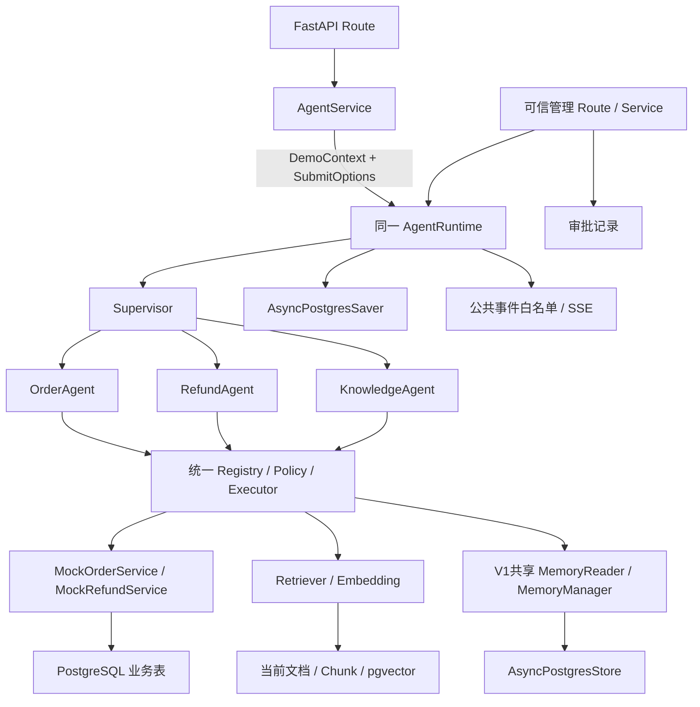
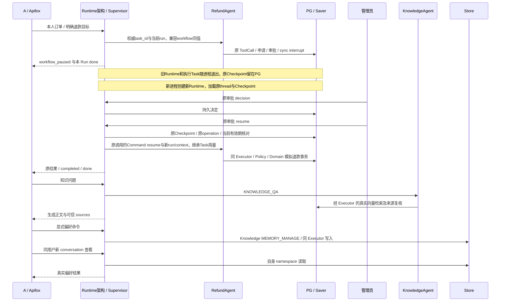

# 06 三个专业流程集成与最终交付完整详细设计

设计日期及最近修订日期为2026-11-09。状态为六阶段详细设计及第二轮定向修订已完成，四项技术决策现已确认或明确延期，当前等待最终设计冻结。所有Task尚未获得开发授权，实际环境验证留实施阶段。

历史轮次说明（保留追溯，当前状态以页首和末尾最新记录为准）。依据为AGENTS.md、项目定位、六阶段路线图与01～05阶段详细设计。本阶段沿用前序方案，以05最新修订的节点调用、生成式RAG、共享Memory及unknown人工核对边界作为集成输入。本轮产物仅为本文件。

## 1. 阶段目标、范围与任务对应

目标是将共享资源、Supervisor与三个专业流程接成完整应用，按实际数据和故障证据验收五项核心能力，交付可重复运行的本地Demo。部署边界为单FastAPI应用、单worker、单PostgreSQL实例。订单与退款使用本地模拟数据和模拟状态变更。

| 二级环节 | 三级Task |
| --- | --- |
| 6.1 三Agent和共享能力整合 | 6.1.1 完整演示环境装配、6.1.2 会话/状态/事件统一 |
| 6.2 核心风险及跨会话验收 | 6.2.1 核心持久化故障、6.2.2 隔离和退化路径 |
| 6.3 演示与交付 | 6.3.1 Apifox与演示脚本、6.3.2 交付记录和最小回归 |

“完整演示环境装配”的完成依据是资源所有权、执行边界、失败语义和真实依赖组合。身份模式继续限development/test。最终能力清单包含统一工具治理、可信HITL、PG持久中断及原调用恢复、真实Embedding/pgvector生成式RAG、跨会话持久Store。

## 2. 总体架构与完整数据流



普通输入由Route一次解析，服务端按development/test名单解析DemoIdentity。Service.prepare_chat取得session并返回DemoContext/SubmitOptions二元组，submit_chat显式传context/options/owner给Runtime.submit。Runtime在thread门禁内唯一创建正式task_id或加载原Task，再关联Run并独立执行。Supervisor经Gateway路由，程序校验组合，专业wrapper白名单映射，同Executor执行工具，结果经过Response及图内run_finish后发布。

DemoIdentity是服务端根据development/test环境允许名单，从请求提供的user_id中解析出的演示身份，不代表真实请求者身份认证。客户端可以选择允许名单中的用户，服务端校验名单并构造DemoIdentity，订单与Memory按该身份核验归属。模型参数不能覆盖user_id、owner或权限范围。A/B验收检查已解析身份的数据访问隔离，其结论不构成公网真实身份安全保证。管理审批使用独立本地演示入口及服务端审计Actor，V1无管理员认证。

| 专业任务 | 执行链 | 结果依据 |
| --- | --- | --- |
| ORDER_QUERY | prepare_query收窄get/list→对应单工具Schema→原生调用→Executor→本人订单SQL | 服务返回的实际订单事实 |
| REFUND_APPLY | 原call持久化→申请/审批登记→真实Gate→管理决定→新进程Runtime读取原快照恢复→Policy/Domain复检→原调用执行 | 原operation的退款事务与审批记录 |
| KNOWLEDGE_QA | 原八节点→原生search_knowledge→Retriever/Embedding/pgvector→证据评估→生成正文→来源复核 | 本轮Evidence及当前doc/version/chunk/hash |
| MEMORY_MANAGE | 原用户明确指令→Knowledge wrapper分派命令小图→准备revision/尝试快照→同Executor写Store | profile.revision/last_mutation及真实结果 |

三个Agent在各自普通准备节点共享MemoryReader。Memory只影响允许的呈现偏好，当前用户明确指令优先。知识问答继续使用check_request、prepare_query、select_retrieval_tool、retrieve_knowledge、assess_evidence、generate_answer、validate_sources、map_result八节点。记忆命令由同KnowledgeAgent分派独立小图。

## 3. 前序交付与集成输入

| 来源 | 06接收的能力与接口 | 集成证据 |
| --- | --- | --- |
| 01 | Settings、DemoIdentity、session绑定、业务池、Gateway、模型/执行预算类型 | 目标库隔离、身份环境限制、资源关闭记录 |
| 02 | AgentState、专业输入输出、transfers、Runtime、RunScope、thread门禁、独立执行、订阅Owner | 顺序任务/澄清、断开清理、终态收敛记录 |
| 03 | Registry冻结、Metadata/Schema、Policy、Executor、call_records、模拟订单 | 参数范围、原生消息配对、本人SQL查询记录 |
| 04 | PG Saver/sync、可信审批、repair-binding、Command恢复、原operation事务与结果复用 | 原call/原namespace、完整进程重启与故障窗口记录 |
| 05 | 版本化当前语料、Embedding/Retriever、生成式AnswerDraft/来源、PG Store、共享Reader/Manager及V1显式记忆命令图 | 真向量、引用、用户隔离、跨会话CRUD及unknown限制 |

6.1.1未来开始前逐项接收实际实现和证据。能力未完成时记录具体依赖及责任Task，装配验证使用真实路径补齐其接线。自动测试可使用构造注入替身，面向演示的启动装配只注册已具备真实实现的能力。

## 4. 应用装配与生命周期

### 4.1 装配顺序与资源所有权

1. 解析集中Settings和目标环境，建立资源就绪视图。
2. 打开01业务池，核对应用迁移版本，构造session、订单/退款/审批具体服务与Repository。
3. 创建04独立checkpoint池及Saver，核对显式setup版本。
4. 创建05 Store资源适配及其lifespan自有池，检查显式setup已完成、所需表/基础结构就绪及资源可用性。Manager只借用读写能力，初始化沿05已有方式。
5. 创建共享ChatModel/Gateway、独立Embedding薄适配和具体Retriever，核对文档profile/维度与当前语料。
6. 构造真实工具定义，统一注册和冻结Registry，注入同Policy/Executor及必要业务上下文投影。
7. 构建专业子图、Memory命令子图及主图。根图采用compile(checkpointer=saver)，专业与Memory子图沿LangGraph支持的父Checkpointer继承机制，保持默认per-invocation语义和原调用位置/生命周期，由框架管理namespace。Saver由根图统一持有，子图保持继承配置，checkpointer=False禁止用于这些子图，动态namespace由框架生成。启动时编译一次。
8. 构造同Runtime、Service、Route依赖，公开各项安全就绪状态。

资源创建函数采用前序既有接口，6.1只补main/builder依赖接线。节点与Service单例的可变用户执行数据经context/State传递。实际构造参数在未来实施时对照已交付接口确认，本文表格描述装配契约。

### 4.2 就绪状态与失败语义

| 资源 | 受影响能力 | 公共行为 |
| --- | --- | --- |
| HTTP存活 | health | 返回存活与安全就绪布尔值，隐藏DSN/密钥/原始异常 |
| 模型或session资源不可用 | chat受理 | 按01/02开流前503 |
| Saver未就绪 | 持久Agent执行/退款恢复 | 暂停相关受理，记录checkpoint_unavailable，演示资源验收阻塞 |
| 订单/审批服务不可用 | 对应业务/管理入口 | 受理前资源错误或开流后failed，保留已提交业务事实 |
| Embedding/知识索引不可用 | QA | failed/capability_unavailable，区别于empty |
| Store技术故障 | 可选个性化/显式管理 | 可选Reader降级，显式读写失败或unknown |

registry的启用状态与资源运行中故障分别处理。注册时按启动能力决定目录，后续瞬时故障经handler安全错误返回。就绪变更与目录冻结的具体接线由6.1.1核对前序实现，避免同一次请求暴露与执行工具集不一致。

### 4.3 关闭与异常初始化

停止Runtime受理，按02默认5秒给予已受理调用收敛窗口，随后按既有关闭规则取消剩余主动执行并释放thread/订阅。取消期间已开始的退款或Store写按operation事实核对，状态记录保留unknown可能性。

执行调用退出后，Store Infrastructure Adapter按05安装版本适配停止/await基类任务，退出Store上下文，关闭其lifespan自有池。随后关闭模型/Embedding客户端、Saver池和业务池，初始化失败按已创建资源反序清理。05的Reader经MemoryManager.snapshot使用公开aget，显式修改经MemoryManager.apply使用公开单项abatch，外部池由应用拥有。局部私有任务适配集中在Infrastructure。

## 5. 会话、状态、预算与事件契约

### 5.1 标识与状态权威

| 标识 | 生命周期 |
| --- | --- |
| user_id | 请求选择的演示用户，经development/test名单校验构造DemoIdentity，普通scope固定 |
| conversation_id/thread_id | sessions按user/conversation持久绑定稳定thread |
| task_id | 唯一权威Task标识，跨澄清/审批等待/恢复保持，对外优先使用 |
| workflow_id | 与task_id同值，仅兼容已有Graph协议，随Task已有记录传递 |
| run_id | 每次具体主动执行独立创建，恢复沿原Task继承用量 |
| call_id | 模型原生ID，退款恢复保留原call及参数 |
| node_call_id | 05按task/node/tool/version/slot/逻辑轮次稳定生成 |
| execution_id | 一次Executor执行入口关联当前run，重试记录attempt序号 |
| operation_id | 退款/记忆业务幂等关联，独立于run与工具物理尝试 |
| request_id | HTTP请求级去重，仅当前进程约定保留窗口内有效 |

Runtime新建Task时生成task_id，兼容字段workflow_id直接取该值。workflow_id不单独生成ID，不维护独立存储或生命周期，只有已有Graph契约需要时随Task字段保留。公共请求使用已确定的ChatRequest，查询/结果优先暴露task_id；已有响应若暂含workflow_id，其值必须与task_id一致。

两类调用均适配为内部ParsedToolCall，调用来源由可信context提供。

| 来源 | ParsedToolCall.call_id | 结果传递 |
| --- | --- | --- |
| LLM原生ToolCall | 保留模型原始call_id，不覆盖/重新生成 | 必须按原call_id正常配对ToolMessage |
| 节点构造调用 | 程序生成稳定node_call_id | 约定Node State/结果增量，不生成ToolMessage或伪造AIMessage |

两类调用使用同Policy、Executor、预算与安全call_records。execution_id关联一次实际执行入口，attempt区分该执行内的实际尝试。Policy拒绝记零handler尝试，纯已知结果复用按既有规则记录；节点结果保留origin/node_name及当前run关联，不能改成模型消息发布。

### 5.1.1 HTTP去重与业务幂等

request_id为可选字段。提供时按02去重键/输入指纹，在约定的当前进程保留窗口去重，网络重试尽可能复用原值。省略或为null时不保证HTTP请求级去重，不按相同消息文本推断重复。进程重启后不能据request_id或旧Run缓存判断业务是否执行。无论是否提供request_id，退款和Memory实际副作用均受持久operation_id及各自领域幂等机制保护。

复用02第6.4已确定缓存规则，终态Run自结束起最长30分钟、最多100条，惰性清理到期及最旧终态，同时删除对应request_id索引与订阅资源。容量压力可提前淘汰，命中不刷新保留期；活动Run不按TTL回收，受8个活动Run上限约束。每Run至多一个可选request_id映射，索引随Run存在，终态/活动共受100+8边界约束。去重键为(user_id,conversation_id,request_id)，输入指纹包含message/input_mode，内容冲突409。清理或重启后不承诺HTTP去重，业务仍查原operation。此为02既有策略的组合约定，无新增缓存服务。

operation_id持久化关联真实业务副作用，退款在原业务记录、Memory写入在既有profile.last_mutation及原Task快照中核对。退款恢复必须复用原operation_id。已成功操作只复用原结果，不产生第二次业务变更。Memory仅保留最近操作关联，若被后来操作覆盖且无法证明旧结果，按05返回conflict/unknown并人工核对。unknown先检查原operation/revision/last_mutation或退款事实，禁止新建operation盲目重试。HTTP去重命中不能替代业务核对，业务幂等也不能推导HTTP请求已被去重。

Graph保存Task快照，RunRecord保存当前进程执行视图，业务表保存订单/审批/退款事实，Store保存偏好，知识表保存当前文档/Chunk。state不能携带模型客户端、池、锁或管理key。父子图只映射允许输入、SpecialistResult、sources、缺参和用量。

| 场景 | 状态与动作 |
| --- | --- |
| 新conversation | 服务端建立绑定，新逻辑目标初始化Task用量 |
| 同conversation完成后新目标 | 复用thread，新Task清理专业槽与用量 |
| needs_input续接 | 保留task/目标/预算，只补允许缺参 |
| 同thread运行中 | 409冲突，同Task多Run顺序执行 |
| 真实审批等待 | 最新父子快照与绑定有效，普通聊天/new_task冲突 |
| 管理resume受理 | 新run、原Task/thread/call/operation，当前context传播至原子图 |
| 已完成Run缓存丢失 | Run查询可404，按04当前Task/申请事实查询核对 |
| 业务成功而图失败 | run_status=failed可与business_status=SUCCEEDED并存 |

审批状态按04区分持久决定、当时有效性和Task状态。

| 既有决定与业务事实 | 有效性与持久记录 | Task/Workflow表达 |
| --- | --- | --- |
| PENDING已到expires_at | GET只读显示decision=PENDING、approval_validity=expired；POST decision/resume短事务按DB时间原子转EXPIRED，原expires_at保留 | 图在interrupt时仍waiting_approval；resume先提交EXPIRED再推进原Gate拒绝收敛 |
| APPROVED但未退款且已过期 | decision仍APPROVED，原approver/decided_at保留；由expires_at与当前DB时间判断已失效，返回安全code=approval_expired | 原图等待时仍waiting_approval；受控resume只走失效拒绝收敛，禁止新退款副作用 |
| 原operation已SUCCEEDED，审批后来过期 | 决定保留原值，原成功结果可查询/复用 | Task按真实Graph状态展示，允许安全结果收敛；业务状态仍SUCCEEDED |

沿既有PENDING/APPROVED/REJECTED/EXPIRED及created_at/expires_at/decided_at字段表达，过期有效性在查询/执行时派生，无新增审批状态机或持久过期标记。Graph关闭申请失败或预算不足时按实际failed/清理未完成表达，不能把审批状态变化当作Task已经收敛或业务表已经关闭。重复resume始终使用原expires_at。

POST resume在Runtime thread门禁内进入原审批受理短事务，锁行后取DB当前时间clock_timestamp，校验主体/绑定/决定/期限。PENDING未过期409 approval_pending，过期先转EXPIRED并提交，随后才允许原Gate拒绝收敛。APPROVED过期保留决定，只允许拒绝收敛或原成功结果复用。事务不跨Graph执行等待，Gate/Policy/Domain再次检查期限。Task未知/未收敛状态仍依原快照和业务事实表达。

受理首先复用04第9.2的四类检查，不把当前interrupt作为通用前置。

| 当前情况 | 动作及验收 |
| --- | --- |
| 真实Interrupt等待 | 核对当前pending interrupt的ID/thread/namespace/Gate及原主体/调用绑定，按审批受理规则通过后以原上下文Command(resume)，拒绝/过期也由原Gate收敛 |
| Gate后Graph未正常结束 | 不要求当前interrupt，校验原持久绑定、最新checkpoint/安全next和operation，可信结果传回原节点；不伪造interrupt或盲发Command |
| Graph已正常结束 | 校验持久终态及结果后直接返回，accepted=false且无新Run，不重跑Graph或退款工具 |
| Checkpoint或业务不明 | 保留unknown/execution_uncertain，拒绝自动恢复，沿原业务核对或人工处理 |

前两类可推进路径才进入上述受理短事务并创建新Run，后两类不创建执行。已成功operation只读核对和结果复用均允许，禁止再次退款写副作用或第二次业务状态变更。

完整进程重启时，旧AgentRuntime、RunRecord缓存与asyncio.Task随旧进程退出。新进程创建新的AgentRuntime实例，通过持久session定位原thread，读取原父子Checkpoint和可信审批事实，再创建新run_id受理恢复并继续原Graph。task_id/workflow_id/thread_id、原ToolCall的call_id/name/raw_args/canonical_args及application_id/operation_id/approval_id保持原关联。恢复复用已保存申请和原调用，两类Task预算从原快照继承。全文的统一Runtime指同一套架构与恢复入口，实例按进程创建。

ModelCallUsage/RunUsage均沿Task累计。模型重试计Chat尝试，工具handler实际尝试计tool_calls，Embedding计搜索内部I/O与主动时间，用户/审批等待排除。未知消耗沿04保守核算/停止边界。普通run_finish在图内返回最终用量更新，真实interrupt保留待恢复快照。

### 5.2 公共SSE与HTTP边界

沿02的event/data格式及RuntimeEvent，以run_id/task_id、sequence和安全payload关联公开事件。workflow_id仅在已有协议兼容需要时作为同值别名保留。事件沿status/token/error/done及workflow_paused/workflow_resumed，Runtime管理状态与发布，SSE负责传输。

| 事件/出口 | 发布条件 | 允许信息 |
| --- | --- | --- |
| status | 运行进度或收敛后状态 | 当前run/task状态、Agent粗粒度阶段 |
| token/最终结果 | Response认可且普通run_finish提交成功 | 最终文本、真实业务结果白名单、知识sources |
| workflow_paused | 真实interrupt已持久化并绑定成功 | 原Task/本run、安全等待说明 |
| workflow_resumed | 原审批恢复成功受理 | 原Task/新run关联 |
| error | 安全失败出口 | code、固定说明、结果是否需核对 |
| done | 本run的流结束 | run_status/task_status，等待可保留 |

token为SSE事件名称，data.content可以一次承载完整最终回复。V1采用业务结果校验、run_finish更新提交、图正常返回和RunRecord收敛后再发布最终文本的粒度。该方案不承诺LLM逐Token输出，执行与事件结构按现有设计使用，模型内部推理/消息/工具参数保持内部可见范围。

### 5.3 按业务类型确定Response职责

| 任务 | 最终Response职责 |
| --- | --- |
| ORDER_QUERY | 根据真实订单事实组织回复 |
| REFUND_APPLY | 根据已核验的退款业务事实组织回复 |
| KNOWLEDGE_QA | 原样输出approved_answer与经过验证的sources |
| MEMORY_MANAGE | 根据真实Store操作结果组织回复 |

KnowledgeAgent的AnswerDraft先通过validate_sources对本轮Evidence及当前document/version/chunk/hash的检查，形成approved_answer和PublicCitation。SpecialistResult白名单传递该正文和来源，主Response直接采用，随后等待run_finish提交再公开。来源验证证明引用关联有效，语义正确性由既有证据约束和样本评估检验。统一Response集中处理最终业务输出，各业务按其既定事实模板或批准结果组织，KNOWLEDGE_QA出口采用直接传递流程，额外LLM自由改写禁止用于该出口。

内部推理、AIMessage/ToolMessage、raw_args、审批快照、namespace、凭据和完整记忆只留允许的内部路径。QA来源由服务端Evidence元数据构造，模型answer通过来源验证后输出，语义正确性另做样本验收。

开流前校验/资源/冲突使用HTTP错误，开流后故障走error/done。单Run单订阅有界队列，首次迭代前断开由请求级Owner清理，旧Owner按subscription_id关闭。执行task由Runtime强引用持有。再次订阅返回安全当前视图和后续事件，Last-Event-ID按02拒绝重放要求。断开或进程退出时done送达情况由真实连接决定。

## 6. 最终跨阶段接口契约

下列协议已同步到对应阶段的Markdown定义，实际接线与验证按未来Task实施。资源选型决策单独留在13.2。

| 契约 | 最终约定 | 定义责任 |
| --- | --- | --- |
| Permission Scope | 普通DemoIdentity固定提供orders:read/refunds:request/knowledge:read/memory:read/memory:write，Service/Runtime传递，同Policy复检。Memory限自身namespace，write还须显式MEMORY_MANAGE及node路径 | 01身份、03执行、05业务 |
| TaskType | CLARIFICATION、ORDER_QUERY、REFUND_APPLY、KNOWLEDGE_QA、MEMORY_MANAGE。Knowledge wrapper分别接QA八节点图与记忆命令图，路由/字段/结果按02统一 | 02 |
| ToolMetadata | name/version/description/enabled/allowed_agents/required_scopes/risk_level/approval_required/read_only/has_business_side_effects/idempotency/timeout_seconds/max_retries/tags。idempotency为not_applicable或operation_id_required | 03，04/05复用 |
| ToolPolicy | task_type来自已验证Task，agent_type来自合法wrapper，origin/node_name来自编译调用入口，允许工具及参数来自程序收窄范围。两来源走同Executor/Policy，来源字段不进入Metadata | 03 |
| 节点记录 | node_call_id以task/node/tool/version/slot/逻辑轮次稳定生成，作为内部ParsedToolCall.call_id。execution_id标一次Executor入口，记录当前run与attempt。call_records存安全结果和累计用量，node结果回State，原生call才配ToolMessage | 03，05复用 |
| 最小业务上下文 | 订单/知识/Reader用user/task/run。退款原call产生后用04退款关联。V1显式写handler用operation/digest/expected_revision/replay_check_only并调MemoryManager.apply，Executor分别投影，完整权限/预算对象留执行层 | 03基础，04/05专属 |
| SpecialistResult | QA completed须approved_answer与已验证PublicCitation，Response原样输出。MEMORY_MANAGE completed须真实Store结果且sources=[]。订单/退款须真实领域事实 | 02结果，04/05内容 |
| HTTP Request | user_id/conversation_id/message必填，input_mode默认auto、request_id为可选UUID，extra=forbid，workflow_id从公共body移除并对旧字段422 | 01准备、02受理 |
| Service提交 | prepare_chat(...)返回tuple[DemoContext, SubmitOptions]，options由已校验input_mode/request_id构造，DemoContext不含这些控制参数及未绑定Task字段；submit_chat(context, *, options, subscription_owner)显式调用Runtime.submit，stream_chat(handle)消费已受理订阅 | 01准备契约，02接线 |
| 幂等边界 | request_id仅当前进程保留窗口去重，网络重试复用；operation_id持久保护业务副作用，恢复复用原值，unknown先核对 | 02 HTTP，04/05业务 |
| Task关联 | Runtime在门禁内生成权威task_id，内部workflow_id=task_id，同值别名保留原图关联。两者在State/专业request/申请审批记录中一致传递，澄清/审批/恢复稳定 | 02生命周期 |
| 持久别名约束 | 04申请两个字段非空同类型并CHECK相等，审批subject_snapshot两个键存在且字符串同值，Repository在写入/复用/读取映射/恢复时比原Task及申请校验 | 04表/Repository |
| Graph出口及恢复 | 普通finish图内结算并sync，真实interrupt不走普通finish。管理恢复分真实等待Command、Gate后原绑定/安全位置核对续跑、正常END直接持久结果复用、未知拒绝自动恢复四类，仅实际推进创建新Run，延续原Task/调用/预算 | 02运行、04恢复 |

Service生成普通候选run_id并解析session，Runtime确定受理归属。只有实际恢复推进才创建新run，正常END复用持久结果，未知拒绝自动恢复。客户端选择演示身份/会话并提交业务输入。task_id唯一权威，workflow_id仅同值内部兼容别名，无独立ID/存储/生命周期。两类调用统一ParsedToolCall/Policy/Executor，原生ToolMessage与节点State分别闭合，06验收组合行为。

Memory V1装配只包括共享MemoryReader、MemoryManager和既有MemoryManage命令图。原Human确定性解析/白名单校验形成MemoryCommand后，同Policy/Executor到Manager.apply；读取由Reader到Manager.snapshot。只支持answer_language/answer_style，保留跨会话/跨Thread、版本、幂等、锁及unknown边界。MemoryWriter为V2候选维护组件，不在V1注册、装配、执行或验收，也不是V1前置。

写前协议沿D03第5.1/D04第6.4及D05第10.2，prepare_memory_write准备原命令/op/digest/expected_revision，用同prepare_attempt绑定真实准备context、编译目标context和最小业务关联，标记及原State完成sync后，execute_memory_write才以当前context经同Policy/execute_prepared进入handler及Manager.apply。prepare零尝试，sync失败无write handler，普通execute不能绕过写前边界；退款既有调用缺省不变。

Memory节点白名单以D05第6.1为唯一具体清单，实际写仅execute_memory_write，显式读节点R命名read_preferences，其余读取仅各专业prepare_query/prepare_refund及prepare_memory_write的合法Agent/Task组合。装配不靠KNOWLEDGE身份笼统放行，Policy同时验证来源节点、origin、工具名/版本、参数、scope及预算。

Manager四态与Executor结果分层。applied/reused为success，conflict为business_rejected/not_started，unknown为既有执行failed但必须保留code=memory_result_unknown、effect_status=unknown、data.status=unknown及原memory_result，不能当作普通failed或未写。明确未开始的基础设施异常由Executor映射failed/not_started且data=None；handler已进入的读取故障仍计一次，Policy/启动前预算拒绝才零次。当前unknown领域载荷按注册Schema校验，无旧成功数据。Run/公共错误表达未完成并保留结果未知说明，不重试写。

原operation已未知时，核对读取故障或Policy/预算阻断不能将其改为未开始。当前核对调用的拒绝状态与原memory_result.unknown并存；Manager无法确认原结果仍返回unknown，本次零写不证明原写未提交。

Memory unknown按05只核对原operation/revision/last_mutation，操作者确认前暂停相关profile写入。资源运行行为与版本适配的未来验证归13.2B。

### 6.1 本地审批Actor及未来认证接入

V1暂缓管理员认证，不配置admin_api_key、管理SecretStr或X-Admin-Key，不实现compare_digest、固定demo-admin、账号/RBAC/SSO。04提供最小ApprovalActorProvider，development/test注入LocalDemoApprovalActor，返回ApprovalActor(approver_id='local-demo-approval')仅用于审计，不证明真实操作者身份或权限。客户端不能提供reviewer_id/approver_id或权限作为可信来源。

4.2.2负责ActorProvider、审批Repository及列表/详情/决定，4.1.2负责原Runtime的Resume/repair-binding及接线，二者扩展同一个approvals Router。06仅装配provider并注册一次，ApprovalService与退款状态机不依赖认证实现。未来真实认证可提供同一Actor边界，不在V1实施。

V1整个审批入口只用于development/test本地回环演示，启动及Apifox指向127.0.0.1，不暴露公网、远端或反向代理；production不注册演示Router，对应地址404，provider不创建演示Actor。本地直接调用不要求凭据，不能把Actor或接口分离描述为认证隔离。普通chat不能批准、拒绝或触发Resume，领域Policy/归属/原调用绑定/30分钟有效期/幂等检查继续执行。

## 7. 六个Task完整设计

### Task 6.1.1 完整演示环境装配

#### 1. 设计目标

把01～05的真实实现经正常HTTP入口组合成统一可运行应用，建立资源可追踪的初始化与关闭顺序。

#### 2. 模块职责划分

main/lifespan拥有应用资源，infrastructure管理具体池/Saver/Store适配，工具实现封装Domain/Retriever/Memory，builder连接专业图和主图，Runtime/Service/Route沿既有分层。

#### 3. 技术方案与选择理由

使用现有构造注入和应用生命周期管理。模型/Graph应用级共享，执行数据显式传递，Registry装配后冻结，单Runtime管理全部任务。演示入口由真实资源和本地模拟业务组成。

#### 4. 未来正式实施步骤

1. 接收01～05交付物与已冻结的前置契约清单，核对第6节同步项和证据是否齐备。
2. 按第4节创建资源与具体服务，核对池所有权及显式初始化版本。
3. 将订单、退款、知识、偏好工具注册同Registry，校验Schema/版本/handler及过滤范围。
4. 注入共享Gateway/Policy/Executor，构建专业图/记忆命令图与wrapper，仅根图compile(checkpointer=saver)，子图按4.1继承。
5. 装配既有Runtime/Service，注册由4.2.2与4.1.2共同扩展的同一个approvals Router一次。前者提供ApprovalActorProvider及审批列表/详情/决定，后者提供Resume/repair-binding能力及接线。核对普通聊天与审批入口分离、Actor服务端来源及production禁用，06只装配注册，不重复实现接口。
6. 清理演示配置对测试Stub的引用，自动用例通过构造注入替身。
7. 未来分别验证正常启动、部分资源失效、初始化中途失败与关闭，记录模拟数据标记和就绪状态。

#### 5. 接口、类、函数及数据结构

复用Settings、ModelGateway、ToolRegistry/ToolDefinition、ToolPolicy、ToolExecutor、各builder、AgentRuntime及既有Service。就绪视图只投影模型/session/checkpoint/knowledge/store等少量字段，命名以01已交付接口为准。构造依赖变动在第6节登记。

#### 6. 文件与目录规划

未来修改app/main.py、infrastructure既有资源模块、主/专业builder、API依赖及必要配置示例。main只注册前序共同扩展的同一个approvals Router，API依赖只接已有ActorProvider/Service，不新增第二套管理Route或实现。资源初始化继续使用01/04/05脚本，受影响装配用例覆盖接线。

#### 7. 前置依赖和阶段交接

依赖01～05实际能力及公共接口同步，给6.1.2提供真实应用，给6.2提供可观测持久资源。开发授权后先补前置缺项再进入装配验收。

#### 8. 交付物与未来验收标准

三个专业任务和显式偏好任务能经正常入口访问真实资源，来源/工具集合/状态可核对，初始化失败有明确资源状态，关停无遗留活动调用。记录实现、自动检查和真实联调各自证据。

### Task 6.1.2 会话/状态/事件统一

#### 1. 设计目标

按前置冻结契约完成会话、Task、Run、Graph State、RuntimeEvent和SSE接线，使顺序任务/澄清/审批恢复具有一致身份关联、预算与公开状态。

#### 2. 模块职责划分

Service解析可信session与管理引用，Runtime受理/互斥/收敛，transfers维护父子白名单，Graph维护结果与图内finish，streaming只序列化允许事件。

#### 3. 技术方案与选择理由

沿02 RunRecord、RunScope、请求级SubscriptionOwner和04真实快照恢复。task_status/run_status/business_status分别来自其权威，05知识sources和Memory结果按任务类型投影。

#### 4. 未来正式实施步骤

1. 复用prepare_chat二元组和submit_chat(context, options, owner)签名，确认Route唯一解析且input_mode/request_id完整进入Runtime，DemoContext不承载提交控制项。仅Runtime新建正式task_id，旧Graph在正式绑定后取同值workflow_id。
2. 接新会话/顺序任务/澄清、当前Task查询和同thread冲突，验证旧专业槽清理。
3. 集成4.1.2已提供的resume与原Task预算继承，接入事件/状态投影，验证新Runtime加载原thread/Checkpoint、新run延续原调用。
4. 对齐真实interrupt与普通结束出口，确定run_finish、RunRecord最终化、事件发布顺序。
5. 依据前置字段契约接安全RunView/最终sources/记忆结果投影，KNOWLEDGE_QA原样传approved_answer与sources。
6. 复用Owner覆盖首次迭代前断开、慢订阅和重新订阅，核对缓存失效/重启后的查询行为。
7. 未来核对HTTP去重窗口/重启失效、事件顺序/唯一done、完整正文token、跨Task清理及预算继承，业务执行仍按原operation核对。

#### 5. 接口、类、函数及数据结构

复用ExecutionContext/RunExecutionContext、PendingTask、SpecialistInput/Result、RuntimeEvent、RunView、ResumeAcceptance、SubscriptionOwner。新增字段仅取第6节已明确的跨阶段同步要求，最终序列化示例见第9节。

#### 6. 文件与目录规划

未来修改runtime/agent_runtime.py、services/agent_service.py、contracts/transfers、专业wrapper、streaming及既有HTTP测试。公共事件Schema在其原模块集中维护。

#### 7. 前置依赖和阶段交接

依赖6.1.1装配、02运行契约及04/05结果结构，交6.2真实受理/查询/事件行为及6.3可冻结API。

#### 8. 交付物与未来验收标准

验收context/options由Service显式完整传入Runtime，request_id省略时不承诺HTTP去重，缓存规则不变。Task仅Runtime创建，续接不更换ID。实际恢复推进新建Run并延续用量，正常END只返回持久结果，未知拒绝自动恢复。审批/业务/执行状态独立表达，订阅断开释放且执行继续，来源和业务事实真实，无跨任务污染。

### Task 6.2.1 核心持久化故障

#### 1. 设计目标

验收真实PG中断、完整进程重启与原退款调用的持久关联，并核实业务提交后图快照失败的安全行为。

#### 2. 模块职责划分

04已有审批/Domain/Runtime实现承担执行语义，集成用例和独立进程驱动控制故障边界，业务SQL与Saver状态接口提供事实，记录文档保存证据。

#### 3. 技术方案与选择理由

复用04故障矩阵和原operation核对，采用真实测试PG、受控模型及完整进程退出/新进程启动。关键数据在重启前保存安全关联清单，业务结果从原记录读取。

#### 4. 未来正式实施步骤

1. 为各成功/拒绝/故障分支准备独立订单，记录初态及user/session/thread/task/call/operation/approval关联。
2. 发真实退款请求，核对原call、规范参数、真实interrupt、child namespace与审批绑定已落盘。
3. 停止FastAPI整个进程并确认退出，保留测试数据库，以相同版本/节点拓扑新进程启动。
4. 新进程新Runtime读取原Task/审批/Checkpoint，分别验证真实interrupt等待、Gate后未结束、正常END、快照/业务未知四类。只有前两类核验后创建新run推进，核对原thread/task/workflow/call/name/args/application/operation/approval和继承用量；END直接持久结果，未知拒绝自动恢复。
5. 验拒绝/重复/相反决定/并发resume和有效期，PENDING惰性EXPIRED、APPROVED过期保留决定但禁写、Task仅由Graph出口收敛；重复resume不续期，成功op过期仅复用。
6. 注入真实中断已存但绑定失败，调用既有repair-binding，核对原绑定幂等与未绑定不可决定。
7. 注入事务提交后结果checkpoint失败，按原operation分别验证成功复用、确认未执行再受控尝试、unknown停止。
8. 检查原ToolMessage ID/ToolCall配对、订单标记/成功申请唯一，保存实际根/子恢复调用形式及安全重入证据。

#### 5. 接口、类、函数及数据结构

复用ApprovalReference/Subject/InterruptBinding、RefundRecoveryContext、PreparedToolAttempt、MockRefundService原operation查询和现有管理接口。next=execute_refund时确认成功的结果通过04可信context到达原节点，退款写副作用尝试次数为零。

#### 6. 文件与目录规划

未来扩展04已有PG/独立进程用例与tests/test_refund_integration.py，故障控制仅测试注入。结果写入最终验收记录，包含业务行、关联摘要与安全快照投影。

#### 7. 前置依赖和阶段交接

依赖6.1.1/6.1.2、04实际PG Saver及退款实现，接收04已验证窗口，重点验证完整装配下组合行为。交6.2.2和6.3可信重启演示证据。

#### 8. 交付物与未来验收标准

真实进程退出后原中断可找到并Command恢复，Gate后没有pending interrupt也可依安全位置核对续跑，正常END无新Run/Graph/退款工具，未知保留unknown并拒绝自动恢复。原operation已成功时允许只读核对和结果复用，退款写副作用尝试及第二次状态变更为零。拒绝零退款，实际版本嵌套调用有验证记录。

### Task 6.2.2 隔离和退化路径

#### 1. 设计目标

验收三个专业流程共享基础设施时的用户隔离、权限拒绝、故障降级和预算退出。

#### 2. 模块职责划分

现有API/Policy/Domain维护安全边界，集成用例从正常入口提供A/B和错误输入，必要故障替身控制外部错误，真实PG/Store/向量资源验证持久结果。

#### 3. 技术方案与选择理由

复用前序风险用例，按第10节矩阵挑选跨组件新增风险。验证错误分类、实际访问次数/状态和公共输出，测试结构跟随可观察行为。

#### 4. 未来正式实施步骤

1. 通过服务端按名单构造A/B两个DemoIdentity，验选定身份后的本人订单/Store访问范围、普通chat不能提交审批决定或恢复，审计Actor不能来自user_id、模型args伪造owner/scope拒绝。body.user_id选择另一允许用户按演示规则解析。
2. 验get/list范围和统一ParsedToolCall的来源记录，原生call_id不可覆盖，node_call_id只回State，execution_id/attempt可追溯，同Policy拒绝时零handler尝试。
3. 验SSE首次迭代前断开、流中断开、队列慢消费及再次订阅，后台业务结果照常核对。
4. 注入Gateway失败/任务额度耗尽，核对跨run计数与副作用前预算校验。
5. 验Embedding错误、查询故障、empty、弱证据、错误/过期引用与冲突，核对生成正文语义样本。
6. 验Reader empty/unavailable/denied/partial及显式读取失败，权限拒绝无Store访问。
7. 验Memory相同op、revision冲突及两层结果，区分failed/not_started与failed/unknown且领域unknown保留；验写前sync失败无handler、prepare零计数、最终Policy拒绝零尝试及已入handler未Put仍计一次。核对6.1完整节点白名单、错node/allowed_tools/model伪造均拒绝，以及原快照失败重入只核对，无自动恢复平台。
8. 验关闭时任务/订阅/池释放，记忆失败发生在已完成退款之后时业务事实保持成功。

#### 5. 接口、类、函数及数据结构

复用Policy结果、ToolExecutionResult、PreferenceSnapshot/MemoryMutationResult、AnswerDraft/Evidence/PublicCitation及安全RunView。expected_revision、last_mutation和replay_check_only沿05定义。

#### 6. 文件与目录规划

未来复用HTTP/Runtime/知识/记忆集成测试，增加仅覆盖装配风险的用例，固定知识问答fixture与最终故障记录。真实模型/Embedding记录独立存档。

#### 7. 前置依赖和阶段交接

依赖6.1完整装配及6.2.1核心持久事实，知识/记忆沿05已交付语料和namespace。交6.3可重复的正常/退化演示和已知限制。

#### 8. 交付物与未来验收标准

拒绝、技术失败、unknown与正常无数据均可辨别，跨用户无数据泄漏，断开与降级规则成立，默认测试外部付费调用可控。所有核心组合风险有实际证据和未验证项登记。

### Task 6.3.1 Apifox与演示脚本

#### 1. 设计目标

让使用者按同一组请求完成本人订单、退款重启恢复、证据问答和跨会话偏好演示，并能核对底层事实。

#### 2. 模块职责划分

Apifox集合组织接口与安全变量，演示说明负责初始化/操作顺序和预期数据，既有查询接口/SSE提供反馈，操作者负责真实进程重启与人工审批。

#### 3. 技术方案与选择理由

采用第8～9节演示脚本与普通/管理环境变量分组，重启后从原审批记录提取关联。成功/拒绝使用不同模拟订单，历史成功订单保持原状态。

#### 4. 未来正式实施步骤

1. 固定目标库、演示用户/订单/语料/profile及初始偏好，记录user_id演示选择的边界、资源版本与安全前提。
2. 建Apifox分组，普通user_id留JSON作演示选择，本地审批组无管理key/Header/认证变量，Actor由服务端provider固定提供。集合指向127.0.0.1，production审批入口不可用，导出仍清空模型/数据库等秘密。
3. 按第8节逐项制作请求、SSE观察点及状态/业务核对步骤。
4. 配置从返回结果人工或集合脚本提取run/task/application/approval/digest，禁止硬编码旧关联。
5. 写清停止原进程、保持PG、新进程启动、查询原审批与独立resume步骤。
6. 加入拒绝/无证据/B隔离/修改删除分支及失败定位表。
7. 未来由另一操作者从导出的集合和说明重跑并记录差异，修正具体演示步骤。

#### 5. 接口、类、函数及数据结构

API采用第9节既有请求，集合变量包括base_url、user_a/user_b、conversation、run_id、approval_id、application_id、subject_digest。内部thread/call/operation只读记录用于核对，管理请求按04Schema提交。

#### 6. 文件与目录规划

未来交付apifox/agent-engine-demo.json或实施时Apifox支持的导出格式、docs/demo-walkthrough.md及安全环境变量模板。具体格式由6.3.1导入验证后冻结。

#### 7. 前置依赖和阶段交接

依赖6.1与6.2通过的核心流程，交6.3.2可实际导入的请求集合、重启演示说明和失败识别步骤。

#### 8. 交付物与未来验收标准

集合可导入、敏感值留本地环境，另一操作者按说明完成原中断恢复和实际数据核对，A偏好在新conversation与重启后可读，B保持自身数据隔离。

### Task 6.3.2 交付记录和最小回归

#### 1. 设计目标

交付可以在干净环境复现的运行材料，建立设计/实现/自动验证/真实联调的独立记录和用户最终验收入口。

#### 2. 模块职责划分

依赖清单固定环境，README给主运行路径，示例配置解释资源目标，演示文档与Apifox承载操作，验收记录保存证据及限制。维护者按现有项目规范运行必要验证。

#### 3. 技术方案与选择理由

集中复用01～05初始化入口与阶段证据，执行一次受影响最小回归和干净环境演示。只对新增失败/变动扩大检查，真实Chat/Embedding用量和结果单独记录。

#### 4. 未来正式实施步骤

1. 固定Python/直接依赖/解析版本及PG17/pgvector实际版本，记录安装/目标配置。
2. 整理.env.example，列Chat/Embedding/PG/Store/管理凭据/预算配置及就绪行为。
3. 核对应用迁移、Saver.setup、Store.setup、模拟订单种子和固定知识导入顺序。
4. 复用6.3.1集合和演示，更新README架构/启动/状态查询/关闭/重启说明。
5. 授权开发阶段按AGENTS运行必要依赖检查、受影响回归与代码检查，并在干净环境核对资源释放。
6. 显式真实Chat/Embedding/PG完成五能力演示，记录供应商/profile、步骤、实际数据和费用观测边界。
7. 填交付/验收矩阵、未实现/未验证项及已知限制，提供用户审核材料。

#### 5. 接口、类、函数及数据结构

交付记录每项含能力/责任Task、实现状态、自动验证证据、真实联调证据、环境版本、结果与遗留。状态采用planned/implemented/verified/blocked等可读字段，最终用户验收单独记录日期及结论。

#### 6. 文件与目录规划

未来更新README.md、.env.example、必要依赖清单/初始化说明，交docs/final-acceptance.md、demo-walkthrough.md及Apifox集合。执行与修改仅在后续开发授权后进行。

#### 7. 前置依赖和阶段交接

依赖6.3.1与6.2所有关键证据。最终交用户按第12节门禁验收，后续问题按具体责任Task登记处理。

#### 8. 交付物与未来验收标准

干净环境能按材料复现五核心能力，代码/自动验证/真实联调状态分别可查，密钥只在本地环境，所有关键失败或未验证项明确列出，用户完成最终验收后记录V1交付结论。

## 8. 完整演示流程与时序

### 8.1 准备顺序

未来操作者选择development或独立test目标，准备PG17/pgvector，执行应用迁移及04 Saver/05 Store显式setup，幂等插入模拟订单，按text-embedding-3-small/1536及同一Profile导入语料，配置普通用户、真实模型/Embedding凭据，注入本地审计Actor，以127.0.0.1启动单worker。V1无管理key配置，production不注册审批Router。各步复用已有脚本，种子保留已退款事实，成功演示使用未退款独立订单或明确重置独立测试环境。

### 8.2 操作与预期

| 步骤 | 请求/操作 | 预期与核对 |
| --- | --- | --- |
| 1 | A会话c1问本人订单 | Supervisor→Order，工具集收窄，返回实际本人订单 |
| 2 | A同会话明确新任务申请退款 | 原call保存，申请与审批PENDING，真实interrupt |
| 3 | 查询当前Task/审批 | waiting_approval，记录approval/application/task/thread/call/operation |
| 4 | 普通chat试图批准 | 409/无审批权限，原记录保持 |
| 5 | 完全停止FastAPI进程，保留PG后重启 | 新进程重新建立资源，原审批/快照仍可读取 |
| 6 | 管理员提交原subject_digest的决定 | 原记录APPROVED，resume_required |
| 7 | 独立调用原approval的resume | 新run，原thread/task/call/operation保持，兼容workflow取task同值；实际写前再次核验有效期 |
| 8 | 查业务与Run结果 | 原operation成功一次，订单标记与申请结果一致 |
| 9 | 重复相同决定/resume | 成功op仅复用，未写而审批过期则拒绝新副作用，重复resume不续期 |
| 10 | 另一个独立订单做拒绝分支 | 原call拒绝闭合，订单退款标记保持初态 |
| 11 | A知识问答 | 原生search调用、真实向量证据、生成正文、真实sources |
| 12 | 问知识库之外的问题 | rejected资料不足，技术故障另归failed |
| 13 | A明确“请记住：回答风格=简洁” | MEMORY_MANAGE，Store实际revision变化 |
| 14 | A新会话c2查看偏好，再重启读取 | 同user namespace中的偏好仍可读取 |
| 15 | 选择B的DemoIdentity查看偏好，以B查询A订单；另行选择A作对照 | B的访问范围限B的订单/profile，A使用A范围。客户端选择允许的A user_id可模拟A，验收区分身份选择与领域归属校验 |
| 16 | A修改、删除指定偏好、清除全部 | 实际Store值变化，最小last_mutation元数据按05保留 |
| 17 | 最终核对 | 业务表、Saver状态接口、Store结果与知识来源一致 |



## 9. Apifox接口与公开结果契约

集合分为环境/健康、普通chat与Run、Task/退款状态、独立管理、RAG、Memory六组。本地审批组不含管理key/Header/认证变量，审计Actor由服务端提供，production禁用，演示地址仅127.0.0.1。普通user_id在JSON body一次解析，由服务端按development/test名单构造DemoIdentity。选择另一允许ID即可模拟该用户，数据访问按解析后的身份归属执行。

| 接口 | 请求要点 | 响应观察 |
| --- | --- | --- |
| POST /agent/chat | user_id、conversation_id、message，可选input_mode/request_id沿02 | SSE首帧run/task，最终status/token/sources/done |
| POST /agent/runs/{run_id}/status | user_id/conversation_id | RunView、安全结果、task/run状态、用量/usage_complete |
| POST /agent/runs/{run_id}/events | 同上 | 当前快照+未来事件，现有单订阅约束 |
| POST /agent/tasks/current | user_id/conversation_id | 持久当前Task，重启后原Run缓存丢失时使用 |
| POST /agent/refunds/{application_id}/status | user_id/conversation_id | 本人申请/审批/实际模拟结果 |
| GET /admin/approvals及/{approval_id} | development/test本地演示入口，服务端审计Actor | 只读列表项/详情均含approval_id/subject_digest/decision/expires_at/binding_status/approval_validity/can_decide/can_resume，另投影真实业务/Task状态 |
| POST /admin/approvals/{approval_id}/decision | decision、subject_digest | 200原子决定，相同幂等、相反409 |
| POST /admin/approvals/{approval_id}/resume | 空object、本地演示入口及服务端Actor | 按四类受理，真实等待/Gate后安全推进202新Run；正常END为200 accepted=false、run_id=null、result为原Task持久SpecialistResult，无Graph或退款工具调用；未知/未到期PENDING/不安全位置409，过期不得新写 |
| POST /admin/approvals/{approval_id}/repair-binding | 空object、本地演示入口及服务端Actor | 幂等补原真实绑定，随后另行decision/resume |

普通chat示例采用规划中的02请求形态。

审批响应中binding_status为unbound/bound，approval_validity为派生valid/pending/expired/rejected，规则与04第8.2相同。GET时间取当前DB时间，仅计算标志。PENDING到期可仍显示decision=PENDING、validity=expired，POST才落库EXPIRED；APPROVED到期显示原decision及expired。can_decide要求本地入口已启用、未过期PENDING及完整绑定。can_resume要求入口已启用、主体/绑定/当前安全快照一致、无活动Run，并已有决定或PENDING已过期；未过期PENDING为false，终态Task为false。过期时true只允许拒绝收敛或成功结果复用，POST仍重新校验。

同决定重交返回200原审批视图，approver_id/decided_at/expires_at保留，即使已批准记录后来过期；相反决定409。展示字段不持久化为另一套状态机。

```json
{
  "user_id": "dev-user",
  "conversation_id": "demo-c1",
  "message": "查询订单 demo-order-1",
  "input_mode": "new_task",
  "request_id": "8ca2e289-f094-4db7-9706-ce952268e462"
}
```

示例order_id需在未来集合替换为种子实际ID。网络重试复用原request_id，完全重启后用原task_id、申请/审批和operation事实查询判断结果。退款继续通过原approval resume，原operation保持，不能靠新chat/request_id判断未执行或发新operation盲试。公共示例不提交workflow_id。Memory沿05语法，unknown先人工核对原操作再处理。

公共最终结果字段按已交付RunView冻结。订单投影服务事实，退款标记模拟并含原operation/application及实际状态，知识保留answer与PublicCitation的evidence/document/version/chunk/title/source/section/page/checked_at，Memory给允许字段/revision/操作结果。客户端以来源对象构造显示，原始数据库/SDK对象留在内部。

## 10. 核心风险与未来验收矩阵

| 场景 | 可观察判据 | 归属 |
| --- | --- | --- |
| 完整装配 | 五能力真实资源、三专业实际路由、统一注册/执行 | 6.1.1 |
| 顺序Task与澄清 | thread复用、Task边界清楚、旧状态清理/预算继承 | 6.1.2 |
| 同thread并发 | 第二执行冲突，不创建第二业务Run | 6.1.2 |
| Task唯一权威 | 澄清/审批/恢复task_id稳定，workflow仅内部同值兼容，无独立ID/存储/生命周期 | 6.1.2 |
| HTTP/业务幂等 | 同进程原request_id匹配去重，重启不依赖它判断副作用；原operation成功只复用，unknown不建新op | 6.1.2/6.2 |
| 可选request_id | 省略/null不保证HTTP去重，两类请求的实际副作用仍按原operation幂等保护 | 6.1.2/6.2 |
| 去重容量/淘汰 | 终态最长30分钟/100条，惰性淘汰最旧及其request_id，活动最多8条保留；过期/容量/重启后按业务事实判断 | 6.1.2 |
| 真interrupt重启 | 全进程退出后原snapshot/namespace/call可定位 | 6.2.1 |
| 批准/拒绝/重复相反决定 | 可信记录、拒绝零退款、同决定幂等/相反409 | 6.2.1 |
| 绑定失败 | 原repair-binding补同一绑定，未绑定不可审批 | 6.2.1 |
| 退款成功后快照失败 | 原op成功，原节点重入只复用结果，退款写副作用尝试次数为零 | 6.2.1 |
| 确认未执行/unknown | 前者重新检查批准/预算/资格和新尝试标记，后者停止副作用 | 6.2.1 |
| 原生/节点工具记录 | 模型消息按call配对，node只记录State，实际尝试统一计数 | 6.2.2 |
| 执行关联差异 | 原生call_id原值与ToolMessage匹配，节点ID程序生成且无模型消息，execution_id/attempt/State记录可关联 | 6.2.2 |
| 审批过期 | 自审批申请创建计时，已批准但写前过期仍阻止副作用；成功op仅查询/复用，重复resume不绕过 | 6.2.1 |
| 数据与管理隔离 | 服务端分别构造A/B DemoIdentity，B范围无法查询A订单/namespace，普通chat不能审批，本地控制面无真实身份认证，模型不能改scope；body.user_id选择A时按A演示身份执行 | 6.2.2 |
| 本地审批Actor及延期认证 | development/test回环演示、服务端固定Actor仅作审计，拒绝body额外reviewer_id/权限字段；production不注册Router，V1无管理key/Header/认证配置，普通chat无法审批 | 6.1.1/6.2.2 |
| 审批过期状态 | PENDING→EXPIRED，APPROVED过期仍保留决定并派生无效，Task由Graph真实出口决定；成功op保持SUCCEEDED，重复resume无新副作用 | 6.2.1 |
| 审批GET/POST界限 | GET八字段只读，POST resume行锁后按DB时间转换过期PENDING再原Gate收敛，未到期拒绝；相同决定不改原人/时间/期限 | 6.2.1 |
| 四种Resume及写副作用边界 | 真实等待核验interrupt后Command；Gate后不要求当前interrupt，按原绑定/安全位置核对续跑；正常END返回持久结果且无新Run/Graph/退款工具；未知拒绝自动恢复。成功operation允许只读核对，退款写尝试及第二次状态变更均为零 | 6.2.1 |
| Service提交参数 | Route单次解析，prepare_chat返回context/options，submit_chat显式转交Runtime，缺省request_id仍可提交且不承诺HTTP去重，Task仅Runtime创建 | 6.1.2 |
| 持久task别名 | 申请CHECK相等、审批主体同值约束、Repository校验有效，错配拒绝；无独立workflow生命周期 | 6.2.1 |
| 已确认检索与ES边界 | text-embedding-3-small/1536与Profile一致，candidate5/top3、2400tokens/24KiB、阈值null，评估三态；Agent仅领域DTO，PG唯一权威后端，无ES依赖/部署/混排/双写 | 6.1.1/6.2.2 |
| QA最终回复 | AnswerDraft经来源检查后，SpecialistResult传approved_answer/PublicCitation，Response原样输出，无额外LLM改写，语义质量单独验收 | 6.1.2/6.2.2 |
| Saver继承 | 仅根图持PG Saver，专业/Memory子图沿默认per-invocation继承，原namespace和调用位置可恢复 | 6.1.1/6.2.1 |
| SSE三种断开 | 首次迭代前/中途/慢订阅资源释放，执行与业务事实可查 | 6.2.2 |
| SSE输出粒度 | 业务校验与run_finish提交后才公开，token.data.content可承载完整正文，验收依据为事件及结果 | 6.1.2/6.2.2 |
| 模型失败/额度耗尽 | 安全失败、累计不清零、额度耗尽不继续写 | 6.2.2 |
| Embedding/PG错误与empty | failed和无匹配/不足rejected明确区分 | 6.2.2 |
| 引用/语义边界 | 错ID/版本拒绝，合法引用的错误正文在语义验收失败 | 6.2.2 |
| Reader分类 | empty正常、技术unavailable降级、denied零Store访问、partial剔除字段 | 6.2.2 |
| Memory版本边界 | V1原Human确定性命令经同治理到Manager.apply，Reader统一委托snapshot，两个字段且跨Thread共享；无MemoryWriter运行实例/工具/文件实现依赖，V2仅候选建议与未来独立授权边界 | 6.1.1/6.2.2 |
| Memory准备/节点/失败契约 | 原关联和标记sync后才execute_prepared最终Policy，固定准备源/执行目标，错节点拒绝；Manager仅四态，unknown保留领域载荷/code/effect_status，not_started技术错误无伪造领域结果；工具尝试与实际写次数分开 | 6.1.2/6.2.2 |
| V1显式记忆修改故障 | 同op复用、旧revision拒绝、unknown不报成功；人工核对原operation/revision/last_mutation前暂停相关profile新写，禁止新op盲写；已知重入只核对，人工暂停为操作规约 | 6.2.2 |
| 已退款后Memory失败 | 订单/申请实际成功事实保持，Memory单独报告结果 | 6.2.2 |
| Store跨会话/重启 | A在c1写c2读，进程重启保留，B隔离 | 6.2.2 |
| 关闭/初始化中断 | 所有已创建资源释放，运行中副作用状态可核对 | 6.1/6.2 |
| 独立操作者复现 | 从集合/说明到数据核对完整成功 | 6.3 |

测试按实际风险组织并复用01～05已有用例。持久化场景采用真实独立测试PG/Saver/Store/pgvector，付费Chat/Embedding演示单独显式运行并记录。普通协程崩溃按未知执行状态处理，只有04已定义的持久中断及受控安全后段具备恢复路径。

## 11. 交付文件、依赖与实施顺序

| 未来交付 | 内容/责任 |
| --- | --- |
| README | 定位、架构图、启动/关闭、资源初始化、公共请求迁移，6.3.2 |
| .env.example | 普通/管理凭据边界、Chat/Embedding/DB/预算设置，6.3.2 |
| requirements.in/txt与版本记录 | 实际直接依赖和已验证解析版本，6.3.2 |
| Apifox集合与无密钥变量模板 | 普通与管理分组、动态原关联，6.3.1 |
| docs/demo-walkthrough.md | 首次环境、退款重启、RAG、Memory及失败定位 |
| docs/final-acceptance.md | 每能力实现/自动/真实/用户验收证据、遗留 |
| 既有初始化脚本/迁移/知识语料 | 引用01/03/04/05的具体入口，记录目标和版本 |

未来主线为前序01～05实现与接口同步完成→6.1.1→6.1.2→6.2.1→6.2.2→6.3.1→6.3.2。6.1.2的Schema对齐和6.3集合草案可提前准备，正式端到端验收遵循依赖。6.2.2故障用例设计可复用前序资料，真实组合验证等待完整装配。

## 12. 阶段门禁与最终验收

| 门禁 | 进入下一环节所需证据 |
| --- | --- |
| G0前置 | 01～05实际能力与第6节接口差异已有责任方/处理结论 |
| G1装配 | 真资源与正常入口三专业任务、Memory任务及状态协议成立 |
| G2持久风险 | 完整进程重启、原call恢复、拒绝/冲突、提交后快照失败已验证 |
| G3隔离退化 | 第10节关键隔离/预算/SSE/检索/Memory故障均有证据 |
| G4复现 | 干净环境、实际可导入集合、初始化及独立操作者演示完成 |
| G5用户验收 | 五核心证据、全部重大遗留处理、用户给出最终验收结论 |

设计完成、编码完成、自动验证、真实联调和用户验收分别登记。重大隔离、重复副作用、伪成功、原中断恢复或持久数据缺失属于门禁阻塞。资料不足、配置缺失或模型服务不可用的场景标未验证并说明条件。V1完成以G5及实际证据为准。

## 13. 最终技术决策与实施验证

### 13.1 已确定的接口及本轮同步

01已统一scope与公共请求，02已正式接纳记忆任务/结果及Task同值别名，03已定义最终Metadata/Policy/节点记录，04已采用同Policy来源约束及副作用验收，05已复用这些协议。路线图Task 6.1.1更名为完整演示环境装配。应用关闭窗口采用02的5秒。

### 13.2A 最终技术决策（已确认或明确延期）

| 决策 | 最终约定 | 跨阶段影响 | 状态 |
| --- | --- | --- | --- |
| Embedding | OpenAI text-embedding-3-small，1536维，显式embedding_profile/profile_revision，导入/查询兼容同一Profile | 05导入/向量列/查询，06真实验收；实际API和账号兼容留实施 | 用户正式确认 |
| RAG参数与充分性 | candidate=5、topK=3、2400 tokens且24KiB、固定阈值null；Evidence Assessment为sufficient/insufficient/conflicting，无证据拒绝确定性答案 | 05检索/组织/生成/来源验证，06分别验引用有效与中文语义质量 | 用户正式确认，效果留实施验收 |
| 审批有效期 | approvals.created_at起30分钟，expires_at=created_at+30 minutes；DB时间核验，决定/重复Resume不续期，恢复及新写前再检 | 04状态/事务/恢复及06过期验收；APPROVED过期禁新写，成功operation只读核对/复用，不回滚成功事实 | 用户正式确认 |
| 管理员认证 | V1延期，不实现管理key/Header/compare_digest/demo-admin认证或RBAC；只注入服务端LocalDemoApprovalActor作审计，production禁用本地演示入口 | 04 ActorProvider及审批/恢复，06装配/Apifox/审计；普通聊天不能审批 | 用户正式决定延期，未来真实认证沿ActorProvider接入 |

四项决策均已获得用户确认或明确延期，无该四项待确认参数。设计决策确认不代表实际环境验证通过或Task获得开发授权。

ES仅作为未来扩展，D05复用SearchQuery/EvidenceChunk/SearchResult/EvidenceReference，KnowledgeAgent不依赖PG/ES原生结果。PG/pgvector是V1唯一实际检索后端和权威知识源，明确SQL/psycopg精确余弦排序，无LangChain PG VectorStore或ANN。未来ES Retriever及HybridRetriever以PG权威ID/版本/hash/source为基础合并、去重、排序；V1不实现ES、BM25、RRF、双写/同步、Outbox或重建任务。

### 13.2B 实施阶段验证事项

| 事项 | 未来验证责任 | 证据 |
| --- | --- | --- |
| LangGraph实际版本父子Checkpoint恢复 | 4.1.1/4.3.2，6.2.1组合验收 | 原namespace/位置、当前context传播、根/子恢复形式及成功后安全重入 |
| Store适配器运行/关闭 | 5.3.1，6.1.1/6.2.2验组合 | 公开aget/abatch取消分类、单点任务清理、自有池关闭 |
| Apifox导出格式 | 6.3.1 | 实际导入/变量/SSE行为，6.3.2复现记录 |
| Chat与Embedding环境及服务商/API兼容 | 前序模型/导入联调，5.2.2及6.3.2 | 实际服务商/账号模型可用性、endpoint/API参数兼容、返回维度/profile及真实调用记录；模型名本身不代表接口已经可用 |

这些事项在设计阶段登记未来验证方法，实际验证结果届时记录。Memory unknown沿人工核对边界执行。

### 13.2C 已确定或已采用

现有六阶段架构、36Task、唯一Runtime、task_id生成责任、context/options提交、四类Resume、同Policy/Executor、PG持久化分工及Memory unknown人工核对均按正文采用。运行容量及缓存沿02，不重新列为待选参数。采用契约不代表实现或验证通过。

### 13.2D V1范围外

生产认证、分布式调度/预算、持久事件重放、通用恢复及自动Memory崩溃恢复平台保持延期，不阻塞当前设计收敛。13.2A四项已确认或明确延期，无该四项待决参数，13.2B为未来实施验证。

## 14. 本轮设计与未来执行状态

| Task | 设计 | 实现 | 自动验证 | 真实联调 |
| --- | --- | --- | --- | --- |
| 6.1.1 完整演示环境装配 | 详细设计已完成，等待最终冻结 | 待授权 | 未执行 | 未执行 |
| 6.1.2 会话/状态/事件统一 | 详细设计已完成，等待最终冻结 | 待授权 | 未执行 | 未执行 |
| 6.2.1 核心持久化故障 | 详细设计已完成，等待最终冻结 | 待授权 | 未执行 | 未执行 |
| 6.2.2 隔离和退化路径 | 详细设计已完成，等待最终冻结 | 待授权 | 未执行 | 未执行 |
| 6.3.1 Apifox与演示脚本 | 详细设计已完成，等待最终冻结 | 待授权 | 未执行 | 未执行 |
| 6.3.2 交付记录和最小回归 | 详细设计已完成，等待最终冻结 | 待授权 | 未执行 | 未执行 |

以下为历史修订记录，待确认参数及旧管理密钥方案仅反映当时决策，已由末尾最新正式确认记录替代。

历史修订记录（仅追溯当轮范围，不作为当前待办）。初版创建此Markdown设计文档，本次审核修订仅修改本文。开发、依赖安装、数据库初始化/迁移、测试、检查、容器、模型/Embedding及Apifox联调均等待后续授权。06完整方案提交用户整体审核。

2026-11-09审核修订仅落在本文件。已对齐DemoIdentity数据隔离边界、根Saver与子图继承、QA批准正文直出、同Policy来源约束、新进程新Runtime恢复，以及Task职责/Store就绪/5秒关闭/token完整正文/Memory人工unknown细节。六Task八项设计与既有阶段结构保持，文档修订完成并提交最终审核，实际验证仍依未来授权执行。

2026-11-09最后接口收敛已同步01身份/请求、02Task与别名/结果、03工具上下文与记录、04来源约束/副作用验收、05接入契约及路线图6.1.1命名。六Task八项结构与依赖主线保持。接口约定具备冻结候选条件，13.2A四项资源/授权参数仍待用户确认，全项目设计尚未标记全部冻结。本轮仅修改上述Markdown，未执行开发、依赖安装、迁移、测试或联调。

2026-11-09本次最终定向修订仅修改06文档。统一task_id权威/workflow同值内部别名、ParsedToolCall两来源及消息职责、request_id进程窗口与operation_id持久业务幂等、SSE完整最终正文粒度，并同步Task步骤/图示/接口/矩阵。13.2A四项推荐继续待用户确认，补齐审批创建起算/写前过期再检/成功op复用，Embedding服务商/API兼容留实施验证。六Task及其八项结构完整。01～05本轮仅作既有契约参考，未修改，全部开发与实际验证等待用户后续授权。
2026-11-09本轮定向修订统一DemoIdentity为名单解析的演示身份，管理员推荐改为单admin_api_key/compare_digest/固定demo-admin，并补齐PENDING过期、APPROVED失效和Task收敛的区别，以及可选request_id的去重边界。06同步状态/API/Apifox/验收/决策表，04仅按授权同步冲突认证接口与相关Task/验收。六Task八项结构完整，四项参数仍推荐待确认。仅修改上述Markdown，未开发、测试、安装、迁移、启动或联调。
2026-11-09联合审核修订同步审批GET八字段只读、POST resume受理短事务的DB当前时间/过期转换、同决定幂等、持久Task别名约束及管理Router归属。request_id复用02既有终态30分钟/100条惰性最旧淘汰及活动8条规则，无新缓存平台。04/06状态/API/Task/矩阵一致，六Task八项结构完整，四项推荐参数继续待确认。本轮仅修改这两份Markdown，未开发、安装、迁移、测试或联调。

## 2026-11-09 全项目审查第一轮整改记录

同步四类Resume和成功operation只读核对边界，补Service context/options接口及Runtime唯一Task生成，更新6.1.2/6.2.1步骤、验收、架构图、统一契约和决策分类。13.2A四项继续推荐待用户确认。

六阶段、18环节、36Task保持不变。本轮仅修改Markdown设计、规范及导航，未检查实际开发进度，未修改业务代码、配置、依赖、数据库或迁移，未运行测试、代码检查、服务、容器、模型或Apifox联调。四项决策仍推荐待用户确认，设计尚未冻结。第一轮修订完成后停止，最终只读复核由用户另行授权。

## 2026-11-09 第二轮定向文档收敛记录

修订第6.1节管理接口归属及Task 6.1.1步骤/文件规划。4.2.2与4.1.2共同扩展同一个approvals Router，06只装配依赖并注册一次，不重复实现管理接口。

第二轮修订完成，六阶段、18环节、36Task及既有八项结构不变。四项推荐决策仍待用户确认，未宣布冻结或授权实施。本轮仅修改Markdown，未检查实际开发进度，未开发、安装、测试、检查代码、操作数据库或启动/联调。最终只读复核由用户另行授权。

## 2026-11-09 最终技术决策确认与冻结准备记录

13.2A四项改为正式确认/明确延期。同步本地审批Actor、30分钟、检索Profile/参数、ES未来边界及验收/Apifox；不再配置管理key/Header或认证。前三项批准、第四项延期，不留原四项待确认门禁。

用户正式确认前三项技术参数并明确延期管理员认证，已无这四项待确认决策。历史记录中的待确认或管理密钥方案仅供追溯，当前以本文规范及本记录为准。LocalDemoApprovalActor固定审计值采用local-demo-approval，沿用approver_id存储字段，不构成真实身份认证或授权。

六阶段、18环节、36Task和既有八项设计结构不变。仍为纯逻辑设计，只修改Markdown，未检查实际开发进度，未修改代码、SQL、实际配置或依赖，未安装、测试、检查代码、启动、数据库操作或联调。实施验证尚待授权，当前等待用户最终设计冻结确认，设计确认不授予任何Task开发权限。本轮完成即停止。

## 2026-11-09 Memory V1与V2职责收敛记录

同步架构图、05交付、Store生命周期、最小业务上下文、6.2.2及验收矩阵。V1集成MemoryReader/MemoryManager和显式命令图，不实例化/注册/执行MemoryWriter，不以V2为前置。

V1保留AsyncPostgresStore、两偏好字段、用户Namespace、跨会话/跨Thread、revision、operation_id/digest/expected_revision/last_mutation、per-user锁及conflict/unknown和原Checkpoint写前边界。显式解析独立于V2，旧记录中的Writer为当时V1写路径称谓，现已统一为MemoryManager及显式命令流程，不代表V2已实现。

六阶段、18环节、36Task和八项设计结构保持，5.3.2仅授权更名，无新增Agent、Graph或Task。此前四项最终技术决策不变。本轮仅改Markdown，未检查开发进度，未修改Python/SQL/依赖/配置，未测试、迁移或联调；实现及冻结不在本轮授权内，完成后停止并提交用户审核。

## 2026-11-09 Memory V1最终执行接口收敛记录

第6节同步Memory写前准备/最终执行、节点白名单及领域/执行两层状态，第6.2.2和最终验收矩阵补sync失败、零尝试/真实handler计数和unknown保留证据。装配继续复用唯一Executor及既有Memory图。

本轮补齐的是同一Executor的跨阶段接口细节，无第二执行器或新治理平台。MemoryManager仍只返回applied/reused/conflict/unknown，明确未开始的技术故障沿Executor异常契约；unknown不得伪装普通技术失败或未写。V1显式管理、共享Reader/Manager、两字段、单进程锁及人工核对边界保留，MemoryWriter仍仅V2且未来需独立授权。

六阶段、18环节、36Task保持，不新增Agent、Graph、Task、表或独立服务。仅修改Markdown，未修改代码/SQL/配置/依赖，未检查开发进度、运行测试/代码检查、安装、启动、数据库操作或联调。文档完成提交用户审核，未授权任何实施。
