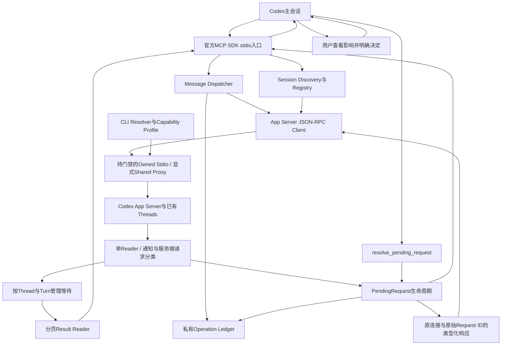

# 通用 Codex Session MCP Bridge 源码研究与自主实现设计

日期为 2026-11-10。状态为 **设计待审核，正式开发未开始**。Agent Engine Demo 开发流程暂停，本方案是独立的用户级会话通信基础设施设计。

本轮产物为本文件。研究使用上游临时克隆、本机 CLI 导出的协议 Schema 和官方文档，没有安装上游或新依赖，没有修改全局 MCP 配置，没有新建会话或向现有会话发送新任务。

## 1. 研究对象、证据和适用范围

### 1.1 固定的上游版本

上游为 `saidelike/codex-thread-bridge`，本轮固定提交为 `4b5821503f341d86fa8f04cad503f789aab9a404`，包版本为0.1.0。研究目录为 `D:/py/codex-bridge-research-20261110/upstream`。克隆只用于阅读，后续自主实现不导入或依赖该包。[上游固定版本](https://github.com/saidelike/codex-thread-bridge/tree/4b5821503f341d86fa8f04cad503f789aab9a404)

已检查9个Python源码文件、MCP入口、依赖与许可证，重点逐段审查通信、发送/steer、操作凭证、发现、分页、等待、原文分块及相关测试。创建会话、worktree、权限修改和reload源码也用于确认其范围，自己的V1不纳入这些能力。测试目录静态AST统计为11个test文件、100个测试函数，参数化后的用例数未统计。本轮没有执行上游测试，当前项目解释器未安装mcp，设计阶段也不安装其依赖。

### 1.2 五类证据分开记录

| 类别 | 已有事实 | 能支持的结论 |
| --- | --- | --- |
| 前一轮本机真实通信 | 桌面CLI queue → 原测试Thread加载 → started/delta/completed → 分页读回SESSION_LINK_OK | 同一持久Thread上的短文本任务与结果闭环可行 |
| 本轮源码审查 | 固定提交下实际实现及测试断言 | 上游采用的机制和静态风险，不表示本机上游服务已运行 |
| 本轮本机Schema审查 | 桌面CLI稳定/实验Schema导出 | 当前二进制接受的字段形状和门控，不替代接口行为及真实执行验收 |
| 官方文档支持 | 配置优先级、MCP enabled、审批请求/响应与清理通知 | 官方描述的行为，须与本机版本核对 |
| 设计推断及尚待实测 | 子进程单项禁用、PendingRequest闭环、桌面并发门禁 | 自主方案及未来验收要求，尚未取得运行证据 |

前轮已确认PATH CLI为0.144.4且没有queue，桌面CLI为0.167.0-alpha.3.2，初始化返回的CODEX_HOME为用户目录下`.codex`。前轮临时独立stdio服务器能发现已有会话，恢复原测试Thread并收到真实完成事件。本轮不重复模型调用。该证据没有证明桌面原进程的实时状态同步、执行中steer、中断、多进程接管、长任务或客户端审批回调均可用。

### 1.3 本轮协议来源

使用桌面配套可执行文件导出文档到研究目录的`protocol-stable`和`protocol-experimental`，命令如下。这些命令只生成协议文件，没有启动服务或创建Thread。

```powershell
codex.exe app-server generate-json-schema --out <研究目录>/protocol-stable
codex.exe app-server generate-json-schema --experimental --out <研究目录>/protocol-experimental
```

后文字段以本机0.167.0-alpha.3.2生成的`v2/*.json`为当前实施参考，官方仓库main用于解释机制，不能用其更新后的内容替代本机契约。初始化、恢复、通知及历史读取的官方入口已阅读。[App Server文档](https://learn.chatgpt.com/docs/app-server)

### 1.4 本轮定向修订的核查记录

本轮再次只读调用原桌面CLI的`app-server --help`。本机help列出`--stdio`、`--listen`、`-c/--config <key=value>`和`--print-startup-config`，说明点路径配置覆盖及TOML值解析，stdio为默认传输。此次没有运行print-startup-config、启动App Server或读取真实配置正文。

官方配置参考及在线Config Schema包含`mcp_servers.<id>.enabled`，配置优先级文档把CLI覆盖置于项目/用户默认配置之上，强制requirements仍须遵守。因此子进程读取相同home配置而重复加载Bridge是需要防护的设计风险，发生时机及本机单项覆盖效果尚待B2验证。在线Config Schema与本机导出的App Server Schema不是同一份文件。本机`ConfigReadResponse.Config`允许额外字段，没有以强类型列出MCP enabled，不能据它单独证明本机禁用已生效。[配置参考](https://learn.chatgpt.com/docs/config-file/config-reference) [配置优先级](https://learn.chatgpt.com/docs/config-file/config-basic#configuration-precedence) [在线配置Schema](https://learn.chatgpt.com/docs/config-schema.json)

审批形状直接核对研究目录中本机稳定/实验Schema的`ServerRequest.json`、各类`*RequestApprovalParams/Response.json`及`v2/ServerRequestResolvedNotification.json`。命令/文件审批在稳定Schema存在，`availableDecisions`和命令`additionalPermissions`仅在本机实验Schema中出现。`item/tool/requestUserInput`即使出现在稳定导出中仍有EXPERIMENTAL说明，应按语义标记实验，不能仅按文件是否存在认定稳定。所有响应的实际执行效果、回调路由和桌面同步仍未实测。

## 2. 上游源码结构与职责

| 文件 | 实际职责及本轮审查重点 |
| --- | --- |
| `server.py`，348行 | FastMCP v1入口、工具装饰器/参数、读写annotations、lifespan、CLI socket/state-dir选项 |
| `rpc.py`，153行 | 已有Unix控制socket的WebSocket JSON-RPC多路复用、握手、Future匹配、断线/超时 |
| `proxy_transport.py`，144行 | CLI发现、Windows CLI socket proxy、socketpair、双向字节泵及关闭回收 |
| `bridge.py`，1019行 | 工具业务、发送/steer、发现/读取/等待、操作凭证协调，以及额外创建/权限能力 |
| `ledger.py`，142行 | 上游自己的SQLite操作账本、request_id指纹、重放、路径别名账本迁移 |
| `records.py`，160行 | 原生记录信封、coverage、sourceVersion、文本截断清单与可校验分块重组 |
| `worktrees.py`，170行 | Git checkout准备、权限/路径校验及保留式worktree，本方案仅研究其边界 |
| `reload.py`，61行 | 显式确认后请求config/mcpServer/reload，区分拒绝与未知结果 |
| `__init__.py` | 包版本 |
| `scripts/check_connection.py` | 通过MCP客户端做连接/读检查，仍依赖已存在的控制socket |
| `pyproject.toml`、`uv.lock` | Python≥3.11，mcp≥1.26且<2，websockets≥15且<18；console entry及开发依赖 |

源码职责直接以文件实现为依据。上游包含比本需求更大的创建、权限和worktree范围，自主版本保留通信核心。[上游源码目录](https://github.com/saidelike/codex-thread-bridge/tree/4b5821503f341d86fa8f04cad503f789aab9a404/src/codex_thread_bridge)

## 3. 上游核心通信机制

### 3.1 MCP与App Server是两层连接

上游`make_server`注册16个MCP工具，通过stdio对外运行。lifespan结束时关闭RPC及ledger。工具使用类型注解生成Schema，读工具标记readOnlyHint，写工具统一标记destructiveHint/openWorldHint。说明要求调用者授权变更、为每次意图保留稳定request_id，并区分accepted与completed。这些annotations属于提示，不构成授权执行器。[server.py](https://github.com/saidelike/codex-thread-bridge/blob/4b5821503f341d86fa8f04cad503f789aab9a404/src/codex_thread_bridge/server.py#L18-L44)

MCP的stdio不等于App Server使用stdio。上游RPC必须找到已有控制socket，默认位于CODEX_HOME/app-server-control/app-server-control.sock，自己不启动或替换App Server。Unix直接WebSocket连接该socket，Windows auto选择CLI proxy；本机前轮未找到可用控制socket，因此不能据本机stdio通信成功推断上游能直接启动使用。[rpc.py](https://github.com/saidelike/codex-thread-bridge/blob/4b5821503f341d86fa8f04cad503f789aab9a404/src/codex_thread_bridge/rpc.py#L49-L89)

### 3.2 Windows Socket Proxy

`ProxyWebSocket.open`启动`codex app-server proxy --sock <path>`。它转发已有socket的原始字节，不创建新的App Server。Python通过socketpair的两条异步字节泵把标准WebSocket客户端连接到CLI的stdin/stdout，WebSocket握手、fragment和ping仍由websockets库处理。它禁用compression/proxy，设置16MiB消息上限；关闭以共享cleanup task和shield防止调用方取消导致子进程遗留，再terminate/超时kill回收。[proxy_transport.py](https://github.com/saidelike/codex-thread-bridge/blob/4b5821503f341d86fa8f04cad503f789aab9a404/src/codex_thread_bridge/proxy_transport.py#L38-L144)

其CLI Resolver依次接受显式路径/环境变量、CODEX_HOME standalone位置、Windows桌面安装目录下修改时间最新的候选、PATH。它不检查queue或协议功能。修改时间最新和PATH命中都不能独立证明适配当前会话格式。自己的版本将做能力核验，显式配置错误时也不静默改选其他程序。[CLI选择源码](https://github.com/saidelike/codex-thread-bridge/blob/4b5821503f341d86fa8f04cad503f789aab9a404/src/codex_thread_bridge/proxy_transport.py#L14-L35)

### 3.3 RPC、请求与通知

上游有一个reader、递增RPC id和pending Future字典。connect锁确保共享连接初始化一次，握手开启experimentalApi。服务端响应按id投递，超时、连接丢失、缺result转换TransportError。新请求前可以重连，已发送请求不自动重发。[RPC请求实现](https://github.com/saidelike/codex-thread-bridge/blob/4b5821503f341d86fa8f04cad503f789aab9a404/src/codex_thread_bridge/rpc.py#L28-L153)

**上游没有Turn事件监听器。** `_receive`遇到任何含method的消息直接跳过，包含通知及服务端请求。其理由是已有共享服务器的回调可能由其他订阅客户端处理，错误回复也可能抢走回调。该策略保护其他客户端，但不能证明另一个客户端真实存在，也不会把turn/completed主动交给wait工具。本机独立stdio进程不能照搬“桌面会处理回调”的假设。[通知与回调处理](https://github.com/saidelike/codex-thread-bridge/blob/4b5821503f341d86fa8f04cad503f789aab9a404/src/codex_thread_bridge/rpc.py#L91-L115)

## 4. 上游八项重点能力的真实行为

| 工具 | 实际RPC与行为 | 参数/返回及局限 |
| --- | --- | --- |
| list_threads | thread/list，useStateDbOnly=true，支持cwd/归档/source及父/祖先过滤 | limit1～100、opaque cursor；失败返回data=null及discovery，不退化成无过滤搜索；非完整历史保证 |
| send_message_to_thread | 读状态，resume无设置覆盖，校验审批策略，再turn/start | request_id/thread_id/message；回执保存resumed及turnId；使用input=[]、toolOutput，未走CLI queue |
| steer_thread | turn/steer，携带expectedTurnId及文本input | 稳定request_id；返回turnId必须等于期望，否则unknown；不自动resume/转成新任务 |
| read_thread | 元数据与一页完整Turn读取后做显示截断 | limit1～100、max_text_chars100～20000，报告截断JSON pointer及原文恢复途径 |
| read_thread_turns | thread/turns/list，itemsView=full | 原样返回原生字段、sourceVersion、coverage及nextCursor；一页不是完整会话 |
| read_thread_items | thread/items/list，可指定turnId | 原样分页；不以不存在接口的猜测字段补数据 |
| wait_thread | 每0.5秒轮询最近100个Turn的summary，按确切turn_id匹配 | timeout0～50秒；completed/failed/interrupted都是terminal，超时不停止执行；找不到旧Turn可能只是窗口外 |
| get_operation | ledger.get(request_id) | 读取持久回执，没有自动查Codex来修复unknown，也没有在Turn完成后自动改写accepted |

发送源码650～709行与steer源码710～741行明确展现了其两条写路径。toolOutput保留了工具输出来源语义，不能在自己的实现中悄悄替换成不同授权级别的消息后宣称等价。[发送及steer](https://github.com/saidelike/codex-thread-bridge/blob/4b5821503f341d86fa8f04cad503f789aab9a404/src/codex_thread_bridge/bridge.py#L650-L741)

发现对state DB的使用是通过官方thread/list参数完成，代码没有直接查询Codex内部SQLite。parent/ancestor参数及相关来源枚举存在版本依赖，不能凭标题、sessionId、forkedFromId或cwd推出续接/父子关系。自己的项目角色绑定只需要显式选择既有Thread，不引入祖先自动归属。[发现实现](https://github.com/saidelike/codex-thread-bridge/blob/4b5821503f341d86fa8f04cad503f789aab9a404/src/codex_thread_bridge/bridge.py#L746-L855)

原文读取及wait分别位于857～1019行。sourceVersion绑定一次原生响应、请求和endpoint，不是整个分页历史的事务版本。分块以Python Unicode字符计位置，验证连续性、长度、源digest及重组完整性，但一次原生RPC仍须先装入内存，其16MiB限制不会因下游分块消失。[读取与等待](https://github.com/saidelike/codex-thread-bridge/blob/4b5821503f341d86fa8f04cad503f789aab9a404/src/codex_thread_bridge/bridge.py#L857-L1019) [记录封装](https://github.com/saidelike/codex-thread-bridge/blob/4b5821503f341d86fa8f04cad503f789aab9a404/src/codex_thread_bridge/records.py)

### 4.1 上游幂等与异常

Ledger是上游自己的SQLite文件，按规范化socket路径分账本。request_id全账本唯一，指纹基于method与完整params，事务中INSERT OR IGNORE防重复。begin先写in_progress_or_unknown，成功收RPC后记accepted，RPC拒绝记failed，取消/其他异常记outcome_unknown。相同id相同参数重放回执，不继续半成品操作；同id不同参数冲突。跨重启保留及路径别名导入也有测试。[ledger.py](https://github.com/saidelike/codex-thread-bridge/blob/4b5821503f341d86fa8f04cad503f789aab9a404/src/codex_thread_bridge/ledger.py) [mutation协调](https://github.com/saidelike/codex-thread-bridge/blob/4b5821503f341d86fa8f04cad503f789aab9a404/src/codex_thread_bridge/bridge.py#L176-L202)

该设计能抑制经此账本重复投递，不承诺Codex服务端Exactly Once。响应丢失时没有完整自动关联恢复；`get_operation`只保留已知事实。上游全局mutation锁还会串行化不同Thread上的变更，自己的版本使用按Thread的操作锁及持久唯一约束。上游对原文不做凭据过滤，完整原文与安全展示边界需自行设计。[上游行为与测试](https://github.com/saidelike/codex-thread-bridge/blob/4b5821503f341d86fa8f04cad503f789aab9a404/tests/test_bridge.py#L209-L358)

## 5. 上游测试审查及证据边界

| 测试文件 | 测试函数数 | 静态确认的主要覆盖 |
| --- | --- | --- |
| test_bridge.py | 27 | 请求去重/冲突、丢响应/取消、部分完成、busy、精确steer、只读不resume、错误Turn与分页 |
| test_creation_profile.py | 3 | 创建配置保持及不匹配时不投递 |
| test_discovery_mcp.py | 6 | 原生过滤/coverage、失败不无过滤重试、父关系冲突及cursor |
| test_ledger.py | 3 | socket别名、重启持久性、迁移冲突回滚 |
| test_mcp.py | 3 | 真MCP stdio客户端到fake App Server的Schema/分页及去重 |
| test_mcp_records.py | 7 | 原生记录保留、长文本重组、缺块/变源、截断及coverage |
| test_permissions.py | 12 | 审批/权限原样、预期身份、拒绝与unknown |
| test_proxy_transport.py | 10 | WebSocket碎片/ping、握手失败、取消回收、CLI选择、响应丢失不重发 |
| test_reload.py | 7 | reload确认/拒绝、取消/未知不重试 |
| test_rpc.py | 4 | 通知交错与请求复用、共享回调不抢答、错误及超时 |
| test_worktree.py | 18 | 外部Git临时目录、保留工件、取消及隔离检查，自己的V1不纳入 |

这些是函数统计，不是通过数或覆盖率。conftest的fake服务器会按输入生成确定结果，不能证明真实模型、真实Codex的队列/历史语义。proxy若干测试明确skip Windows，fake上游也依赖Unix socket，因此Windows自动化与真实可用性须另外验收。本轮只读测试断言，没有运行上游测试。[测试目录](https://github.com/saidelike/codex-thread-bridge/tree/4b5821503f341d86fa8f04cad503f789aab9a404/tests) [Windows skip与relay替身](https://github.com/saidelike/codex-thread-bridge/blob/4b5821503f341d86fa8f04cad503f789aab9a404/tests/test_proxy_transport.py)

## 6. 许可证与借鉴边界

上游许可证为MIT，版权标注为2026 codex-thread-bridge contributors。许可证要求在复制的软件或实质部分中保留版权与许可通知。本方案参考职责、回执和故障思路，自主编写代码、测试和文档，不复制其函数、测试实现或将其作为依赖。如以后引入具体片段，应另行记录来源及满足通知要求，不能将复制内容标为原创。[固定版本LICENSE](https://github.com/saidelike/codex-thread-bridge/blob/4b5821503f341d86fa8f04cad503f789aab9a404/LICENSE)

官方Codex协议与官方MCP SDK作为直接技术依据。其他相关实现仅研究这两套官方项目，避免扩展到通用多Agent框架调研。[Codex官方仓库](https://github.com/openai/codex) [官方MCP Python SDK](https://github.com/modelcontextprotocol/python-sdk)

## 7. 已验证方案与上游对比及取舍

| 维度 | 此前本机已验证 | 上游实际方案 | 自主V1决策 |
| --- | --- | --- | --- |
| App Server连接 | 自有子进程stdio | 已有控制socket WebSocket | Owned Stdio为优先验证候选，正式写入后端待门禁裁决 |
| Windows | 桌面CLI可启动 | CLI proxy加socketpair | Owned候选无需WebSocket库，保留显式proxy适配边界 |
| Thread发现 | thread/list | thread/list及state-db/祖先过滤 | 支持cwd分页，额外过滤按能力开放 |
| 新消息 | CLI queue后resume | resume后turn/start+toolOutput | Direct文本input为候选，尚未获启用资格；queue显式实验模式 |
| 运行中追加 | 未实测 | turn/steer+expectedTurnId | 独立工具和精确Turn前置条件，未来真实验证 |
| 事件 | 已观察started/delta/completed | 接收后丢弃，wait轮询 | 单reader分类事件，通知驱动等待加分页补证 |
| 结果 | 分页读回确切Turn | 记录/分页/原文块与coverage | 按Operation/Turn读取公开AgentMessage，完整性明确 |
| 操作幂等 | 只有一次通信验证 | 私有SQLite持久回执 | 私有操作账本、预写发送意图、ID证据恢复 |
| 多项目 | 未实现绑定 | cwd过滤，无五角色Registry | 用户级按project_id隔离并显式绑定 |
| 回调 | 短回复未触发 | 留给其他共享订阅者 | PendingRequest转主会话取用户决定，再回复原连接；未知则needs_attention |
| 同Thread并发 | 桌面同步/并发未实测 | 共享endpoint，仍需多客户端路由审查 | A/B/C专项验收后选用，Bridge文件锁不证明全局排他 |
| MCP递归 | 前轮临时服务未注册本Bridge | 不另启动App Server | 子进程仅禁用自身全部登记别名，需实际生效与进程数验收 |

Owned Stdio加Direct是基于协议形状与既有stdio读写经验选择的**优先验证候选**。候选不自动成为可靠默认或已启用写后端。正式启用须完成递归防护、真实通信、桌面状态同步、同Thread并发、审批及所需工具回调门禁，形成指定CLI/transport/dispatch组合的验证记录。失败时优先评估共享服务器，仍须明确授权及独立验证。发出一次写请求后不因兼容错误或超时换后端重发。

借鉴项为稳定请求凭证、未知结果不重发、只读不resume、精确Turn匹配、opaque cursor保留、原始状态及coverage、取消安全清理。不直接采用已有socket为唯一前提、按mtime选择CLI、丢弃所有通知、最近100Turn作为完整等待视野、原文任意字段直接透出、创建/worktree/权限/Goal工具。

## 8. 自主总体架构与实现原则

目标是用户级通信MCP Server。角色名用于路由，开发任务、QA判定、修复决策和阶段推进仍由主会话负责。



逻辑职责不要求各自成为独立类。Turn Manager和Event Listener可在同一模块，Session Discovery和Registry合在sessions模块，避免为图中每个方框建立无调用者抽象。

设计采用Python3.13的独立用户级虚拟环境，运行依赖为官方`mcp>=2,<3`与Pydantic v2，asyncio/JSON/SQLite/文件锁使用标准库。具体兼容补丁版本在B1的干净环境解析并锁定。websockets仅在共享proxy适配获批实施时作为额外依赖引入，Owned候选不依赖它。该环境不导入Agent Engine Demo，也不依赖其.venv。

官方MCP SDK当前稳定线为v2，入口为MCPServer。上游使用v1 FastMCP，不能直接照抄其初始化和装饰器代码。实施时使用v2官方生命周期/工具/取消API，并验证当前Codex MCP协议协商。若协商不兼容，明确阻塞或另行批准适配，不能无记录地更换SDK主版本。[官方SDK当前文档](https://py.sdk.modelcontextprotocol.io/) [上游依赖声明](https://github.com/saidelike/codex-thread-bridge/blob/4b5821503f341d86fa8f04cad503f789aab9a404/pyproject.toml)

### 8.1 模块接口与职责

| 模块 | 主要接口与职责 | 边界 |
| --- | --- | --- |
| config/models | BridgeConfig、Tool参数、Project/Binding/Operation/PendingRequest/Result DTO | 类型化审批联合、子进程禁用自身别名及验证门禁 |
| cli | resolve_cli、inspect_cli、build_child_launch_plan → CliProfile/LaunchPlan | 核对config覆盖能力、生成单项禁用参数，记录证据等级 |
| transport | open/send/receive/close，OwnedStdioTransport | 单实例一个自有App Server、递归环境哨兵、进程树回收；未来proxy为第二实现 |
| rpc | connect、call、subscribe_notifications、reply_server_request | Response/Notification/Server Request独立分派，原连接/epoch/原ID响应，不重连重放审批 |
| sessions | list、initialize_project、bind/unbind、resolve_binding | 项目路径规范化、角色revision、显式确认，不凭标题自动绑定 |
| operations | reserve、mark_sent、record_receipt、observe、reconcile、reserve_resolution | 私有SQLite关联PendingRequest、原任务及审批操作，CAS去重、断线失效与审计 |
| dispatch | send、steer、interrupt、resolve_pending | 固定目标、启用门禁、用户决定及方法专属响应校验，按Thread串行 |
| events | register_waiter、observe_turn、observe_server_request、wait | 通知与PendingRequest生命周期、清理/断线事件、有界缓存及阻塞唤醒 |
| results | read_turn、read_messages、page_result | 分页到正确Turn、消息过滤、源版本和完整性 |
| server | SDK工具注册、lifespan、标准错误映射 | stdout只放MCP协议，日志写stderr，无直接业务逻辑 |

## 9. CLI与传输兼容策略

### 9.1 CLI Resolver

候选顺序为用户显式`--codex-bin`或Bridge配置、已安装desktop路径、CODEX_HOME standalone路径，最后才考虑PATH候选。显式路径错误即返回配置错误。自动发现可枚举桌面目录和运行进程的可执行文件路径，但不读取命令行中的认证参数、auth文件或Token。

每个候选以无shell的参数数组运行`--version`、相关`help`，核对app-server及选定dispatch后端所需能力。版本和mtime用于诊断与排序，不替代能力检查。PATH旧版本不满足profile时不得回退使用。升级后重新生成/比对Schema及运行只读握手，原版本通过记录不自动迁移给新二进制。

Owned候选必须另外核对`--stdio`、`--config`及单MCP禁用契约。LaunchPlan保存实际MCP注册名集合、仅针对这些名字的enabled覆盖、home/cwd和预期进程数量。MCP注册名由获批安装配置登记，不能根据工具名猜测；无法确认自身别名或存在未知指向本Bridge的配置时停止启动。配置覆盖支持与递归防护实测通过分别记证据，help支持不等于运行验收通过。

CliProfile保存可执行文件规范路径、原始版本、文件摘要、选定CODEX_HOME、支持的方法/字段、证据等级和检查时间。CODEX_HOME按显式配置→环境→用户默认目录选择，并与initialize返回路径核对。若旧服务不返回home信息，应标为未确认，禁止跨home自动合并角色绑定。

### 9.2 Owned Stdio候选与MCP递归防护

以明确选中的CLI启动自有App Server，每个Bridge进程至多持有一个，复用连接服务多个已绑定Thread。Windows使用隐藏窗口和管道，MCP与子进程管道分离。先initialize，再initialized，读接口只加载元数据，发送才可能resume。正式写入须先通过9.5门禁。

子进程保持同一CODEX_HOME、认证与模型配置来源，采用进程内CLI覆盖，仅禁用本Bridge全部获批登记的MCP名称。以下只是未来参数数组示意，`codex_session_bridge`是拟定注册键，实际使用登记名。参数存在由本机help确认，键的含义由官方文档支持，本机禁用效果尚待验证。

```text
[resolved_codex, "app-server", "--stdio", "--config", "mcp_servers.codex_session_bridge.enabled=false"]
```

逐个别名生成点路径，注册名限制为安全的简单键，不能拼未经校验的TOML路径。覆盖不写config.toml，不更换home，不传approval/model/sandbox覆盖，不清空整个mcp_servers表。其他MCP的参数/环境、认证和模型配置按原层级继承，实际有效差异须在B2按脱敏投影核验。强制策略、项目配置、插件提供的别名或恢复配置可能改变最终效果，无法确认全部自身入口均被禁用时阻塞Owned路径。

增加Bridge自有环境哨兵`CODEX_SESSION_BRIDGE_CHILD=1`传给子App Server。若它意外再次启动本Bridge，新实例在构造连接前检查哨兵并以recursion_guard退出，禁止再创建子App Server。该变量是Bridge设计，非Codex参数。环境转发可能被策略过滤，哨兵只能作为第二层防护，不能替代enabled=false实测。首次探测须使用受控子进程替身，未确认单项禁用前不直接用真实全局注册做递归实验。

B2获准真实验证时先核对有效配置，再触发MCP实际初始化/Thread恢复，确认禁用在这些时点仍成立。一个Bridge实例只产生一个预期App Server，自身MCP启动数为零，其他MCP保持原配置并按需启动。记录父子进程树、启动计数、脱敏配置差异、退出清理。配置验证或启动失败返回recursion_guard_unverified/config_override_failed，禁止循环重启。Windows受控退出及失败清理必须覆盖自己创建的进程树，包含意外递归和MCP后代，不能只回收直接子PID。

若本机不能可靠单项禁用，Owned保持不可启用，提交共享已有App Server的方案供审核。临时完整配置副本的优先级、秘密泄露及认证继承尚无证据，本版不把它当作已可用替代。全局配置编辑及切换CODEX_HOME均不属于此方案。

RPC reader始终运行，按消息形状区分响应、通知、服务端请求，服务端request id与客户端request id各有命名空间。待响应数量默认最多64，读请求超时15秒，单帧上限16MiB为Bridge自身策略。stderr持续排空但只保存安全类别，不向MCP透出完整供应商错误。写请求返回`not_sent / sent / outcome_unknown`发送事实，不能只抛一个丢失发送阶段的超时异常。

MCP取消单次wait只释放waiter，不关闭连接或取消Turn。Bridge进程退出与自有App Server进程退出可能影响活动Turn，V1不承诺断开后执行继续。正常退出最多等待5秒收敛，持久记录仍活动/未确认的Operation，关闭自己拥有的资源。共享socket模式只关自己的客户端及proxy，不停止共享App Server。

### 9.3 Shared Socket/Proxy适配边界

显式配置已存在的控制socket时，未来可连接共享服务器。在Windows上以官方CLI proxy转发WebSocket字节，复用标准WebSocket实现。该路径需要额外适配和Windows验收，V1默认不因stdio遇错自动切换到它。不会自动启daemon、开网络监听、配置远程控制或替换桌面服务器。

若需要让桌面与Bridge同时拥有同一服务器中的实时状态及审批回调，应单独批准共享endpoint接入并验收。目前只证明相同持久Thread可在独立服务器续接。连接到相同CODEX_HOME不等于连接到同一个活跃运行时。

### 9.4 三种候选组合的适用性

| 维度 | A Owned Stdio + Direct | B Owned Stdio + CLI Queue | C Shared Socket/Proxy |
| --- | --- | --- | --- |
| 与桌面共享运行时 | 无此保证，独立实例 | 无此保证，队列持久化不改变实例关系 | 仅连到桌面实际使用的同一endpoint时成立，尚未证实本机可接入 |
| 实时通知 | 本机stdio曾观察到，Direct专项待验 | 消费队列的实例需有订阅，另一实例不保证可见 | 上游连接成立后可传输，跨客户端订阅/路由待验 |
| 审批回调 | 由Bridge承接并经主会话闭环，待验 | 必须确认由谁消费及谁收到请求，待验 | 必须确认回调所有者及其他客户端清理，不能抢答 |
| Direct/steer/interrupt | Schema支持，外部竞争与运行效果待验 | queue只解决入队，steer/interrupt仍依赖实际运行实例 | 同一运行时便于目标关联，仍需目标Turn及回调归属验证 |
| Windows | stdio前轮通过，递归/进程树待验 | queue前轮短文本通过，综合风险待验 | 上游有proxy实现，本机尚无可用共享socket证据 |
| 生命周期 | Bridge拥有子进程，退出可能影响Turn | CLI进程短暂，Owned消费者仍有退出影响 | 仅关客户端/proxy，不停止共享服务器 |
| 桌面冲突 | 高风险未知项，文件锁不约束桌面 | 同样未知，不能因queue持久化宣称消除 | 减少跨运行时问题，仍有多客户端同时写/审批争用 |
| 真实开发可行性 | 待四项真实门禁及递归防护 | 待独立组合验收，不继承A通过结果 | 待endpoint、Windows、回调所有权及真实开发验收 |

本表除明确列出的前轮观察外，均为源码/Schema支持下的设计分析，尚未完成真实比较。

### 9.5 写入后端启用门禁

profile增加validation_status=unverified/verified/failed、CLI摘要、endpoint/runtime_instance、transport/dispatch组合、所需回调种类、递归防护结果、桌面同步与并发测试证据。schema_supported与runtime_verified分别记录。send、resume、queue启动、steer、interrupt及审批响应均遵守所选profile，不允许用只读握手通过替代写门禁。

正式启用某组合必须通过真实通信、桌面消息/状态/结果同步、同Thread并发及交替操作、审批和任务所需工具回调四项门禁，Owned另须递归防护通过。B5的fake测试及B6中显式获批的验收探针可在隔离受控范围验证未启用组合，探针许可绑定测试范围和目标，不能用于普通任务。B6记录A结果，若A/B不能安全满足目标，优先提交C的B7实施申请，禁止自动切后端；C通过后才可成为正式选定路径。B7作为扩展Task仍可选，选定C时它成为B8必需依赖。必要能力失败时不能仅标注限制后继续宣称真实开发闭环通过。

### 9.6 当前方法兼容矩阵

| 方法/字段 | 本机稳定Schema | 本机实验Schema | 自主使用方式 |
| --- | --- | --- | --- |
| thread/list及cwd/useStateDbOnly | 有 | 有 | 发现默认state-db读取，明确覆盖范围 |
| parentThreadId/ancestorThreadId过滤 | 无 | 有 | V1五角色路由不依赖 |
| thread/read、thread/loaded/list | 有 | 有 | 元数据及当前服务器加载状态 |
| thread/turns/list、thread/items/list | 有 | 有 | 精确Turn及结果分页 |
| turn/start，input、clientUserMessageId、toolOutput | 有 | 有 | 候选使用文本input，启用遵守9.5 |
| turn/steer及expectedTurnId | 有 | 有 | 精确已有活动Turn，实测门禁 |
| turn/interrupt | 有 | 有 | 精确Thread/Turn，中断ACK与最终状态分开 |
| thread/queue/add/list/start及queue/changed | 无 | 有 | 实验模式显式启用，未知结果不能回退重发 |
| thread/settings/update | 实验门控 | 有 | 不在通信V1暴露 |
| item/commandExecution/requestApproval、item/fileChange/requestApproval | 有 | 有 | 按类型保存PendingRequest，用户决定后回复原ID |
| item/permissions/requestApproval | 有 | 有 | 权限子集及turn作用域，Schema存在不代表实际授权验收通过 |
| item/tool/requestUserInput | 有但描述EXPERIMENTAL | 有 | 默认needs_attention，类型适配另行验证 |
| serverRequest/resolved | 有 | 有 | 原requestId和threadId，表示回答或清理，不证明审批接受 |

Schema中有字段只证明序列化契约存在。`clientUserMessageId`是关联标识，不能仅凭其存在承诺服务端幂等。官方方法级实验标注也明确覆盖queue族。[官方方法定义](https://github.com/openai/codex/blob/main/codex-rs/app-server-protocol/src/protocol/common.rs#L630-L664)

## 10. 多项目Session Registry

### 10.1 项目标识和角色绑定

project_id为用户确认的稳定slug或UUID，不由目录basename唯一决定。保存canonical_cwd及home_key，Windows路径按绝对路径、resolve及normcase比较，同时保留显示路径。目录重命名由显式重新初始化更新，不能自动把新目录绑定到旧项目。

每项目角色固定为MAIN/PLANNER/IMPLEMENTER/TESTER/FIXER，可缺省未绑定。initialize_project_sessions登记项目并返回候选，不按标题填角色。绑定必须提供用户明确选择的thread_id，随后经thread/read核验存在、cwd与home一致。标题重名只显示候选，不作决策。V1绑定要求精确cwd相同，未来可显式设计多个允许根目录。

Binding包含role、thread_id、observed_title、revision、bound_at、verified_home_key及canonical_cwd。每项目配置另有project_revision。bind/unbind携带expected_revision做CAS，原子替换JSON；Windows采用同目录临时文件、flush/fsync和os.replace，跨进程文件锁保护读改写。OS权限使用当前用户目录ACL，POSIX模式位不能当作Windows权限验证。

### 10.2 持久文件示例

示例只有占位符，不保存当前个人Thread ID。

```json
{
  "schema_version": 1,
  "project_id": "project-a",
  "canonical_cwd": "<项目规范绝对路径>",
  "home_key": "<规范CODEX_HOME摘要>",
  "project_revision": 3,
  "bindings": {
    "IMPLEMENTER": {
      "thread_id": "<用户选定的现有Thread UUID>",
      "revision": 2,
      "observed_title": "执行"
    }
  }
}
```

角色重绑只影响新Operation，已存在Operation始终指向reserve时保存的Thread和binding revision。重复request_id先返回原凭证，再考虑当前绑定，防止重绑后将重试投递给另一个会话。解绑不删除Operation、不取消Turn。

### 10.3 多MCP进程与同Thread所有权

全局注册MCP后，每个Codex客户端可能启动自己的Bridge进程。不能假设只有一个Python实例。Registry文件锁及自己的SQLite唯一约束必须跨进程生效。每个Thread的控制连接在Bridge实例间使用私有OS文件锁认领，PID只用于诊断，不以租约超时自动抢占仍存活进程。

同一Bridge实例支持多个项目/多个Thread，项目数据隔离。另一个实例可只读分页和查询已知Operation，但同Thread写/steer若由其他Bridge实例持有，返回owner_unavailable及安全所有权信息，不在第二个独立App Server中并发resume。共享服务器客户端模式未来可在验收后放宽。V1不新增跨进程调度daemon或IPC Broker。

文件锁只约束自己的Bridge实例，无法锁住用户直接在桌面发送的操作。外部并发仍须依赖Codex运行时错误、预期Turn检查及unknown裁决，不承诺桌面与独立stdio之间的全局排他。

### 10.4 局部状态与控制范围

| 事实 | 证据来源 | 能得出的状态 |
| --- | --- | --- |
| 持久Thread存在 | thread/read/list及覆盖范围 | exists，不表示当前空闲 |
| 当前服务器加载 | loaded/list或本连接状态 | loaded_here，notLoaded不能推出全局未执行 |
| 当前服务器正在执行 | 精确Turn及本连接事件 | execution_here，不能覆盖其他实例 |
| 其他服务器正在执行 | 未来共享运行时观察或专项实测证据 | execution_elsewhere=known/unknown，缺证据为unknown |
| 本Bridge控制范围 | 私有文件锁、连接实例、绑定revision | bridge_owner，仅限制Bridge实例，global_exclusive始终不得凭文件锁设true |
| 桌面同步 | 指定版本与组合的专项验收 | desktop_sync=verified/unverified/failed，不由同home推导 |

get_session_status同时返回以上证据、observed_at和scope。V1没有已证实的跨App Server全局执行查询或全局idle CAS。写入前需要已通过9.5的组合及确认的控制范围。Owned若只能在用户承诺桌面不操作的窗口工作，应记录operating_constraint，验证越界时安全拒绝/明确冲突，不能宣称支持任意并发。若桌面并发会覆盖历史或造成不可识别的重复执行，则Owned不满足本项目正式启用条件，转而审核共享候选。

## 11. Thread、Request、Operation、Queue、Turn模型

| 标识 | 生成者与含义 | 约束 |
| --- | --- | --- |
| project_id | 用户确认的项目通信空间 | 与App Server projectId不同 |
| role | 项目内路由别名 | 不是身份认证或执行授权 |
| thread_id | Codex既有会话标识 | 由发现/手工确认取得，不由Bridge新建 |
| request_id | 调用方为一个明确写意图提供的稳定UUID | 同项目同意图重试复用，不等同RPC id |
| operation_id | Bridge reserve时生成的UUID | get/wait/reply的主关联，持久稳定 |
| rpc_request_id | 单连接请求序号，带connection_epoch诊断 | 重连可重编号，不作幂等凭据 |
| server_request_id | App Server发起请求的原始JSON-RPC id，保留string/integer类型 | 与客户端RPC id分命名空间，以连接实例/epoch及原ID联合定位 |
| pending_request_id | Bridge为一次服务端请求生成的UUID | 关联Thread、可证实Turn及原Operation，非原生RPC id |
| client_user_message_id | reserve时生成并持久保存 | 原生消息关联证据，不能假定服务端去重 |
| queue_id | Codex队列提交ID，可空 | direct候选模式为空，实验queue模式保存 |
| turn_id | Codex实际执行ID | 收到ACK或取得精确关联证据后保存 |
| result_id/version | Bridge选定Turn结果快照标识与摘要 | 分页/分块完整性，不是全局历史版本 |

新任务Operation通常对应一个Turn；多个steer/control Operation可指向同一个Turn。Queue项开始后才关联Turn。不能用一条必定一对一的ID链解释所有操作。

一个执行Operation可产生多个PendingRequest。每次用户决定另建method=resolve_pending_request的Operation，以pending_request_id和规范响应指纹关联原执行Operation，RPC响应仍使用原server_request_id，不把审批Operation UUID写入JSON-RPC id。服务端请求可能早于turn/start ACK到达，先保存原生thread/turn及request，取得可靠关联后再填execution_operation_id，不用“最近任务”猜测归属。

### 11.1 Operation持久结构

Bridge使用独立的标准库SQLite账本，不部署数据库服务。数据库路径固定在自己的session-bridge目录，禁止读取或附加Codex内部state/logs数据库。项目绑定仍为单独JSON配置。

operations保存operation_id、project_id、request_id、method、request_digest、thread_id、role_at_dispatch、binding_revision、backend、client_user_message_id、queue_id、turn_id、delivery_state、turn_status、result_state、last_error及证据时间。唯一键为(project_id, request_id)，指纹覆盖明确目标、方法、原样message、expected_turn_id等实际意图。消息不strip、不自动归一化换行。精确payload仅保存在当前用户私有存储，日志只写摘要和ID。

事务只覆盖Bridge本地reserve/CAS，不跨网络持锁。sqlite采用本地磁盘、WAL、busy_timeout和durable提交；同一request_id不同参数冲突，同参数返回原Operation。未知操作保留；删除账本会丢去重证据，V1不自动清理unknown记录。数据库文件及可能的WAL/备份受同一私有ACL保护。

同一私有数据库增加pending_requests及resolution关联记录，保存pending_request_id、project_id、thread_id、native_turn_id可空、execution_operation_id可空、item_id/approval_id可空、owner_instance、runtime_instance、connection_epoch、原server_request_id及其类型、request_method/type、schema_profile、原始参数私有摘要/必要payload、安全展示投影及display_digest、created_at、原生到期证据可空、state、resolution_operation_id和响应发送/清理证据。唯一键为(owner_instance, connection_epoch, typed_server_request_id)，收到重复请求先核对method/params指纹，异内容冲突不覆盖。原生ID可重复跨epoch，禁止仅按裸ID回复。

连接对象和待响应句柄只在owner进程内有效，持久记录只用于审计及失效/未知裁决，不能在重启后反序列化成可继续回答的连接。其他Bridge进程可读取安全待办，但resolve需要原owner和仍有效连接，本版没有跨进程转发，返回owner_unavailable。需要由持有该Operation的主MCP连接处理，人类决定等待期间保持连接存活。

### 11.2 分开的状态轴

delivery_state为prepared、dispatching、accepted、queued、rejected、outcome_unknown。turn_status保留原生inProgress/completed/failed/interrupted或null。result_state为unobserved、pending_persistence、ready、incomplete或unavailable。needs_attention作为独立阻塞原因。

accepted只表示收到原生接收ACK，queued只表示队列存在。只有确切Turn终态且结果证据满足读取规则，wait才返回terminal=true和相应result_state。Turn失败不是投递失败，结果尚未落盘也不能伪造空回复成功。

PendingRequest单独使用waiting、responding、response_sent、resolved、cancelled、expired、connection_lost及outcome_unknown。waiting为当前原连接仍可答，response_sent只证明本地传输写出，resolved表示服务端已回答或清理并附resolution_evidence，不能无证据标成“用户批准已执行”。取消/过期须保存原生证据或明确的本地有效期策略，created_at不能伪装原生期限。断线前未发送的waiting变connection_lost，发送中/已写而未确认的请求变outcome_unknown。重启旧epoch不可回答，unknown历史继续保留。原执行Operation仍可保持inProgress并带waiting_for_user/needs_attention，不另造Codex原生Turn状态。

## 12. 投递、steer、中断与故障恢复

### 12.1 受门禁约束的Direct RPC候选

1. 调用方提供project_id、role、binding_revision、request_id和原样message。校验项目、角色绑定、cwd/home、自发送限制及9.5组合门禁。门禁未通过只允许明确获批范围内的验收探针。
2. 先按request_id查询原Operation。新意图在事务中reserve并保存精确目标和client_user_message_id，再获得该Thread的Bridge控制锁。
3. 建立reader和事件订阅，再读thread元数据与局部执行状态，同时核对实例及控制范围。notLoaded保留global_execution=unknown，不能据它选择resume。只读入口不会resume；已获控制范围且门禁允许的send可显式resume，不携带model/cwd/approval/sandbox/reasoning覆盖，进程级禁用自身MCP覆盖仍应生效。
4. 重新核对实际返回Thread/cwd、状态和可处理的审批/工具回调策略。存在外部队列时先核对；如果无法确认恢复是否会自动执行未知队列，标needs_attention，禁止新写。
5. 写前将dispatching持久化，发送一次turn/start，input为明确委派文本，clientUserMessageId为已保存值。返回Turn ID后立刻保存accepted及turn_id。消息作为委派任务接受目标自己的系统/用户约束，不代表提升主会话权限。
6. 终态事件仅更新相同Thread/Turn，随后用分页读取补持久结果。写请求超时不触发第二次send或queue后端。

新任务入口要求已确认控制范围内的空闲目标，不自动steer。状态检查与turn/start之间仍有外部客户端竞态，Codex没有在本机稳定Schema提供通用idle CAS字段。若发生冲突或无法确认是否加入了既有Turn，保留unknown/needs_attention，不伪称独立新任务已开始。未通过桌面并发门禁的组合不得用于正式任务。

### 12.2 实验Queue模式与CLI兼容

显式启用且profile通过验证后，可使用thread/queue/add，字段为threadId、clientUserMessageId和input，返回queuedSubmission.id。保存queue_id后可恢复原Thread，本机已有证据表明resume可能自动消费队列，不能再无条件启动下一项。若仍在队列，需要明确指定自己的queuedSubmissionId才可start，不执行无ID的“启动队首”以免推动他人任务。

queue必须继承所选组合的递归、控制范围、桌面同步与回调门禁。入队持久化不产生全局Thread锁，也不能证明消费它的是哪一个App Server；消费实例未知时禁止由第二实例resume/start，先只读核对并标needs_attention。

get_operation恢复时先查自己的queue_id/client_user_message_id，再查精确Thread的历史消息关联。队列为空可能表示已执行或被删除，不能据此重发。CLI queue仅作为显式兼容后端，因其输出和自动生成ID的控制能力较弱，不作为Direct失败后的兜底；必须单独测试命令输出解析及退出0但未执行的情况。官方CLI也说明queue恢复失败仍可能成功退出。[官方queue说明](https://learn.chatgpt.com/docs/developer-commands#codex-queue)

### 12.3 执行中steer

steer_session要求expected_turn_id和独立request_id，调用turn/steer时带expectedTurnId及clientUserMessageId。须由已验证组合中持有该活动Turn的运行实例执行，不能仅凭持久Turn ID在第二服务器接管。目标完成或Turn不匹配则拒绝，不降级为新消息。ACK必须回指同一Turn。accepted仅表示Codex接受追加，不表示Agent已采纳或整个Turn完成。连接丢失后没有原生消息关联证据时保持unknown。

### 12.4 中断

interrupt_session要求绑定版本、确切turn_id和request_id，仅在确认控制范围的原运行实例向该Thread/Turn调用turn/interrupt。ACK保存为控制请求接受，随后等待目标的实际终态。目标在中断前自然completed时如实返回completed，不改写为interrupted。wait超时、MCP取消、解绑和重新绑定都不隐式中断。中断后PendingRequest须依据清理事件/原Turn终态失效，不能继续接受旧决定。

### 12.5 未知结果恢复表

| 断点 | 可核对事实 | 决策 |
| --- | --- | --- |
| reserve前输入失败 | 无Operation、无发送 | 修正输入后新意图可提交 |
| prepared且明确尚未进入写路径 | 本地发送事实 | 同ID可首次发送，事务CAS保证只一个发送者 |
| dispatching后进程退出，实际可能未写 | 无法证明未发送 | outcome_unknown，先核对，不重发 |
| 发送后ACK丢失 | clientUserMessageId、原生消息clientId或队列关联 | 精确且唯一匹配时绑定Turn，否则unknown |
| ACK已落账本后断线 | 已知turn_id | 重连只读同一Turn，确认终态及结果 |
| completed事件先到、历史暂不可读 | 精确事件但原文未持久 | pending_persistence，有限补查，不返回其他Turn的旧回复 |
| 多个候选/原生clientId缺失 | 内容相同、时间接近均非唯一证据 | 保持unknown/needs_attention，人工核对 |
| 写RPC明确拒绝 | 原生错误及已完成的准备副作用 | rejected，保留resume等事实；同ID重放拒绝凭证 |
| 审批waiting时断线 | 旧epoch原请求未发送响应 | connection_lost，仅审计，重连不能回复旧ID |
| 审批响应可能写出后断线/崩溃 | 响应指纹、发送阶段及可能的清理/动作证据 | outcome_unknown，不重复响应，不把resolved通知推断为原决定执行成功 |
| 同Thread检测外部执行/历史冲突 | 局部状态、原生事件及已批准控制范围 | 暂停新写，原Operation只读核对，禁止自动换服务器/后端 |

稳定request_id提供Bridge范围的重复抑制，clientUserMessageId提供可选恢复关联。当前Schema的UserMessage.clientId可空，不能承诺所有历史均可关联。时间戳、相同文本digest、最近Turn或标题匹配不构成自动恢复的充分证据。

## 13. Event Listener与完成等待

单reader按JSON-RPC形状分派响应、通知和服务端请求。通知处理器只保留有界状态及每个已关联Turn的AgentMessage缓冲，默认每Turn不超过256KiB增量缓存，超出标记需从持久接口重读。不可丢弃turn/completed来保留token事件，读取器不等待MCP消费者或任意工具调用。

内部键为(connection_epoch, thread_id, turn_id)，Operation持有跨epoch的thread/turn关联。先登记观察再投递，ACK前到达的事件先进入有界未关联缓冲，得到Turn ID后合并。乱序/重复item事件按item_id管理，最终文本优先以持久结果校验，不能把delta再次拼到完整item上。

wait_for_completion默认20秒、单次最大50秒。MCP等待超时返回timed_out=true，Operation仍可查询。通知驱动优先，先后各做一次只读核对以覆盖先完成后等待；断线、事件缺口或跨实例读取时按有界退避轮询确切Turn。不要只搜索最近100个Turn后就宣布不存在。分页达到本次时间/页数上限返回coverage不完整及继续位置，下次调用继续核对。

terminal同时包括completed、failed和interrupted。返回保持原生turn_status，completed但没有公开AgentMessage时返回empty_reply或结果待持久，不能返回旧任务的回复。get_session_status还要返回status_source=bridge_runtime/stored_metadata、observed_at、loaded_here和connection_epoch。notLoaded只表示当前服务器没有该会话的活跃对象，不能等同不存在、空闲或未执行。

服务端请求进入PendingRequest生命周期，不在reader内等待人类。wait_for_completion遇到新待办立即有界返回terminal=false、blocked_on_user=true和pending_request_ids，主会话据此调用查询并向用户展示，取得决定后resolve再继续wait。普通wait超时或调用取消不批准、不拒绝、不使待办过期。get_session_status补充10.4的局部/外部执行及控制范围证据。`serverRequest/resolved`按同一epoch/thread/typed request ID消费，Turn终态和断线同样触发待办有效性重核，不以未经证实的客户端通知名称作为取消依据。

### 13.1 服务端回调与长任务可行性门禁

审批、动态工具、requestUserInput、认证刷新等带method及id的服务端请求不能当成通知吞掉，也不能与响应Future误配。RPC响应必须匹配客户端Future，Notification没有请求id，Server Request同时含method和id并保存原始id类型。V1通信层不代替用户决定，不读取/转发认证Token。下面的闭环是设计，尚待fake和真实门禁。

1. RPC识别Server Request，按method和本机Schema校验，取得原生Thread、Turn、item/approval ID。没有原生Turn证据时返回null及原因，不能补成当前最新Turn。无Thread归属的认证类请求不纳入项目审批。
2. Events创建PendingRequest，先持久化再唤醒主会话等待者，记录原连接owner/epoch、typed request ID、原生归属、原任务关联和安全展示内容。多次命令审批可共享item_id，必须保留不同approval_id及请求id。
3. 主会话调用list_pending_requests，只取得其项目范围内待办，向用户展示请求类型、命令/cwd或文件变更、作用域、影响及允许决定。目标Agent提供的reason/command/内容都是不可信展示数据，不能充当用户同意。内容缺失或脱敏后影响无法判断时保持等待并要求补足可核查展示，不默认accept。
4. 用户明确批准、拒绝或取消后，主会话提交resolve_pending_request，包含原待办、expected_revision、display_digest、decision及类型专属参数、稳定request_id和人类决定来源。没有明确决定时保持waiting，不能用超时、沉默、其他任务授权或目标回复推导同意。
5. Dispatcher核验项目、原owner/连接epoch、typed request ID、原Thread/Turn仍有效、method/schema、待办revision、决定是否属于本次允许集合及用户确认内容是否一致。人类等待期间不占用reader或网络锁。
6. 在同一连接控制锁下重核有效性，在单个本地事务中为本次决定reserve独立Operation并CAS waiting→responding，避免无凭证的中间状态。再调用reply_server_request，在**原连接**写出`{"id": <原始id>, "result": <方法专属响应>}`，省略服务端不支持的JSON-RPC外层字段，遵循当前App Server wire契约。这是对服务端请求的响应，不再发一个resolve方法的App Server RPC。清理事件和发送顺序由owner串行裁决，远端清理竞态仍可能存在。写出后CAS记录response_sent，不覆盖先到的清理/终态证据，不能等待一个协议未承诺的“响应的响应”。
7. 观察`serverRequest/resolved`、对应item和Turn事件，区分服务端清理、动作declined/failed/completed及原执行结果。resolved可由回答或自动清理触发，不能单独证明选择被采用。主会话继续wait和精确结果读取，批准也不保证命令执行成功，拒绝可能让Agent继续同一Turn，cancel则可能终止Turn。

同一request_id/同一待办/同一响应指纹返回原决定凭证，已response_sent不再写一次。即使使用新request_id，也必须由pending_request_id的唯一resolution/CAS阻止二次回复；相反决定报decision_conflict。responding中途崩溃或响应写后失联保留outcome_unknown，禁止重连发送旧ID。waiting断线为connection_lost，原生取消/清理或Turn终态使其不可再回答，过期来源必须明确记录。新连接若重新收到同内容请求，是新epoch的新待办，需要重新核对并取得适用于该请求的用户决定。

### 13.2 方法专属决策与处理范围

| 原生method | 本机Schema支持的响应 | V1处理设计与安全展示 |
| --- | --- | --- |
| item/commandExecution/requestApproval | CommandExecutionRequestApprovalResponse的decision，枚举/对象联合 | 开放一次性accept、decline、cancel，按请求availableDecisions（仅实验Schema）和kind进一步取交集。humanCommand同样只可这三项。展示command/cwd/reason或networkApprovalContext中的具体目标、动作和作用域 |
| item/fileChange/requestApproval | FileChangeRequestApprovalResponse的decision | 开放一次性accept、decline、cancel。请求本身不含完整diff，须以同epoch/thread/turn/item的fileChange事件补齐changes及影响。grantRoot不当作已获会话授权 |
| item/permissions/requestApproval | PermissionsRequestApprovalResponse的permissions及scope，另有可空strictAutoReview | 类型专属decision=grant/deny，映射为用户明确选择的已请求权限子集或空permissions，scope固定turn。grant需提供granted_permissions，deny无额外授权；严格验证路径/网络及环境，不自行扩大权限 |
| item/tool/requestUserInput | ToolRequestUserInputResponse的answers映射，值为含answers数组的对象 | 实验能力，V1默认只展示并needs_attention，后续若启用须另验问题ID、选项/自由文本及原生自动清理。不能把answers改造成通用批准 |
| mcpServer/elicitation/request、item/tool/call | 各自有独立响应Schema | 属补充输入/动态工具执行，默认requires_external_handler。不能用批准代替实际工具结果，也不在resolve白名单伪造回答 |
| legacy execCommandApproval/applyPatchApproval、认证/attestation、未知method | 旧版或其他专属Schema | 不套用新decision结构，保留安全待办/诊断及needs_attention，认证内容不出现在待办列表 |

命令Schema还包含acceptForSession、策略修订对象及网络策略变更，文件Schema包含acceptForSession，权限scope还有session。自主V1只提供上表收敛后的单次/turn作用域，不提供持久放行或修改approvalPolicy/sandbox绕过。permissions属于原生请求的人类决定，严格限于原请求子集，响应字段必须逐类型验证，不能统一发送`{"decision":"approve"}`。strictAutoReview等非必要字段默认省略，任何新增适配需明确Schema及验收。[官方审批与权限流程](https://learn.chatgpt.com/docs/app-server#approvals)

### 13.3 审批归属、主会话权限及共享模式

只有原运行实例的指定主控制MCP连接可resolve，其他Bridge实例即使读到账本也不能回复。用户级角色绑定仅提供路由，role=MAIN或请求参数中的user_confirmed=true均不足以证明用户决定。resolve需要宿主可核验的用户确认及主控制调用来源，附审计引用和display_digest，验证发生在Bridge受信适配层，不能接受目标Agent自报授权。Owned子App Server禁用自身MCP可阻断目标经其继承工具自我审批；共享模式还须验证目标工具暴露与回调所有权，禁止把审批工具交给目标。

当前本轮没有验证Codex MCP宿主是否提供可核验的调用Thread身份或人类确认凭据，MCP initialize的clientInfo也不是身份凭证。B6须验证宿主确认/隔离机制。若只能获得模型自报的role或用户决定，resolve维持needs_attention，不得宣称防自审批门禁通过；在用户审核受信控制通道方案前阻塞自动审批闭环。这里不虚构宿主配置键，也不新增外部认证服务。

共享endpoint不能只因收到广播请求就认定本Bridge拥有回答权。必须关联Bridge发起的确切Turn及可证明的回调控制范围，并确认桌面是否同时处理。所有权不明时标waiting_for_external_handler，主会话可查询但不可resolve；他方已清理的请求立即失效。同样，独立stdio不能假定桌面会接手。未知、未适配或审批权限缺失时继续保留needs_attention兜底，不自动批准、拒绝或修改原权限。

短文本SESSION_LINK_OK只验证无工具/审批路径。实际任务需在B6/B8证明命令与文件审批的批准、拒绝、取消、等待恢复及所需权限/工具回调。回调缺口是正式启用阻塞项。Bridge退出后旧连接请求不可恢复，必须保留此限制，不能以持久PendingRequest宣称人类审批跨进程续答。

## 14. Result Reader与完整回复

get_latest_reply虽然沿用用户要求的工具名，必须提供operation_id，或显式提供已绑定Thread和确切turn_id。工具不提供“任意最近一条回复”默认行为。先验证Operation所属项目及固定目标，历史Operation在角色重绑后仍读原目标，不转到新绑定。

优先使用thread/turns/list定位精确Turn，itemsView=full。原生返回不完整items时用thread/items/list过滤turnId，按opaque cursor继续，保持服务端顺序及未知字段的覆盖诊断。重复cursor、空页却有继续cursor、错误Thread/Turn、不完整itemsView、超大单item分别报gap，不能当作完整回复。

结果仅公开该Turn的AgentMessage文本及item_id/phase/顺序，不透出reasoning、命令输出、任意Tool输出或整个会话。`messages`保存该Turn所有允许公开的AgentMessage，`final_text`优先取phase=final的内容；旧记录没有phase时取末条并标selection=legacy_last_agent_message。完整消息列表与最终回复选择分开，不把commentary自动视为最终业务结论。

长回复以本地私有结果快照和result_version提供稳定分页，每页默认最多16000个Unicode字符，含offset/next_offset/total_chars及完整性状态。单结果上限默认16MiB，超限返回result_incomplete并保留可核对来源，不静默截断。未完成Turn不生成不可变“完整结果”；终态历史仍可能变化，首次读取保存source digest，后续源不一致则建立新版本而不混合旧块。

原生分页并非事务性历史快照。Bridge的result_version只绑定选定Turn已捕获的公开结果，不证明全部会话上下文完整，也不恢复上游已丢弃内容。未知字段由原生记录适配层保留作诊断，MCP结果使用白名单，减少无关原文暴露。

## 15. MCP工具契约

### 15.1 公共规则

采用官方SDK的结构化输出与参数校验，版本化工具返回schema_version=1。变更工具要求主会话已有明确授权、project_id和request_id，角色绑定变更要求expected_revision，消息类还要求binding_revision。参数明确限制长度与UTF-8大小，原样message上限64KiB。工具描述应注明副作用和权限继承，annotations只作辅助。

工具响应包含ok、data、error、warnings及capabilities_used。错误字段为code、safe_message、operation_id、delivery_state、needs_attention和retry_advice。不能因MCP isError就让客户端误以为Codex未收到消息。任何可能已发送的失败都必须带可恢复Operation凭证。只读工具不resume、不投递、不重建会话。

### 15.2 工具清单与输入输出

| 工具 | 主要输入 | 主要输出及副作用 |
| --- | --- | --- |
| get_capabilities | 可选project_id | CLI/SDK/协议、home确认、transport/dispatch组合、递归/桌面/回调门禁及已验证等级 |
| list_sessions | project_id或cwd、limit、opaque cursor、archived | Thread ID/title/cwd/原生状态、来源、next_cursor、coverage；不读无关会话正文 |
| initialize_project_sessions | project_id、cwd、可选显式绑定、request_id | Project及revision、候选/已确认绑定；写用户级配置，不创建Codex会话 |
| get_session_binding | project_id、可选role | 当前Project/Binding及revision；只读 |
| bind_session | project_id、role、thread_id、expected_revision、request_id | 核验后的Binding与新revision；不改Thread标题/角色指令 |
| unbind_session | project_id、role、expected_revision、request_id | 新revision及解除结果；不停止目标 |
| send_message | project_id、role、binding_revision、request_id、message | Operation、后端、delivery_state及可空queue/turn ID；一次明确新任务 |
| steer_session | 上述目标、expected_turn_id、request_id、message | 对指定活动Turn的操作凭证；不降级新任务 |
| get_session_status | project_id、role或operation_id | 原生状态、exists/loaded_here/execution_here/execution_elsewhere、bridge_owner/control_scope、desktop_sync、观测时间、待办及阻塞原因 |
| wait_for_completion | project_id、operation_id、timeout_seconds | terminal/timed_out、确切Turn状态、result_state、blocked_on_user/pending_request_ids；有待办及时返回 |
| get_latest_reply | project_id、operation_id或显式Turn selector、结果cursor/version | 当前指定任务的公开消息/文本页、长度/版本/完整性及脱敏标志 |
| get_operation | project_id、operation_id或原request_id、reconcile=false | 持久凭证及状态轴；reconcile仅只读核对，不resume/重发 |
| interrupt_session | project_id、role、binding_revision、turn_id、request_id | 控制ACK及目标最终状态观察；与发送意图独立 |
| list_pending_requests | project_id、可选role/operation_id、状态过滤及opaque cursor | 当前及审计待办页、owner可答性、覆盖范围；只读，不触发审批 |
| resolve_pending_request | project_id、pending_request_id、expected_revision、display_digest、request_id、类型化decision/专属参数及受信用户决定引用 | 独立resolution Operation、待办状态及响应/清理证据；仅原有效连接，可能结果未知 |

保留原有13个工具，增加两项审批工具，共15个。发现与项目初始化分开，查询绑定与Operation分开，长结果分页放在结果工具内，不为每个内部步骤再增工具。

list_pending_requests每项至少返回pending_request_id、project_id、role_at_dispatch、execution_operation_id可空、thread_id、原生turn_id可空及缺失原因、原始server_request_id及类型、request_method/request_type、item_id/approval_id可空、created_at、connection_epoch、owner_instance、state/revision、can_resolve及blocked_reason、display_digest、safe_content、allowed_decisions与所需参数Schema。必要时附分页展示，未完整展示影响前不得resolve。类型未支持的请求仍能查询状态，敏感认证请求只暴露安全诊断类别。

resolve的decision按request_type使用可判别联合，拒绝多余字段。命令/文件采用accept、decline、cancel；permissions采用grant/deny及上表参数。客户端不提供可替换的原始RPC id、connection、Thread或Turn，Bridge从PendingRequest读取并再次核对，避免改参挪用。相同决定重试返回原凭证，冲突决定拒绝，过期/取消/断线报request_not_actionable，发送不确定报outcome_unknown。输出区分response_sent、resolved/cleared和目标动作状态，不返回笼统approved=true。

### 15.3 示例返回

```json
{
  "schema_version": 1,
  "ok": true,
  "data": {
    "project_id": "project-a",
    "operation_id": "<Bridge生成UUID>",
    "thread_id": "<已确认的既有Thread>",
    "delivery_state": "accepted",
    "queue_id": null,
    "turn_id": "<Codex返回Turn>",
    "turn_status": "inProgress",
    "result_state": "unobserved"
  },
  "warnings": []
}
```

该返回不宣称任务完成。MCP request id、用户request_id和operation_id三者独立，MCP重连后仍以持久Operation核对。

## 16. 安全、重试与错误语义

### 16.1 安全边界

- 使用CODEX_HOME和官方API，不读auth.json、Token文件或Codex内部SQLite。认证由官方App Server按既有环境处理。
- 项目绑定与操作数据位于用户级私有目录，代码和测试仓库不保存个人Thread ID或完整会话样本。
- 绑定是本机路由，不是调用者身份认证。共享主机不宣称多用户隔离。V1只开放本地stdio，不新增远程HTTP监听。
- 会话正文与目标Agent回复是外部数据，不能作为自动批准Bridge工具、改变绑定或绕过既有角色规则的指令。主会话负责解释与授权下一步。
- resolve必须经受信主控制通道及用户明确决定，显示内容摘要与原请求绑定。禁用子App Server中的Bridge工具防止目标自审批；共享模式若无法隔离目标调用权限则审批门禁失败。不得自动批准、把未知请求映射成批准或通过改权限绕过。
- 用户可控路径不拼shell，不从消息读取本机文件。操作id/cursor只作数据参数，不用于任意路径拼接，project文件名使用校验后的slug或摘要。
- 操作日志仅记录必要关联、阶段、时长和错误类别。默认不记录prompt、完整reply、供应商错误或原始服务端回调参数。
- 任务结果只选公开AgentMessage，审批展示采用13.2的方法白名单投影，两者均对已识别凭据脱敏。若发生脱敏，明确redacted=true及字段/长度变化，不称原文逐字完整；原始Token不进入MCP内容或日志。任意文本的秘密检测无法保证识别所有模式，该限制必须保留。
- 结果文件及Operation payload属于敏感本地数据，受ACL保护。人工清理终态结果缓存与保留幂等凭证分别处理，unknown凭证不自动删除。

### 16.2 错误分类与重试

| 情况 | 建议错误码 | 行为 |
| --- | --- | --- |
| CLI不支持/协议字段不兼容 | incompatible_cli / unsupported_capability | 无发送，不回退旧PATH或其他写后端 |
| home或项目/cwd不符 | identity_mismatch / project_mismatch | 拒绝目标绑定及投递 |
| 角色未绑定/版本冲突 | unbound_role / binding_conflict | 重新读取绑定，由用户确认 |
| Thread在本服务器未加载 | status_unconfirmed | 只读如实返回，只有明确发送可尝试resume |
| Thread由另一Bridge实例控制 | owner_unavailable | 只读查询，禁止并发接管 |
| active新任务或旧Turn steer | thread_busy / turn_conflict | 不隐式改派、不自动变成queue/新Turn |
| 同request_id异内容 | request_conflict | 返回原操作标识，禁止第二投递 |
| 明确发送前连接失败 | connection_unavailable | 允许重连只读；首次写仍须走同Operation的CAS |
| 写后超时/断线/进程退出 | outcome_unknown | 同ID查凭证/只读核对，不自动重发 |
| 未支持的服务端回调 | requires_external_handler | needs_attention，不伪造批准或成功 |
| 子进程自身MCP禁用未证实 | recursion_guard_unverified / config_override_failed | 拒绝启动/写入，有限退出，不循环重启 |
| 组合门禁或外部控制范围未确认 | backend_unverified / control_scope_unknown | 仅允许获批验收探针，正式写入阻塞 |
| 人类决定/主控制来源不可验证 | human_decision_required / controller_unverified | 待办维持waiting，不向原连接写响应 |
| 决定与展示/类型/原请求不匹配 | decision_conflict / invalid_decision | 原待办不变，禁止改目标或权限 |
| 待办取消、过期或旧连接失效 | request_not_actionable | 返回失效证据，禁止向新连接重放 |
| wait超时 | 响应timed_out=true | 目标继续，调用方可继续等 |
| 分页/持久证据不完整 | result_incomplete / pending_persistence | 保留cursor/coverage，不返回其他任务文本 |
| 存储损坏/锁冲突 | storage_unavailable / storage_conflict | 变更前失败，不内存兜底绕过去重 |

读请求可有界重连重试，最多2次额外尝试并使用退避。opaque分页的原请求参数保持相同，游标失效必须报告。写请求没有网络自动重试，只能在被证明未发送的prepared阶段通过同Operation进行首次发送。SQLite与Codex不共享事务，V1不承诺Exactly Once。

## 17. 用户级文件结构与接入

```text
%USERPROFILE%/.codex/
├── tools/codex-session-bridge/
│   ├── pyproject.toml
│   ├── requirements.lock
│   ├── README.md
│   ├── .venv/
│   ├── src/codex_session_bridge/
│   │   ├── __main__.py
│   │   ├── server.py
│   │   ├── config.py
│   │   ├── models.py
│   │   ├── cli.py
│   │   ├── transport.py
│   │   ├── rpc.py
│   │   ├── sessions.py
│   │   ├── operations.py
│   │   ├── dispatch.py
│   │   ├── events.py
│   │   └── results.py
│   └── tests/
├── session-bridge/
│   ├── bridge.json
│   ├── projects/<project_id>.json
│   ├── operations.sqlite3
│   ├── results/<operation_id>/<result_version>.json
│   └── runtime/<home_key>/<thread_key>.lock
└── config.toml
```

代码位置可由用户选择，状态目录固定与代码解耦。源码可独立版本管理，运行状态目录不加入其Git。Bridge不读取Agent Engine Demo的Settings或requirements。多个项目只需发现及显式绑定，用户级MCP注册一次即可复用同一工具集。

未来注册使用独立虚拟环境的Python绝对路径和`-m codex_session_bridge`，通过参数指向用户级bridge.json。配置中不硬编码个人Thread ID；CLI位置允许配置并重新核验。全局config.toml只增加一个MCP条目，登记实际注册名及可能别名，供子进程单项禁用。原配置保留并备份，具体diff、安装命令、主控制审批入口隔离及重载方式在实施获批后提交用户确认。本轮不执行注册或reload。

MCP Server默认随客户端启动/退出，Owned App Server是其子进程，不注册系统服务、不启动长期后台daemon。正式无人值守跨客户端持续任务若需要独立常驻进程，须另行设计并获批，不在当前V1承诺中隐藏该依赖。

## 18. 分阶段实施Task

以下8个Task属于独立Bridge开发计划，不改变Agent Engine Demo六阶段/36Task。当前全部为NOT_STARTED。先完成基础与可控测试，再做明确授权的真实会话验收，最后才安装和用户级注册。

依赖主线保持B1→B2→B3→B4→B5→B6→B8。B2即使发现本机Owned单项禁用不可靠，也可交付通用RPC及受控替身结果，保持Owned真实能力阻塞，B3～B6可继续获批的离线/fake实现。B7仍为可选兼容Task，依赖B6已提供的工具/测试框架与候选评估记录，不要求A组合先取得全部真实验收通过。若A失败且选C，B7实现C后复用B6用例验证C，B8必须等待选定组合的全部门禁通过。框架实现完成、某组合验收失败和Task最终验收三类记录分开，避免以B6框架可用冒充A可用，也避免B6/B7相互等待。

### B1 工程、SDK及CLI能力基线

- **实现目标** 建立独立Python包与可复现环境，选择实际兼容CLI和官方MCP SDK版本。
- **具体职责** 用户级配置、CliProfile、SDK协商、单MCP覆盖能力核查和逐组合验证状态，不做消息写入。
- **输入输出** 输入安装目录/可选codex路径/home，输出锁定依赖、CLI候选/拒绝理由及get_capabilities DTO。
- **依赖关系** 设计获批及用户允许创建目录/安装依赖，无后续Task前置要求。
- **文件规划** pyproject.toml、requirements.lock、config.py、cli.py、基础models.py及tests/test_cli.py。
- **实现步骤** 创建隔离环境；验证SDK v2入口/stdio客户端；枚举候选并检查version/help/Schema；核对--config及enabled契约；在B2递归防护前只用受控替身，真实握手推迟至B2；记录兼容profile与未验证门禁。
- **验收标准** PATH旧版本不会误用；显式路径失败不静默回退；无真实.env/认证内容输出；SDK与目标Codex MCP协商及实际版本有证据；协议支持与后端正式启用分开。
- **失败处理** 安装或协商失败保持阻塞，报告精确版本/错误类别；升级或SDK降级方案须说明，不改全局配置。

### B2 Owned Stdio RPC、递归防护与服务端请求分类

- **实现目标** 建立有递归防护、可并发请求、双向RPC和安全关闭的候选连接。
- **具体职责** 单App Server子进程、单项配置覆盖/环境哨兵、JSONL framing、initialize、Response/Notification/Server Request分流及原ID回复。
- **输入输出** 输入CliProfile、登记MCP名及Transport配置，输出LaunchPlan、配置防护证据、RPC事件与SendDisposition。
- **依赖关系** B1，默认只实现OwnedStdio，proxy保留接口形状。
- **文件规划** transport.py、rpc.py、tests/test_rpc.py、tests/fake_app_server.py。
- **实现步骤** 受控配置验证全部自身别名enabled=false及环境哨兵；获批后核对有效配置并观察实际MCP初始化；隐藏窗口与单reader；双向ID独立映射；原连接reply；重连epoch与待办失效；超时/取消/帧限制；Windows进程树有界关闭。
- **验收标准** 一个Bridge至多一个App Server且不再启动Bridge，其他MCP/模型/认证配置不变；启动失败不无限重试；乱序和同id双向请求不误配；审批响应保留原id类型/epoch；退出无自有后代遗留。
- **失败处理** 禁用无法确认则Owned阻塞，提交共享方案；坏帧/断线标未决写unknown、waiting待办失效；原写/旧审批不重放，未知回调needs_attention。

### B3 多项目发现与角色Registry

- **实现目标** 对任意项目发现既有Thread并由用户确认五角色绑定。
- **具体职责** cwd/home核验、分页、revision CAS、原子配置持久化及局部/外部状态证据分离。
- **输入输出** 输入project_id/cwd/显式Thread选择，输出Project、Binding和覆盖范围，不返回无关正文。
- **依赖关系** B1～B2。
- **文件规划** sessions.py、models.py、tests/test_sessions.py及项目配置Schema。
- **实现步骤** 规范化项目路径；分页thread/list；处理notLoaded及错误；用户确认映射；跨进程锁、CAS和原子写；解绑保留历史Operation。
- **验收标准** 重名不自动绑定；跨项目/cwd错配拒绝；同名目录可独立项目；重启绑定可读；两个进程竞争更新不覆盖；notLoaded不被转换为空闲/全局排他。
- **失败处理** 项目目录消失、cursor失效、JSON损坏或home不符均返回显式错误，保留原文件，不创建替代Thread。

### B4 持久Operation与重复/未知结果恢复

- **实现目标** 让连接丢失后的重试可核对，稳定保存发送意图及已知关联。
- **具体职责** 私有SQLite唯一键、Operation/PendingRequest状态轴、写前reserve/CAS、恢复证据及按Thread的Bridge所有权锁。
- **输入输出** 输入request_id/目标快照/精确payload，输出稳定Operation及冲突或恢复判定。
- **依赖关系** B3；允许先用fake RPC事件验证，不依赖真实消息。
- **文件规划** operations.py、dispatch.py中的Operation入口、tests/test_operations.py。
- **实现步骤** 建Operation/PendingRequest关联表及版本；reserve事务；发送阶段落盘；typed server ID与epoch唯一约束；审批resolution CAS；跨实例去重/只读reconcile；结果缓存与凭证保留分离。
- **验收标准** 相同ID只一个发送者；异参数拒绝；角色重绑重放仍指向原Thread；写后崩溃不重发；审批换request_id仍不能二次回复；重启旧PendingRequest不可复活；文件锁不被当作桌面全局锁。
- **失败处理** 存储不可用时拒绝变更，不使用临时内存幂等；未知/损坏记录保留供恢复，不新建ID绕过。

### B5 消息、审批闭环、steer、interrupt与事件完成

- **实现目标** 实现受门禁的候选写入、精确Turn观察及人类审批往返闭环。
- **具体职责** Direct候选、steer/control、事件/wait、PendingRequest生命周期和类型化决定，保留原生状态。
- **输入输出** 输入绑定/Operation/消息或精确Turn及用户决定，输出投递/审批凭证、pending_request_ids、终态与阻塞证据。
- **依赖关系** B2～B4。
- **文件规划** dispatch.py、events.py、tests/test_dispatch.py、tests/test_events.py。
- **实现步骤** 先订阅再写；控制范围/9.5门禁；无权限覆盖resume且保持自身MCP禁用；合并ACK前事件；请求入待办/唤醒主会话/用户决定验证/原连接类型化回复；resolved与item证据核对；断线失效/unknown；精确Turn中断。
- **验收标准** fake中完整批准、拒绝、取消后继续/终止；无用户决定维持等待；旧epoch/错Thread/Turn/原ID类型不匹配及未知类型不得答；新request_id也不重复审批；wait不死等人类；外部控制未知拒绝写；原有完成/steer/ACK/有界事件要求继续成立。
- **失败处理** 无受信主控制权限或未知回调保持needs_attention；响应写后不明则unknown，无自动重答；桌面并发控制范围不明时不接管或换后端。

### B6 结果读取、MCP工具及真实互通门禁

- **实现目标** 暴露15个明确工具，读取精确任务回复，并验收真实审批、桌面同步和同Thread行为。
- **具体职责** 原13工具加待办查询/决定、结构化返回、分页/长回复、SDK生命周期、受信用户决定与逐组合验证报告。
- **输入输出** 输入Operation或显式Turn selector，输出版本化Result页、coverage和精确关联；真实探针输入须用户批准。
- **依赖关系** B1～B5。
- **文件规划** results.py、server.py、__main__.py、tests/test_results.py、tests/test_mcp.py。
- **实现步骤** 注册15工具及类型化审批Schema；完整读取/过滤/脱敏；fake MCP闭环；获批后在既有测试Thread验证Direct、命令/文件批准拒绝取消、主控制身份/用户确认及目标禁用审批工具；执行19.1桌面同步、并发与交替/重启专项，再测steer/interrupt。
- **验收标准** 原13功能保留，15工具可发现；用户真实决定回到原请求并观察后续执行，重复/断线不误报；桌面消息、状态、结果及持久历史证据完整；并发结果符合控制约束且无覆盖/无法识别的重复；9.5全门禁通过才启相应组合；长回复/SDK要求继续成立，无新增Thread。
- **失败处理** 将框架结果与A组合真实门禁分别报告。A失败时保持未启用，并可提交B7共享候选申请；若MCP宿主无法证明人类决定/主控制来源，审批闭环阻塞，禁止用自报确认、降权限要求或fake结果冒充通过。

### B7 实验Queue及共享Proxy兼容验证

- **实现目标** 在明确需要时接入已验证环境的queue模式，保留共享服务器的Windows适配能力。
- **具体职责** 后端显式选择、queue_id/clientUserMessageId/turn关联、resume自动消费竞态及proxy生命周期。
- **输入输出** 输入允许的实验profile或已存在socket，输出独立兼容测试报告及已确认能力。
- **依赖关系** B2、B4～B5及B6工具/验收框架和候选评估结果，不依赖A全部真实门禁通过。B7仍可选，A/B不满足目标而选C时成为选定路径的必需项。
- **文件规划** dispatch.py的queue适配、transport.py的proxy实现、可选websockets依赖及tests/test_compatibility.py。
- **实现步骤** 先核对Schema和共享endpoint身份；按获批范围验证queue/add与消费实例、指定队列启动、CLI输出；proxy的Windows握手/关闭；共享回调归属及目标无审批权；对B/C分别复用B6真实用例和19.1专项。
- **验收标准** 不启动他人队首，不因queue空或写后未知换后端；queue不被当作全局排他；共享endpoint确属桌面使用的实例、回调不抢答且响应路由可核对；Windows清理及所选组合全部门禁有真实证据。
- **失败处理** 没有socket或版本不支持时明确unsupported，不自动启daemon或升级；未获扩展授权时仅保留设计接口和未验证标记。

### B8 用户级安装、跨项目及真实开发能力验收

- **实现目标** 把通过验证的Bridge安装为可跨项目复用的用户级MCP工具。
- **具体职责** 独立环境/文档、一次注册、私有绑定/账本、两项目隔离和实际任务回调能力验收。
- **输入输出** 输入用户批准的安装路径、配置diff、两个既有会话集合及真实任务范围，输出安装/兼容/验收报告。
- **依赖关系** B6框架和所选组合的全部真实门禁。若选择B/C则还须B7完成并通过复用的B6验收；全局配置修改和真实模型任务另须明确批准。
- **文件规划** README、安装与卸载说明、用户配置示例、tests/test_multi_project.py及docs验收记录。
- **实现步骤** 提交最小config.toml差异和实际注册名；获批安装/注册后复验自身禁用；跨项目绑定/隔离；真实最小开发→QA→需要时修复闭环；中途人工审批往返及拒绝分支；桌面交替/重启历史核对；退出子进程清理和unknown恢复。
- **验收标准** 无个人ID进入源码Git；双项目去重隔离；用户只需作真实人类决定，消息/报告由主会话自动发送、等待及读取；所需执行工具与审批路径、桌面同步和控制约束均通过；无递归及残留进程；短文本成功不能替代真实开发任务证据。
- **失败处理** 注册失败保留原配置并按备份恢复；能力不足不启动Agent Engine Demo开发流程，不用改变目标角色或审批设置通过验收。

## 19. 测试与验收矩阵

| 场景 | 核心断言 | 验证类型与证据 |
| --- | --- | --- |
| 多CLI/旧PATH | 选定真实兼容桌面程序，不能误回退 | 文件/子进程替身及本机只读 |
| SDK v2兼容 | 当前Codex可发现15工具，原13契约保留，并接受结构化结果 | 真MCP连接，安装后显式执行 |
| RPC乱序/断线 | 请求不串，写只发一次，读可重连 | fake子进程与坏帧/超时注入 |
| Windows关闭取消 | 无遗留自有子进程/句柄，stderr不堵 | Windows实际子进程，不用POSIX替代 |
| Owned递归防护 | 一个Bridge至多一个预期App Server，自身MCP启动数零，其他MCP/认证/模型配置保持 | 先受控fixture，再获批的配置差异与实际MCP启动观察；进程树及退出记录 |
| 自身别名/环境哨兵 | 全部登记别名被禁用，意外子Bridge在启动App Server前退出，配置失败不循环重试 | 配置合并/哨兵fixture及Windows进程计数 |
| 发现/角色 | 重名候选、精确cwd、opaque cursor、显式绑定 | fake分页与已存在会话只读 |
| 多进程配置 | CAS冲突可见、文件完整、同Thread所有权不双占 | 两个独立进程及本地私有临时文件 |
| 请求重复/重绑 | 原Operation重放不改目标、不重发 | SQLite事务与重启故障注入 |
| reserve/ACK崩溃 | 未知保留，唯一原生ID才恢复 | 断点/崩溃探针，检查实际发送次数 |
| 队列自动消费 | Queue/Turn关联正确、无第二启动 | fake加获批真实queue探针 |
| 通知先于ACK | started/completed仍关联正确Operation | 控制通知顺序的fake |
| wait先后/取消 | 旧Turn不替代、超时不取消任务 | 精确状态及请求计数 |
| 分页旧Turn | 超过100Turn仍能有限继续查找 | 多页fixture，明确coverage |
| 长回复/Unicode | 所有块完整、有版本；缺块/变源不混合 | 结果重组及摘要核验 |
| 秘密及注入内容 | 不输出已识别凭据；回复不能自动触发写工具 | 公开消息fixture及工具调用审计 |
| steer/interrupt | 仅预期Turn，ACK不冒充最终成功 | fake及获批真实活动Turn |
| 审批完整往返 | 主会话取得用户决定，经原连接/epoch/typed id类型化回复，目标继续/拒绝/取消 | fake与获批真实命令/文件审批，权限适配按所选任务核验 |
| 审批展示与权限 | 无用户决定维持等待，目标工具不能自审批，篡改展示摘要/扩大权限拒绝 | 注入fixture、宿主主控制与人类确认能力真实验证 |
| 审批重复/竞争 | 相同/新request_id均不二次回复，反向决定冲突，resolved与响应竞态不误报 | CAS并发、重复原生ID、字符串/整数ID及不同epoch故障注入 |
| 审批取消/断线 | 取消/过期/旧epoch不可答，写后失联unknown，重启不复活原请求 | 本机Schema的resolved清理、Turn终态、EOF/崩溃fixture及获批真实验证 |
| 方法专属响应 | command/file/permissions各用专属Schema，未知/工具/认证类不被转换成批准 | 稳定/实验Schema fixture，额外字段及非法枚举拒绝 |
| 回调缺口 | 未适配或控制来源未证实则needs_attention，相关真实门禁阻塞 | 服务端请求fixture及真实工具小任务 |
| 双项目 | 相同标题/request_id不混淆；跨项目读写拒绝 | 两个临时项目及独立Registry |
| 最小真实闭环 | 既有测试Thread执行确切消息，主会话收到真实回复 | Turn ID、事件、持久结果一致 |
| 桌面同步/同Thread | 消息/状态/结果同步及并发、交替、重启历史核对，局部状态不冒充全局空闲 | 19.1专项逐项留证，按A/B/C组合分别裁决 |
| 后端启用 | 通信/桌面同步/同Thread/所需回调及Owned递归全通过才启，失败不自动换后端 | profile门禁快照及负向探针 |
| 真实开发闭环 | 所需执行/MCP工具和结果读取实际可用 | 单独获批的最小编码/QA任务；短文本成功不替代 |
| 进程退出与恢复 | 活跃任务结果不明如实报告，重连只读核对 | 有界退出、重启及原生结果核查 |

不以测试数量作为目标，不默认运行真实模型。任何跳过的真实门禁均标未验证，不能用上游fake测试或此前SESSION_LINK_OK覆盖。本轮没有执行此矩阵，属于未来验收要求。

### 19.1 桌面与独立/共享App Server专项验收计划

以下仅是未来测试计划，本轮全部为NOT_RUN。用户单独授权测试目标、消息、并发操作及可产生的文件/命令副作用后，在已存在的测试Thread开展。定义D为桌面App Server，O为Bridge自有App Server，S为获准共享endpoint。实例编号由Bridge握手/进程及endpoint证据登记，不能将同home视为同实例。A、B、C三组合各建独立结果表，不把A通信通过继承为B/C通过。

| 步骤 | 操作主体与实例 | 测试动作 | 预期判据 | 实际/是否通过 |
| --- | --- | --- | --- | --- |
| 1 | 用户/桌面D | 打开已有测试Thread，记录原持久历史和桌面空闲观察 | 明确Thread及桌面实例，原记录可核对，当前局部状态仅作观察 | NOT_RUN / 待验证 |
| 2 | 主会话/Bridge O或S，桌面D空闲 | 按组合发唯一测试消息并记录入队/Turn关联 | 主会话收到真实回复，桌面消息、执行状态、最终结果均能核对 | NOT_RUN / 待验证 |
| 3 | 用户/桌面D，Bridge任务活动 | 在已知安全范围内从桌面对同Thread发消息/控制请求 | 行为可观测，安全拒绝/序列化或明确受限；无覆盖、无未识别重复，原Turn归属不被混用 | NOT_RUN / 待验证 |
| 4 | 主会话及用户/O与D或S | 双方交替执行多轮，每轮独立标识 | 每个操作与Turn唯一对应，顺序、回复及历史完整，审批不串轮 | NOT_RUN / 待验证 |
| 5 | 用户/桌面D，Bridge读连接 | 正常退出/重启桌面，重新查看同Thread | 持久消息、Turn、审批后的执行记录和结果保留，无历史覆盖；实际同步延迟留证 | NOT_RUN / 待验证 |
| 6 | Bridge O或S与桌面D | 分别同时读，再在获批范围同时尝试写入 | 记录实际接受/冲突规则、各实例局部状态及最终历史，不能依据单侧notLoaded推断成功条件 | NOT_RUN / 待验证 |
| 7 | 用户、主会话、目标Agent/O或S | 触发命令/文件审批，批准、拒绝、取消分用例，含共享客户端同时可见场景 | 仅指定主控制路径响应，用户决定与原请求一致，目标继续/终止可证，桌面显示与回调归属清楚 | NOT_RUN / 待验证 |
| 8 | 主会话/O或S | 对指定活动Turn分别steer/interrupt并关闭Bridge | 控制命中实际实例及Turn，审批失效符合事件；进程清理，无旧请求重放 | NOT_RUN / 待验证 |

每次动作必须记录case_id、组合/CLI版本、操作主体、App Server实例与endpoint类型、真实thread_id、实际turn_id（未知则明确unknown）、queue_id可空、PendingRequest及原始typed id/epoch、操作前后状态、预期结果、实际观察、证据时间、同步延迟、是否通过及原因。个人ID和会话证据只存在用户私有验收记录，本设计使用占位符。

桌面无法实时同步、回调无法可靠归属或并发出现覆盖/重复时，对应门禁记FAILED，Owned不得启用为正式默认。若观察到安全拒绝或只能在显式独占窗口工作，须写明控制约束并由用户审核适用范围，不能从“本次没出错”推导全局排他。优先提出共享候选验证计划，不能自动换路径重发。验收前保留原历史证据，使用安全内容及授权测试目录，测试清理不得删除既有Thread或历史。

## 20. 风险、延期与审核项

| 风险 | 当前处理决定 | 实施后需要的证据 |
| --- | --- | --- |
| 桌面CLI alpha升级/安装路径变化 | 运行时Resolver与profile重新核验 | 版本/Schema/只读握手/真实写路径 |
| Owned递归启动自身MCP | 进程级enabled=false全别名覆盖加环境哨兵，未确认则阻塞Owned | 本机有效配置、MCP启动时点、进程数量/后代清理；本轮仅help及官方契约核查 |
| 独立服务器与桌面并发持有 | 局部/全局证据分开，9.5正式启用门禁，必要时审核共享路径 | 19.1桌面同步/并发/交替/重启逐组合记录，Bridge锁不证明全局排他 |
| 人类审批无法恢复执行 | PendingRequest反向传递、用户决定、类型化原连接响应，未知/失效安全等待 | 批准/拒绝/取消及重复/失联真实测试；旧连接不能重启续答 |
| 主控制来源/用户决定不可核验 | 目标自审批禁止，禁用子进程自身工具并核验宿主受信确认 | 当前宿主能力未验证，缺失即阻塞resolve，需审核控制通道 |
| 动态工具或其他回调缺口 | 类型白名单、needs_attention，不以通用批准替代工具/认证响应 | 所需真实工具及共享路由证据；目标依赖缺失能力时门禁失败 |
| 传输丢失导致投递未知 | 稳定Operation、原生ID核对、无自动重发 | 注入丢ACK/重启后的去重测试 |
| Queue实验接口变化 | Direct仍为待验候选，queue显式profile且不提供全局锁 | 本机实际返回、消费实例/Turn关联及并发门禁 |
| MCP v1/v2差异 | 新实现采用当前官方v2，独立协商验证 | 真实Codex宿主及结构化结果 |
| 历史读取不完整 | 精确Turn、coverage及分页，拒绝旧回复代替 | 大历史/缺口fixture和持久结果核验 |
| 本地敏感数据与存储增长 | 私有ACL、最小展示、独立结果清理 | Windows ACL及密钥fixture；unknown保留策略 |
| Bridge退出影响自有Turn | 明确生命周期限制，不宣称后台持续执行 | 受控关闭及断电恢复观察 |

后续可考虑共享常驻服务器、更多角色、多个目录根、远程机器或更多回调类型，但需要各自授权和验收。B7共享接入是本版已有可选候选，命令/文件/权限HITL闭环已进入B5/B6，不再整体延期。本轮不建设通用Agent框架、开发调度器、Worktree、自动创建会话、持久权限修改或Goal管理。

### 20.1 本轮完成与未验证项

已完成固定上游源码研究、许可证核对、100个测试函数的静态组织审查、关键测试断言阅读、官方文档核对、本机稳定/实验Schema导出对比，以及完整自主架构/接口/Task/验收设计。研究目录保留原始上游和Schema，便于复核。官方v2源码旧路径v2.rs抓取404后，采用common.rs和本机生成Schema核对，不把该404解释为协议不存在。

本轮定向修订已完成三个问题在架构、接口、模型、Task和验收中的同步。新增证据为桌面CLI help、既有本机稳定/实验Schema及官方配置/审批文档核对，均为只读。官方网页与本机Schema不同之处保留版本区分，尤其availableDecisions属于本机实验字段。

未进行单项禁用/MCP初始化递归、有效配置读取、进程树清理、Direct真实投递、审批批准拒绝与主控制权限验证、桌面同步/并发/交替/重启、steer/interrupt、共享proxy、SDK v2真实接入及开发任务闭环。未安装依赖、创建源码、改全局配置、启动App Server或新增/投递会话。此前仅短文本queue双向通信已验证，不能替代新增门禁。

文档内Python/SDK版本、Owned+Direct优先验证候选、15工具、私有SQLite加项目JSON、PendingRequest用户决定闭环、跨进程锁及保守unknown均为待审核设计。未确认项仍包括本机enabled覆盖对恢复Thread的实际效果、MCP宿主受信人类决定/主控制来源能力、独立/共享模式的桌面与回调行为。必要能力未证实则阻塞对应后端启用，不能表述为已解决的运行事实。需要批准后才能实施B1～B8，全局注册、个人绑定和真实任务仍按具体可审阅范围授权。

本轮完成后停止，等待设计审核及实施授权。
